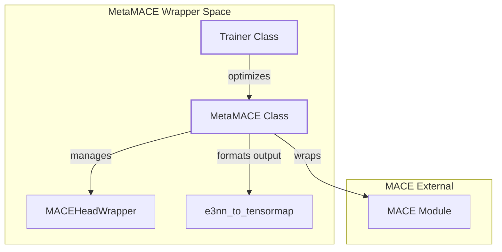
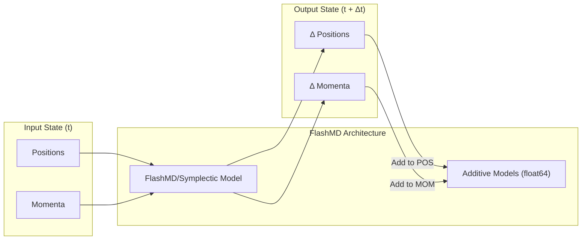

# Experimental Architectures: MACE, PhACE, DPA3, FlashMD, Classifier

Relevant source files

The following files were used as context for generating this wiki page:

- [examples/1-advanced/04-flashmd.py](examples/1-advanced/04-flashmd.py)
- [examples/1-advanced/08-llpr-ensemble-training.py](examples/1-advanced/08-llpr-ensemble-training.py)
- [examples/1-advanced/09-classifier.py](examples/1-advanced/09-classifier.py)
- [examples/1-advanced/09-symplectic-flashmd.py](examples/1-advanced/09-symplectic-flashmd.py)
- [examples/1-advanced/options-flashmd-symplectic.yaml](examples/1-advanced/options-flashmd-symplectic.yaml)
- [src/metatrain/experimental/classifier/tests/test_classifier.py](src/metatrain/experimental/classifier/tests/test_classifier.py)
- [src/metatrain/experimental/dpa3/trainer.py](src/metatrain/experimental/dpa3/trainer.py)
- [src/metatrain/experimental/flashmd/documentation.py](src/metatrain/experimental/flashmd/documentation.py)
- [src/metatrain/experimental/flashmd/modules/additive.py](src/metatrain/experimental/flashmd/modules/additive.py)
- [src/metatrain/experimental/flashmd/tests/test_basic.py](src/metatrain/experimental/flashmd/tests/test_basic.py)
- [src/metatrain/experimental/flashmd/tests/test_functionality.py](src/metatrain/experimental/flashmd/tests/test_functionality.py)
- [src/metatrain/experimental/flashmd/trainer.py](src/metatrain/experimental/flashmd/trainer.py)
- [src/metatrain/experimental/flashmd_symplectic/__init__.py](src/metatrain/experimental/flashmd_symplectic/__init__.py)
- [src/metatrain/experimental/flashmd_symplectic/tests/test_checkpoints.py](src/metatrain/experimental/flashmd_symplectic/tests/test_checkpoints.py)
- [src/metatrain/experimental/flashmd_symplectic/tests/test_continue.py](src/metatrain/experimental/flashmd_symplectic/tests/test_continue.py)
- [src/metatrain/experimental/flashmd_symplectic/tests/test_functionality.py](src/metatrain/experimental/flashmd_symplectic/tests/test_functionality.py)
- [src/metatrain/experimental/flashmd_symplectic/trainer.py](src/metatrain/experimental/flashmd_symplectic/trainer.py)
- [src/metatrain/experimental/mace/checkpoints.py](src/metatrain/experimental/mace/checkpoints.py)
- [src/metatrain/experimental/mace/documentation.py](src/metatrain/experimental/mace/documentation.py)
- [src/metatrain/experimental/mace/model.py](src/metatrain/experimental/mace/model.py)
- [src/metatrain/experimental/mace/modules/heads.py](src/metatrain/experimental/mace/modules/heads.py)
- [src/metatrain/experimental/mace/tests/__init__.py](src/metatrain/experimental/mace/tests/__init__.py)
- [src/metatrain/experimental/mace/tests/checkpoints/model-v4_trainer-v2.ckpt.gz](src/metatrain/experimental/mace/tests/checkpoints/model-v4_trainer-v2.ckpt.gz)
- [src/metatrain/experimental/mace/tests/test_basic.py](src/metatrain/experimental/mace/tests/test_basic.py)
- [src/metatrain/experimental/mace/tests/test_foundation.py](src/metatrain/experimental/mace/tests/test_foundation.py)
- [src/metatrain/experimental/mace/trainer.py](src/metatrain/experimental/mace/trainer.py)
- [src/metatrain/experimental/mace/utils/_load_model_file.py](src/metatrain/experimental/mace/utils/_load_model_file.py)
- [src/metatrain/experimental/mace/utils/mace_head.py](src/metatrain/experimental/mace/utils/mace_head.py)
- [src/metatrain/experimental/mace/utils/structures.py](src/metatrain/experimental/mace/utils/structures.py)
- [src/metatrain/experimental/phace/documentation.py](src/metatrain/experimental/phace/documentation.py)
- [src/metatrain/experimental/phace/model.py](src/metatrain/experimental/phace/model.py)
- [src/metatrain/experimental/phace/tests/test_basic.py](src/metatrain/experimental/phace/tests/test_basic.py)
- [src/metatrain/experimental/phace/trainer.py](src/metatrain/experimental/phace/trainer.py)
- [src/metatrain/llpr/tests/options-llpr.yaml](src/metatrain/llpr/tests/options-llpr.yaml)
- [src/metatrain/llpr/tests/test_llpr.py](src/metatrain/llpr/tests/test_llpr.py)
- [src/metatrain/llpr/trainer.py](src/metatrain/llpr/trainer.py)
- [src/metatrain/soap_bpnn/documentation.py](src/metatrain/soap_bpnn/documentation.py)
- [src/metatrain/utils/additive/remove.py](src/metatrain/utils/additive/remove.py)
- [src/metatrain/utils/data/atomic_basis_helpers.py](src/metatrain/utils/data/atomic_basis_helpers.py)
- [src/metatrain/utils/hypers.py](src/metatrain/utils/hypers.py)
- [tests/utils/data/test_atomic_basis_helpers.py](tests/utils/data/test_atomic_basis_helpers.py)
- [tests/utils/test_additive.py](tests/utils/test_additive.py)

This page describes the experimental architectures supported by `metatrain`. These models are in an experimental lifecycle stage, meaning their APIs or internal implementations may evolve rapidly. They include wrappers for external libraries (MACE, DPA3), highly optimized research architectures (PhACE), and specialized models for molecular dynamics state prediction (FlashMD) or categorical classification.

## MetaMACE: MACE Wrapper

`MetaMACE` is a wrapper around the MACE (Many-body Atomic Cluster Expansion) architecture [src/metatrain/experimental/mace/model.py:51-52](). It enables MACE to function within the `metatrain` ecosystem by providing multi-headed outputs, coordinate system alignment via `e3nn`, and integration with `metatensor` data structures.

### Key Features
- **Multi-Head Support**: Allows training on multiple targets simultaneously using `MACEHeadWrapper` and `NonLinearHead` [src/metatrain/experimental/mace/modules/heads.py]().
- **Coordinate Alignment**: Uses `e3nn_to_tensormap` to convert internal MACE representations into equivariant `metatensor` blocks [src/metatrain/experimental/mace/utils/mts.py]().
- **Foundation Model Loading**: Can load pre-trained MACE models from files or `torch.nn.Module` instances [src/metatrain/experimental/mace/model.py:122-133](). When loading, it extracts atomic baselines and scales to ensure compatibility with the `metatrain` `Scaler` and `CompositionModel` [src/metatrain/experimental/mace/model.py:142-162]().

### MetaMACE Entity Map
The following diagram maps the high-level MACE concepts to the specific implementation classes and functions in the wrapper.

Title: MetaMACE Architecture Mapping

Sources: [src/metatrain/experimental/mace/model.py:51-106](), [src/metatrain/experimental/mace/trainer.py:136-140](), [src/metatrain/experimental/mace/modules/heads.py:12-15](), [src/metatrain/experimental/mace/utils/mts.py:73-75]().

---

## PhACE: Physics-Aware Cluster Expansion

`PhACE` is a research-oriented architecture designed for high performance and strict physical constraints. It utilizes `torch.compile` for graph optimization and `ClebschGordanReal` for efficient handling of spherical harmonics.

### Implementation Details
- **Optimization**: The trainer includes a `compile_model` function that uses `make_fx` to trace the model and `torch.compile` with `mode="max-autotune"` to generate optimized kernels [src/metatrain/experimental/phace/trainer.py:72-105]().
- **EMA Training**: Implements Exponential Moving Average (EMA) via `AveragedModel` to improve model stability and generalization [src/metatrain/experimental/phace/trainer.py:13-14](), [src/metatrain/experimental/phace/trainer.py:152]().
- **Equivariance**: Uses a pre-computed spherical-to-Cartesian conversion matrix for rank-2 tensors, mapped via Clebsch-Gordan coefficients [src/metatrain/experimental/phace/model.py:108-120]().

Sources: [src/metatrain/experimental/phace/model.py:53-60](), [src/metatrain/experimental/phace/trainer.py:72-107](), [src/metatrain/experimental/phace/modules/cg_coefficients.py:25]().

---

## DPA3: DeepMD-kit Integration

The `DPA3` architecture integrates `deepmd-kit` models into the `metatrain` pipeline. It specifically focuses on the `RepFlow` descriptors and ensuring precision consistency between `metatrain` and `deepmd` internals.

### Data Flow and Constraints
1. **Precision Validation**: The trainer enforces that the `base_precision` in the YAML configuration matches the `descriptor.precision` set during the DPA3 model's construction [src/metatrain/experimental/dpa3/trainer.py:132-148]().
2. **Neighbor List Handling**: DPA3 requires specific neighbor list formats. The trainer validates these using `get_requested_neighbor_lists` before starting training [src/metatrain/experimental/dpa3/trainer.py:111-130]().
3. **Additive Models**: Like other architectures, DPA3 supports `CompositionModel` baselines, which are always kept in `float64` to prevent numerical drift in energy baselines [src/metatrain/experimental/dpa3/trainer.py:152-155]().

Sources: [src/metatrain/experimental/dpa3/model.py:44](), [src/metatrain/experimental/dpa3/trainer.py:56-80]().

---

## FlashMD and FlashMD Symplectic

FlashMD models are designed for "direct" molecular dynamics state prediction—predicting future positions and momenta from current states rather than integrating forces.

### FlashMD Variants
- **FlashMD**: Predicts variations in positions and momenta over a fixed `timestep` [src/metatrain/experimental/flashmd/trainer.py:107-118]().
- **FlashMD Symplectic**: Extends the base model with symplectic constraints to ensure energy conservation and physical consistency over long trajectories [src/metatrain/experimental/flashmd_symplectic/model.py:43]().

### Trainer Requirements
The trainer requires a `timestep` (in fs) and a dictionary of atomic `masses` [src/metatrain/experimental/flashmd/trainer.py:107-132](). If masses are not provided, it defaults to values from `ase.data.atomic_masses` [src/metatrain/experimental/flashmd/trainer.py:126-128]().

Title: FlashMD State Prediction Flow

Sources: [src/metatrain/experimental/flashmd/model.py:45](), [src/metatrain/experimental/flashmd/trainer.py:107-132](), [src/metatrain/experimental/flashmd/trainer.py:177-178]().

---

## Classifier

The `Classifier` architecture is used for categorical property prediction (e.g., phase identification, local structure classification). Unlike the potential energy surface (PES) models, it operates on discrete labels.

### Features
- **Categorical Cross-Entropy**: Typically uses classification-specific loss functions rather than MSE.
- **Integration**: Uses the standard `metatrain` data pipeline but expects targets to represent class indices or one-hot encoded vectors.

Sources: [examples/1-advanced/09-classifier.py](), [src/metatrain/experimental/classifier/tests/test_classifier.py]().

---

## Shared Experimental Utilities

### Atomic Basis Helpers
Experimental models often use an "atomic basis" for representations. `metatrain` provides utilities to manipulate these:
- **Densification**: `densify_atomic_basis_target` moves `atom_type` key dimensions to samples to create a padded dense tensor for GPU efficiency [src/metatrain/utils/data/atomic_basis_helpers.py:176-181]().
- **Sparsification**: `sparsify_atomic_basis_target` reverses this process for storage or specific equivariant operations [src/metatrain/utils/data/atomic_basis_helpers.py:29-30]().

### Additive Model Removal
Experimental trainers use `remove_additive` to subtract baseline contributions (like `CompositionModel` or `ZBL`) from targets before backpropagation [src/metatrain/utils/additive/remove.py:15-20](). This ensures the neural network only learns the "residual" physics [src/metatrain/utils/additive/remove.py:123-143]().

Sources: [src/metatrain/utils/data/atomic_basis_helpers.py:176-199](), [src/metatrain/utils/additive/remove.py:15-29]().

---