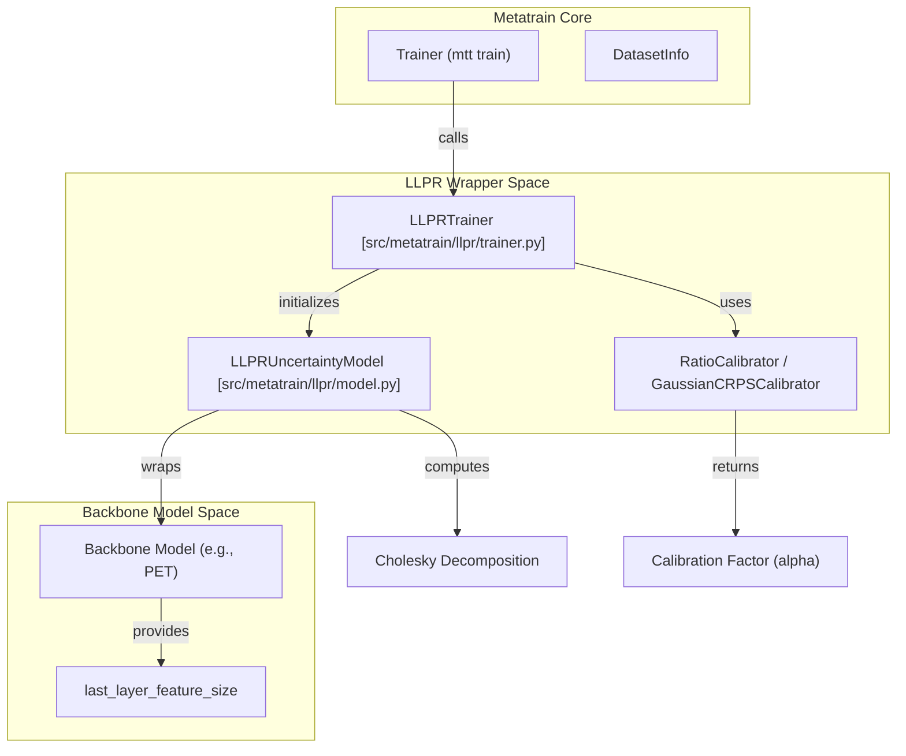
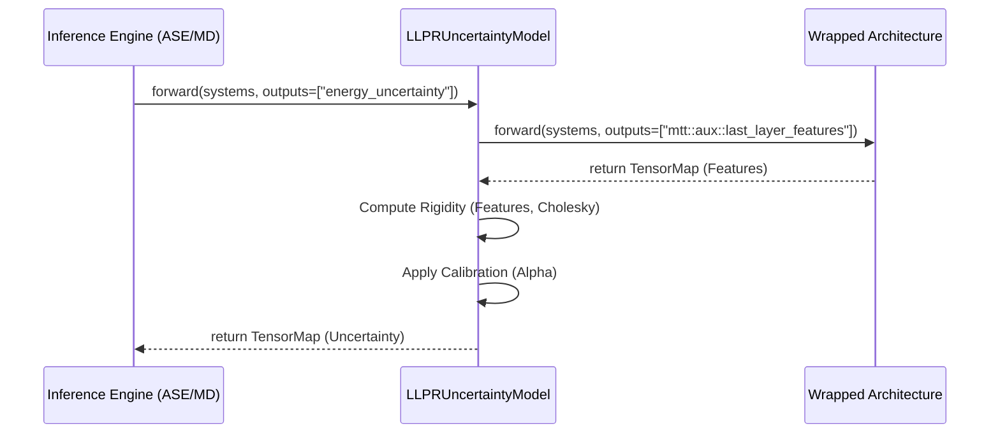

# LLPR — Uncertainty Quantification

Relevant source files

The following files were used as context for generating this wiki page:

- [docs/src/concepts/fine-tuning.rst](docs/src/concepts/fine-tuning.rst)
- [examples/0-beginner/02-fine-tuning.py](examples/0-beginner/02-fine-tuning.py)
- [examples/0-beginner/05-run_ase.py](examples/0-beginner/05-run_ase.py)
- [examples/1-advanced/01-llpr.py](examples/1-advanced/01-llpr.py)
- [examples/1-advanced/02-zbl.py](examples/1-advanced/02-zbl.py)
- [examples/1-advanced/08-llpr-ensemble-training.py](examples/1-advanced/08-llpr-ensemble-training.py)
- [examples/1-advanced/09-classifier.py](examples/1-advanced/09-classifier.py)
- [src/metatrain/experimental/classifier/tests/test_classifier.py](src/metatrain/experimental/classifier/tests/test_classifier.py)
- [src/metatrain/llpr/calibration.py](src/metatrain/llpr/calibration.py)
- [src/metatrain/llpr/checkpoints.py](src/metatrain/llpr/checkpoints.py)
- [src/metatrain/llpr/documentation.py](src/metatrain/llpr/documentation.py)
- [src/metatrain/llpr/model.py](src/metatrain/llpr/model.py)
- [src/metatrain/llpr/tests/checkpoints/model-v3_trainer-v4.ckpt.gz](src/metatrain/llpr/tests/checkpoints/model-v3_trainer-v4.ckpt.gz)
- [src/metatrain/llpr/tests/checkpoints/model-v3_trainer-v5.ckpt.gz](src/metatrain/llpr/tests/checkpoints/model-v3_trainer-v5.ckpt.gz)
- [src/metatrain/llpr/tests/options-llpr.yaml](src/metatrain/llpr/tests/options-llpr.yaml)
- [src/metatrain/llpr/tests/test_llpr.py](src/metatrain/llpr/tests/test_llpr.py)
- [src/metatrain/pet/modules/adaptive_cutoff.py](src/metatrain/pet/modules/adaptive_cutoff.py)
- [src/metatrain/pet/tests/checkpoints/model-v14_trainer-v13.ckpt.gz](src/metatrain/pet/tests/checkpoints/model-v14_trainer-v13.ckpt.gz)
- [src/metatrain/pet/tests/test_adaptive_cutoff.py](src/metatrain/pet/tests/test_adaptive_cutoff.py)

The **LLPR (Last-Layer Prediction Rigidity)** architecture is a wrapper model designed for computationally efficient uncertainty quantification. It is based on the prediction rigidity approach, which leverages the features of the last layer of a neural network to estimate prediction errors [src/metatrain/llpr/documentation.py:5-9]().

## Overview and Integration

LLPR operates as a `ModelInterface` wrapper around other supported architectures, such as **PET** and **SOAP-BPNN** [src/metatrain/llpr/documentation.py:7-9](). It extends the base model by computing a covariance matrix of the last-layer features and providing calibrated standard deviations for target properties [src/metatrain/llpr/model.py:60-79]().

### Data Flow and Code Entity Mapping

The following diagram illustrates how the `LLPRUncertaintyModel` wraps a backbone model and manages data flow between the metatrain training utilities and the underlying architecture.

**LLPR System Architecture Mapping**

**Sources:** [src/metatrain/llpr/model.py:42-87](), [src/metatrain/llpr/documentation.py:5-16](), [src/metatrain/llpr/calibration.py:10-24]()

---

## Core Components

### 1. Covariance Computation
The model stores a covariance matrix (or its Cholesky decomposition) of the last-layer features for each target property [src/metatrain/llpr/model.py:168-180](). 
*   **Regularization:** To ensure numerical stability during inversion, a regularizer $\varsigma^2$ is added to the diagonal of the feature covariance matrix [src/metatrain/llpr/documentation.py:58-67]().
*   **Storage:** The model registers these as buffers (`cholesky_{target_name}`) to ensure they are saved in the checkpoint but not treated as trainable parameters unless specified [src/metatrain/llpr/model.py:175-180]().

### 2. Calibration
LLPR requires a global calibration factor $\alpha$ to map the raw rigidity scores to meaningful standard deviations [src/metatrain/llpr/documentation.py:69-71]().

| Method | Logic | Description |
| :--- | :--- | :--- |
| `absolute_residuals` | MAE-based | Robust to outliers; uses $\sqrt{\pi/2}$ correction for Gaussian units [src/metatrain/llpr/calibration.py:72-74](). |
| `squared_residuals` | MSE-based | Minimizes negative log-likelihood under Gaussian assumption [src/metatrain/llpr/calibration.py:75-77](). |
| `crps` | CRPS-based | Minimizes the Continuous Ranked Probability Score [src/metatrain/llpr/calibration.py:84-93](). |

**Sources:** [src/metatrain/llpr/calibration.py:10-81](), [src/metatrain/llpr/documentation.py:141-161]()

### 3. Ensemble Weight Training
LLPR can generate an ensemble of predictions. Users can optionally perform gradient-based tuning of these ensemble weights using backpropagation [src/metatrain/llpr/documentation.py:11-13]().
*   **Loss Functions:** Recommended losses include `gaussian_nll_ensemble` and `empirical_crps_ensemble` [src/metatrain/llpr/documentation.py:79-85]().
*   **Parameters:** By default, only the ensemble weights are trained. Setting `train_all_parameters: true` allows the backbone model weights to be updated simultaneously [src/metatrain/llpr/documentation.py:92-100]().

---

## Model Interface and Outputs

The `LLPRUncertaintyModel` dynamically adds uncertainty-related outputs to the capabilities of the wrapped model [src/metatrain/llpr/model.py:143-166]().

**Entity Interaction: Output Generation**

**Sources:** [src/metatrain/llpr/model.py:270-320](), [src/metatrain/llpr/model.py:348-380]()

### Supported Output Names
For a target named `energy`, LLPR provides:
*   `energy_uncertainty`: The standard deviation of the prediction [src/metatrain/llpr/documentation.py:24-25]().
*   `energy_ensemble`: Individual ensemble member predictions [src/metatrain/llpr/documentation.py:26-27]().

Both outputs support `sample_kind="system"` (total uncertainty) and `sample_kind="atom"` (Local Prediction Rigidity - LPR) [src/metatrain/llpr/model.py:64-66]().

---

## Implementation Details

### Key Classes
*   `LLPRUncertaintyModel`: The main wrapper class implementing `ModelInterface`. It manages the wrapped model and uncertainty buffers [src/metatrain/llpr/model.py:42-84]().
*   `RatioCalibrator`: Handles statistics accumulation for residual-based calibration [src/metatrain/llpr/calibration.py:10-31]().
*   `GaussianCRPSCalibrator`: Implements the root-finding logic for CRPS calibration [src/metatrain/llpr/calibration.py:84-100]().

### Checkpoint Evolution
The LLPR architecture has undergone several version updates to improve stability and functionality:
*   **v3 to v4:** Migration from storing `inv_covariance` to `cholesky` buffers for better numerical stability [src/metatrain/llpr/checkpoints.py:58-75]().
*   **v2 to v3:** Renaming `state_dict` keys and introducing `llpr_ensemble_layers` for backpropagation-based ensemble training [src/metatrain/llpr/checkpoints.py:29-44]().

**Sources:** [src/metatrain/llpr/model.py:42-43](), [src/metatrain/llpr/checkpoints.py:1-145]()

---