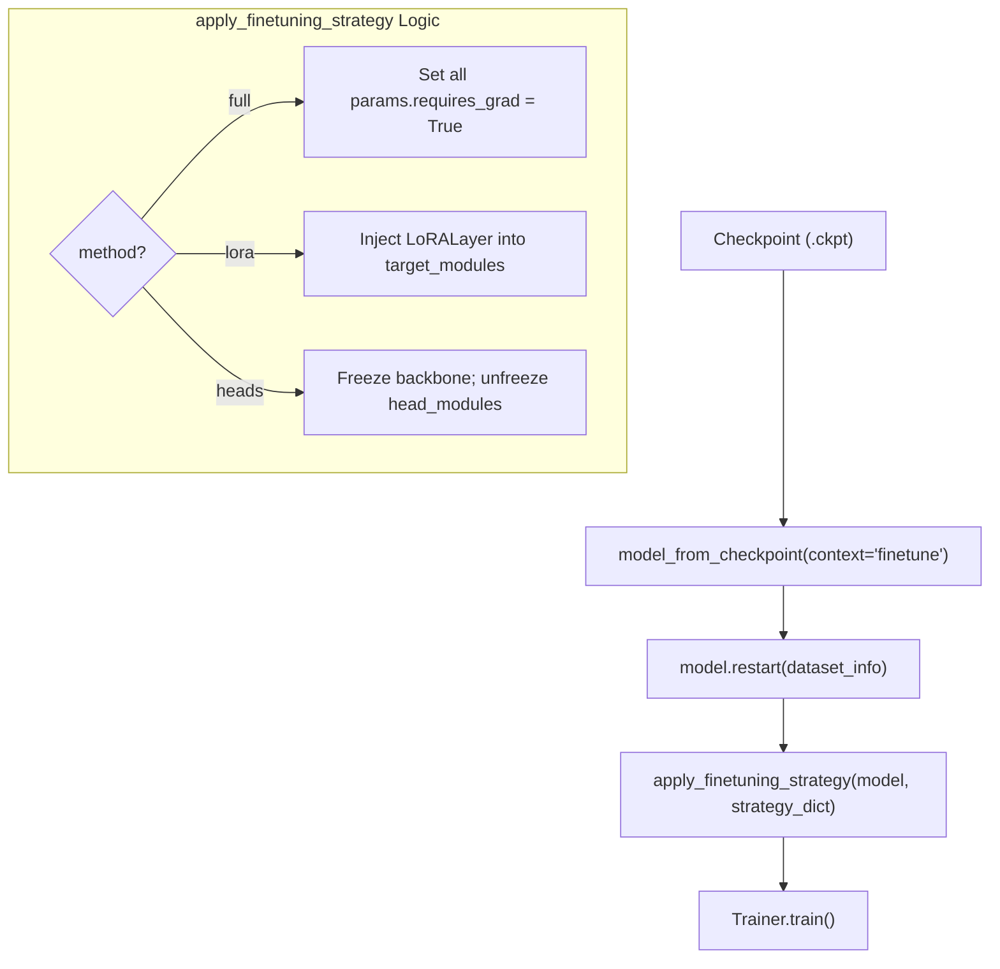
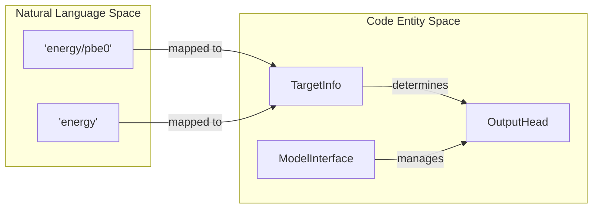

# Fine-tuning and Transfer Learning

<details>
<summary>Relevant source files</summary>

The following files were used as context for generating this wiki page:

- [docs/src/concepts/fine-tuning.rst](docs/src/concepts/fine-tuning.rst)
- [examples/0-beginner/02-fine-tuning.py](examples/0-beginner/02-fine-tuning.py)
- [examples/0-beginner/05-run_ase.py](examples/0-beginner/05-run_ase.py)
- [examples/1-advanced/00-transfer-learning.py](examples/1-advanced/00-transfer-learning.py)
- [examples/1-advanced/01-llpr.py](examples/1-advanced/01-llpr.py)
- [examples/1-advanced/02-zbl.py](examples/1-advanced/02-zbl.py)
- [examples/1-advanced/options-flashmd-finetune.yaml](examples/1-advanced/options-flashmd-finetune.yaml)
- [examples/1-advanced/options-flashmd.yaml](examples/1-advanced/options-flashmd.yaml)
- [src/metatrain/experimental/flashmd/tests/checkpoints/model-v3_trainer-v4.ckpt.gz](src/metatrain/experimental/flashmd/tests/checkpoints/model-v3_trainer-v4.ckpt.gz)
- [src/metatrain/experimental/flashmd/tests/checkpoints/model-v3_trainer-v5.ckpt.gz](src/metatrain/experimental/flashmd/tests/checkpoints/model-v3_trainer-v5.ckpt.gz)
- [src/metatrain/llpr/tests/checkpoints/model-v3_trainer-v3.ckpt.gz](src/metatrain/llpr/tests/checkpoints/model-v3_trainer-v3.ckpt.gz)
- [src/metatrain/pet/tests/checkpoints/model-v11_trainer-v12.ckpt.gz](src/metatrain/pet/tests/checkpoints/model-v11_trainer-v12.ckpt.gz)
- [src/metatrain/pet/tests/test_finetuning.py](src/metatrain/pet/tests/test_finetuning.py)

</details>


This page covers the strategies and implementation details for adapting pre-trained models to new datasets, levels of theory, or different physical properties. Fine-tuning allows users to leverage learned representations from large-scale datasets (like PET-MAD) and refine them on smaller, high-accuracy reference datasets [examples/0-beginner/02-fine-tuning.py:11-17]().

### Overview of Strategies

Metatrain supports several fine-tuning methods, primarily focused on the PET architecture, though the infrastructure is designed for extensibility [docs/src/concepts/fine-tuning.rst:6-14]().

| Strategy | Description | Key Use Case |
| :--- | :--- | :--- |
| **Full** | All model weights are trainable. | Sufficient data available; large shift in domain. |
| **LoRA** | Low-Rank Adaptation; injects trainable rank-decomposition matrices into layers. | Parameter-efficient fine-tuning; prevents catastrophic forgetting. |
| **Heads** | Freezes the backbone; only output heads and last layers are trainable. | Transferring representations to entirely new properties. |

Sources: [docs/src/concepts/fine-tuning.rst:26-44](), [src/metatrain/pet/tests/test_finetuning.py:31-40](), [src/metatrain/pet/tests/test_finetuning.py:90-98]()

---

### Configuration and the FinetuneHypers Schema

Fine-tuning is triggered by the `finetune` block within the architecture's training configuration. The `apply_finetuning_strategy` utility processes this configuration to modify the model's internal `requires_grad` flags or inject new modules [src/metatrain/pet/tests/test_finetuning.py:12-12](), [src/metatrain/pet/tests/test_finetuning.py:42-42]().

#### Configuration Example (YAML)
```yaml
architecture:
  training:
    finetune:
      method: "lora"
      read_from: "path/to/pretrained.ckpt"
      config:
        target_modules: ["input_linear", "output_linear"]
        rank: 8
        alpha: 16
      inherit_heads:
        energy/pbe0: "energy"
```
Sources: [docs/src/concepts/fine-tuning.rst:38-44](), [src/metatrain/pet/tests/test_finetuning.py:63-72]()

---

### Implementation Data Flow

The following diagram illustrates how a pre-trained checkpoint is transformed into a fine-tuning session via the `model_from_checkpoint` and `apply_finetuning_strategy` functions.

**Model Adaptation Workflow**

Sources: [src/metatrain/pet/tests/test_finetuning.py:198-201](), [src/metatrain/pet/tests/test_finetuning.py:42-42](), [src/metatrain/pet/tests/test_finetuning.py:100-100]()

---

### Key Components

#### 1. Target Inheritance (`inherit_heads`)
When introducing a new target (e.g., `energy/pbe0`), the weights of the output heads are normally initialized randomly. The `inherit_heads` parameter allows copying weights from an existing head in the checkpoint to the new head [docs/src/concepts/fine-tuning.rst:150-160](). This is particularly useful when the new level of theory is physically similar to the old one [examples/1-advanced/00-transfer-learning.py:77-83]().

#### 2. Parameter-Efficient Fine-Tuning (LoRA)
For the PET architecture, LoRA can be applied to specific linear layers (e.g., `input_linear`, `output_linear`). This significantly reduces the number of trainable parameters [src/metatrain/pet/tests/test_finetuning.py:43-45]().
- **Rank (`rank`)**: The dimension of the low-rank update.
- **Alpha (`alpha`)**: Scaling factor for the LoRA update.

#### 3. New Targets and Variants
Metatrain encourages using "variants" for fine-tuning. Instead of overwriting the `energy` target, users define `energy/variant_name`. This allows the model to maintain multiple output heads simultaneously [docs/src/concepts/fine-tuning.rst:57-64]().

**Code Entity Mapping: Target Variants**

Sources: [docs/src/concepts/fine-tuning.rst:64-71](), [examples/1-advanced/00-transfer-learning.py:60-65]()

---

### Transfer Learning to New Properties

Transfer learning extends fine-tuning by adapting a model to completely different physical quantities (e.g., from `energy` to `dipole_moment`). This typically uses the `heads` method to keep the structural representations (backbone) fixed while training new property-specific output layers [examples/1-advanced/00-transfer-learning.py:169-172]().

#### Integration with Simulation Engines
Fine-tuned models with custom variant names (e.g., `energy/finetune`) require explicit mapping when used in ASE or LAMMPS:
- **ASE**: Pass `variants={"energy": "finetune"}` to the `MetatomicCalculator` [docs/src/concepts/fine-tuning.rst:107-115]().
- **LAMMPS**: Use the `variant finetune` keyword in the `pair_style` command [docs/src/concepts/fine-tuning.rst:125-131]().

Sources: [docs/src/concepts/fine-tuning.rst:99-105](), [examples/1-advanced/00-transfer-learning.py:103-113]()

---

### Utility Functions

- **`apply_finetuning_strategy(model, strategy)`**: The primary entry point for modifying a model instance based on a `FinetuneHypers` dictionary [src/metatrain/pet/tests/test_finetuning.py:12-12]().
- **`model_from_checkpoint(checkpoint, context="finetune")`**: Loads the model architecture and weights from a `.ckpt` file specifically for a fine-tuning context [src/metatrain/pet/tests/test_finetuning.py:198-198]().

Sources: [src/metatrain/pet/tests/test_finetuning.py:42-42](), [src/metatrain/pet/tests/test_finetuning.py:198-198]()

---