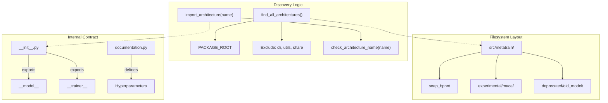
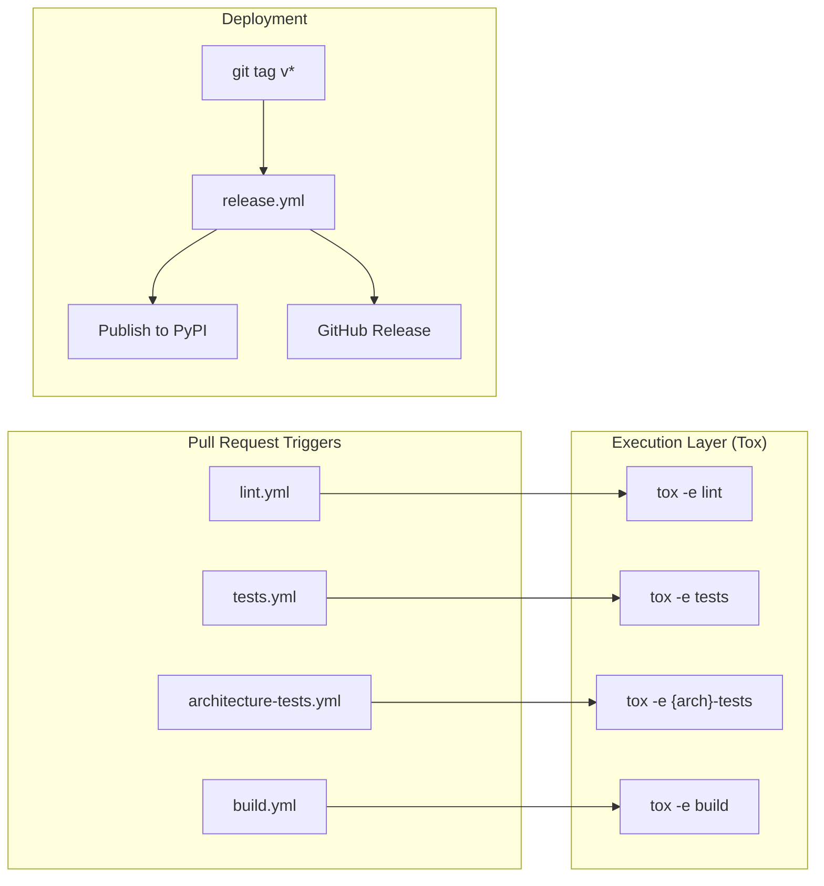

# Developer Guide

Relevant source files

The following files were used as context for generating this wiki page:

- [.github/PULL_REQUEST_TEMPLATE/pull_request_new-architecture.md](.github/PULL_REQUEST_TEMPLATE/pull_request_new-architecture.md)
- [.github/pull_request_template.md](.github/pull_request_template.md)
- [.github/workflows/architecture-tests.yml](.github/workflows/architecture-tests.yml)
- [.github/workflows/build.yml](.github/workflows/build.yml)
- [.github/workflows/docs.yml](.github/workflows/docs.yml)
- [.github/workflows/lint.yml](.github/workflows/lint.yml)
- [.github/workflows/pr-docs-preview.yml](.github/workflows/pr-docs-preview.yml)
- [.github/workflows/tests.yml](.github/workflows/tests.yml)
- [.readthedocs.yml](.readthedocs.yml)
- [CONTRIBUTING.rst](CONTRIBUTING.rst)
- [MANIFEST.in](MANIFEST.in)
- [docs/src/dev-docs/architecture-life-cycle.rst](docs/src/dev-docs/architecture-life-cycle.rst)
- [docs/src/dev-docs/getting-started.rst](docs/src/dev-docs/getting-started.rst)
- [docs/src/dev-docs/index.rst](docs/src/dev-docs/index.rst)
- [docs/src/dev-docs/new-architecture.rst](docs/src/dev-docs/new-architecture.rst)
- [src/metatrain/share/base_hypers.py](src/metatrain/share/base_hypers.py)
- [src/metatrain/utils/architectures.py](src/metatrain/utils/architectures.py)
- [tests/cli/test_base_precision.py](tests/cli/test_base_precision.py)
- [tests/utils/test_architectures.py](tests/utils/test_architectures.py)
- [tests/utils/test_pydantic.py](tests/utils/test_pydantic.py)

The **Developer Guide** provides the necessary technical information for contributors to extend and maintain the `metatrain` library. It covers the plugin-based architecture system, the testing framework, and the automated CI/CD pipelines.

## Architecture Plugin System

`metatrain` is designed around a modular plugin system where different atomistic machine learning models can be integrated by following a standard interface. Each architecture is contained within its own directory and must expose a `Model` and a `Trainer` class [docs/src/dev-docs/new-architecture.rst:59-66]().

### The Architecture Lifecycle
Architectures in `metatrain` follow a specific lifecycle:
1.  **Experimental**: New or rapidly changing architectures, located in `src/metatrain/experimental/` [src/metatrain/utils/architectures.py:193-201]().
2.  **Stable**: Mature architectures with stable APIs, located in the root `src/metatrain/` directory [src/metatrain/utils/architectures.py:184-190]().
3.  **Deprecated**: Architectures slated for removal, located in `src/metatrain/deprecated/` [src/metatrain/utils/architectures.py:193-201]().

### Code Entity Mapping
The following diagram maps the high-level architecture concepts to their specific code entities and file locations.

**Architecture Registry and Discovery**

Sources: [src/metatrain/utils/architectures.py:117-201](), [docs/src/dev-docs/new-architecture.rst:81-94]()

## Adding a New Architecture

To add a new architecture, a developer must implement four mandatory files: `model.py`, `trainer.py`, `documentation.py`, and `__init__.py` [docs/src/dev-docs/new-architecture.rst:81-94](). The `Model` must inherit from `ModelInterface` and the `Trainer` from `TrainerInterface` [docs/src/dev-docs/new-architecture.rst:59-66]().

*   **ModelInterface**: Defines the forward pass, checkpointing, and export logic [docs/src/dev-docs/new-architecture.rst:112-128]().
*   **TrainerInterface**: Defines the training loop and how to handle training/validation datasets [docs/src/dev-docs/new-architecture.rst:159-165]().
*   **Hyperparameter Validation**: Uses `TypedDict` and Pydantic to ensure configuration files are valid [src/metatrain/share/base_hypers.py:37-56]().

For a step-by-step implementation guide, see [Adding a New Architecture](#6.1).

## Testing Infrastructure

`metatrain` uses `tox` to manage isolated testing environments and `pytest` as the test runner [CONTRIBUTING.rst:79-80]().

*   **Unit Tests**: Located in the `tests/` directory, covering core utilities and the CLI [CONTRIBUTING.rst:91]().
*   **Architecture Tests**: Each architecture can be tested individually using specific tox environments (e.g., `tox -e soap-bpnn-tests`) [CONTRIBUTING.rst:100-107]().
*   **Validation**: Tests include equivariance checks, autograd consistency, and checkpoint compatibility [docs/src/dev-docs/new-architecture.rst:139-144]().

For details on the testing framework and adding new tests, see [Testing Infrastructure](#6.2).

## CI/CD and Release Pipeline

The project utilizes GitHub Actions for continuous integration and deployment.

**CI/CD Workflow Overview**

Sources: [.github/workflows/lint.yml:25-27](), [.github/workflows/tests.yml:52-53](), [.github/workflows/architecture-tests.yml:45-48](), [.github/workflows/build.yml:26-27](), [CONTRIBUTING.rst:184-204]()

### Key Workflows
*   **Tests**: Runs unit tests across multiple Python versions and operating systems [.github/workflows/tests.yml:10-21]().
*   **Architecture Tests**: A matrix job that runs specific tests for every registered architecture [.github/workflows/architecture-tests.yml:10-27]().
*   **Documentation**: Builds the Sphinx documentation and deploys it to GitHub Pages or Read the Docs [.github/workflows/docs.yml:28-29](), [.readthedocs.yml:18-21]().
*   **Release**: Automates the publishing of packages to PyPI and creates GitHub releases upon tagging [CONTRIBUTING.rst:199-204]().

For details on the release process and workflow configurations, see [CI/CD and Release Pipeline](#6.3).

## Contributing Guidelines

1.  **Issue Tracking**: Report bugs and feature requests via GitHub Issues [CONTRIBUTING.rst:27-32]().
2.  **Development Setup**: Use `uv` or `pip` to install development dependencies and `tox` for running tests [CONTRIBUTING.rst:46-60]().
3.  **Code Style**: Adhere to the `black` formatter and pass the `lint` tox environment [CONTRIBUTING.rst:89-98]().
4.  **Pull Requests**: All PRs must pass CI checks and receive a maintainer's approval before merging [CONTRIBUTING.rst:157-163]().

Sources: [CONTRIBUTING.rst:1-204](), [src/metatrain/utils/architectures.py:1-201](), [docs/src/dev-docs/new-architecture.rst:1-188]()

---