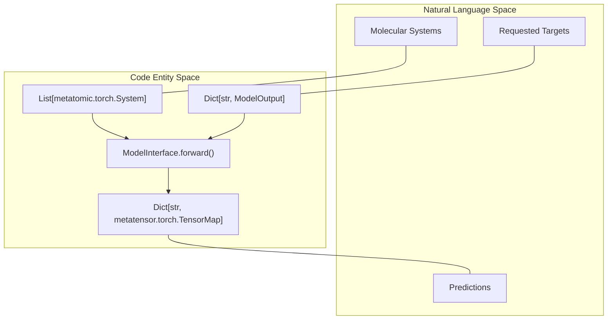
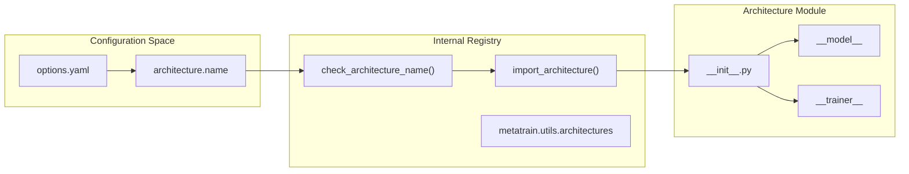

# Adding a New Architecture

<details>
<summary>Relevant source files</summary>

The following files were used as context for generating this wiki page:

- [.github/PULL_REQUEST_TEMPLATE/pull_request_new-architecture.md](.github/PULL_REQUEST_TEMPLATE/pull_request_new-architecture.md)
- [.github/pull_request_template.md](.github/pull_request_template.md)
- [CONTRIBUTING.rst](CONTRIBUTING.rst)
- [MANIFEST.in](MANIFEST.in)
- [docs/src/architectures/templates/model_hypers.rst](docs/src/architectures/templates/model_hypers.rst)
- [docs/src/architectures/templates/trainer_hypers.rst](docs/src/architectures/templates/trainer_hypers.rst)
- [docs/src/dev-docs/architecture-life-cycle.rst](docs/src/dev-docs/architecture-life-cycle.rst)
- [docs/src/dev-docs/getting-started.rst](docs/src/dev-docs/getting-started.rst)
- [docs/src/dev-docs/index.rst](docs/src/dev-docs/index.rst)
- [docs/src/dev-docs/new-architecture.rst](docs/src/dev-docs/new-architecture.rst)
- [src/metatrain/share/base_hypers.py](src/metatrain/share/base_hypers.py)
- [src/metatrain/utils/abc.py](src/metatrain/utils/abc.py)
- [src/metatrain/utils/architectures.py](src/metatrain/utils/architectures.py)
- [tests/cli/test_base_precision.py](tests/cli/test_base_precision.py)
- [tests/utils/test_architectures.py](tests/utils/test_architectures.py)
- [tests/utils/test_pydantic.py](tests/utils/test_pydantic.py)

</details>


Implementing a new architecture in `metatrain` requires adhering to a specific plugin system that ensures compatibility with the training CLI, data pipeline, and export infrastructure. Every architecture must satisfy a contract defined by two main classes: a `Model` and a `Trainer`.

## 1. Required File Structure

Architectures are located in `src/metatrain/` (for stable models) or `src/metatrain/experimental/` (for models in development) [[docs/src/dev-docs/new-architecture.rst:82-84]](). A new architecture directory must contain the following four files:

| File | Purpose |
| :--- | :--- |
| `model.py` | Implementation of the `Model` class (subclass of `ModelInterface`). |
| `trainer.py` | Implementation of the `Trainer` class (subclass of `TrainerInterface`). |
| `documentation.py` | Hyperparameter schema definitions using `TypedDict`. |
| `__init__.py` | Registration of the model and trainer classes. |

Sources: [[docs/src/dev-docs/new-architecture.rst:85-93]]()

## 2. Architecture Interfaces

The interaction between the `metatrain` CLI and a specific architecture is governed by the `ModelInterface` and `TrainerInterface` abstract base classes.

### ModelInterface Contract (`model.py`)

The `Model` class defines the core neural network and must implement several abstract methods for lifecycle management [[src/metatrain/utils/abc.py:29-34]]().

**Data Flow: Model Training & Inference**
The following diagram shows how the `Model` interacts with system data and requested outputs.


Sources: [[src/metatrain/utils/abc.py:101-106]]()

**Required Class Attributes:**
- `__checkpoint_version__`: Integer used for upgrading older state dicts [[src/metatrain/utils/abc.py:43-47]]().
- `__supported_devices__`: List of `torch.device` (e.g., `["cuda", "cpu"]`) [[src/metatrain/utils/abc.py:48-54]]().
- `__supported_dtypes__`: List of `torch.dtype` (e.g., `[torch.float32]`) [[src/metatrain/utils/abc.py:55-61]]().
- `__default_metadata__`: `ModelMetadata` containing citations and implementation references [[src/metatrain/utils/abc.py:62-70]]().

### TrainerInterface Contract (`trainer.py`)

The `Trainer` class manages the optimization loop and dataset validation [[docs/src/dev-docs/new-architecture.rst:159-161]]().

**Key Functions:**
- `__init__(hypers)`: Initializes the trainer with architecture-specific training hyperparameters [[src/metatrain/utils/abc.py:214-215]]().
- `train(...)`: The main entry point for the training loop. It receives the model, datasets, and device information [[src/metatrain/utils/abc.py:218-232]]().

## 3. Hyperparameter Schema (`documentation.py`)

`metatrain` uses `Pydantic` and `TypedDict` to validate user configuration. Architectures must define their specific options in `documentation.py`.

**Implementation Pattern:**
Developers should define `ModelHypers` and `TrainerHypers` classes. To allow these to track the global precision setting, use `BasePrecision.value` [[src/metatrain/share/base_hypers.py:19-33]]().

```python
from typing_extensions import TypedDict
from metatrain.share.base_hypers import BasePrecision

class ModelHypers(TypedDict):
    n_layers: int
    precision: int = BasePrecision.value  # Tracks global base_precision
```
Sources: [[src/metatrain/share/base_hypers.py:19-33]](), [[src/metatrain/utils/architectures.py:72-78]]()

## 4. Integration and Registration

### The `__init__.py` Entry Point
To register the architecture, the `__init__.py` file must map the local classes to the expected internal symbols `__model__` and `__trainer__` [[docs/src/dev-docs/new-architecture.rst:182-187]]().

```python
from .model import MyModel
from .trainer import MyTrainer

__model__ = MyModel
__trainer__ = MyTrainer
__maintainers__ = ["@username"]
```

### Registration Checklist
1. **`pyproject.toml`**: Add architecture-specific dependencies to the `optional-dependencies` section [[.github/PULL_REQUEST_TEMPLATE/pull_request_new-architecture.md:13-14]]().
2. **`CODEOWNERS`**: Add the maintainer's GitHub handle for the new directory [[.github/PULL_REQUEST_TEMPLATE/pull_request_new-architecture.md:15]]().
3. **Validation**: Ensure `find_all_architectures()` detects the new folder [[src/metatrain/utils/architectures.py:170-180]]().

## 5. Checkpoint Versioning

Architectures must support checkpoint upgrades via `upgrade_checkpoint(checkpoint)`. This allows the library to load models trained with older versions of the architecture by transforming the state dictionary before initialization [[src/metatrain/utils/abc.py:192-195]]().

**Architecture Registration Logic**

Sources: [[src/metatrain/utils/architectures.py:16-31]](), [[src/metatrain/utils/architectures.py:117-126]](), [[docs/src/dev-docs/new-architecture.rst:182-187]]()

Sources:
- [[src/metatrain/utils/abc.py:1-232]]()
- [[src/metatrain/utils/architectures.py:1-201]]()
- [[docs/src/dev-docs/new-architecture.rst:1-187]]()
- [[src/metatrain/share/base_hypers.py:19-57]]()
- [[.github/PULL_REQUEST_TEMPLATE/pull_request_new-architecture.md:5-40]]()

---