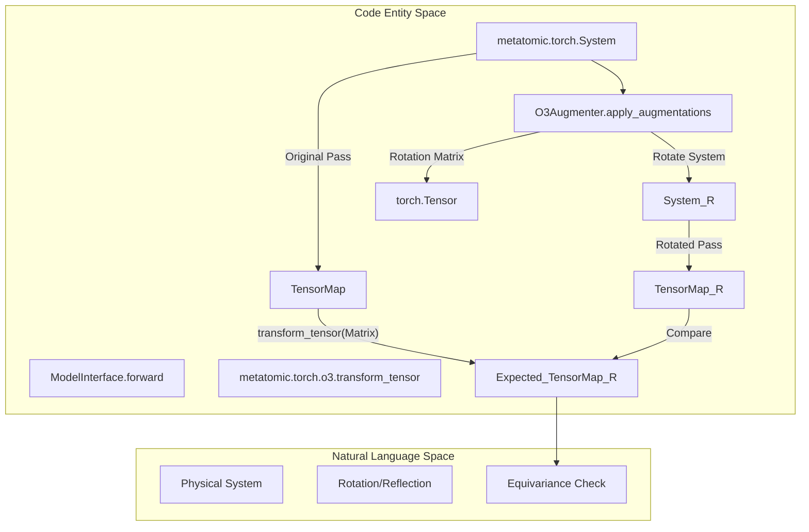
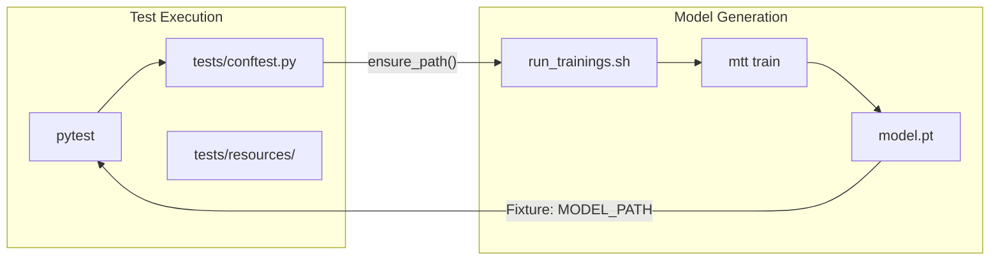

# Testing Infrastructure

Relevant source files

The following files were used as context for generating this wiki page:

- [.gitignore](.gitignore)
- [examples/1-advanced/fig_09-classifier_001.json.gz](examples/1-advanced/fig_09-classifier_001.json.gz)
- [examples/GALLERY_HEADER.rst](examples/GALLERY_HEADER.rst)
- [src/metatrain/experimental/flashmd/tests/checkpoints/model-v3_trainer-v3.ckpt.gz](src/metatrain/experimental/flashmd/tests/checkpoints/model-v3_trainer-v3.ckpt.gz)
- [src/metatrain/experimental/phace/tests/test_regression.py](src/metatrain/experimental/phace/tests/test_regression.py)
- [src/metatrain/llpr/tests/checkpoints/model-v3_trainer-v2.ckpt.gz](src/metatrain/llpr/tests/checkpoints/model-v3_trainer-v2.ckpt.gz)
- [src/metatrain/pet/tests/checkpoints/model-v10_trainer-v11.ckpt.gz](src/metatrain/pet/tests/checkpoints/model-v10_trainer-v11.ckpt.gz)
- [src/metatrain/pet/tests/checkpoints/model-v11_trainer-v11.ckpt.gz](src/metatrain/pet/tests/checkpoints/model-v11_trainer-v11.ckpt.gz)
- [src/metatrain/pet/tests/test_regression.py](src/metatrain/pet/tests/test_regression.py)
- [src/metatrain/soap_bpnn/tests/__init__.py](src/metatrain/soap_bpnn/tests/__init__.py)
- [src/metatrain/utils/augmentation.py](src/metatrain/utils/augmentation.py)
- [src/metatrain/utils/scaler/_base_scaler.py](src/metatrain/utils/scaler/_base_scaler.py)
- [src/metatrain/utils/scaler/scaler.py](src/metatrain/utils/scaler/scaler.py)
- [src/metatrain/utils/testing/_utils.py](src/metatrain/utils/testing/_utils.py)
- [src/metatrain/utils/testing/architectures.py](src/metatrain/utils/testing/architectures.py)
- [src/metatrain/utils/testing/autograd.py](src/metatrain/utils/testing/autograd.py)
- [src/metatrain/utils/testing/checkpoints.py](src/metatrain/utils/testing/checkpoints.py)
- [src/metatrain/utils/testing/output.py](src/metatrain/utils/testing/output.py)
- [tests/conftest.py](tests/conftest.py)
- [tests/resources/run_trainings.sh](tests/resources/run_trainings.sh)
- [tests/resources/setup_trainings.sh](tests/resources/setup_trainings.sh)
- [tests/resources/spherical_disk_dataset.zip](tests/resources/spherical_disk_dataset.zip)
- [tests/resources/spherical_targets_rotated.zip](tests/resources/spherical_targets_rotated.zip)
- [tests/resources/spherical_targets_unrotated.zip](tests/resources/spherical_targets_unrotated.zip)
- [tests/utils/test_augmentation.py](tests/utils/test_augmentation.py)
- [tests/utils/test_scaler.py](tests/utils/test_scaler.py)

The `metatrain` testing infrastructure is designed to ensure the physical correctness, numerical stability, and backward compatibility of atomistic machine learning models. It provides a suite of automated tests for equivariance, symmetry validation, autograd consistency, and checkpoint migration.

### Core Testing Framework

The testing system is built around a hierarchy of test classes that architecture developers can inherit from to validate their implementations.

#### Architecture-Specific Tests
The `ArchitectureTests` class (and its derivatives) provides a standardized way to test model components. It includes utilities for creating datasets and initializing models with minimal hyperparameters to keep tests efficient.

| Class | Purpose | Source |
| :--- | :--- | :--- |
| `OutputTests` | Validates model outputs (scalars, vectors, spherical tensors) and equivariance. | [src/metatrain/utils/testing/output.py:24-31]() |
| `AutogradTests` | Ensures that gradients (forces/stress) are correctly computed and consistent. | [src/metatrain/utils/testing/autograd.py]() |
| `CheckpointTests` | Verifies checkpoint saving, loading, and version upgrades. | [src/metatrain/utils/testing/checkpoints.py:62-67]() |

### Equivariance and Symmetry Validation

The `OutputTests` class is the primary tool for validating that models respect physical symmetries. It uses the `O3Augmenter` to apply random $O(3)$ transformations (rotations and reflections) to systems and checks if the model outputs transform accordingly.

#### Equivariance Test Flow
The following diagram illustrates how `OutputTests` validates equivariance by comparing transformed outputs with outputs of transformed systems.

**Model Equivariance Validation Flow**

**Sources:** [src/metatrain/utils/testing/output.py:102-150](), [src/metatrain/utils/augmentation.py:78-101]()

### Autograd and Gradient Tests
Gradients are critical for atomistic potentials (forces and virial stress). The infrastructure includes tests to verify that:
1. `compute_gradient` (from `metatrain.utils.evaluate_model`) correctly handles the `requires_grad` state of positions and cell vectors.
2. The model supports backpropagation through all its internal layers.
3. Mixed targets (e.g., energy and non-conservative stress) are handled correctly [src/metatrain/pet/tests/test_regression.py:178-212]().

### Checkpoint Upgrade Infrastructure

`metatrain` maintains backward compatibility through a versioned checkpoint system. When a model or trainer's internal structure changes, developers must bump the `__checkpoint_version__`.

#### Checkpoint Lifecycle
1. **Validation**: `check_same_checkpoint_structure` compares a saved checkpoint against the current model's expected keys [src/metatrain/utils/testing/checkpoints.py:30-39]().
2. **Upgrading**: If versions mismatch, the infrastructure calls the architecture's `upgrade_checkpoint` method [src/metatrain/utils/testing/checkpoints.py:163-169]().
3. **Contexts**: Loading is tested across three contexts: `restart`, `finetune`, and `export` [src/metatrain/utils/testing/checkpoints.py:132-138]().

**Sources:** [src/metatrain/utils/testing/checkpoints.py:19-28](), [src/metatrain/utils/testing/checkpoints.py:154-172]()

### Regression Testing
Architecture-specific regression tests (e.g., in `metatrain.pet.tests.test_regression`) use hardcoded expected values to ensure that model outputs do not drift over time due to code changes.

| Test Function | Target | Detail |
| :--- | :--- | :--- |
| `test_regression_init` | Random Init | Checks output at initialization with a fixed seed. |
| `test_regression_energies_forces_train` | Training | Runs 2 epochs and compares final energies/forces. |
| `test_regression_energy_non_conservative_stress` | Stress | Validates handling of systems with/without PBC. |

**Sources:** [src/metatrain/pet/tests/test_regression.py:39-80](), [src/metatrain/pet/tests/test_regression.py:84-140]()

### Test Environments and Fixtures

#### Tox and CI
The project uses `tox` to manage architecture-specific test environments. This allows running tests for a specific architecture (e.g., `pet`) without installing dependencies for others.

#### Conftest Fixtures
The `tests/conftest.py` file provides global fixtures and resource paths:
- **RESOURCES_PATH**: Points to the `tests/resources` directory containing XYZ files and reference ZIP datasets [tests/conftest.py:24-37]().
- **MODEL_PATH**: Lazily generates trained models for tests using `run_trainings.sh` to avoid re-training on every test execution [tests/conftest.py:73-91]().

**Resource Management Flow**

**Sources:** [tests/conftest.py:73-107](), [tests/resources/run_trainings.sh]()

### Test Resources
- **XYZ Files**: Reduced datasets like `qm9_reduced_100.xyz` [tests/conftest.py:26]().
- **Spherical Datasets**: Pre-computed rotated and unrotated targets (e.g., dipole moments, electron density) stored in ZIP format for validating `O3Augmenter` [tests/utils/test_augmentation.py:107-116]().
- **Checkpoints**: Gzipped `.ckpt.gz` files representing previous versions of models to test the upgrade logic [src/metatrain/utils/testing/checkpoints.py:156-161]().

**Sources:** [tests/conftest.py:24-37](), [tests/utils/test_augmentation.py:23-52]()

---