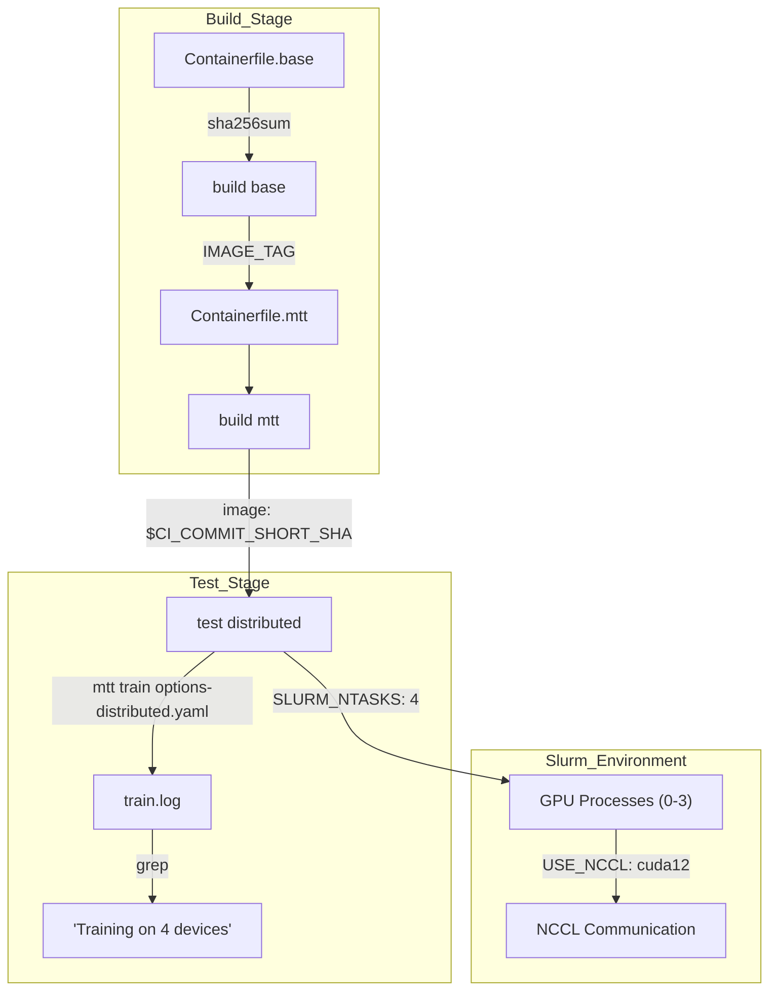
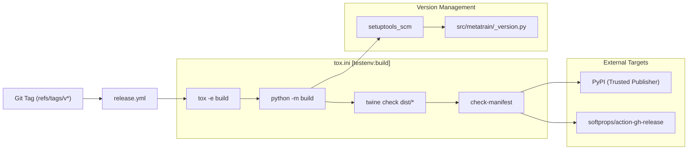

# CI/CD and Release Pipeline

Relevant source files

The following files were used as context for generating this wiki page:

- [.github/workflows/architecture-tests.yml](.github/workflows/architecture-tests.yml)
- [.github/workflows/build.yml](.github/workflows/build.yml)
- [.github/workflows/docs.yml](.github/workflows/docs.yml)
- [.github/workflows/lint.yml](.github/workflows/lint.yml)
- [.github/workflows/pr-docs-preview.yml](.github/workflows/pr-docs-preview.yml)
- [.github/workflows/release.yml](.github/workflows/release.yml)
- [.github/workflows/tests.yml](.github/workflows/tests.yml)
- [.readthedocs.yml](.readthedocs.yml)
- [ci/containers/Containerfile.base](ci/containers/Containerfile.base)
- [ci/containers/Containerfile.mtt](ci/containers/Containerfile.mtt)
- [ci/cscs.yml](ci/cscs.yml)
- [docs/generate_examples/conf.py](docs/generate_examples/conf.py)
- [docs/requirements.txt](docs/requirements.txt)
- [docs/src/conf.py](docs/src/conf.py)
- [pyproject.toml](pyproject.toml)
- [tox.ini](tox.ini)

The `metatrain` codebase utilizes a multi-layered CI/CD infrastructure to ensure code quality, cross-platform compatibility, and robust distributed training performance. The pipeline is primarily driven by GitHub Actions for standard checks and CSCS (Swiss National Supercomputing Centre) for GPU-accelerated distributed testing.

## GitHub Actions Workflows

GitHub Actions handles the majority of the continuous integration tasks, including linting, unit testing, architecture-specific validation, and documentation builds.

### Workflow Orchestration
The project uses `tox` as the primary task runner across all workflows to provide environment isolation and reproducible test execution `[tox.ini:1-22]()`. The `uv` package manager is utilized via `tox-uv` to accelerate dependency installation `[tox.ini:4-4]()`.

| Workflow | Trigger | Purpose | Key Commands |
| :--- | :--- | :--- | :--- |
| **Lint** | PR | Static analysis and type checking | `tox -e lint` |
| **Tests** | Push/PR | Core package unit tests (Ubuntu/macOS/Windows) | `tox -e tests` |
| **Architecture Tests** | Push/PR | Model-specific validation (matrixed) | `tox -e {arch}-tests` |
| **Build** | PR | Package integrity and manifest checks | `tox -e build` |
| **Docs** | Push/PR | Sphinx documentation generation | `tox -e docs` |
| **Release** | Tags | PyPI publishing and GitHub Release | `tox -e build` |

### Architecture-Specific Testing
Because `metatrain` supports numerous model architectures with varying dependency requirements (e.g., `torch-spex` for `soap-bpnn`, `mace-torch` for `mace`), tests are split into specific environments to avoid dependency bloat in the core test suite `[.github/workflows/architecture-tests.yml:10-27]()`.

Sources: `[.github/workflows/tests.yml:1-69]()`, `[.github/workflows/architecture-tests.yml:1-58]()`, `[tox.ini:1-22]()`.

## CSCS Distributed Training CI

For high-performance computing (HPC) validation, `metatrain` integrates with CSCS via GitLab CI templates `[ci/cscs.yml:1-2]()`. This pipeline tests multi-GPU distributed training on `gh200` nodes using Slurm.

### Container Infrastructure
The CSCS pipeline uses a two-stage container build process:
1.  **Base Image**: Built from `ci/containers/Containerfile.base`. It contains heavy dependencies like `FFTW3` and basic system libraries `[ci/cscs.yml:11-24]()`.
2.  **MTT Image**: Built from `ci/containers/Containerfile.mtt`. This image installs the `metatrain` source code on top of the base image `[ci/cscs.yml:29-40]()`.

### Distributed Test Execution
The `test distributed` jobs verify that the `mtt train` command correctly utilizes multiple devices.
- **Single Target**: Standard multi-GPU training `[ci/cscs.yml:43-63]()`.
- **Multi-target**: Validates distributed logic for models with multiple output heads `[ci/cscs.yml:65-90]()`.
- **Fine-tuning**: Ensures distributed restarts and fine-tuning strategies function correctly `[ci/cscs.yml:91-115]()`.

#### Distributed Pipeline Data Flow
Title: CSCS Distributed CI Data Flow

Sources: `[ci/cscs.yml:1-115]()`.

## Documentation Pipeline

The documentation is built using Sphinx and hosted on GitHub Pages and Read the Docs.

### Build Process
The build process involves several custom steps defined in `docs/src/conf.py`:
1.  **Environment Setup**: Sets `METATENSOR_IMPORT_FOR_SPHINX` to "1" to enable documentation-specific class definitions `[docs/src/conf.py:12-15]()`.
2.  **README Conversion**: The `copy_readme()` function converts GitHub-style links in the main `README.md` into MyST-compatible cross-references `[docs/src/conf.py:52-72]()`.
3.  **Example Generation**: The `generate_examples()` function executes a sub-process to run `sphinx-gallery` in a clean environment, preventing import conflicts with the main Sphinx process `[docs/src/conf.py:74-87]()`.
4.  **Architecture Docs**: `setup_architectures_docs()` automatically generates documentation pages for registered architectures `[docs/src/conf.py:92-92]()`.

### Read the Docs Integration
The project uses `.readthedocs.yml` to configure the RTD build environment, ensuring all `optional-dependencies` (like `soap-bpnn`, `pet`, `gap`) are installed for complete API documentation.

Sources: `[docs/src/conf.py:1-109]()`, `[.github/workflows/docs.yml:1-56]()`, `[pyproject.toml:66-96]()`.

## Release Process

The release process is automated via the `release.yml` workflow, triggered by Git tags.

1.  **Tagging**: A developer pushes a tag (e.g., `v0.1.0`).
2.  **Integrity Check**: The `tox -e build` command runs `python -m build`, `twine check`, and `check-manifest` to ensure the distribution is valid `[tox.ini:123-141]()`.
3.  **PyPI Publication**: If the tag starts with `v`, the workflow publishes the source distribution (`.tar.gz`) and wheel (`.whl`) to PyPI using Trusted Publishers `[.github/workflows/release.yml:35-37]()`.
4.  **GitHub Release**: The workflow creates a GitHub Release and attaches the build artifacts `[.github/workflows/release.yml:38-47]()`.

### Release Logic Association
Title: Release Pipeline Code Entities

Sources: `[.github/workflows/release.yml:1-48]()`, `[tox.ini:123-141]()`, `[pyproject.toml:103-104]()`.

---