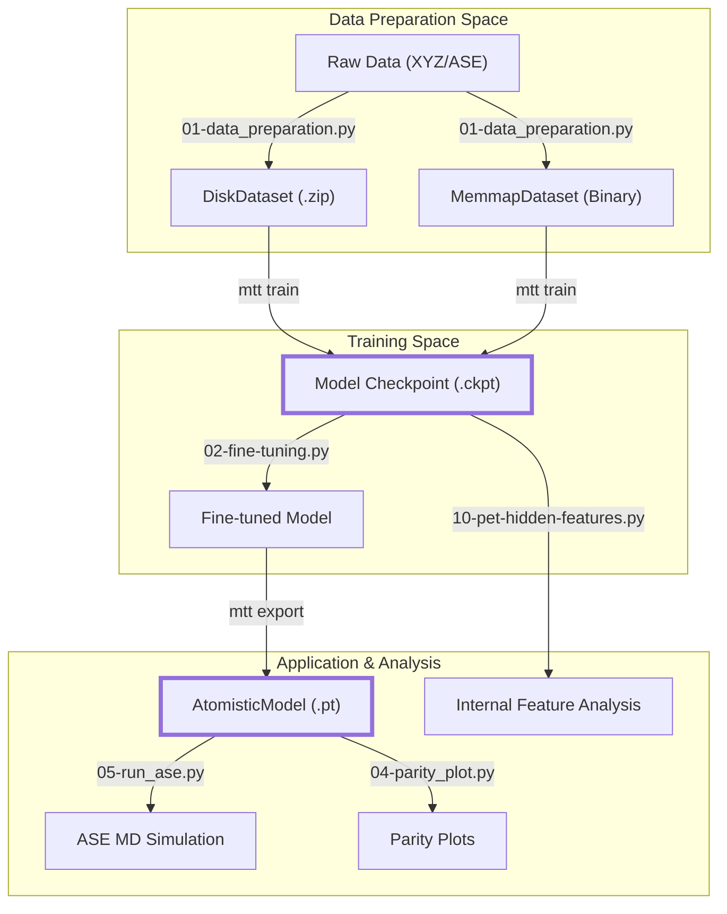
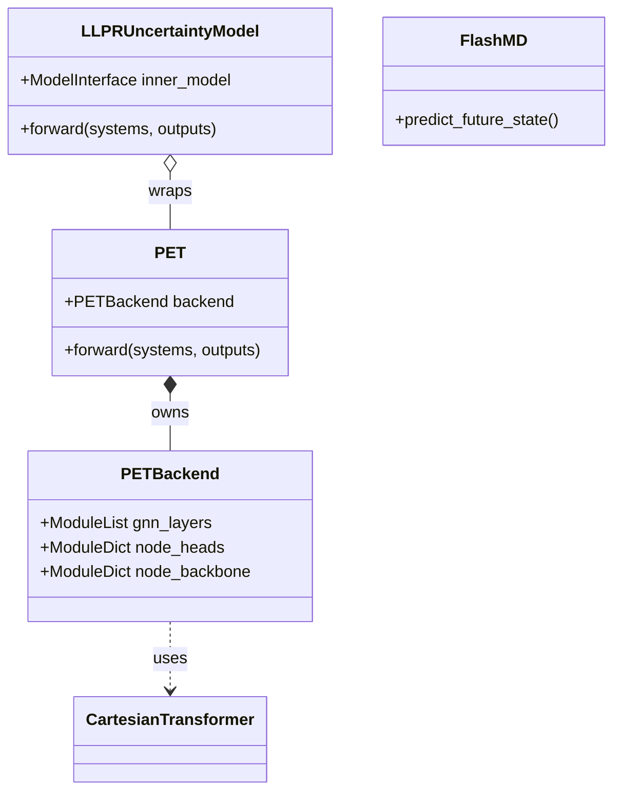

# Examples and Tutorials

Relevant source files

The following files were used as context for generating this wiki page:

- [docs/src/concepts/dataset-formats.rst](docs/src/concepts/dataset-formats.rst)
- [docs/src/concepts/fine-tuning.rst](docs/src/concepts/fine-tuning.rst)
- [docs/src/concepts/index.rst](docs/src/concepts/index.rst)
- [docs/src/concepts/loss-functions.rst](docs/src/concepts/loss-functions.rst)
- [docs/src/faq.rst](docs/src/faq.rst)
- [docs/src/getting-started/quickstart.rst](docs/src/getting-started/quickstart.rst)
- [examples/0-beginner/01-data_preparation.py](examples/0-beginner/01-data_preparation.py)
- [examples/0-beginner/02-fine-tuning.py](examples/0-beginner/02-fine-tuning.py)
- [examples/0-beginner/04-parity_plot.py](examples/0-beginner/04-parity_plot.py)
- [examples/0-beginner/05-run_ase.py](examples/0-beginner/05-run_ase.py)
- [examples/0-beginner/options-ft-eval.yaml](examples/0-beginner/options-ft-eval.yaml)
- [examples/0-beginner/options-ft.yaml](examples/0-beginner/options-ft.yaml)
- [examples/1-advanced/00-transfer-learning.py](examples/1-advanced/00-transfer-learning.py)
- [examples/1-advanced/01-llpr.py](examples/1-advanced/01-llpr.py)
- [examples/1-advanced/02-zbl.py](examples/1-advanced/02-zbl.py)
- [examples/1-advanced/04-flashmd.py](examples/1-advanced/04-flashmd.py)
- [examples/1-advanced/06-mixed-stress-training.py](examples/1-advanced/06-mixed-stress-training.py)
- [examples/1-advanced/07-dos-training.py](examples/1-advanced/07-dos-training.py)
- [examples/1-advanced/08-llpr-ensemble-training.py](examples/1-advanced/08-llpr-ensemble-training.py)
- [examples/1-advanced/09-classifier.py](examples/1-advanced/09-classifier.py)
- [examples/1-advanced/09-symplectic-flashmd.py](examples/1-advanced/09-symplectic-flashmd.py)
- [examples/1-advanced/10-pet-hidden-features.py](examples/1-advanced/10-pet-hidden-features.py)
- [examples/1-advanced/DOS_structures.xyz](examples/1-advanced/DOS_structures.xyz)
- [examples/1-advanced/options-dos.yaml](examples/1-advanced/options-dos.yaml)
- [examples/1-advanced/options-mixed-stress.yaml](examples/1-advanced/options-mixed-stress.yaml)
- [examples/1-advanced/options-no-llpr.yaml](examples/1-advanced/options-no-llpr.yaml)
- [src/metatrain/experimental/classifier/tests/test_classifier.py](src/metatrain/experimental/classifier/tests/test_classifier.py)
- [src/metatrain/experimental/flashmd_symplectic/__init__.py](src/metatrain/experimental/flashmd_symplectic/__init__.py)
- [src/metatrain/llpr/tests/options-llpr.yaml](src/metatrain/llpr/tests/options-llpr.yaml)
- [src/metatrain/llpr/tests/test_llpr.py](src/metatrain/llpr/tests/test_llpr.py)
- [src/metatrain/pet/modules/backend.py](src/metatrain/pet/modules/backend.py)
- [src/metatrain/pet/modules/diagnostic.py](src/metatrain/pet/modules/diagnostic.py)
- [src/metatrain/pet/tests/test_diagnostic.py](src/metatrain/pet/tests/test_diagnostic.py)
- [src/metatrain/pet/tests/test_feature_extraction.py](src/metatrain/pet/tests/test_feature_extraction.py)
- [src/metatrain/pet/tests/test_non_strict_nl.py](src/metatrain/pet/tests/test_non_strict_nl.py)
- [src/metatrain/utils/hypers.py](src/metatrain/utils/hypers.py)

This section provides a comprehensive guide to the bundled examples and tutorials in `metatrain`. These resources are designed to take users from basic data preparation and model training to advanced topics like uncertainty quantification, specialized physics-informed potentials, and hidden feature extraction.

The tutorials are split into two main categories:
1. **Beginner Tutorials**: Focus on the core workflow using the `mtt` CLI, basic data formats, and standard MD simulations.
2. **Advanced Tutorials**: Explore specialized architectures (FlashMD, PET), complex training regimes (Multi-GPU, DOS), and diagnostic tools.

## Tutorial Workflow Overview

The following diagram illustrates the transition from raw data to advanced model analysis as covered in the tutorials.

### Data to Analysis Pipeline

**Sources:** [examples/0-beginner/01-data_preparation.py:1-28](), [examples/0-beginner/02-fine-tuning.py:11-20](), [examples/0-beginner/05-run_ase.py:5-20](), [examples/1-advanced/10-pet-hidden-features.py:1-15]().

---

## Beginner Tutorials
For a detailed walkthrough, see [Beginner Tutorials](#7.1).

The beginner track covers the essential building blocks for using `metatrain` effectively:

*   **Data Preparation**: Instructions on converting small datasets (XYZ/ASE) into high-performance formats like `DiskDataset` (zipped metatensors) and `MemmapDataset` (binary memory-mapped arrays for HPC) [examples/0-beginner/01-data_preparation.py:101-180]().
*   **Basic Training & Fine-tuning**: Utilizing the `mtt train` command to either train from scratch or fine-tune a pre-trained model (e.g., PET-MAD) using a `finetune` block in the YAML configuration [examples/0-beginner/02-fine-tuning.py:24-45]().
*   **Evaluation & Visualization**: Generating parity plots to identify outliers and verify model convergence [examples/0-beginner/04-parity_plot.py](), and running NVE molecular dynamics using the `MetatomicCalculator` within the ASE environment [examples/0-beginner/05-run_ase.py:80-95]().

**Sources:** [examples/0-beginner/01-data_preparation.py:41-42](), [examples/0-beginner/02-fine-tuning.py:102-103](), [examples/0-beginner/05-run_ase.py:33-34]().

---

## Advanced Tutorials
For a detailed walkthrough, see [Advanced Tutorials](#7.2).

Advanced tutorials address complex scientific use cases and performance optimization:

*   **Uncertainty Quantification**: Using the **Last-Layer Prediction Rigidity (LLPR)** wrapper to obtain per-atom or per-system uncertainty estimates and ensemble predictions [examples/1-advanced/01-llpr.py](), [src/metatrain/llpr/tests/test_llpr.py:36-38]().
*   **Physics-Informed Potentials**: Implementing the **ZBL** (Ziegler-Biersack-Littmark) additive potential for accurate short-range repulsion [examples/1-advanced/02-zbl.py]().
*   **Specialized Training**:
    *   **FlashMD**: Direct prediction of MD states (future positions/momenta) for speedups of 1-2 orders of magnitude [examples/1-advanced/04-flashmd.py:5-8]().
    *   **Density of States (DOS)**: Training models like PET-MAD-DOS using the **Shift Agnostic MSE loss** [examples/1-advanced/07-dos-training.py:5-9]().
    *   **Mixed-Stress Training**: Handling datasets with varying availability of stress/virial tensors [examples/1-advanced/06-mixed-stress-training.py]().
*   **Hidden Feature Extraction**: A deep dive into the `PET` architecture to extract internal node and edge embeddings using the `mtt::feature::` prefix [examples/1-advanced/10-pet-hidden-features.py:149-164]().

### Advanced Model Components

**Sources:** [src/metatrain/pet/modules/backend.py:12-26](), [src/metatrain/llpr/tests/test_llpr.py:37-38](), [examples/1-advanced/04-flashmd.py:67-75](), [examples/1-advanced/10-pet-hidden-features.py:159-164]().

---

## Summary of Example Scripts

| Script | Level | Key Feature / Class |
| :--- | :--- | :--- |
| `01-data_preparation.py` | Beginner | `DiskDatasetWriter`, `systems_to_torch` |
| `02-fine-tuning.py` | Beginner | `finetune` YAML block, `PET-MAD` |
| `05-run_ase.py` | Beginner | `MetatomicCalculator`, `VelocityVerlet` |
| `01-llpr.py` | Advanced | `LLPRUncertaintyModel`, `energy_uncertainty` |
| `04-flashmd.py` | Advanced | `future_positions`, `future_momenta` |
| `07-dos-training.py` | Advanced | `Shift Agnostic MSE`, `masked_mse` |
| `10-pet-hidden-features.py` | Advanced | `PETBackend`, `mtt::feature::node_backbone` |

**Sources:** [examples/0-beginner/01-data_preparation.py:41](), [examples/0-beginner/02-fine-tuning.py:26-28](), [examples/0-beginner/05-run_ase.py:83-90](), [examples/1-advanced/04-flashmd.py:67-70](), [examples/1-advanced/07-dos-training.py:7-9](), [examples/1-advanced/10-pet-hidden-features.py:149-154]().

---