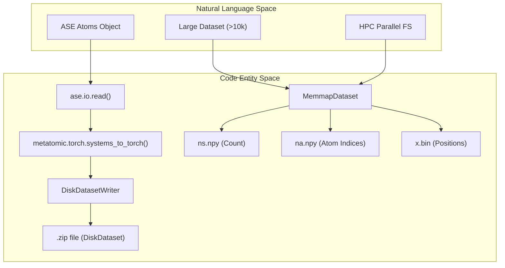
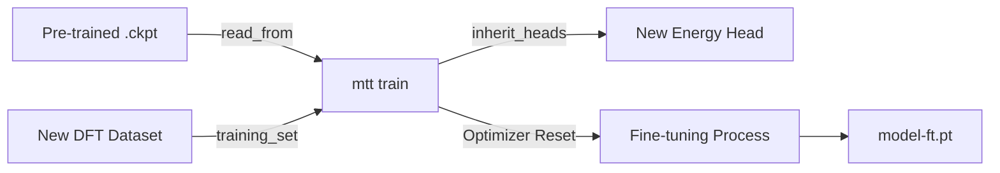

# Beginner Tutorials

Relevant source files

The following files were used as context for generating this wiki page:

- [docs/src/concepts/auxiliary-outputs.rst](docs/src/concepts/auxiliary-outputs.rst)
- [docs/src/concepts/dataset-formats.rst](docs/src/concepts/dataset-formats.rst)
- [docs/src/concepts/fine-tuning.rst](docs/src/concepts/fine-tuning.rst)
- [docs/src/concepts/index.rst](docs/src/concepts/index.rst)
- [docs/src/faq.rst](docs/src/faq.rst)
- [docs/src/getting-started/quickstart.rst](docs/src/getting-started/quickstart.rst)
- [examples/0-beginner/01-data_preparation.py](examples/0-beginner/01-data_preparation.py)
- [examples/0-beginner/02-fine-tuning.py](examples/0-beginner/02-fine-tuning.py)
- [examples/0-beginner/04-parity_plot.py](examples/0-beginner/04-parity_plot.py)
- [examples/0-beginner/05-run_ase.py](examples/0-beginner/05-run_ase.py)
- [examples/0-beginner/options-ft-eval.yaml](examples/0-beginner/options-ft-eval.yaml)
- [examples/0-beginner/options-ft.yaml](examples/0-beginner/options-ft.yaml)
- [examples/0-beginner/options-memmap.yaml](examples/0-beginner/options-memmap.yaml)
- [examples/1-advanced/01-llpr.py](examples/1-advanced/01-llpr.py)
- [examples/1-advanced/02-zbl.py](examples/1-advanced/02-zbl.py)
- [examples/1-advanced/03-fitting-generic-targets.py](examples/1-advanced/03-fitting-generic-targets.py)
- [src/metatrain/experimental/dpa3/tests/test_compile.py](src/metatrain/experimental/dpa3/tests/test_compile.py)
- [src/metatrain/experimental/dpa3/tests/test_pretrained.py](src/metatrain/experimental/dpa3/tests/test_pretrained.py)
- [src/metatrain/experimental/dpa3/tests/test_regression.py](src/metatrain/experimental/dpa3/tests/test_regression.py)

This page provides a technical walkthrough of the beginner-level examples provided in the `metatrain` codebase. These tutorials cover the essential workflow from data preparation and model training to fine-tuning, validation via parity plots, and deployment in molecular dynamics simulations using the Atomic Simulation Environment (ASE).

## 1. Data Preparation

`metatrain` supports three primary data formats, each suited for different dataset scales and hardware constraints.

### 1.1. XYZ and ASE Databases
For small datasets (typically <10k structures), users can provide standard XYZ files or ASE databases. `metatrain` uses the ASE library to read these into memory [examples/0-beginner/01-data_preparation.py:19-22](). Custom scalar properties are read from `atoms.info`, while vector/tensor properties like forces or stress are read from `atoms.arrays` [examples/0-beginner/01-data_preparation.py:69-74]().

### 1.2. DiskDataset (.zip)
For datasets that exceed available GPU memory but are not large enough to require complex parallel I/O, the `DiskDataset` format is recommended [examples/0-beginner/01-data_preparation.py:20-22](). It stores structures and their associated targets as serialized `metatensor` objects within a ZIP archive.

**Implementation Details:**
- **Writer:** The `DiskDatasetWriter` class is used to serialize data [examples/0-beginner/01-data_preparation.py:106-106]().
- **Data Flow:** Structures are converted to the internal torch format using `metatomic.torch.systems_to_torch` before being passed to the writer [examples/0-beginner/01-data_preparation.py:114-117]().
- **Structure:** Each structure is stored in a folder named by its index (e.g., `0/system.mta`, `0/energy.mts`) [docs/src/concepts/dataset-formats.rst:49-61]().

### 1.3. MemmapDataset (Directory)
For large-scale training on parallel filesystems (HPC clusters), `MemmapDataset` is the preferred format [examples/0-beginner/01-data_preparation.py:173-174](). It utilizes memory-mapped NumPy arrays to avoid I/O bottlenecks by loading data on-the-fly without reading the entire file into RAM.

**Data Entity Association: Data Preparation**

*Sources: [examples/0-beginner/01-data_preparation.py:114-134](), [docs/src/concepts/dataset-formats.rst:75-91]()*

---

## 2. Basic Training with `mtt train`

The core entry point for training is the `mtt train` CLI command. It requires a YAML configuration file that defines the architecture, training hyperparameters, and dataset paths.

**Key Components:**
- **Architecture Selection:** Specified via the `architecture.name` key (e.g., `pet`, `soap_bpnn`) [examples/0-beginner/options-memmap.yaml:4-4]().
- **Target Specification:** Defines which properties the model should learn (e.g., `energy`, `forces`, `stress`) and their corresponding units [examples/0-beginner/options-memmap.yaml:13-20]().
- **Logging:** Training progress, including RMSE/MAE for each target, is logged to a `train.csv` file in the `outputs` directory [examples/0-beginner/02-fine-tuning.py:128-130]().

---

## 3. Fine-tuning a Pre-trained Model

Fine-tuning allows adapting a model trained on a large, general dataset (like PET-MAD) to a specific system with high-level reference data (e.g., DFT). Currently, this is primarily supported for the **PET** architecture [examples/0-beginner/02-fine-tuning.py:6-8]().

### 3.1. Implementation Strategy
- **Weight Inheritance:** Users can use `method: "full"` to adapt all weights [docs/src/concepts/fine-tuning.rst:42-43]().
- **Energy Variants:** It is recommended to create a new energy head (e.g., `energy/finetune`) to avoid conflicts with the pre-trained model's reference energy [examples/0-beginner/02-fine-tuning.py:34-40]().
- **Head Copying:** The `inherit_heads` parameter allows copying weights from an existing head to a new one instead of random initialization [docs/src/concepts/fine-tuning.rst:168-169]().

**Data Flow: Fine-tuning Pipeline**

*Sources: [docs/src/concepts/fine-tuning.rst:29-45](), [examples/0-beginner/02-fine-tuning.py:43-46]()*

---

## 4. Model Validation: Parity Plots

Parity plots are the primary tool for visualizing model accuracy by plotting predicted values against reference values.

**Implementation Steps:**
1. **Inference:** Run `mtt eval` to generate predictions on a test set [examples/0-beginner/04-parity_plot.py:7-9]().
2. **Extraction:** Load both reference and predicted XYZ files using `ase.io.read` [examples/0-beginner/04-parity_plot.py:23-27]().
3. **Visualization:** Use `matplotlib` to scatter plot predicted vs. target values and calculate the Root Mean Square Error (RMSE) [examples/0-beginner/04-parity_plot.py:51-84]().
4. **Outlier Analysis:** Use `chemiscope` for interactive visualization, allowing users to click on outliers in the parity plot to inspect the corresponding 3D atomic structure [examples/0-beginner/04-parity_plot.py:111-139]().

---

## 5. ASE Molecular Dynamics

Once a model is exported to a `.pt` file, it can be used as a calculator within the ASE environment to perform Molecular Dynamics (MD).

### 5.1. The `MetatomicCalculator`
The `MetatomicCalculator` class (from the `metatomic_ase` package) bridges the `metatrain` model and ASE's MD engines [examples/0-beginner/05-run_ase.py:33-33]().

**Workflow:**
1. **Initialize Atoms:** Load initial coordinates and set velocities (e.g., `MaxwellBoltzmannDistribution`) [examples/0-beginner/05-run_ase.py:56-76]().
2. **Attach Calculator:** Instantiate `MetatomicCalculator` with the exported model path and assign it to `atoms.calc` [examples/0-beginner/05-run_ase.py:83-83]().
3. **Define Integrator:** Use ASE integrators like `VelocityVerlet` [examples/0-beginner/05-run_ase.py:90-90]().
4. **Run Simulation:** Execute the simulation loop, collecting energy and trajectory data for conservation analysis [examples/0-beginner/05-run_ase.py:113-120]().

**Sources:**
- [examples/0-beginner/01-data_preparation.py]()
- [examples/0-beginner/02-fine-tuning.py]()
- [examples/0-beginner/04-parity_plot.py]()
- [examples/0-beginner/05-run_ase.py]()
- [docs/src/concepts/dataset-formats.rst]()
- [docs/src/concepts/fine-tuning.rst]()

---