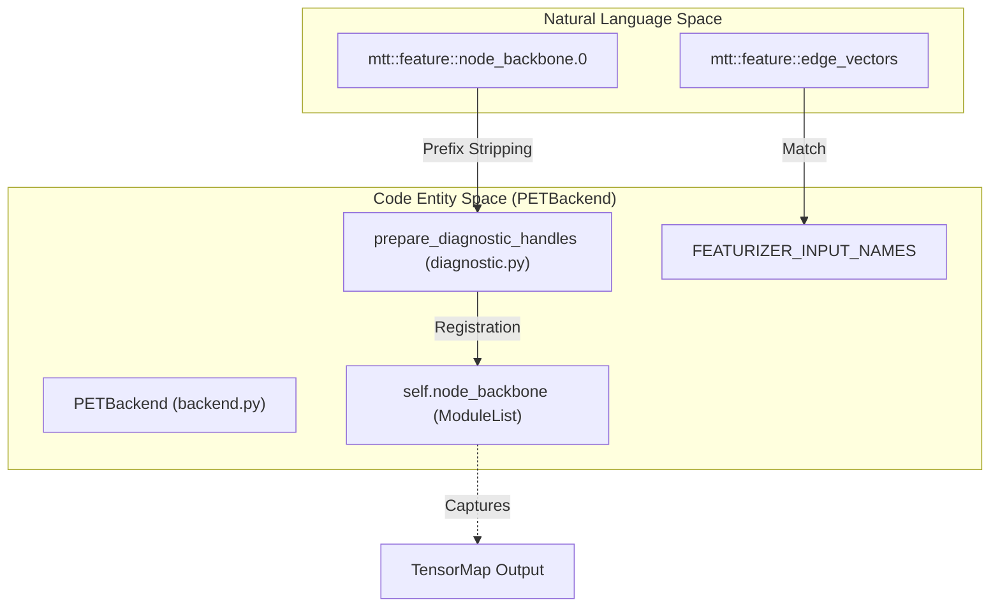
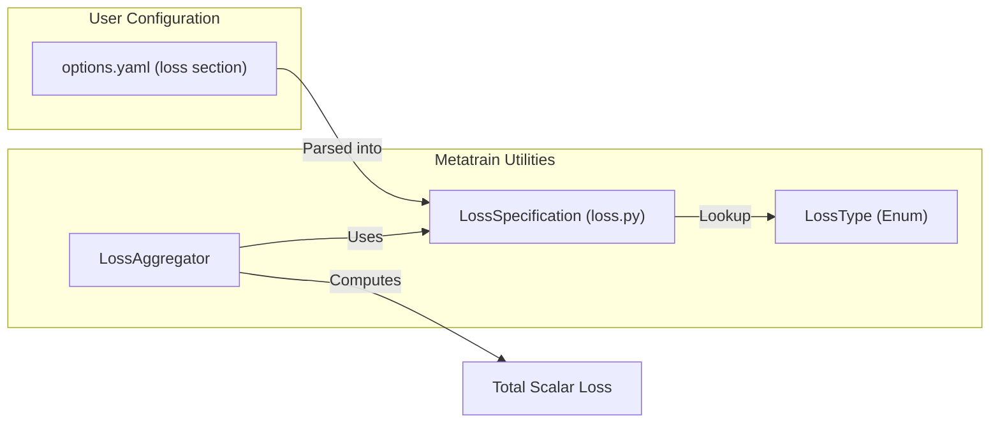

# Advanced Tutorials

Relevant source files

The following files were used as context for generating this wiki page:

- [docs/src/concepts/loss-functions.rst](docs/src/concepts/loss-functions.rst)
- [examples/1-advanced/00-transfer-learning.py](examples/1-advanced/00-transfer-learning.py)
- [examples/1-advanced/04-flashmd.py](examples/1-advanced/04-flashmd.py)
- [examples/1-advanced/06-mixed-stress-training.py](examples/1-advanced/06-mixed-stress-training.py)
- [examples/1-advanced/07-dos-training.py](examples/1-advanced/07-dos-training.py)
- [examples/1-advanced/08-llpr-ensemble-training.py](examples/1-advanced/08-llpr-ensemble-training.py)
- [examples/1-advanced/09-classifier.py](examples/1-advanced/09-classifier.py)
- [examples/1-advanced/09-symplectic-flashmd.py](examples/1-advanced/09-symplectic-flashmd.py)
- [examples/1-advanced/10-pet-hidden-features.py](examples/1-advanced/10-pet-hidden-features.py)
- [examples/1-advanced/DOS_structures.xyz](examples/1-advanced/DOS_structures.xyz)
- [examples/1-advanced/options-dos.yaml](examples/1-advanced/options-dos.yaml)
- [examples/1-advanced/options-flashmd-finetune.yaml](examples/1-advanced/options-flashmd-finetune.yaml)
- [examples/1-advanced/options-flashmd.yaml](examples/1-advanced/options-flashmd.yaml)
- [examples/1-advanced/options-mixed-stress.yaml](examples/1-advanced/options-mixed-stress.yaml)
- [examples/1-advanced/options-no-llpr.yaml](examples/1-advanced/options-no-llpr.yaml)
- [src/metatrain/experimental/classifier/tests/test_classifier.py](src/metatrain/experimental/classifier/tests/test_classifier.py)
- [src/metatrain/experimental/flashmd/tests/checkpoints/model-v3_trainer-v4.ckpt.gz](src/metatrain/experimental/flashmd/tests/checkpoints/model-v3_trainer-v4.ckpt.gz)
- [src/metatrain/experimental/flashmd/tests/checkpoints/model-v3_trainer-v5.ckpt.gz](src/metatrain/experimental/flashmd/tests/checkpoints/model-v3_trainer-v5.ckpt.gz)
- [src/metatrain/experimental/flashmd_symplectic/__init__.py](src/metatrain/experimental/flashmd_symplectic/__init__.py)
- [src/metatrain/llpr/tests/checkpoints/model-v3_trainer-v3.ckpt.gz](src/metatrain/llpr/tests/checkpoints/model-v3_trainer-v3.ckpt.gz)
- [src/metatrain/llpr/tests/options-llpr.yaml](src/metatrain/llpr/tests/options-llpr.yaml)
- [src/metatrain/llpr/tests/test_llpr.py](src/metatrain/llpr/tests/test_llpr.py)
- [src/metatrain/pet/modules/backend.py](src/metatrain/pet/modules/backend.py)
- [src/metatrain/pet/modules/diagnostic.py](src/metatrain/pet/modules/diagnostic.py)
- [src/metatrain/pet/tests/checkpoints/model-v11_trainer-v12.ckpt.gz](src/metatrain/pet/tests/checkpoints/model-v11_trainer-v12.ckpt.gz)
- [src/metatrain/pet/tests/test_diagnostic.py](src/metatrain/pet/tests/test_diagnostic.py)
- [src/metatrain/pet/tests/test_feature_extraction.py](src/metatrain/pet/tests/test_feature_extraction.py)
- [src/metatrain/pet/tests/test_non_strict_nl.py](src/metatrain/pet/tests/test_non_strict_nl.py)
- [src/metatrain/utils/hypers.py](src/metatrain/utils/hypers.py)

This section covers complex workflows and specialized training scenarios in `metatrain`. These advanced tutorials demonstrate how to leverage the modular architecture to handle non-standard targets, quantify uncertainty, and accelerate molecular dynamics.

## FlashMD and Symplectic MD

FlashMD models afford molecular dynamics simulations that are significantly faster than traditional MLIPs by directly predicting future positions and momenta [examples/1-advanced/04-flashmd.py:5-7]().

### Data Flow for FlashMD
FlashMD requires future positions and momenta as targets, typically derived from NVE trajectories [examples/1-advanced/04-flashmd.py:32-34]().

1.  **Trajectory Generation**: Generate NVE data using a baseline potential (e.g., EMT, DFT).
2.  **Time Lag Selection**: Define a `time_lag` (e.g., 32 fs) for future state prediction [examples/1-advanced/04-flashmd.py:74]().
3.  **Structure Preparation**: Save `future_positions` and `future_momenta` as arrays in the atomic structures [examples/1-advanced/04-flashmd.py:83-87]().
4.  **Time Reversal (Optional)**: Augment data by reversing momenta and swapping "now" and "ahead" frames to enforce time-reversibility [examples/1-advanced/04-flashmd.py:97-105]().

### Symplectic FlashMD
Symplectic FlashMD uses a fixed-point solver to preserve Hamiltonian properties. The data preparation involves mapping a midpoint configuration to the difference (`delta`) in positions and momenta [examples/1-advanced/09-symplectic-flashmd.py:65-83]().

| Feature | Standard FlashMD | Symplectic FlashMD |
| :--- | :--- | :--- |
| **Input Geometry** | $q_t$ | $(q_t + q_{t+\Delta t})/2$ |
| **Input Momentum** | $p_t$ | $(p_t + p_{t+\Delta t})/2$ |
| **Targets** | $q_{t+\Delta t}, p_{t+\Delta t}$ | $\Delta q, \Delta p$ |

**Sources**: [examples/1-advanced/04-flashmd.py](), [examples/1-advanced/09-symplectic-flashmd.py]()

---

## Uncertainty Quantification with LLPR

LLPR (Last-Layer Prediction Rigidity) provides uncertainty quantification by wrapping an existing architecture and computing the covariance of the last-layer features [src/metatrain/llpr/tests/test_llpr.py:22-24]().

### Implementation Lifecycle
The LLPR workflow typically follows a three-step training process:
1.  **Base Training**: Train a standard model (e.g., PET) [src/metatrain/llpr/tests/test_llpr.py:33-34]().
2.  **LLPR Initialization**: Create an LLPR model using the base model checkpoint. This freezes the backbone and prepares the covariance calculation [src/metatrain/llpr/tests/test_llpr.py:37-38]().
3.  **Ensemble Training (Optional)**: Train ensemble weights to calibrate the uncertainty [src/metatrain/llpr/tests/test_llpr.py:155-158]().

### LLPR Model Outputs
When exported, an LLPR model provides three related outputs for a target (e.g., `energy`):
*   `energy`: The mean prediction.
*   `energy_uncertainty`: The standard deviation derived from the rigidity matrix.
*   `energy_ensemble`: Individual predictions from the generated ensemble [src/metatrain/llpr/tests/test_llpr.py:110-128]().

**Sources**: [src/metatrain/llpr/tests/test_llpr.py]()

---

## Electronic Density of States (DOS) Training

Training models for the electronic Density of States (DOS) requires handling unique properties like shift-invariance and energy grid masking [examples/1-advanced/07-dos-training.py:5-9]().

### Shift-Agnostic Loss
The DOS is often predicted on a fixed energy grid. Because the absolute energy reference in DFT can be arbitrary, `metatrain` provides a `shift_agnostic_mse` loss [examples/1-advanced/options-dos.yaml:16]().

### Data Pipeline for DOS
1.  **Smearing**: Convert discrete eigenvalues and k-point weights into a continuous DOS using Gaussian smearing [examples/1-advanced/07-dos-training.py:57-63]().
2.  **Masking**: Define a `mask` to ignore unphysical DOS values (e.g., above the computed band limit) [examples/1-advanced/07-dos-training.py:98-102]().
3.  **Target Configuration**: The DOS is treated as a scalar target with a large number of `num_subtargets` corresponding to the energy grid points [examples/1-advanced/options-dos.yaml:26-30]().

**Sources**: [examples/1-advanced/07-dos-training.py](), [examples/1-advanced/options-dos.yaml]()

---

## PET Hidden Feature Extraction

The PET architecture allows users to extract intermediate representations (atom-type embeddings, neighborhood geometries, etc.) using the `mtt::feature::` prefix in the `outputs` dictionary [examples/1-advanced/10-pet-hidden-features.py:6-9]().

### Capturable Entities
The `PETBackend` module owns the learnable submodules [src/metatrain/pet/modules/backend.py:24-26](). Tensors are categorized into two types:

1.  **Node-like**: Shape `(n_atoms, d)`, carrying `["system", "atom"]` labels [src/metatrain/pet/modules/diagnostic.py:52-53]().
2.  **Edge-like**: Shape `(n_atoms, max_neighbors, d)`, carrying pair labels `["system", "first_atom", "second_atom", ...]` [src/metatrain/pet/modules/diagnostic.py:54-57]().

### Code Mapping: Diagnostic Hooks
The following diagram shows how natural language requests for "features" map to the internal `PETBackend` and its diagnostic hooks.

**PET Diagnostic Feature Mapping**

**Sources**: [src/metatrain/pet/modules/backend.py](), [src/metatrain/pet/modules/diagnostic.py](), [examples/1-advanced/10-pet-hidden-features.py]()

---

## Generic Targets and Loss Configuration

Advanced users can define custom targets and associate them with specific loss functions and gradients [docs/src/concepts/loss-functions.rst:110-112]().

### Internal Loss Specification
While shorthands like `loss: mse` are common, the internal representation allows per-gradient control:

| Target | Gradient | Loss Type | Weight |
| :--- | :--- | :--- | :--- |
| `energy` | - | `mse` | 1.0 |
| `energy` | `positions` (forces) | `mse` | 1.0 |
| `energy` | `strain` (stress) | `mse` | 1.0 |

Users can explicitly configure these in the `options.yaml` to handle "non-standard" gradients or masked losses [docs/src/concepts/loss-functions.rst:131-132]().

### Masked Loss Functions
Masked losses (`masked_mse`, `masked_mae`, `masked_huber`) are used when datasets contain padded targets. The masks are passed as `extra_data` in the training set [docs/src/concepts/loss-functions.rst:146-152]().

**System-to-Code Mapping: Loss Aggregation**

**Sources**: [docs/src/concepts/loss-functions.rst](), [src/metatrain/utils/hypers.py]()

---