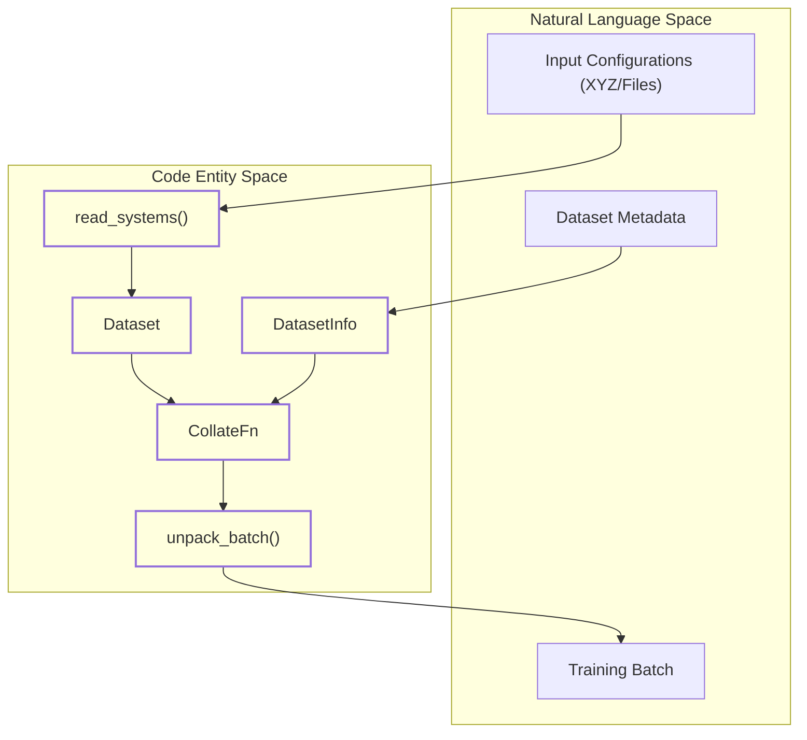
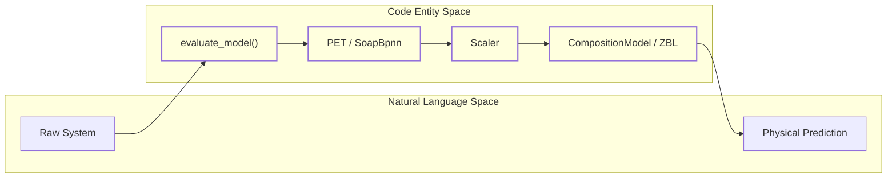

# Glossary

Relevant source files

The following files were used as context for generating this wiki page:

- [.codecov.yml](.codecov.yml)
- [CODEOWNERS](CODEOWNERS)
- [README.md](README.md)
- [ci/cscs.yml](ci/cscs.yml)
- [docs/src/dev-docs/new-architecture.rst](docs/src/dev-docs/new-architecture.rst)
- [docs/src/dev-docs/new-loss.rst](docs/src/dev-docs/new-loss.rst)
- [pyproject.toml](pyproject.toml)
- [src/metatrain/experimental/dpa3/documentation.py](src/metatrain/experimental/dpa3/documentation.py)
- [src/metatrain/experimental/dpa3/model.py](src/metatrain/experimental/dpa3/model.py)
- [src/metatrain/experimental/dpa3/trainer.py](src/metatrain/experimental/dpa3/trainer.py)
- [src/metatrain/experimental/flashmd/trainer.py](src/metatrain/experimental/flashmd/trainer.py)
- [src/metatrain/experimental/flashmd_symplectic/documentation.py](src/metatrain/experimental/flashmd_symplectic/documentation.py)
- [src/metatrain/experimental/flashmd_symplectic/trainer.py](src/metatrain/experimental/flashmd_symplectic/trainer.py)
- [src/metatrain/experimental/mace/model.py](src/metatrain/experimental/mace/model.py)
- [src/metatrain/experimental/mace/trainer.py](src/metatrain/experimental/mace/trainer.py)
- [src/metatrain/experimental/phace/model.py](src/metatrain/experimental/phace/model.py)
- [src/metatrain/experimental/phace/tests/test_regression.py](src/metatrain/experimental/phace/tests/test_regression.py)
- [src/metatrain/experimental/phace/trainer.py](src/metatrain/experimental/phace/trainer.py)
- [src/metatrain/gap/model.py](src/metatrain/gap/model.py)
- [src/metatrain/gap/trainer.py](src/metatrain/gap/trainer.py)
- [src/metatrain/llpr/model.py](src/metatrain/llpr/model.py)
- [src/metatrain/llpr/trainer.py](src/metatrain/llpr/trainer.py)
- [src/metatrain/pet/checkpoints.py](src/metatrain/pet/checkpoints.py)
- [src/metatrain/pet/documentation.py](src/metatrain/pet/documentation.py)
- [src/metatrain/pet/model.py](src/metatrain/pet/model.py)
- [src/metatrain/pet/modules/adaptive_cutoff.py](src/metatrain/pet/modules/adaptive_cutoff.py)
- [src/metatrain/pet/modules/conditioning.py](src/metatrain/pet/modules/conditioning.py)
- [src/metatrain/pet/modules/structures.py](src/metatrain/pet/modules/structures.py)
- [src/metatrain/pet/tests/checkpoints/model-v14_trainer-v13.ckpt.gz](src/metatrain/pet/tests/checkpoints/model-v14_trainer-v13.ckpt.gz)
- [src/metatrain/pet/tests/checkpoints/model-v15_trainer-v13.ckpt.gz](src/metatrain/pet/tests/checkpoints/model-v15_trainer-v13.ckpt.gz)
- [src/metatrain/pet/tests/test_adaptive_cutoff.py](src/metatrain/pet/tests/test_adaptive_cutoff.py)
- [src/metatrain/pet/tests/test_regression.py](src/metatrain/pet/tests/test_regression.py)
- [src/metatrain/share/base_hypers.py](src/metatrain/share/base_hypers.py)
- [src/metatrain/soap_bpnn/model.py](src/metatrain/soap_bpnn/model.py)
- [src/metatrain/utils/abc.py](src/metatrain/utils/abc.py)
- [src/metatrain/utils/additive/remove.py](src/metatrain/utils/additive/remove.py)
- [src/metatrain/utils/architectures.py](src/metatrain/utils/architectures.py)
- [src/metatrain/utils/augmentation.py](src/metatrain/utils/augmentation.py)
- [src/metatrain/utils/data/atomic_basis_helpers.py](src/metatrain/utils/data/atomic_basis_helpers.py)
- [src/metatrain/utils/data/dataset.py](src/metatrain/utils/data/dataset.py)
- [src/metatrain/utils/data/get_dataset.py](src/metatrain/utils/data/get_dataset.py)
- [src/metatrain/utils/data/readers/ase.py](src/metatrain/utils/data/readers/ase.py)
- [src/metatrain/utils/data/readers/readers.py](src/metatrain/utils/data/readers/readers.py)
- [src/metatrain/utils/errors.py](src/metatrain/utils/errors.py)
- [src/metatrain/utils/evaluate_model.py](src/metatrain/utils/evaluate_model.py)
- [src/metatrain/utils/loss.py](src/metatrain/utils/loss.py)
- [src/metatrain/utils/neighbor_lists.py](src/metatrain/utils/neighbor_lists.py)
- [src/metatrain/utils/omegaconf.py](src/metatrain/utils/omegaconf.py)
- [src/metatrain/utils/scaler/_base_scaler.py](src/metatrain/utils/scaler/_base_scaler.py)
- [src/metatrain/utils/scaler/scaler.py](src/metatrain/utils/scaler/scaler.py)
- [src/metatrain/utils/testing/output.py](src/metatrain/utils/testing/output.py)
- [src/metatrain/utils/units.py](src/metatrain/utils/units.py)
- [tests/cli/test_base_precision.py](tests/cli/test_base_precision.py)
- [tests/test_readme.py](tests/test_readme.py)
- [tests/test_registered_archs.py](tests/test_registered_archs.py)
- [tests/utils/data/test_atomic_basis_helpers.py](tests/utils/data/test_atomic_basis_helpers.py)
- [tests/utils/data/test_combine_dataloaders.py](tests/utils/data/test_combine_dataloaders.py)
- [tests/utils/data/test_dataset.py](tests/utils/data/test_dataset.py)
- [tests/utils/data/test_readers.py](tests/utils/data/test_readers.py)
- [tests/utils/test_additive.py](tests/utils/test_additive.py)
- [tests/utils/test_architectures.py](tests/utils/test_architectures.py)
- [tests/utils/test_augmentation.py](tests/utils/test_augmentation.py)
- [tests/utils/test_errors.py](tests/utils/test_errors.py)
- [tests/utils/test_loss.py](tests/utils/test_loss.py)
- [tests/utils/test_pydantic.py](tests/utils/test_pydantic.py)
- [tests/utils/test_scaler.py](tests/utils/test_scaler.py)
- [tests/utils/test_units.py](tests/utils/test_units.py)
- [tox.ini](tox.ini)

This glossary defines technical terms, jargon, and domain-specific concepts used within the `metatrain` codebase. It serves as a reference for onboarding engineers to understand the implementation details and data flow of the system.

## Core Domain Concepts

### Atomistic Model
A model that takes an atomistic system (positions, atomic types, cell) and predicts physical properties (e.g., energy, forces). In `metatrain`, these are implemented as `torch.nn.Module` subclasses wrapped in the `metatomic.torch.AtomisticModel` interface for deployment [src/metatrain/pet/model.py:10-17]().

### System
The fundamental data structure representing a single atomic configuration. It contains atomic positions, species (atomic types), cell vectors, and periodicity.
*   **Code Entity:** `metatomic.torch.System` [src/metatrain/pet/model.py:16]().

### Neighbor List
A list of pairs of atoms within a certain `cutoff` distance. `metatrain` uses these to define local environments for Graph Neural Networks (GNNs) or descriptors like SOAP.
*   **Code Entity:** `metatomic.torch.NeighborListOptions` [src/metatrain/pet/model.py:15]().
*   **Implementation:** Handled via `get_neighbor_list` on a `System` object [src/metatrain/soap_bpnn/model.py:162]().

### Target
A physical property predicted by the model (e.g., `energy`, `forces`, `virial`). Each target is associated with a `TargetInfo` object describing its metadata.
*   **Code Entity:** `TargetInfo` [src/metatrain/utils/data/dataset.py:41]().

---

## Data Flow & Architecture Entities

The following diagram maps high-level system components to their specific code implementations and shows how data flows from raw systems to training-ready batches.

**Data Preparation to Batching**

**Sources:** [src/metatrain/utils/data/dataset.py:70-108](), [tests/utils/data/test_dataset.py:10-24]()

### DatasetInfo
A container for global dataset metadata, including the length units used, the unique set of atomic types present, and information about all prediction targets.
*   **Code Pointer:** `metatrain.utils.data.DatasetInfo` [src/metatrain/utils/data/dataset.py:70]().

### TargetInfo
Stores metadata for a specific prediction target, such as its physical quantity (e.g., "energy"), units, and whether it has associated gradients (like forces).
*   **Code Pointer:** `metatrain.utils.data.TargetInfo` [src/metatrain/utils/data/dataset.py:40-44]().

### ModelInterface
A mandatory abstract base class that every architecture in `metatrain` must implement. It defines the contract for initializing models from hyperparameters and `DatasetInfo`.
*   **Code Pointer:** `metatrain.utils.abc.ModelInterface` [src/metatrain/pet/model.py:20]().

---

## Technical Jargon & Abbreviations

| Term | Definition | Code Reference |
| :--- | :--- | :--- |
| **NEF** | Node-Edge-Feature format. A specific tensor reshaping used in PET to handle graph data. | [src/metatrain/pet/modules/structures.py:8-13]() |
| **SOAP** | Smooth Overlap of Atomic Positions. A descriptor for local atomic environments. | [src/metatrain/soap_bpnn/model.py:36]() |
| **BPNN** | Behler-Parrinello Neural Network. A high-dimensional neural network potential. | [src/metatrain/soap_bpnn/model.py:190-202]() |
| **LLPR** | Last-Layer Prediction Rigidity. A method for uncertainty quantification. | [src/metatrain/pet/model.py:112-114]() |
| **ZBL** | Ziegler-Biersack-Littmark. An additive potential for short-range repulsion. | [src/metatrain/pet/model.py:21]() |
| **Composition** | A linear model fitting the base energy contribution of each atomic species. | [src/metatrain/pet/model.py:19]() |

---

## Model Evaluation & Scaling

This diagram illustrates the relationship between a trained model and the utilities that transform raw outputs into physical predictions.

**Model Inference Logic**

**Sources:** [src/metatrain/utils/evaluate_model.py:21-31](), [src/metatrain/pet/model.py:164-172](), [src/metatrain/utils/scaler/scaler.py]()

### Scaler
Responsible for normalizing targets during training and denormalizing them during inference. It ensures that different physical quantities (e.g., Energy in eV vs. Forces in eV/A) have comparable magnitudes for the optimizer.
*   **Code Pointer:** `metatrain.utils.scaler.Scaler` [src/metatrain/pet/model.py:31]().

### evaluate_model
A utility function that handles the logic of running a model on a set of systems, including the computation of autograd-based gradients (forces/stress) if requested.
*   **Code Pointer:** `metatrain.utils.evaluate_model.evaluate_model` [src/metatrain/utils/evaluate_model.py:21]().

### Adaptive Cutoff
A PET-specific feature where the neighbor list cutoff radius is adjusted per-atom to maintain a target number of neighbors.
*   **Implementation:** `get_adaptive_cutoffs_solver` and `get_adaptive_cutoffs_grid` [src/metatrain/pet/modules/structures.py:7]().

---

## Infrastructure & Tooling

### mtt
The primary CLI entry point for `metatrain`. It supports subcommands for training, evaluation, and exporting models.
*   **Code Pointer:** `metatrain.__main__:main` [pyproject.toml:54]().

### tox
The automation tool used for running linting, type checking, and architecture-specific tests in isolated environments.
*   **Configuration:** `tox.ini` [tox.ini:1-22]().

### metatensor / metatomic
External libraries that provide the underlying tensor data structures (`TensorMap`, `TensorBlock`) and atomistic interfaces used throughout the project.
*   **References:** [pyproject.toml:15-19]().

**Sources:**
* `src/metatrain/utils/data/dataset.py`
* `src/metatrain/pet/model.py`
* `src/metatrain/soap_bpnn/model.py`
* `src/metatrain/utils/evaluate_model.py`
* `pyproject.toml`
* `tox.ini`
* `tests/utils/data/test_dataset.py`