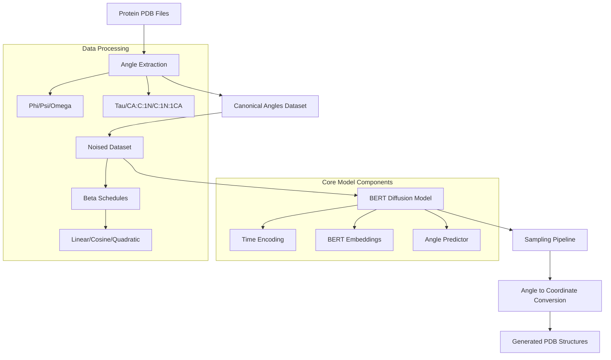

FoldingDiff is a **diffusion model for protein backbone generation** that leverages transformer architecture to create novel protein structures. This innovative approach uses **angle-based protein representation** combined with **BERT-style transformers** and **diffusion noise scheduling** to generate biologically plausible protein backbones.


## Architecture Overview

The system implements a sophisticated pipeline that transforms protein structures into angular representations, applies diffusion processes, and reconstructs 3D coordinates. The core architecture integrates multiple specialized components working in concert:



## Key Components

### Core Model Architecture
The system centers around `BertForDiffusion` [foldingdiff/modelling.py#L487], which combines HuggingFace's BERT architecture with diffusion-specific modifications:

- **Time Encoding**: Supports both Gaussian Fourier projections and sinusoidal embeddings for timesteps [foldingdiff/modelling.py#L42-L78]
- **Angular Loss Functions**: Specialized loss handling for angular data including radian-aware L1 and smooth L1 variants [foldingdiff/modelling.py#L224-L237]
- **Multi-head Architecture**: BERT-style transformer with attention mechanisms for sequence modeling

### Dataset System
The data pipeline supports multiple dataset variants with different feature sets [foldingdiff/datasets.py#L75-L566]:

| Dataset Type | Features | Angular Components | Use Case |
|--------------|----------|-------------------|----------|
| `CathCanonicalAnglesOnlyDataset` | 6 angles | All angular | Standard training |
| `CathCanonicalMinimalAnglesDataset` | 4 angles | All angular | Minimal reconstruction |
| `CathCanonicalCoordsDataset` | XYZ coordinates | Non-angular | Cartesian baseline |

### Angle Representation System
Proteins are represented using **canonical dihedral angles** [foldingdiff/angles_and_coords.py#L23-L27]:
- **Dihedral angles**: φ (phi), ψ (psi), ω (omega) - backbone torsion angles
- **Non-dihedral angles**: τ (tau), CA:C:1N, C:1N:1CA - geometric constraints
- **Coordinate conversion**: NERF (Neural Radiance Fields) based reconstruction from angles to 3D coordinates

### Diffusion Process
The system implements multiple **noise scheduling strategies** [foldingdiff/beta_schedules.py#L20-L41]:

- **Linear schedule**: Simple linear interpolation
- **Cosine schedule**: Cosine-based scheduling for better performance
- **Quadratic schedule**: Quadratic interpolation for different noise dynamics

## Project Structure

```
foldingdiff/
├── Core Modules
│   ├── modelling.py          # BERT diffusion model architecture
│   ├── datasets.py           # Dataset loading and processing
│   ├── sampling.py           # Generation and sampling pipeline
│   ├── angles_and_coords.py  # Angle-coordinate conversion
│   └── beta_schedules.py     # Noise scheduling functions
├── Analysis Tools
│   ├── lddt.py              # Local Distance Difference Test
│   ├── tmalign.py           # TM-score calculation
│   ├── custom_metrics.py    # Evaluation metrics
│   └── plotting.py          # Visualization utilities
└── Utilities
    ├── utils.py             # Helper functions
    ├── nerf.py              # Neural radiance fields
    └── vdw_clashes.py       # Van der Waals clash detection
```

## Key Features

### Pre-trained Models
The project provides **pre-trained models** on HuggingFace [README.md#L65-L82], enabling immediate use without training:

```python
from foldingdiff import modelling
from huggingface_hub import snapshot_download

# Load pre-trained model
model = modelling.BertForDiffusion.from_dir(
    snapshot_download("wukevin/foldingdiff_cath")
)
```

### Flexible Sampling
The sampling pipeline supports [foldingdiff/sampling.py#L135-L145]:
- **Variable length generation**: Generate proteins of different lengths
- **Batch processing**: Efficient generation of multiple structures
- **Configurable timesteps**: Control diffusion process granularity

### Evaluation Pipeline
Comprehensive evaluation includes [README.md#L139-L175]:
- **Self-consistency TM scores**: Measure structural stability
- **Inverse folding**: Test designability with ProteinMPNN and ESM-IF1
- **Structure prediction**: Validate with AlphaFold/OmegaFold

## Technical Highlights

> [!TIP]
> The architecture uses **angular representations** instead of Cartesian coordinates, which provides better invariance to rotation and translation while maintaining the essential geometric constraints of protein structures.

> [!TIP]
> The integration of **BERT transformers** with **diffusion models** creates a powerful combination that leverages both the sequence modeling capabilities of transformers and the generative quality of diffusion processes.

## Next Steps

To get started with FoldingDiff:

1. **Quick Start**: [Quick Start](2-quick-start) - Basic usage examples and immediate results
2. **Installation**: [Installation and Environment Setup](3-installation-and-environment-setup) - Detailed setup instructions
3. **Data Preparation**: [Downloading and Preparing Datasets](4-downloading-and-preparing-datasets) - Get training and test data
4. **Pre-trained Models**: [Using Pre-trained Models for Sampling](5-using-pre-trained-models-for-sampling) - Start generating immediately

For deeper understanding of the architecture, explore the **Deep Dive** section starting with [Diffusion Model Architecture and BERT Integration](6-diffusion-model-architecture-and-bert-integration).