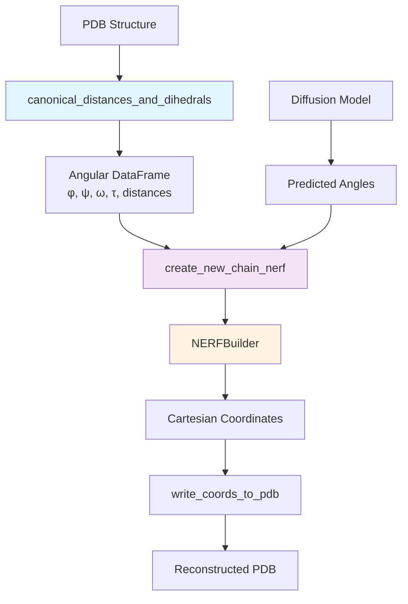

The Angle-to-Coordinate Conversion System is a critical component that transforms internal coordinate representations (angles and distances) into 3D Cartesian coordinates for protein structures. This system bridges the gap between the diffusion model's angular predictions and the physical protein geometry required for downstream analysis and visualization.

## Core Architecture

The conversion system operates through a two-stage pipeline: **extraction** of angular parameters from existing structures and **reconstruction** of coordinates from predicted angles. The system leverages the Natural Extension Reference Frame (NERF) algorithm, which iteratively builds protein backbones using geometric constraints.



## Angular Parameter Extraction

### Canonical Angles and Distances

The system defines two parameter sets for different use cases:

- **MINIMAL_ANGLES**: `["phi", "psi", "omega"]` - Essential backbone dihedral angles
- **EXHAUSTIVE_ANGLES**: `["phi", "psi", "omega", "tau", "CA:C:1N", "C:1N:1CA"]` - Complete geometric description

The `canonical_distances_and_dihedrals` function parses PDB files to extract these parameters using biotite's structure analysis capabilities [angles_and_coords.py#L30-L111](foldingdiff/angles_and_coords.py#L30-L111). It handles:

- **Dihedral angles**: φ (phi), ψ (psi), ω (omega) using `struc.dihedral_backbone()`
- **Bond angles**: τ (N-CA-C), CA:C:1N, C:1N:1CA using `struc.index_angle()`
- **Bond distances**: N:CA, CA:C, 0C:1N using `struc.index_distance()`

### Data Validation

The extraction process includes rigorous validation:

```python
# Angle range validation (-π to π)
for k, v in calc_angles.items():
    if not (np.nanmin(v) >= -np.pi and np.nanmax(v) <= np.pi):
        logging.warning(f"Illegal values for {k} in {fname} -- skipping")
        return None
```

> [!TIP]
> The system automatically pads inter-residue measurements (like 0C:1N distances) with null values to maintain consistent array dimensions with intra-residue measurements, ensuring compatibility with downstream processing.

## NERF-Based Coordinate Reconstruction

### NERF Algorithm Implementation

The NERF (Natural Extension Reference Frame) algorithm reconstructs protein coordinates by iteratively placing atoms using geometric constraints. The core `place_dihedral` function calculates the position of atom D given three preceding atoms (A, B, C) and specified bond parameters [nerf.py#L145-L206](foldingdiff/nerf.py#L145-L206):

```python
def place_dihedral(a, b, c, bond_angle, bond_length, torsion_angle):
    # Creates local coordinate system from a-b-c
    # Places d using bond length, angle, and torsion constraints
    bc = unit_vec(c - b)
    n = unit_vec(cross(ab, bc))
    nbc = cross(n, bc)
    # Transform to global coordinates
    d = m.dot([bond_length * cos/sin components])
    return d + c
```

### NERFBuilder Class

The `NERFBuilder` class orchestrates the reconstruction process [nerf.py#L27-L144](foldingdiff/nerf.py#L27-L144):

- **Initialization**: Accepts dihedral angles and optional bond parameters
- **Coordinate Building**: Iteratively places N-CA-C atoms for each residue
- **Centering**: Provides centered coordinates for consistent positioning

The reconstruction follows a specific atom placement sequence for each residue:

1. **N atom**: Uses C-N bond length/angle + ψ dihedral
2. **CA atom**: Uses N-CA bond length/angle + ω dihedral  
3. **C atom**: Uses CA-C bond length/angle + φ dihedral

### Integration Pipeline

The `create_new_chain_nerf` function serves as the main interface for coordinate reconstruction [angles_and_coords.py#L112-L186](foldingdiff/angles_and_coords.py#L112-L186):

```python
def create_new_chain_nerf(out_fname, dists_and_angles, angles_to_set=None, dists_to_set=None):
    # Auto-detect parameters if not specified
    # Validate required dihedrals (phi, psi, omega)
    # Map parameters to NERF builder kwargs
    nerf_builder = nerf.NERFBuilder(**nerf_build_kwargs)
    coords = nerf_builder.centered_cartesian_coords if center_coords else nerf_builder.cartesian_coords
    return write_coords_to_pdb(coords, out_fname)
```

## Sidechain Reconstruction

### Relative Positioning System

Beyond backbone reconstruction, the system supports sidechain attachment using a library-based approach [angles_and_coords.py#L301-L387](foldingdiff/angles_and_coords.py#L301-L387):

- **SideChainAtomRelative**: Named tuple defining relative geometry (bond_angle, bond_dist, dihedral_angle)
- **AA Library**: Pre-computed sidechain geometries for all 20 amino acids
- **Reconstruction**: Places sidechain atoms relative to backbone N-CA-C frame

The `add_sidechains_to_backbone` function grafts sidechains onto reconstructed backbones [angles_and_coords.py#L378-L435](foldingdiff/angles_and_coords.py#L378-L435):

```python
for rel_atom in aa_library[res_aa]:
    d = nerf.place_dihedral(a, b, c, rel_atom.bond_angle, rel_atom.bond_dist, rel_atom.dihedral_angle)
    # Create atom with proper residue and element information
```

## PDB Output Generation

### Structure Writing

The `write_coords_to_pdb` function converts NumPy coordinate arrays to standard PDB format [angles_and_coords.py#L187-L255](foldingdiff/angles_and_coords.py#L187-L255):

- **Atom Creation**: Generates N, CA, C atoms with proper metadata
- **Bond Assignment**: Creates peptide bond connectivity
- **File Output**: Uses biotite's PDBFile for standards compliance

### Output Validation

The system includes comprehensive validation:

```python
assert coords.shape == (int(dists_and_angles.shape[0] * 3), 3)
if np.any(np.isnan(coords)):
    logging.warning(f"Found NaN values, not writing pdb file {out_fname}")
    return ""
```

> [!TIP]
> The system uses cached properties for coordinate computation to avoid redundant calculations when multiple coordinate representations (centered vs. original) are needed for the same angular parameters.

## System Integration

The Angle-to-Coordinate Conversion System serves as the bridge between the diffusion model's angular predictions and downstream structural analysis tools. It enables:

- **Training Data Preparation**: Converting known structures to angular representations
- **Generation Output**: Transforming sampled angles into valid protein structures  
- **Evaluation Pipeline**: Providing coordinates for TM-score, lDDT, and other metrics
- **Visualization**: Generating PDB files for molecular visualization tools

This system ensures that the abstract angular representations produced by the diffusion model can be grounded in physically realistic 3D protein structures for comprehensive analysis and validation.

For understanding how these converted coordinates integrate with the broader protein generation pipeline, see [Protein Backbone Sampling Pipeline](15-protein-backbone-sampling-pipeline). For details on the angular representations used by the diffusion model, refer to [Angle-based Protein Representation](7-angle-based-protein-representation).