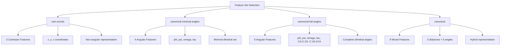
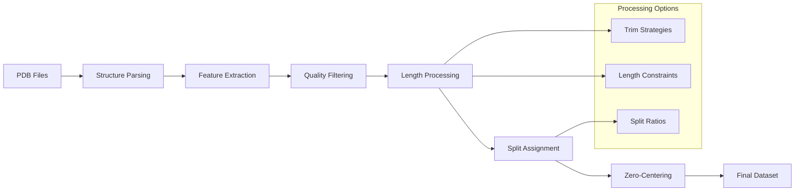

The foldingdiff framework supports multiple dataset variants and feature representations, each optimized for different aspects of protein structure generation. This comprehensive system allows researchers to choose the most appropriate representation for their specific use case, from minimal angle-based models to full Cartesian coordinate approaches.

## Feature Set Architecture

The framework implements a hierarchical feature set system with four primary variants, each defined by their angular composition and dimensional characteristics:

### Core Feature Definitions

The system defines four distinct feature sets through the `FEATURE_SET_NAMES_TO_ANGULARITY` mapping in [`datasets.py`](foldingdiff/datasets.py#L25-L34):

| Feature Set | Dimensionality | Angular Features | Non-angular Features | Use Case |
|-------------|----------------|------------------|---------------------|----------|
| `cart-coords` | 3 | 0 | 3 | Direct coordinate prediction |
| `canonical-minimal-angles` | 4 | 4 | 0 | Basic backbone geometry |
| `canonical-full-angles` | 6 | 6 | 0 | Complete angular representation |
| `canonical` | 9 | 6 | 3 | Hybrid distance-angle model |

The angularity mapping precisely defines which features require circular statistics handling during zero-centering and loss computation: `[False, False, False, True, True, True, True, True, True]` for the canonical set, where the first three are distance features and the remaining six are angular features.

### Detailed Feature Composition

**Canonical Full Angles (`canonical-full-angles`)**: This represents the most comprehensive angular representation, including:
- **Backbone dihedrals**: φ (phi), ψ (psi), ω (omega) - defining the protein backbone conformation
- **Internal angles**: τ (tau) - N-CA-C bond angle
- **Inter-residue angles**: CA:C:1N, C:1N:1CA - capturing geometric relationships between consecutive residues

**Canonical Minimal Angles (`canonical-minimal-angles`)**: A focused subset containing only the essential backbone dihedrals (φ, ψ, ω, τ), suitable for rapid prototyping and reduced computational overhead.

**Cartesian Coordinates (`cart-coords`)**: Direct 3D coordinate representation using backbone CA atom positions, bypassing angular transformations entirely.

**Canonical Hybrid (`canonical`)**: Combines distance measurements (0C:1N, N:CA, CA:C) with the full angular set, providing both local and geometric constraints.

## Dataset Processing Pipeline

The dataset loading system implements a sophisticated processing pipeline with multiple configuration options:

### Trim Strategies

The system supports three sequence length handling strategies defined in [`datasets.py`](foldingdiff/datasets.py#L24):

| Strategy | Behavior | Best For |
|----------|----------|-----------|
| `leftalign` | Pads sequences to max length with left alignment | Preserving N-terminal context |
| `randomcrop` | Randomly crops sequences to target length | Data augmentation |
| `discard` | Removes sequences exceeding max length | Quality control |

### Dataset Sources

The framework supports multiple protein structure databases:

- **CATH**: Curated structural classification database with domain-level annotations
- **AlphaFold**: Comprehensive predicted structure database covering the proteome
- **Custom directories**: User-provided PDB files for specialized applications

Each source undergoes the same featurization pipeline, ensuring consistent representation across different data origins.

## Configuration Variants

The system provides pre-configured dataset variants optimized for different experimental scenarios:

### Research-Grade Configurations

**Full Angles Model** ([`cath_full_angles.json`](config_jsons/cath_full_angles.json#L1)): Uses the canonical-full-angles feature set with 1000 timesteps and linear variance scheduling. This configuration represents the standard research setup with comprehensive angular representation.

**Cosine Schedule Variant** ([`cath_full_angles_cosine.json`](config_jsons/cath_full_angles_cosine.json#L1)): Identical to the full angles model but employs cosine variance scheduling, which can improve training stability and generation quality.

### Cartesian Coordinate Approach

**Raw Coordinates Model** ([`cath_raw_coordinates.json`](config_jsons/cath_raw_coordinates.json#L1)): Implements direct coordinate prediction using the cart-coords feature set with cosine scheduling. This approach bypasses angular transformations entirely, suitable for applications requiring precise spatial positioning.

### Development and Testing

**Mini Model** ([`mini_model.json`](config_jsons/mini_model.json#L1)): A lightweight configuration for rapid development and testing, featuring reduced model dimensions (6 layers, 192 hidden size) and shorter training duration (20 epochs). This variant maintains the full angular feature set while significantly reducing computational requirements.

## Feature Processing and Normalization

### Zero-Centering with Circular Statistics

The system implements sophisticated zero-centering that respects the circular nature of angular features. When `zero_center: true` is enabled, the system:

1. Computes means for each feature using `wrapped_mean` for angular features
2. Subtracts means with appropriate modulo operations for angular features
3. Preserves linear scaling for distance features

This approach is implemented in the `CathCanonicalAnglesDataset` class where angular features are identified using the `FEATURE_SET_NAMES_TO_ANGULARITY` mapping and processed accordingly.

### Quality Control and Filtering

The dataset pipeline includes multiple quality control mechanisms:

- **Structure validation**: Filters malformed PDB files and structures with invalid angle ranges
- **Length constraints**: Enforces minimum and maximum sequence length requirements
- **Value range validation**: Ensures all angular features remain within [-π, π] bounds
- **Missing data handling**: Replaces NaN values with appropriate defaults

## Usage Integration

Dataset variants are seamlessly integrated with the training and sampling pipelines through the configuration system. The `angles_definitions` parameter in each configuration file specifies which feature set to use, automatically configuring the appropriate model architecture and processing pipeline.

> [!TIP]
> The choice of feature set significantly impacts both model performance and computational requirements. Angular representations (`canonical-full-angles`) are more parameter-efficient but require careful handling of circular statistics, while Cartesian coordinates (`cart-coords`) are computationally heavier but avoid angular complexities.

> [!TIP]
> For new applications, start with the `canonical-minimal-angles` feature set to establish baseline performance before progressing to more complex representations. This incremental approach allows for systematic evaluation of feature importance.

## Next Steps

To understand how these dataset variants integrate with the model architecture, see [Diffusion Model Architecture and BERT Integration](6-diffusion-model-architecture-and-bert-integration). For details on angular feature computation and coordinate conversion, refer to [Angle-to-Coordinate Conversion System](10-angle-to-coordinate-conversion-system).