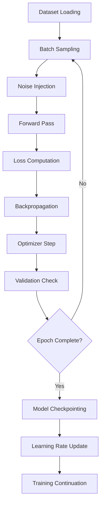

The Lightning Training Pipeline in FoldingDiff provides a structured framework for training diffusion and autoregressive models on protein angle data using PyTorch Lightning. This implementation abstracts away the complexity of training loops, optimization, and validation while maintaining flexibility for different training configurations.

## Core Lightning Module Architecture

The training pipeline centers around two main Lightning modules that inherit from the BERT-based diffusion models:

### BertForDiffusion Lightning Module

The `BertForDiffusion` class extends both `BertForDiffusionBase` and `pl.LightningModule` to provide a complete training interface for diffusion models [foldingdiff/modelling.py#L487-L490](foldingdiff/modelling.py#L487-490). Key initialization parameters include:

- **Learning Rate**: Default `5e-5` with configurable scheduler support
- **Loss Functions**: Support for `l1` and `smooth_l1` losses with angular variants
- **Regularization**: L1 and L2 regularization terms with configurable weights
- **Pairwise Distance Loss**: Optional additional loss term for structural constraints
- **Training Configuration**: Epoch count, steps per epoch, and learning rate scheduling

```python
def __init__(
    self,
    lr: float = 5e-5,
    loss: Union[Callable, LOSS_KEYS] = "smooth_l1",
    use_pairwise_dist_loss: Union[float, Tuple[float, float, int]] = 0.0,
    l2: float = 0.0,
    l1: float = 0.0,
    circle_reg: float = 0.0,
    epochs: int = 1,
    steps_per_epoch: int = 250,
    lr_scheduler: LR_SCHEDULE = None,
    write_preds_to_dir: Optional[str] = None,
    **kwargs,
):
```

### BertForAutoregressive Lightning Module

The autoregressive variant `BertForAutoregressive` follows a similar pattern but is specifically designed for sequential angle prediction tasks [foldingdiff/modelling.py#L896-L901](foldingdiff/modelling.py#L896-901). It implements causal language modeling objectives for protein structure generation.

## Training Pipeline Components

### Loss Computation System

The training pipeline uses a sophisticated loss computation system that handles both angular and non-angular features differently:

```python
def _get_loss_terms(self, batch, write_preds: Optional[str] = None) -> List[torch.Tensor]:
    """
    Returns the loss terms for the model. Length of the returned list
    is equivalent to the number of features we are fitting to.
    """
    known_noise = batch["known_noise"]
    predicted_noise = self.forward(
        batch["corrupted"],
        batch["t"],
        attention_mask=batch["attn_mask"],
        position_ids=batch["position_ids"],
    )
```

The system automatically applies appropriate loss functions based on feature angularity, using angular variants of standard losses for dihedral angles and standard losses for non-angular features [foldingdiff/modelling.py#L553-L580](foldingdiff/modelling.py#L553-580).

### Training Step Implementation

Each training step processes a batch through the following pipeline:

1. **Forward Pass**: Generate noise predictions for corrupted angles
2. **Loss Calculation**: Compute feature-specific loss terms
3. **Regularization**: Apply L1/L2 penalties if configured
4. **Logging**: Record detailed loss metrics for monitoring

```python
def training_step(self, batch, batch_idx):
    """
    Training step, runs once per batch
    """
    loss_terms = self._get_loss_terms(batch)
    avg_loss = torch.mean(loss_terms)

    # L1 loss implementation
    if self.l1_lambda > 0:
        l1_penalty = sum(torch.linalg.norm(p, 1) for p in self.parameters())
        avg_loss += self.l1_lambda * l1_penalty

    # Detailed logging of all loss components
    pseudo_ft_names = (
        (self.ft_names + ["pairwise_dist_loss"])
        if self.use_pairwise_dist_loss
        else self.ft_names
    )
    loss_dict = {
        f"train_loss_{val_name}": val
        for val_name, val in zip(pseudo_ft_names, loss_terms)
    }
    loss_dict["train_loss"] = avg_loss
    self.log_dict(loss_dict)

    return avg_loss
```

### Validation Pipeline

The validation step mirrors the training pipeline but with gradient disabled and optional prediction writing for analysis [foldingdiff/modelling.py#L720-L751](foldingdiff/modelling.py#L720-751):

```python
def validation_step(self, batch, batch_idx) -> Dict[str, torch.Tensor]:
    """
    Validation step
    """
    with torch.no_grad():
        loss_terms = self._get_loss_terms(
            batch,
            write_preds=os.path.join(
                self.write_preds_to_dir, f"{self.write_preds_counter}_preds.json"
            )
            if self.write_preds_to_dir
            else None,
        )
        self.write_preds_counter += 1
    # ... loss computation and logging
```

## Optimizer Configuration

The training pipeline supports multiple optimization strategies through the `configure_optimizers` method [foldingdiff/modelling.py#L762-L804](foldingdiff/modelling.py#L762-804):

### Base Optimizer
- **AdamW**: Default optimizer with configurable learning rate and weight decay
- **Weight Decay**: Applied through L2 regularization parameter

### Learning Rate Schedulers

Two main scheduler options are supported:

| Scheduler | Configuration | Use Case |
|-----------|---------------|----------|
| **OneCycleLR** | `max_lr=1e-2`, frequency per step | General training with cyclical learning rates |
| **LinearWarmup** | 10% warmup steps, frequency per epoch | Transformer-style training with gradual warmup |

```python
if self.lr_scheduler == "OneCycleLR":
    retval["lr_scheduler"] = {
        "scheduler": torch.optim.lr_scheduler.OneCycleLR(
            optim,
            max_lr=1e-2,
            epochs=self.epochs,
            steps_per_epoch=self.steps_per_epoch,
        ),
        "monitor": "val_loss",
        "frequency": 1,
        "interval": "step",
    }
elif self.lr_scheduler == "LinearWarmup":
    warmup_steps = int(self.epochs * 0.1)
    retval["lr_scheduler"] = {
        "scheduler": get_linear_schedule_with_warmup(
            optim,
            num_warmup_steps=warmup_steps,
            num_training_steps=self.epochs,
        ),
        "frequency": 1,
        "interval": "epoch",
    }
```

## Dataset Integration

The training pipeline seamlessly integrates with the dataset classes from `foldingdiff.datasets`:

### Noise Dataset Integration
- **NoisedAnglesDataset**: Adds controlled noise to training data following beta schedules
- **Beta Schedule Support**: Linear, cosine, and quadratic variance schedules [foldingdiff/beta_schedules.py#L20-L41](foldingdiff/beta_schedules.py#L20-41)
- **Angular Variance**: Separate variance control for angular vs non-angular features

### Autoregressive Dataset Support
- **AutoregressiveCausalDataset**: Provides causal language modeling format for sequential prediction
- **Mask Generation**: Automatic creation of causal attention masks for sequential training

## Training Workflow



## Monitoring and Logging

The pipeline provides comprehensive logging capabilities:

### Training Metrics
- **Feature-specific Losses**: Individual loss tracking for each angular feature
- **Regularization Terms**: Separate logging for L1/L2 penalties
- **Timing Information**: Epoch duration and processing speed metrics

### Validation Metrics
- **Per-feature Validation Losses**: Detailed validation loss breakdown
- **Prediction Export**: Optional saving of model predictions for analysis
- **Distributed Training Support**: Proper handling of multi-GPU scenarios

## Configuration Management

Training configurations are managed through JSON files in the `hyperparam_jsons/` directory, enabling systematic hyperparameter sweeps. The `scripts/scripts_from_hyper_json.py` utility provides automated script generation for different parameter combinations [scripts/scripts_from_hyper_json.py#L1-L4](scripts/scripts_from_hyper_json.py#L1-4).

> [!TIP]
> The Lightning training pipeline automatically handles distributed training scenarios, including proper gradient synchronization and loss aggregation across multiple GPUs. This enables seamless scaling from single-GPU development to multi-GPU training without code changes.

> [!TIP]
> For optimal performance with angular data, ensure that the `ft_is_angular` parameter correctly identifies which features are angular (True) versus non-angular (False). This enables the automatic selection of appropriate loss functions and variance schedules for each feature type.

## Next Steps

To understand the complete training ecosystem, explore:
- [Loss Functions for Angular Data](12-loss-functions-for-angular-data) - Detailed explanation of angular loss implementations
- [Configuration Management](14-configuration-management) - Comprehensive guide to training configuration
- [Time Encoding and Noise Schedules](8-time-encoding-and-noise-schedules) - Understanding the diffusion process components