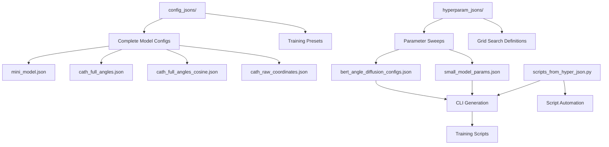

The FoldingDiff repository employs a sophisticated configuration management system that separates model architectures, training parameters, and hyperparameter sweeps into distinct JSON-based configuration files. This approach enables reproducible experiments, systematic hyperparameter optimization, and flexible model configuration across different use cases.

## Configuration Architecture

The configuration system is organized into two primary directories: `config_jsons/` for complete model configurations and `hyperparam_jsons/` for hyperparameter sweep definitions. This separation allows researchers to maintain stable baseline configurations while exploring parameter variations systematically.



## Model Configuration Files

The `config_jsons/` directory contains complete configuration files that define all aspects of model architecture, training parameters, and data processing. Each configuration file represents a self-contained experiment setup.

### Core Configuration Parameters

Every model configuration follows a standardized structure with these key parameter categories:

**Data Configuration:**
- `angles_definitions`: Specifies the protein representation scheme (e.g., "canonical-full-angles", "cart-coords")
- `max_seq_len` and `min_seq_len`: Define sequence length bounds for training
- `trim_strategy`: Determines how sequences longer than `max_seq_len` are handled ("discard" or "randomcrop")
- `zero_center`: Boolean flag for angle centering

**Diffusion Parameters:**
- `timesteps`: Number of diffusion steps (typically 250-1000)
- `variance_schedule`: Noise schedule type ("linear", "cosine", "quadratic")
- `variance_scale`: Scaling factor for noise variance
- `time_encoding`: Time embedding method ("gaussian_fourier")

**Model Architecture:**
- `num_hidden_layers`: Number of transformer layers
- `hidden_size`: Dimension of hidden representations
- `intermediate_size`: Feed-forward network dimension
- `num_heads`: Multi-head attention heads
- `position_embedding_type`: Position encoding strategy ("relative_key")
- `decoder`: Output decoder type ("mlp")

**Training Configuration:**
- `lr`: Learning rate (typically 5e-5)
- `batch_size`: Training batch size
- `gradient_clip`: Gradient clipping threshold
- `loss`: Loss function type ("smooth_l1")
- `lr_scheduler`: Learning rate scheduler ("LinearWarmup")
- `max_epochs` and `min_epochs`: Training epoch bounds
- `dropout_p`: Dropout probability

### Configuration Variants

The repository provides several pre-configured variants optimized for different scenarios:

**Mini Model Configuration** ([`mini_model.json`](config_jsons/mini_model.json#L1-L31)):
- Designed for rapid prototyping and testing
- Reduced architecture: 6 layers, 192 hidden size, 6 attention heads
- Lower timestep count (250) for faster training
- Smaller batch size (128) for memory efficiency

**Full CATH Configuration** ([`cath_full_angles.json`](config_jsons/cath_full_angles.json#L1-L31)):
- Production-ready model with full architecture
- 12 transformer layers, 384 hidden size, 12 attention heads
- 1000 diffusion timesteps for high-quality generation
- Uses linear variance schedule

**Cosine Schedule Configuration** ([`cath_full_angles_cosine.json`](config_jsons/cath_full_angles_cosine.json#L1-L30)):
- Identical to full CATH configuration but with cosine variance schedule
- Cosine schedule often provides better training stability
- Maintains same architectural parameters for direct comparison

**Coordinate-based Configuration** ([`cath_raw_coordinates.json`](config_jsons/cath_raw_coordinates.json#L1-L30)):
- Uses Cartesian coordinates instead of angular representation
- Sets `angles_definitions` to "cart-coords"
- Enables direct comparison between angular and coordinate approaches

## Hyperparameter Sweep System

The `hyperparam_jsons/` directory contains parameter sweep definitions that enable systematic exploration of hyperparameter combinations. These files define parameter grids for automated experimentation.

### Sweep Configuration Structure

Each sweep file defines arrays of values for different parameters, allowing the system to generate all possible combinations:

**BERT Angle Diffusion Sweep** ([`bert_angle_diffusion_configs.json`](hyperparam_jsons/bert_angle_diffusion_configs.json#L1-L25)):
```json
{
    "timesteps": [250, 500, 750, 1000],
    "variance_schedule": ["linear", "cosine", "quadratic"],
    "batch_size": [128, 64],
    "lr": [1e-3, 1e-4],
    "gradient_clip": [0.0, 0.5]
}
```

**Small Model Parameter Sweep** ([`small_model_params.json`](hyperparam_jsons/small_model_params.json#L1-L25)):
```json
{
    "timesteps": [500, 1000],
    "variance_schedule": ["linear", "cosine", "quadratic"],
    "num_hidden_layers": [6, 8, 10],
    "lr": [0.001, 0.0001],
    "batch_size": [64, 128, 256]
}
```

## Automated Script Generation

The repository includes a sophisticated script generation system ([`scripts_from_hyper_json.py`](scripts/scripts_from_hyper_json.py#L1-L151)) that converts hyperparameter sweep definitions into executable training scripts.

### Parameter Processing Functions

The system provides two key utility functions for parameter handling:

**CLI Argument Conversion** ([`params_to_cli_args`](scripts/scripts_from_hyper_json.py#L16-L31)):
```python
def params_to_cli_args(param_dict: Dict[str, Any]) -> str:
    """Format the params to CLI arguments"""
    tokens = []
    for k, v in param_dict.items():
        prefix = "-" if len(k) == 1 else "--"
        if isinstance(v, bool):  # For booleans, treat as flags
            if v:
                tokens.append(f"{prefix}{k}")
        else:
            tokens.append(f"{prefix}{k} {v}")
    # Manually add this since we can't provide this in the json
    tokens.append(f"--outdir {params_to_filename(param_dict)}")
    retval = " ".join(tokens)
    return retval
```

**Filename Generation** ([`params_to_filename`](scripts/scripts_from_hyper_json.py#L32-L52)):
```python
def params_to_filename(
    param_dict: Dict[str, Any],
    blacklist_tokens: Collection[str] = {"model", "blacklist", "config", "pretrained"},
) -> str:
    """Format the params (in key-value pairs (param, arg)) into a filename"""
    tokens = []
    for k, v in param_dict.items():
        if k in blacklist_tokens:
            logging.warning(f"Excluding {k}: {v} from generated fname")
            continue
        assert " " not in k, f"Parameter cannot have space: {k}"
        if isinstance(v, str) and " " in v:  # Replace spaces in value
            v = v.replace(" ", "_")
        # This is (value, key) for historical readability reasons
        tokens.append(f"{v}_{k}")
    return "_".join(tokens)
```

### Script Generation Pipeline

The main generation function ([`main`](scripts/scripts_from_hyper_json.py#L85-L110)) orchestrates the creation of training scripts for all parameter combinations:

1. **Parameter Combination Generation**: Uses `itertools.product` to create all possible parameter combinations from the sweep definition
2. **Script Template Integration**: Incorporates optional template scripts for consistent initialization
3. **Output Directory Management**: Automatically creates organized output directories based on parameter combinations
4. **CLI Argument Formatting**: Converts parameter dictionaries to command-line arguments for execution

## Configuration Best Practices

### Parameter Selection Guidelines

**Model Architecture**:
- Use smaller models (6 layers, 192 hidden) for development and testing
- Scale to full models (12 layers, 384 hidden) for production training
- Adjust `num_hidden_layers` and `hidden_size` proportionally to maintain model capacity

**Training Stability**:
- Start with cosine variance schedule for better convergence
- Use gradient clipping (0.5-1.0) to prevent training instability
- Implement learning rate warmup with `LinearWarmup` scheduler

**Data Processing**:
- Choose `trim_strategy` based on dataset characteristics:
  - "discard" for maintaining sequence integrity
  - "randomcrop" for data augmentation
- Set appropriate `max_seq_len` based on available GPU memory

### Hyperparameter Sweep Strategy

**Systematic Exploration**:
1. **Coarse Grid**: Start with broad parameter ranges (learning rates, batch sizes)
2. **Focused Refinement**: Narrow ranges based on initial results
3. **Final Tuning**: Fine-tune around best-performing parameter combinations

**Efficiency Considerations**:
- Use smaller timesteps (250-500) for initial sweeps
- Increase to 1000 timesteps for final model training
- Leverage the mini model configuration for rapid iteration

## Integration with Training Pipeline

The configuration system seamlessly integrates with the Lightning training pipeline described in the [Lightning Training Pipeline](13-lightning-training-pipeline) documentation. Configuration files are loaded and processed using utility functions like [`update_dict_nonnull`](foldingdiff/utils.py#L124-L135) for parameter merging and validation.

The modular configuration design enables:
- **Reproducible Research**: Complete experiment specifications stored in version-controlled JSON files
- **Systematic Optimization**: Automated hyperparameter exploration through sweep generation
- **Flexible Experimentation**: Easy modification of individual parameters without code changes
- **Scalable Training**: Configuration variants for different computational budgets

For practical implementation details and training execution, refer to the [Lightning Training Pipeline](13-lightning-training-pipeline) documentation, which demonstrates how these configurations are integrated into the complete training workflow.