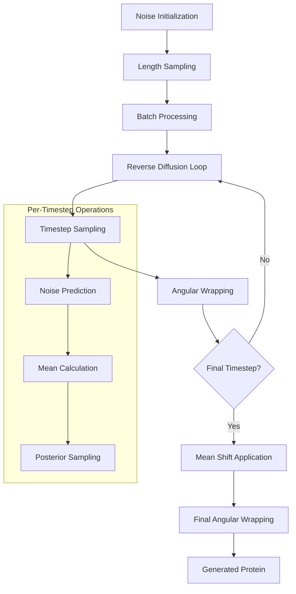

The protein backbone sampling pipeline in FoldingDiff implements a sophisticated diffusion-based approach for generating novel protein structures by iteratively denoising angular representations. This pipeline transforms random noise into biologically plausible protein backbone conformations through a carefully orchestrated sequence of sampling steps.

## Core Sampling Architecture

The sampling process centers around two fundamental functions that implement the reverse diffusion process: `p_sample` for individual timestep sampling and `p_sample_loop` for the complete generation sequence [sampling.py#L28-L91](foldingdiff/sampling.py#L28-L91).

### Single Timestep Sampling

The `p_sample` function implements the core reverse diffusion step using the mathematical framework from Equation 11 of the original diffusion paper:

```python
# Calculate alphas and betas from variance schedule
alpha_beta_values = beta_schedules.compute_alphas(betas)
sqrt_recip_alphas = 1.0 / torch.sqrt(alpha_beta_values["alphas"])

# Model mean calculation using noise predictor
model_mean = sqrt_recip_alphas_t * (
    x - betas_t * model(x, t, attention_mask=attn_mask) / sqrt_one_minus_alphas_cumprod_t
)
```

This implementation follows the standard DDPM formulation where the model predicts noise rather than the clean data directly, with attention masks ensuring proper handling of variable sequence lengths [sampling.py#L27-L77](foldingdiff/sampling.py#L27-L77).

### Complete Sampling Loop

The `p_sample_loop` function orchestrates the full reverse diffusion process, iteratively applying `p_sample` across all timesteps in reverse order. A critical feature is the angular wrapping mechanism that maintains valid angular ranges throughout the sampling process:

```python
# Wrap angular features to maintain [-π, π] range
if isinstance(is_angle, bool):
    if is_angle:
        img = utils.modulo_with_wrapped_range(
            img, range_min=-torch.pi, range_max=torch.pi
        )
```

This wrapping ensures that generated angles remain within the mathematically valid range for dihedral angles, preventing sampling artifacts that could arise from boundary violations [sampling.py#L91-L134](foldingdiff/sampling.py#L91-L134).

## Sampling Pipeline Flow



## Noise Generation and Variance Scheduling

The pipeline employs sophisticated noise generation strategies that adapt to the angular nature of protein representations. The `NoisedAnglesDataset.sample_noise` method implements variance scaling based on feature type:

```python
# Scale noise by angular/non-angular variance
for j in range(noise.shape[-1]):
    s = (
        self.angular_var_scale
        if self.dset.feature_is_angular[self.dset_key][j]
        else self.nonangular_var_scale
    )
    noise[..., j] *= s
```

This adaptive scaling ensures appropriate noise levels for different feature types, with angular features receiving specialized treatment to maintain their circular properties [datasets.py#L772-L795](foldingdiff/datasets.py#L772-L795).

### Beta Schedule Computation

The variance schedule is computed through the `beta_schedules.compute_alphas` function, which generates all necessary terms for the diffusion process:

- **alphas**: `1.0 - betas`
- **alphas_cumprod**: Cumulative product of alphas
- **posterior_variance**: Computed for sampling variance
- **sqrt_alphas_cumprod**: For forward process scaling

These terms enable both the forward noising process and the reverse sampling process with mathematically consistent transformations [beta_schedules.py#L45-L64](foldingdiff/beta_schedules.py#L45-L64).

## High-Level Sampling Interface

The `sample` function provides the primary interface for protein generation, supporting both single-length and sweep sampling across multiple sequence lengths:

```python
def sample(
    model: nn.Module,
    train_dset: dsets.NoisedAnglesDataset,
    n: int = 10,
    sweep_lengths: Optional[Tuple[int, int]] = (50, 128),
    batch_size: int = 512,
    feature_key: str = "angles",
    disable_pbar: bool = False,
    trim_to_length: bool = True,
) -> List[np.ndarray]:
```

This function orchestrates the entire sampling workflow, from length sampling through batch processing to final result compilation [sampling.py#L135-L201](foldingdiff/sampling.py#L135-L201).

### Batch Processing and Memory Optimization

The pipeline implements intelligent batch processing with optional length trimming to optimize memory usage:

```python
# Trim padding regions to reduce memory
if trim_to_length:
    noise = noise[:, : max(this_lengths), :]
```

This optimization is particularly important for generating long protein sequences where memory constraints could otherwise limit sampling capabilities [sampling.py#L175-L179](foldingdiff/sampling.py#L175-L179).

## Angular Range Management

A critical aspect of the pipeline is the management of angular ranges throughout the sampling process. The `utils.modulo_with_wrapped_range` function handles the circular nature of angular data:

```python
def modulo_with_wrapped_range(
    vals, range_min: float = -np.pi, range_max: float = np.pi
):
    # Shift to [0, range_max-range_min), perform modulo, shift back
    top_end = range_max - range_min
    vals_shifted = vals - range_min
    vals_shifted_mod = vals_shifted % top_end
    retval = vals_shifted_mod + range_min
    return retval
```

This implementation properly handles negative range bounds and ensures that all angular values remain within the valid [-π, π] range throughout the sampling process [utils.py#L87-L110](foldingdiff/utils.py#L87-L110).

## Post-Processing and Mean Adjustment

After sampling completion, the pipeline applies mean adjustments to restore the original feature distributions:

```python
if train_dset.dset.get_masked_means() is not None:
    retval = [s + train_dset.dset.get_masked_means() for s in retval]
    # Re-wrap after shifting
    angular_idx = np.where(train_dset.dset.feature_is_angular[feature_key])[0]
    for s in retval:
        s[..., angular_idx] = utils.modulo_with_wrapped_range(
            s[..., angular_idx], range_min=-np.pi, range_max=np.pi
        )
```

This two-step process ensures that generated proteins maintain the statistical properties of the training distribution while respecting angular constraints [sampling.py#L201-L218](foldingdiff/sampling.py#L201-L218).

## Integration with Coordinate Conversion

The generated angular representations can be converted to Cartesian coordinates through the angle-to-coordinate conversion system, enabling downstream structural analysis and visualization. The `angles_and_coords.py` module provides the necessary tools for this transformation, including NERF-based coordinate reconstruction [angles_and_coords.py#L112-L186](foldingdiff/angles_and_coords.py#L112-L186).

> [!TIP]
> The sampling pipeline's strength lies in its careful handling of angular data throughout the diffusion process, maintaining mathematically valid ranges while enabling efficient batch processing and memory optimization.

> [!TIP]
> The modular design allows for easy integration with different variance schedules (linear, cosine, quadratic) and feature sets, providing flexibility for various protein generation scenarios.

## Next Steps

For comprehensive understanding of the sampling pipeline, explore the [Autoregressive Generation](16-autoregressive-generation) approach for sequential protein generation, or examine the [Visualization and Analysis Tools](17-visualization-and-analysis-tools) to analyze generated structures. The [Angle-based Protein Representation](7-angle-based-protein-representation) page provides deeper insight into the angular features used throughout this pipeline.