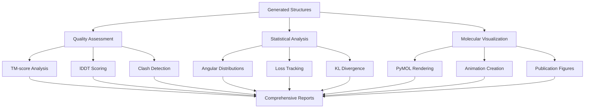

The foldingdiff repository provides a comprehensive suite of visualization and analysis tools designed to evaluate and interpret protein structure generation results. These tools span from molecular visualization to statistical analysis, enabling researchers to assess the quality and characteristics of generated protein structures.

## Molecular Visualization Tools

### PyMOL Integration for Structure Rendering

The `pymol_vis.py` module provides sophisticated molecular visualization capabilities through PyMOL integration, enabling high-quality rendering of protein structures for publication and analysis [foldingdiff/pymol_vis.py](foldingdiff/pymol_vis.py).

**Key Functions:**
- **Individual Structure Rendering**: The `pdb2png()` function converts PDB files to high-resolution PNG images with customizable visualization options including secondary structure annotation and rainbow coloring schemes [foldingdiff/pymol_vis.py#L50-L67].
- **Batch Processing**: `pdb2png_dir_from_args()` enables parallel processing of entire directories of PDB files, significantly accelerating visualization workflows for large datasets [foldingdiff/pymol_vis.py#L74-L84].
- **Animation Creation**: The `images_to_gif()` function creates animated GIFs from series of structure images, perfect for visualizing conformational changes or generation processes [foldingdiff/pymol_vis.py#L93-L112].

**Command Line Usage:**
```bash
# Convert single PDB to PNG
python pymol_vis.py pdb2png -i structure.pdb -o structure.png --psea

# Batch convert directory
python pymol_vis.py pdb2png_dir -i pdbs/ -o images/

# Create animation from series
python pymol_vis.py images_to_gif -i images/*.png -o animation.gif
```

> [!TIP]
> The module supports both secondary structure annotation via PSEA and generation of PSE session files for further interactive analysis in PyMOL.

## Statistical Analysis and Plotting

### Joint Distribution Analysis

The `plotting.py` module provides comprehensive statistical visualization tools for analyzing angular distributions and training metrics [foldingdiff/plotting.py](foldingdiff/plotting.py).

**Ramachandran Plot Analysis:**
The `plot_joint_kde()` function creates kernel density estimation plots specifically designed for analyzing backbone angle distributions, making it ideal for Ramachandran plot analysis [foldingdiff/plotting.py#L26-L45]:

```python
# Create Ramachandran plot
plot_joint_kde(phi_angles, psi_angles, 
               xlabel="Phi (φ)", ylabel="Psi (ψ)",
               fname="ramachandran.pdf")
```

**Training Progress Visualization:**
The `plot_losses()` function provides comprehensive training loss visualization with support for multiple loss types and automatic median calculation for epochs with multiple recordings [foldingdiff/plotting.py#L93-L125].

### Custom Metrics for Distribution Analysis

The `custom_metrics.py` module implements specialized metrics for comparing empirical distributions, particularly useful for evaluating noise schedules and generation quality [foldingdiff/custom_metrics.py](foldingdiff/custom_metrics.py).

**Kullback-Leibler Divergence Analysis:**
- `kl_from_empirical()` computes KL divergence between empirical distributions with configurable binning and pseudocount options [foldingdiff/custom_metrics.py#L15-L38].
- `kl_from_dset()` performs comprehensive KL analysis across timesteps for diffusion processes [foldingdiff/custom_metrics.py#L66-L84].

> [!TIP]
> The wrapped mean function handles angular data correctly by implementing circular statistics for [-π, π] ranges.

## Structure Quality Assessment

### TM-score Analysis

The `tmalign.py` module provides comprehensive structure similarity assessment using the TM-align algorithm [foldingdiff/tmalign.py](foldingdiff/tmalign.py).

**Core Capabilities:**
- **Pairwise Comparison**: `run_tmalign()` executes TM-align between query and reference structures with fast mode option for large-scale analyses [foldingdiff/tmalign.py#L22-L55].
- **Batch Processing**: `max_tm_across_refs()` enables parallel comparison against multiple reference structures, returning the best match and corresponding score [foldingdiff/tmalign.py#L57-L85].

**Usage Example:**
```python
# Single comparison
score = run_tmalign("generated.pdb", "reference.pdb", fast=True)

# Find best match among references
best_score, best_ref = max_tm_across_refs("query.pdb", references_list)
```

### lDDT Scoring

The `lddt.py` module implements local Distance Difference Test (lDDT) scoring through Docker-based OpenStructure integration [foldingdiff/lddt.py](foldingdiff/lddt.py).

**Features:**
- Containerized computation ensures reproducible results using the specified Docker image [foldingdiff/lddt.py#L26-L27].
- `lddt_sampled_folded()` provides batch analysis comparing generated structures against folded variants [foldingdiff/lddt.py#L59-L102].

### Van der Waals Clash Detection

The `vdw_clashes.py` module identifies and quantifies steric clashes in protein structures using established van der Waals radii [foldingdiff/vdw_clashes.py](foldingdiff/vdw_clashes.py).

**Implementation Details:**
- Uses scientifically validated van der Waals radii from published literature [foldingdiff/vdw_clashes.py#L9-L13].
- Implements configurable clash detection with adjustable alpha parameter for distance thresholds [foldingdiff/vdw_clashes.py#L35-L50].

## Analysis Workflow Integration

### Jupyter Notebooks for Comprehensive Analysis

The repository includes specialized Jupyter notebooks that demonstrate integrated analysis workflows:

| Notebook | Purpose | Key Analyses |
|----------|---------|--------------|
| `git_umap.ipynb` | Dimensionality reduction | UMAP visualization of structure space |
| `scissor_effect_plots.ipynb` | Structural effects | Analysis of local modifications |
| `sctm_by_len.ipynb` | Length-dependent analysis | Self-consistency TM-score by protein length |
| `generation_time.ipynb` | Performance metrics | Generation time analysis |

### Visualization Pipeline Architecture



## Best Practices for Analysis

### Reproducible Visualization

- Use the standardized plot directory defined in `plotting.py` for consistent output organization [foldingdiff/plotting.py#L21].
- Leverage parallel processing capabilities for large-scale analyses to ensure efficient computation.
- Document analysis parameters and random seeds for reproducible results.

### Quality Assessment Pipeline

1. **Initial Screening**: Use van der Waals clash detection to identify problematic structures [foldingdiff/vdw_clashes.py].
2. **Similarity Assessment**: Apply TM-score and lDDT analysis for quantitative quality metrics [foldingdiff/tmalign.py](foldingdiff/tmalign.py), [foldingdiff/lddt.py](foldingdiff/lddt.py).
3. **Distribution Analysis**: Evaluate angular distributions using KL divergence and Ramachandran plots [foldingdiff/custom_metrics.py](foldingdiff/custom_metrics.py), [foldingdiff/plotting.py](foldingdiff/plotting.py).
4. **Visual Validation**: Create high-quality molecular images for publication and presentation [foldingdiff/pymol_vis.py](foldingdiff/pymol_vis.py).

These visualization and analysis tools provide a comprehensive framework for evaluating protein structure generation results, enabling both quantitative assessment and qualitative validation through sophisticated molecular visualization capabilities.

For detailed implementation of specific analysis workflows, refer to the [Self-Consistency TM Score Calculation](18-self-consistency-tm-score-calculation) documentation, which builds upon these foundational tools for specialized evaluation metrics.