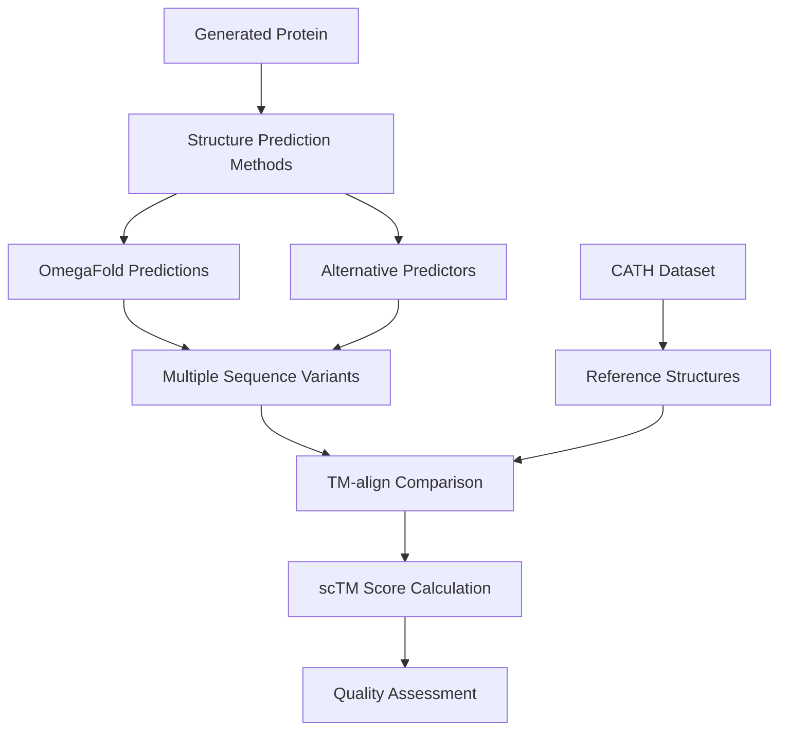

The Self-Consistency TM (scTM) score is a critical evaluation metric for assessing the structural quality and novelty of generated protein structures in the foldingdiff framework. This metric quantifies how consistently a generated structure folds when subjected to different structure prediction methods, providing insights into the structural plausibility of the generated proteins.

## Core Architecture

The scTM calculation framework integrates multiple components to provide comprehensive structural evaluation:



## TM-align Integration

The foundation of scTM calculation relies on the TM-align wrapper implementation in [`foldingdiff/tmalign.py`](foldingdiff/tmalign.py#L22-L56). The core function `run_tmalign()` executes TM-align comparisons between protein structures and parses the output to extract TM-scores normalized by reference length [source](foldingdiff/tmalign.py#L22-L56).

> [!TIP]
> The wrapper uses `Chain_2` TM-score values which normalize by the reference structure length, ensuring consistent comparisons across proteins of different sizes.

Key features of the TM-align integration:

- **Parallel Processing**: The `max_tm_across_refs()` function enables efficient comparison against multiple reference structures using multiprocessing [source](foldingdiff/tmalign.py#L57-L85)
- **Error Handling**: Robust error management returns NaN values for failed comparisons rather than crashing the evaluation pipeline [source](foldingdiff/tmalign.py#L39-L42)
- **File Matching Strategies**: Flexible matching system supports exact, prefix, and suffix strategies for pairing query and reference files [source](foldingdiff/tmalign.py#L86-L114)

## scTM Calculation Pipeline

The scTM evaluation process involves comparing multiple structure predictions of the same sequence to assess structural consistency:

### Structure Prediction Integration
Based on the analysis in [`jupyter/sctm_by_len.ipynb`](jupyter/sctm_by_len.ipynb), the pipeline integrates with OmegaFold predictions enhanced by ProteinMPNN sequence design:

1. **Sequence Generation**: Generated protein sequences are processed through ProteinMPNN for sequence optimization
2. **Structure Prediction**: Multiple structure predictions are generated using OmegaFold
3. **Cross-Comparison**: TM-align compares all predicted structures to calculate consistency scores

### Data Structure and Metrics
The evaluation results are organized in a comprehensive dataframe structure [source](jupyter/sctm_by_len.ipynb#L50-L80):

| Metric | Description | Purpose |
|--------|-------------|---------|
| scTM | Self-consistency TM score | Primary quality metric |
| max training TM | Maximum TM-score to training structures | Novelty assessment |
| length_int | Protein length in residues | Length-based analysis |
| alpha_counts/beta_counts | Secondary structure composition | Structural classification |
| designable | Designability flag | Functional potential |
| mean_bfactor_omegafold | Average B-factor from predictions | Confidence measure |

## Statistical Analysis Framework

The scTM evaluation incorporates sophisticated statistical analysis to understand relationships between protein properties and structural quality:

### Length-Dependent Analysis
The pipeline performs Spearman correlation analysis between protein length and scTM scores [source](jupyter/sctm_by_len.ipynb#L300-L320):

```python
corr, pval = stats.spearmanr(sctm_table['length_int'], sctm_table['scTM'])
```

> [!TIP]
> The analysis reveals a significant positive correlation (ρ ≈ 0.56, p < 10⁻⁶⁴) between protein length and scTM scores, indicating that longer generated proteins tend to achieve higher structural consistency.

### Visualization and Reporting
Results are visualized using seaborn plots with error bars showing min-max ranges across length categories [source](jupyter/sctm_by_len.ipynb#L300-L330). The plotting integrates with the framework's visualization utilities in [`foldingdiff/plotting.py`](foldingdiff/plotting.py).

## Quality Assessment Criteria

The scTM framework provides multiple dimensions for evaluating generated protein quality:

### Structural Consistency
- **scTM Score**: Values closer to 1.0 indicate higher structural consistency across predictions
- **Threshold Analysis**: The 0.5 threshold serves as a benchmark for acceptable structural quality [source](foldingdiff/tmalign.py#L148-L149)

### Novelty Assessment
- **Training TM Comparison**: Maximum TM-score against CATH training structures identifies potentially novel folds
- **Designability**: Integration with inverse folding methods assesses functional potential

### Confidence Metrics
- **B-factor Analysis**: Mean B-factors from OmegaFold predictions provide per-residue confidence estimates [source](jupyter/sctm_by_len.ipynb#L300-L330)
- **Secondary Structure**: Alpha/beta content analysis informs structural classification

## Implementation Considerations

### Computational Efficiency
The scTM calculation is optimized for large-scale evaluation:
- **Parallel Processing**: Multiprocessing support for batch TM-score calculations
- **Memory Management**: Efficient file handling for large protein datasets
- **Chunked Processing**: Configurable chunk sizes for optimal resource utilization

### Integration Points
The scTM framework connects with multiple evaluation components:
- **Structure Prediction**: OmegaFold and alternative predictors
- **Sequence Design**: ProteinMPNN integration for sequence optimization
- **Dataset Management**: CATH dataset integration for reference structures

## Validation and Testing

The TM-align wrapper includes comprehensive test coverage in [`tests/test_tmalign.py`](tests/test_tmalign.py):

- **Reproducibility**: Ensures consistent results across multiple runs
- **Self-comparison**: Validates that comparing a structure to itself yields perfect scores
- **Cross-validation**: Confirms that different structures produce scores < 1.0

## Usage Patterns

The scTM calculation is typically used in these contexts:
- **Model Evaluation**: Assessing the quality of generated protein structures
- **Hyperparameter Optimization**: Comparing different model configurations
- **Research Analysis**: Understanding relationships between generation parameters and structural quality

The framework provides both programmatic APIs through the tmalign module and command-line interfaces for batch processing, enabling flexible integration into different research workflows.

For comprehensive protein generation evaluation, the scTM metric should be considered alongside other quality measures discussed in [Structure Prediction Integration](20-structure-prediction-integration) and [Inverse Folding with ProteinMPNN and ESM-IF1](19-inverse-folding-with-proteinmpnn-and-esm-if1).