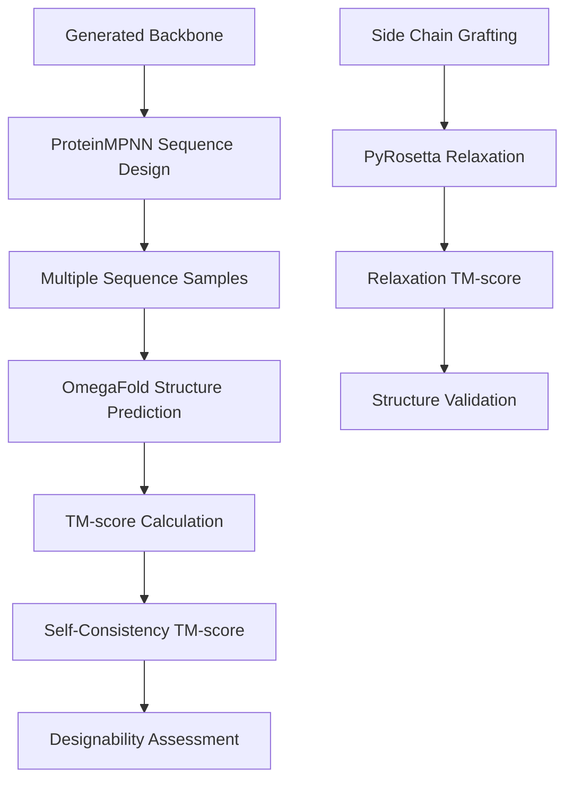

The **inverse folding** evaluation pipeline in foldingdiff assesses the designability of generated protein backbones by predicting amino acid sequences that would fold into the target structures. This process leverages two state-of-the-art inverse folding models: **ProteinMPNN** for sequence design and **ESM-IF1** for validation, providing a comprehensive assessment of structural plausibility.

## Inverse Folding Pipeline Architecture

The inverse folding workflow follows a systematic approach to evaluate generated protein structures:

## ProteinMPNN Integration

ProteinMPNN serves as the primary sequence design engine, taking generated backbone coordinates as input and predicting compatible amino acid sequences. The integration process involves:

- **Multiple sampling**: For each generated backbone, ProteinMPNN generates multiple sequence candidates (typically 8 samples) to explore sequence space diversity
- **Structure prediction**: Each designed sequence is fed to OmegaFold for structure prediction, creating corresponding 3D models
- **Similarity assessment**: TM-scores are calculated between the original generated backbone and each predicted structure to evaluate consistency

The self-consistency TM-score (scTM) represents the maximum TM-score across all sequence samples, with higher values indicating better designability. Based on the analysis in [`graft_and_relax.ipynb`](jupyter/graft_and_relax.ipynb), the pipeline processes 780 generated structures with comprehensive metrics tracking.

## ESM-IF1 Validation Framework

ESM-IF1 provides an independent validation mechanism for the inverse folding results:

- **Cross-model validation**: ESM-IF1 predictions serve as an additional check on sequence-structure compatibility
- **Benchmark comparison**: Results are compared against training set structures to assess novelty
- **Designability classification**: Structures are classified as designable based on established TM-score thresholds

The validation framework tracks multiple metrics including secondary structure composition (alpha/beta counts), protein length categories, and maximum training TM-scores for contextual assessment.

## Side Chain Integration and Relaxation

A critical component of the evaluation involves adding side chains to the backbone-only structures:

- **PyRosetta relaxation**: The [`run_pyrosetta_relax.py`](scripts/run_pyrosetta_relax.py) script performs full-atom relaxation using PyRosetta's energy minimization protocols
- **Clash detection**: Van der Waals clashes are identified and quantified using the [`vdw_clashes`](foldingdiff/vdw_clashes.py) module
- **Structure preservation**: TM-scores before and after relaxation measure structural integrity during side chain addition

The relaxation analysis reveals that approximately 50% of structures maintain high similarity (TM-score > 0.5) after side chain integration, indicating robust backbone generation.

## Performance Metrics and Analysis

The inverse folding evaluation produces several key performance indicators:

| Metric | Description | Typical Range |
|--------|-------------|---------------|
| scTM | Self-consistency TM-score | 0.2-0.8 |
| Relaxation TM-score | Pre/post-relaxation similarity | 0.3-0.8 |
| Designability rate | Fraction with scTM > 0.5 | ~30-40% |
| Clash rate | Structures with steric conflicts | ~15-20% |

Statistical analysis shows a **Spearman correlation of ρ ≈ 0.82** between scTM scores and relaxation TM-scores, indicating that high designability scores generally correlate with robust structural integrity during side chain addition.

## Implementation Details

The inverse folding pipeline is implemented through several key components:

- **Custom metrics**: The [`custom_metrics.py`](foldingdiff/custom_metrics.py) module provides specialized functions for KL divergence calculation and wrapped mean operations for angular data
- **Visualization tools**: Comprehensive plotting capabilities in [`plotting.py`](foldingdiff/plotting.py) generate histograms and scatter plots for result analysis
- **Data management**: Structured output organization with separate directories for different processing stages

The pipeline supports batch processing of multiple generated structures and maintains detailed logs for reproducibility and debugging.

## Integration with Training Pipeline

The inverse folding evaluation integrates seamlessly with the main training workflow through the AMLT configuration system. The [`amlt.yaml`](scripts/amlt.yaml) file orchestrates the execution on distributed computing resources, ensuring scalable evaluation of large protein structure datasets.

This comprehensive evaluation framework provides robust validation of generated protein structures, combining sequence design, structure prediction, and physical validation to assess the practical utility of diffusion-generated protein backbones for real-world applications.

For further details on structure generation and sampling, see [Protein Backbone Sampling Pipeline](15-protein-backbone-sampling-pipeline). To understand the underlying representation system, refer to [Angle-based Protein Representation](7-angle-based-protein-representation).