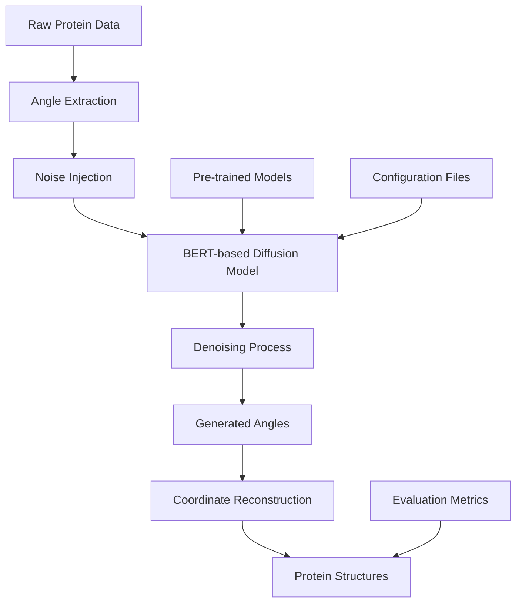
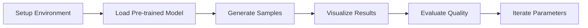

Welcome to the **foldingdiff** quick start guide! This repository provides a powerful diffusion model for generating novel protein backbone structures using internal angle representations. Whether you're a computational biologist, machine learning researcher, or protein engineer, this guide will get you up and running quickly.

## What is foldingdiff?

foldingdiff is a PyTorch-based implementation that applies diffusion models to protein backbone generation. Instead of working with Cartesian coordinates, it uses internal angles (φ, ψ, ω, and additional geometric features) which provide better representation for protein structures and enable more realistic generation.


## System Architecture Overview

The foldingdiff system follows a modular architecture that separates concerns across data processing, model training, sampling, and evaluation:



## Installation and Setup

### Prerequisites

- Python 3.8 or higher
- Conda or Mamba package manager
- CUDA-capable GPU (recommended for sampling)

### Step 1: Clone and Install

```bash
# Clone the repository
git clone https://github.com/microsoft/foldingdiff.git
cd foldingdiff

# Create conda environment
conda env create -f environment.yml
conda activate foldingdiff

# Install the package in development mode
pip install -e ./
```

The environment includes key dependencies like PyTorch, PyTorch Lightning, HuggingFace transformers, and specialized bioinformatics libraries.

### Step 2: Download Pre-trained Models (Optional)

For quick sampling without training, you can use the pre-trained model from HuggingFace:

```python
from huggingface_hub import snapshot_download
from foldingdiff import modelling

# Automatically downloads and caches the model
model = modelling.BertForDiffusion.from_dir(
    snapshot_download("wukevin/foldingdiff_cath")
)
```

## Quick Sampling Example

### Generate Protein Backbones

The fastest way to get started is by sampling from the pre-trained model:

```bash
# Generate 10 protein backbones per length from 50-127 residues
python bin/sample.py -l 50 128 -n 10 -b 512 --device cuda:0
```

This command produces:
- **sampled_angles/**: CSV files with generated internal angles
- **sampled_pdb/**: PDB files with 3D coordinates
- **plots/**: Distribution comparisons with training data

### Performance Expectations

| Device | Sampling Time (512 structures) |
|--------|------------------------------|
| NVIDIA RTX 2080Ti | ~7 minutes |
| 16-core CPU | ~2 hours |

### Python API Sampling

For programmatic access:

```python
from foldingdiff import modelling, sampling
from huggingface_hub import snapshot_download
import torch

# Load pre-trained model
model = modelling.BertForDiffusion.from_dir(
    snapshot_download("wukevin/foldingdiff_cath")
)
model.eval()

# Generate samples
with torch.no_grad():
    samples = sampling.sample(model, n_samples=10, length=64)
    
print(f"Generated {samples.shape[0]} protein structures")
```

## Key Components Overview

### Data Representation

foldingdiff uses internal angle representations rather than Cartesian coordinates:

| Feature Type | Description | Angular? |
|--------------|-------------|----------|
| φ, ψ, ω | Standard backbone dihedral angles | ✅ |
| θ₁, θ₂, θ₃ | Additional geometric angles | ✅ |
| Bond lengths | Distance measurements | ❌ |

### Model Architecture

The core model combines:
- **BERT-style transformer** for sequence modeling
- **Gaussian Fourier projections** for time encoding
- **Diffusion process** with cosine noise schedule

### Configuration System

Models are configured via JSON files in [`config_jsons/`](config_jsons):

- `cath_full_angles_cosine.json`: Full training configuration
- `mini_model.json`: Lightweight testing configuration
- `cath_raw_coordinates.json`: Cartesian coordinate baseline

## Next Steps

Once you've completed this quick start, you may want to:

1. **[Installation and Environment Setup](3-installation-and-environment-setup)** - Detailed installation troubleshooting
2. **[Downloading and Preparing Datasets](4-downloading-and-preparing-datasets)** - Set up training data
3. **[Using Pre-trained Models for Sampling](5-using-pre-trained-models-for-sampling)** - Advanced sampling techniques
4. **[Diffusion Model Architecture and BERT Integration](6-diffusion-model-architecture-and-bert-integration)** - Deep dive into model internals

## Common Use Cases

### Research Applications
- Generate novel protein scaffolds for design
- Study protein folding landscapes
- Benchmark structure prediction methods

### Development Workflow


### Troubleshooting Tips

> [!TIP]
> **GPU Memory Issues**: If you encounter CUDA out-of-memory errors, reduce the batch size with `-b` parameter or use CPU sampling with `--device cpu`.

> [!TIP]
> **Missing Data Warnings**: You may see warnings about "Illegal values for omega" - these are normal and indicate the system is filtering invalid protein structures.

## Resources

- **Documentation**: Full API documentation in the source code
- **Examples**: Jupyter notebooks in [`jupyter/`](jupyter) directory
- **Tests**: Run `python -m unittest -v` to verify installation
- **Community**: GitHub issues for questions and bug reports

The foldingdiff system is designed to be extensible - you can modify configurations, add new evaluation metrics, or integrate with downstream protein design pipelines. Happy protein folding!