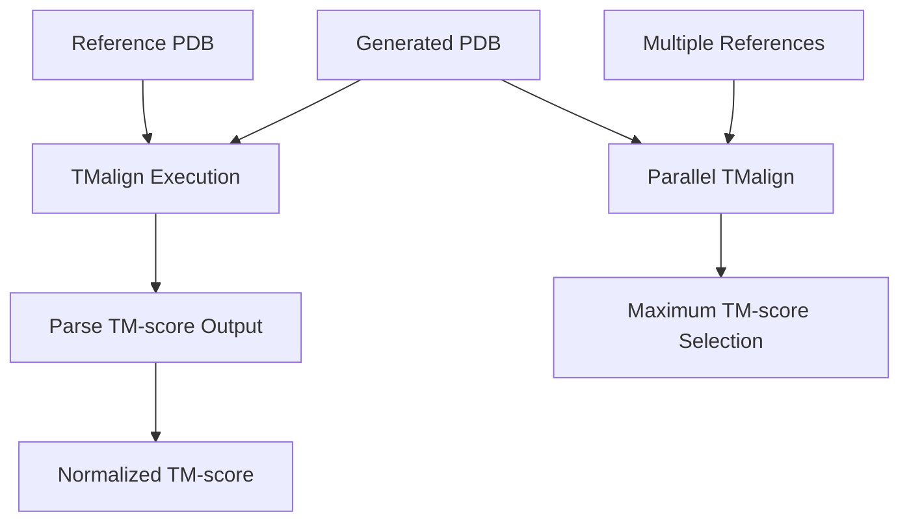

The FoldingDiff framework integrates comprehensive structure prediction and validation tools to evaluate and refine generated protein structures. This integration encompasses multiple complementary approaches: **TM-score alignment**, **lDDT calculation**, **structure relaxation**, and **side-chain packing**. These tools form a complete pipeline for assessing structural quality and optimizing generated protein backbones.

## TM-Score Structural Alignment

The TM-score integration provides robust structural similarity assessment through the `run_tmalign` function, which wraps the TMalign executable for comparing protein structures. This implementation supports both standard and fast alignment modes, with parallel processing capabilities for batch comparisons [foldingdiff/tmalign.py](foldingdiff/tmalign.py#L22-L56).

The core alignment process executes TMalign with configurable parameters and parses the output to extract normalized TM-scores. The implementation includes error handling for failed alignments and returns NaN values when comparisons fail, ensuring robust batch processing [foldingdiff/tmalign.py](foldingdiff/tmalign.py#L47-L56).

For large-scale evaluations, the `max_tm_across_refs` function enables efficient parallel comparison against multiple reference structures, returning the maximum TM-score and corresponding reference [foldingdiff/tmalign.py](foldingdiff/tmalign.py#L57-L85). This is particularly useful for assessing generated structures against structural databases.

## lDDT Distance-Based Assessment

The lDDT (Local Distance Difference Test) integration provides local structural quality assessment through Docker-based OpenStructure execution. The `lddt` function computes distance-based similarity metrics between query and reference structures, offering complementary information to global alignment scores [foldingdiff/lddt.py](foldingdiff/lddt.py#L32-L58).

The implementation leverages a containerized approach with the `run_docker_ost` script, ensuring consistent computational environments across different systems [foldingdiff/lddt.py](foldingdiff/lddt.py#L28). The lDDT calculation is performed in temporary directories to maintain clean execution environments, with proper cleanup and error handling.

For evaluating generated structures against folded variants, the `lddt_sampled_folded` function provides batch processing capabilities, automatically matching sampled structures with their corresponding folded counterparts and computing comprehensive lDDT matrices [foldingdiff/lddt.py](foldingdiff/lddt.py#L59-L75).

## Structure Relaxation with PyRosetta

The PyRosetta integration enables energy-based structure refinement through the `relax_pdb` function. This implementation uses the FastRelax protocol with the full-atom score function to optimize protein structures while maintaining realistic geometry [scripts/run_pyrosetta_relax.py](scripts/run_pyrosetta_relax.py#L18-L27).

The relaxation process loads structures into PyRosetta poses, applies the FastRelax protocol with the default full-atom scoring function, and outputs refined structures. This integration is essential for removing steric clashes and optimizing hydrogen bonding networks in generated backbones.

> [!TIP]
> PyRosetta initialization occurs at module import time, ensuring the Rosetta environment is properly configured before any relaxation operations [scripts/run_pyrosetta_relax.py](scripts/run_pyrosetta_relax.py#L14).

## Side-Chain Packing with FASPR

The FASPR (Fast and Accurate Side-chain Packing) integration provides efficient side-chain reconstruction for backbone-only structures. The `run_faspr` function processes backbone coordinates with amino acid sequences to generate complete atomic models [scripts/faspr.py](scripts/faspr.py#L40-L60).

The implementation handles sequence formatting requirements, converting FASTA inputs to the single-line format expected by FASPR. The side-chain packing process is executed in temporary directories to maintain clean execution environments, with proper file management and error handling.

For comprehensive side-chain reconstruction, the `add_sidechains_to_backbone` function provides a complete pipeline that combines backbone coordinates with amino acid sequences using pre-computed side-chain rotamer libraries [foldingdiff/angles_and_coords.py](foldingdiff/angles_and_coords.py#L378-L387).

## Angle-to-Coordinate Conversion Pipeline

The structure prediction integration heavily relies on the angle-to-coordinate conversion system, which transforms internal angular representations into Cartesian coordinates. The `create_new_chain_nerf` function implements the NERF (Natural Extension Reference Frame) algorithm for reconstructing 3D coordinates from angular parameters [foldingdiff/angles_and_coords.py](foldingdiff/angles_and_coords.py#L112-L122).

This conversion system supports both minimal and exhaustive angle representations, enabling flexible reconstruction strategies based on the available angular information. The pipeline handles coordinate centering and validation, ensuring structurally sound outputs suitable for downstream analysis.

> [!TIP]
> The angle-to-coordinate conversion system maintains consistency between the angular representation used by the diffusion model and the Cartesian coordinates required by structure prediction tools.

## Integration Workflow

The complete structure prediction integration follows a systematic workflow that combines all available tools for comprehensive evaluation and optimization:

This integrated approach enables thorough validation of generated protein structures, providing both global similarity measures through TM-scores and local quality assessments through lDDT. The relaxation and side-chain packing steps ensure that generated backbones are transformed into physically realistic complete structures suitable for downstream applications.

The modular design allows for selective application of different tools based on specific evaluation needs, while maintaining consistency across the entire pipeline. This integration forms the foundation for reliable assessment of the FoldingDiff model's protein generation capabilities.