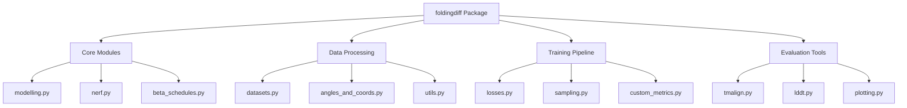

This guide provides comprehensive instructions for setting up the foldingdiff environment, a diffusion model for protein backbone generation. We'll cover system requirements, environment configuration, and data preparation to ensure a smooth installation experience.

## System Requirements

Before proceeding with installation, ensure your system meets these prerequisites:

**Operating System**: Linux, macOS, or Windows (with WSL2)
**Python Version**: 3.8 or higher
**Package Manager**: Anaconda/Miniconda (recommended) or pip
**Hardware**: GPU support recommended for training (CUDA-compatible)
**Storage**: Minimum 10GB free space for datasets and models

## Environment Setup Methods

You have two primary methods for setting up the foldingdiff environment:

### Method 1: Conda Environment (Recommended)

The conda approach provides isolated environment management with optimized package versions:

```bash
# Clone the repository
git clone https://github.com/microsoft/foldingdiff.git
cd foldingdiff

# Create conda environment from configuration file
conda env create -f environment.yml

# Activate the environment
conda activate foldingdiff

# Install the package in development mode
pip install -e ./
```

### Method 2: pip Installation

For users preferring pip-based installation:

```bash
# Clone the repository
git clone https://github.com/microsoft/foldingdiff.git
cd foldingdiff

# Create virtual environment
python -m venv foldingdiff-env
source foldingdiff-env/bin/activate  # On Windows: foldingdiff-env\Scripts\activate

# Install dependencies
pip install -r requirements.txt

# Install the package
pip install -e ./
```

## Package Dependencies Overview

The foldingdiff project relies on several key scientific computing and deep learning libraries:

| Category | Package | Version | Purpose |
|----------|---------|---------|---------|
| **Core ML** | PyTorch | 1.12 | Neural network framework |
| | PyTorch Lightning | 1.6.4 | Training orchestration |
| | Transformers | 4.11.3 | BERT model integration |
| **Data Processing** | NumPy | 1.22.3 | Numerical computations |
| | Pandas | 1.1.5 | Data manipulation |
| | SciPy | 1.9.1 | Scientific computing |
| **Bioinformatics** | Biotite | 0.34 | Protein structure analysis |
| | TM-align | - | Structure alignment |
| **Visualization** | Seaborn | - | Statistical plotting |
| | mpl-scatter-density | - | Density plots |
| | Astropy | 5.1 | Scientific visualization |

> [!TIP]
> The conda environment file [environment.yml](environment.yml) specifies exact versions to ensure reproducibility. Using the conda method is highly recommended for avoiding dependency conflicts, especially with PyTorch CUDA configurations.

## Architecture Overview

The foldingdiff installation creates a modular environment with the following key components:



## Verification and Testing

After installation, verify your setup by running the test suite:

```bash
# Run all tests
python -m pytest tests/

# Run specific test categories
python -m pytest tests/test_model_subparts.py
python -m pytest tests/test_sampling.py
python -m pytest tests/test_utils.py
```

> [!TIP]
> If you encounter import errors, ensure you've installed the package in development mode using `pip install -e ./` from the repository root directory. This makes the package modules available in your Python path.

## Data Preparation (Optional)

For training your own models, you'll need to download the CATH dataset:

```bash
# Navigate to data directory
cd data

# Make download script executable
chmod +x download_cath.sh

# Download and extract dataset
./download_cath.sh
```

The dataset includes approximately 10GB of protein structures and is required only for training, not for sampling with pre-trained models.

## Troubleshooting Common Issues

| Issue | Cause | Solution |
|-------|-------|----------|
| CUDA errors | Incompatible PyTorch version | Reinstall with correct CUDA version: `conda install pytorch torchvision torchaudio pytorch-cuda=11.6 -c pytorch -c nvidia` |
| Import errors | Package not installed in development mode | Run `pip install -e ./` from repository root |
| Memory errors | Insufficient RAM for large datasets | Use smaller dataset variants or increase system memory |
| Permission errors | Insufficient file permissions | Use `chmod +x` for shell scripts or run with appropriate permissions |

## Next Steps

After successful installation, you can proceed to:

1. **[Downloading and Preparing Datasets](4-downloading-and-preparing-datasets)** - Set up training data
2. **[Using Pre-trained Models for Sampling](5-using-pre-trained-models-for-sampling)** - Generate protein structures immediately
3. **[Quick Start](2-quick-start)** - Get familiar with basic usage patterns

The foldingdiff environment is now ready for protein structure generation using diffusion models. For detailed usage examples and advanced configurations, continue with the next documentation sections.