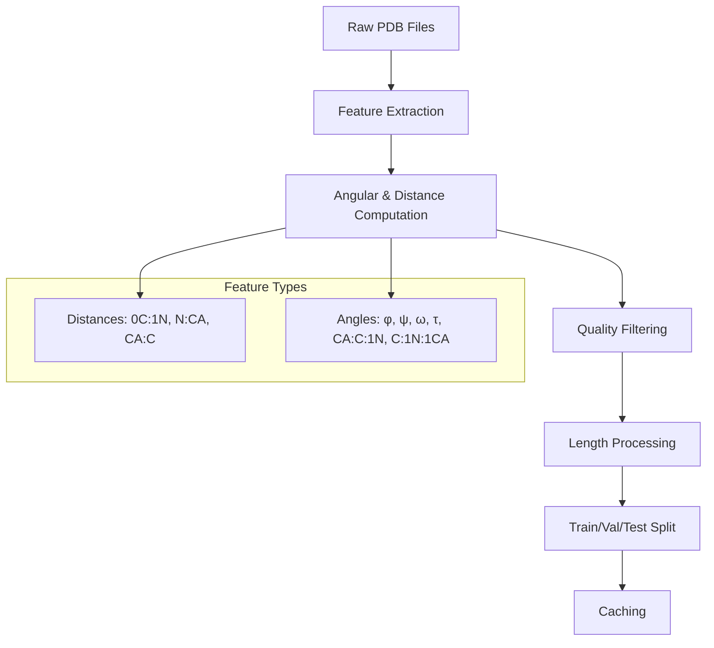

This guide covers the complete process of downloading and preparing protein structure datasets for use with FoldingDiff. The system supports two primary datasets: CATH (a curated protein structure database) and AlphaFold predictions for SwissProt proteins.

## Dataset Overview

FoldingDiff operates on protein structures represented as angular features and coordinates. The system provides several dataset variants optimized for different modeling approaches:

| Dataset Class | Features | Angular Features | Use Case |
|---------------|----------|------------------|----------|
| `CathCanonicalAnglesDataset` | 9 features (3 distances + 6 angles) | 6 angular features | Full canonical representation |
| `CathCanonicalAnglesOnlyDataset` | 6 angles only | 6 angular features | Angle-only modeling |
| `CathCanonicalMinimalAnglesDataset` | 4 angles (φ, ψ, ω, τ) | 4 angular features | Minimal angle set |
| `CathCanonicalCoordsDataset` | XYZ coordinates | 0 angular features | Cartesian coordinate modeling |

## Downloading Datasets

### CATH Dataset

The CATH dataset provides high-quality, non-redundant protein structures with 40% sequence identity cutoff:

```bash
# Navigate to the data directory
cd data

# Execute the download script
./download_cath.sh
```

The download script performs the following operations [download_cath.sh](data/download_cath.sh#L1-L9):

1. Downloads the CATH non-redundant S40 dataset from the official FTP server
2. Verifies file integrity using MD5 checksum
3. Extracts the PDB files to the `cath/domains/` directory

> [!TIP]
> The CATH dataset is approximately 2GB compressed and contains ~30,000 protein domains. Ensure sufficient disk space and stable internet connection before downloading.

### AlphaFold Dataset

For AlphaFold predictions of all SwissProt proteins:

```bash
# Navigate to the data directory  
cd data

# Execute the download script (requires aria2c)
./download_alphafold.sh
```

The AlphaFold download uses `aria2c` for parallel downloading [download_alphafold.sh](data/download_alphafold.sh#L4) and retrieves the complete SwissProt predictions (~50GB compressed).

## Dataset Processing Pipeline

Once downloaded, datasets are processed through a multi-stage pipeline:



### Feature Extraction

The system extracts two types of features from each protein structure [angles_and_coords.py](foldingdiff/angles_and_coords.py#L23-L26):

**Distance Features:**
- `0C:1N`: Distance between consecutive carbonyl carbon and amide nitrogen
- `N:CA`: Distance between amide nitrogen and alpha carbon  
- `CA:C`: Distance between alpha carbon and carbonyl carbon

**Angular Features:**
- `φ` (phi): Backbone dihedral angle (C<sub>i-1</sub>-N<sub>i</sub>-C<sub>αi</sub>-C<sub>i</sub>)
- `ψ` (psi): Backbone dihedral angle (N<sub>i</sub>-C<sub>αi</sub>-C<sub>i</sub>-N<sub>i+1</sub>)
- `ω` (omega): Backbone dihedral angle (C<sub>αi</sub>-C<sub>i</sub>-N<sub>i+1</sub>-C<sub>αi+1</sub>)
- `τ` (tau): Bond angle (N<sub>i</sub>-C<sub>αi</sub>-C<sub>i</sub>)
- `CA:C:1N`: Virtual angle between consecutive residues
- `C:1N:1CA`: Virtual angle for geometric constraints

### Dataset Configuration

The dataset class provides extensive configuration options [datasets.py](foldingdiff/datasets.py#L44-L66):

| Parameter | Type | Default | Description |
|-----------|------|---------|-------------|
| `pdbs` | str/dict | "cath" | Dataset source ("cath", "alphafold", or custom path) |
| `split` | str | None | Dataset split ("train", "validation", "test") |
| `pad` | int | 512 | Maximum sequence length for padding |
| `min_length` | int | 40 | Minimum sequence length filter |
| `trim_strategy` | str | "leftalign" | How to handle sequences > pad length |
| `toy` | int | 0 | Use subset for testing (0 = full dataset) |
| `zero_center` | bool | True | Center angular features around zero mean |
| `use_cache` | bool | True | Enable/disable feature caching |

### Length Processing Strategies

For proteins exceeding the maximum length, three strategies are available [datasets.py](foldingdiff/datasets.py#L440-L460):

| Strategy | Behavior | Use Case |
|----------|----------|----------|
| `"leftalign"` | Keep first `pad` residues | Preserves N-terminal structure |
| `"randomcrop"` | Randomly crop to `pad` residues | Increases training diversity |
| `"discard"` | Remove sequences > `pad` length | Ensures uniform length |

> [!TIP]
> The default 80/10/10 train/validation/test split uses a fixed random seed (6489) for reproducibility across experiments.

## Caching System

To accelerate repeated dataset loading, FoldingDiff implements an intelligent caching system:

1. **Feature Caching**: Computed angular and distance features are cached to avoid reprocessing
2. **Hash Validation**: Cache integrity is verified using codebase MD5 hashes [datasets.py](foldingdiff/datasets.py#L85-L95)
3. **Automatic Cleanup**: Mismatched cache files are automatically removed and regenerated

Cache files are stored with descriptive names including dataset source and filename hash for easy identification.

## Quick Start Examples

### Basic CATH Dataset Loading

```python
from foldingdiff.datasets import CathCanonicalAnglesDataset

# Load full CATH dataset with default settings
dataset = CathCanonicalAnglesDataset(
    pdbs="cath",
    split="train",
    pad=512,
    min_length=40
)

print(f"Loaded {len(dataset)} protein structures")
print(f"Feature names: {dataset.feature_names}")
print(f"Length range: {min(dataset.all_lengths)}-{max(dataset.all_lengths)}")
```

### Minimal Angle Dataset

```python
from foldingdiff.datasets import CathCanonicalMinimalAnglesDataset

# Load minimal angle set (φ, ψ, ω, τ only)
minimal_dataset = CathCanonicalMinimalAnglesDataset(
    pdbs="cath",
    split="train",
    pad=256,  # Shorter sequences for faster training
    trim_strategy="randomcrop"  # Increase diversity
)
```

### Custom Dataset from Directory

```python
# Load PDB files from custom directory
custom_dataset = CathCanonicalAnglesDataset(
    pdbs="/path/to/my/pdbs",  # Directory containing .pdb or .pdb.gz files
    pad=128,
    min_length=20,
    zero_center=True
)
```

## Next Steps

After preparing your datasets, you can:

- **[Using Pre-trained Models for Sampling](5-using-pre-trained-models-for-sampling)**: Load pre-trained models to generate new protein structures
- **[CATH Dataset Integration](9-cath-dataset-integration)**: Deep dive into CATH-specific processing and features
- **[Dataset Variants and Feature Sets](11-dataset-variants-and-feature-sets)**: Explore different feature representations

The modular dataset system allows easy experimentation with different protein representations and training configurations, making it straightforward to adapt the pipeline for specific research needs.