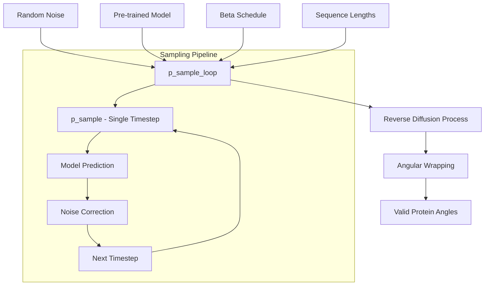

This guide demonstrates how to use pre-trained FoldingDiff models to generate novel protein backbone structures through diffusion sampling. The sampling pipeline converts random noise into valid protein angles using the trained reverse diffusion process.

## Overview of the Sampling Architecture

The sampling system implements a reverse diffusion process that progressively denoises random tensors into valid protein backbone angles. The core components work together to generate protein structures with proper angular constraints and biological validity.



## Quick Start with Pre-trained Models

The simplest way to start generating proteins is using the `sample_simple` function, which handles model loading, dataset preparation, and sampling automatically.

### Basic Usage

```python
from foldingdiff.sampling import sample_simple

# Generate 10 protein structures with lengths 50-128
samples = sample_simple(
    model_dir="wukevin/foldingdiff_cath",  # HuggingFace model ID
    n=10,                                 # Number of samples per length
    sweep_lengths=(50, 128)               # Length range
)

# samples is a list of DataFrames with angle values
for i, sample_df in enumerate(samples):
    print(f"Sample {i}: shape {sample_df.shape}")
    print(sample_df.head())
```

The function automatically downloads the model from HuggingFace Hub if needed and returns DataFrames containing the generated angles [foldingdiff/sampling.py#L227-L266](foldingdiff/sampling.py#L227-L266).

### Available Pre-trained Models

| Model ID | Description | Feature Set |
|----------|-------------|-------------|
| `wukevin/foldingdiff_cath` | Full CATH-trained model | 4 angles (phi, psi, omega, tau) |
| Local model directory | Custom trained models | Depends on training config |

## Advanced Sampling Pipeline

For more control over the sampling process, you can use the lower-level `sample` function directly.

### Complete Pipeline Setup

```python
import torch
from foldingdiff import modelling, datasets, sampling

# Load pre-trained model
model = modelling.BertForDiffusionBase.from_dir("path/to/model")
if torch.cuda.is_available():
    model = model.to("cuda:0")

# Create dummy dataset for sampling configuration
dummy_dset = datasets.AnglesEmptyDataset.from_dir("path/to/model")
noised_dset = datasets.NoisedAnglesDataset(
    dset=dummy_dset,
    dset_key="angles",
    timesteps=250,
    beta_schedule="linear",
    angular_variance=1.0
)

# Generate samples
samples = sampling.sample(
    model=model,
    train_dset=noised_dset,
    n=10,
    sweep_lengths=(50, 128),
    batch_size=512
)
```

### Key Sampling Parameters

| Parameter | Description | Default | Range |
|-----------|-------------|---------|-------|
| `n` | Number of samples per length | 10 | 1-∞ |
| `sweep_lengths` | Length range (min, max) | (50, 128) | Any valid range |
| `batch_size` | Batch size for generation | 512 | 1-1024 |
| `trim_to_length` | Remove padding to save memory | True | Boolean |

## Understanding the Sampling Process

The sampling process consists of two main functions that work together:

### 1. p_sample_loop - Main Sampling Loop

This function orchestrates the reverse diffusion process across all timesteps [foldingdiff/sampling.py#L78-L134](foldingdiff/sampling.py#L78-L134):

```python
@torch.no_grad()
def p_sample_loop(
    model: nn.Module,
    lengths: Sequence[int],
    noise: torch.Tensor,
    timesteps: int,
    betas: torch.Tensor,
    is_angle: Union[bool, List[bool]] = [False, True, True, True],
    disable_pbar: bool = False,
) -> torch.Tensor:
```

Key features:
- Processes timesteps in reverse order (from T to 0)
- Applies angular wrapping for periodic features
- Returns tensor of shape (timesteps, batch_size, seq_len, n_ft)

### 2. p_sample - Single Timestep Denoising

This function performs the actual denoising for a single timestep [foldingdiff/sampling.py#L27-L77](foldingdiff/sampling.py#L27-L77):

```python
@torch.no_grad()
def p_sample(
    model: nn.Module,
    x: torch.Tensor,
    t: torch.Tensor,
    seq_lens: Sequence[int],
    t_index: torch.Tensor,
    betas: torch.Tensor,
) -> torch.Tensor:
```

> [!TIP]
> The angular wrapping is crucial for protein generation. After each timestep, angular features are wrapped back to the [-π, π] range to maintain valid protein geometry [foldingdiff/sampling.py#L95-L105](foldingdiff/sampling.py#L95-L105).

## Model Loading and Configuration

### Loading from Different Sources

The system supports loading models from both local directories and HuggingFace Hub:

```python
# From HuggingFace Hub
model = modelling.BertForDiffusionBase.from_dir("wukevin/foldingdiff_cath")

# From local directory
model = modelling.BertForDiffusionBase.from_dir("./local_model_directory")
```

The `from_dir` method automatically handles:
- Loading training configuration from `training_args.json`
- Loading model weights from appropriate checkpoint files
- Setting up the model architecture with correct parameters [foldingdiff/modelling.py#L297-L313](foldingdiff/modelling.py#L297-L313)

### Dataset Configuration

For sampling, you need a dataset that provides the noise schedule and feature configuration:

```python
# Create empty dataset with correct configuration
dummy_dset = datasets.AnglesEmptyDataset.from_dir(model_directory)

# Wrap with noise schedule
noised_dset = datasets.NoisedAnglesDataset(
    dset=dummy_dset,
    timesteps=250,                    # Must match training
    beta_schedule="linear",            # Must match training
    angular_variance=1.0              # Must match training
)
```

> [!TIP]
> The dataset configuration must exactly match the training configuration, including timesteps, beta schedule, and variance parameters. Mismatches will lead to poor generation quality [foldingdiff/datasets.py#L695-L705](foldingdiff/datasets.py#L695-L705).

## Output Processing and Analysis

### Understanding the Output Format

The sampling functions return structured data in different formats:

1. **Raw samples**: List of numpy arrays with shape (timesteps, seq_len, n_features)
2. **Final samples**: Last timestep from each trajectory
3. **DataFrame format**: Pandas DataFrames with named columns

```python
# Raw output includes all timesteps
raw_samples = sampling.sample(...)  # List of arrays

# Get only final structures
final_samples = [s[-1] for s in raw_samples]

# Convert to DataFrames with feature names
sample_dfs = [
    pd.DataFrame(s, columns=feature_names)
    for s in final_samples
]
```

### Feature Naming and Interpretation

The generated angles follow standard protein backbone conventions:

| Feature | Description | Range | Angular |
|---------|-------------|-------|---------|
| phi | N-CA-C-N dihedral | [-π, π] | Yes |
| psi | CA-C-N-CA dihedral | [-π, π] | Yes |
| omega | C-N-CA-C dihedral | [-π, π] | Yes |
| tau | N-CA-C bond angle | [-π, π] | Yes |

## Performance Considerations

### Memory Optimization

For large-scale generation, consider these optimizations:

1. **Batch size tuning**: Adjust based on GPU memory
2. **Length trimming**: Enable `trim_to_length=True` to reduce memory usage
3. **Sequence length**: Shorter sequences require significantly less memory

### Sampling Speed

The sampling speed depends on:
- Number of timesteps (typically 250)
- Batch size
- Sequence length
- Model architecture size

```python
# Faster sampling for quick prototyping
samples = sampling.sample(
    model=model,
    train_dset=noised_dset,
    n=10,
    sweep_lengths=(50, 64),    # Shorter sequences
    batch_size=256             # Smaller batch size
)
```

## Next Steps

After generating protein angles, you'll want to convert them to 3D coordinates and evaluate their quality:

- **[Angle-to-Coordinate Conversion System](10-angle-to-coordinate-conversion-system)**: Convert generated angles to 3D atomic coordinates
- **[Visualization and Analysis Tools](17-visualization-and-analysis-tools)**: Visualize and analyze the generated structures
- **[Self-Consistency TM Score Calculation](18-self-consistency-tm-score-calculation)**: Evaluate the quality of generated structures

The generated angles can also be used for downstream tasks like inverse folding with tools such as ProteinMPNN and ESM-IF1, as described in **[Inverse Folding with ProteinMPNN and ESM-IF1](19-inverse-folding-with-proteinmpnn-and-esm-if1)**.