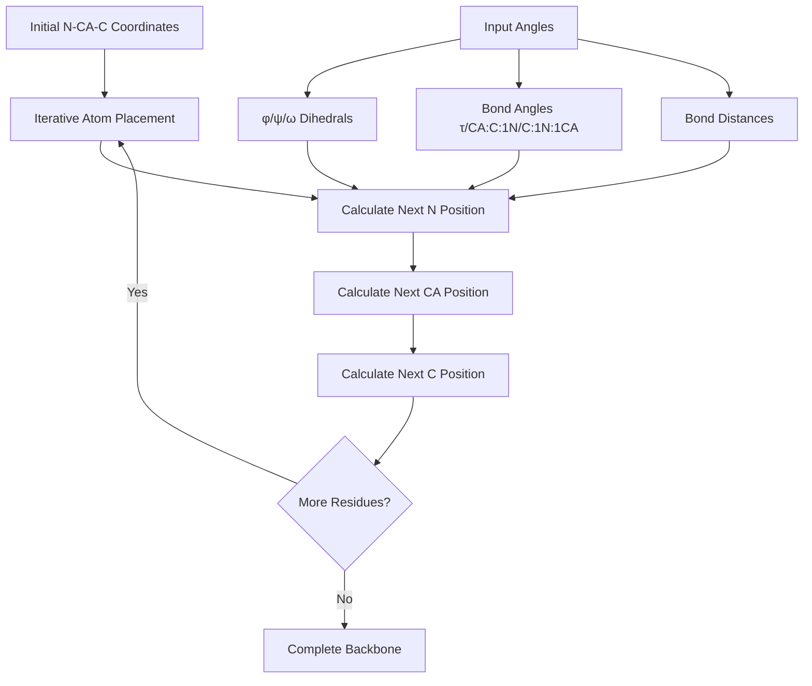
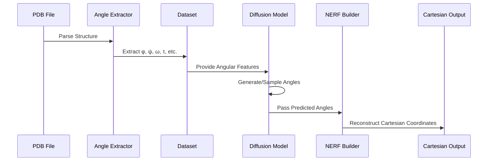

The FoldingDiff framework employs an angle-based representation system for protein structures that provides a mathematically robust and computationally efficient alternative to traditional Cartesian coordinates. This approach captures the essential geometric information of protein backbones through a carefully selected set of internal coordinates, enabling more stable diffusion modeling and better generalization across protein lengths.

## Core Angular Features

The representation system defines three distinct feature sets, each optimized for different modeling requirements:

| Feature Set | Components | Angularity | Description |
|-------------|------------|------------|-------------|
| **canonical** | ["0C:1N", "N:CA", "CA:C", "phi", "psi", "omega", "tau", "CA:C:1N", "C:1N:1CA"] | [False, False, False, True, True, True, True, True, True] | Complete canonical representation with distances and angles |
| **canonical-full-angles** | ["phi", "psi", "omega", "tau", "CA:C:1N", "C:1N:1CA"] | [True, True, True, True, True, True] | All angular features without distances |
| **canonical-minimal-angles** | ["phi", "psi", "omega", "tau"] | [True, True, True, True] | Minimal reconstructable angle set |

Sources: [foldingdiff/datasets.py](foldingdiff/datasets.py#L44-L56)

### Dihedral Angles

The three canonical dihedral angles form the backbone of the representation:

- **φ (phi)**: N-CA-C-N dihedral angle, describing rotation around the N-CA bond
- **ψ (psi)**: CA-C-N-CA dihedral angle, describing rotation around the C-N bond  
- **ω (omega)**: C-N-CA-C dihedral angle, typically constrained near π (180°) for trans peptide bonds

These angles capture the primary degrees of freedom in protein backbone conformation and are sufficient to define the secondary structure elements (α-helices, β-sheets, coils).

### Internal Bond Angles

Three additional internal angles provide geometric constraints for accurate reconstruction:

- **τ (tau)**: N-CA-C bond angle, approximately 109°
- **CA:C:1N**: C-N bond angle between adjacent residues
- **C:1N:1CA**: N-CA bond angle between adjacent residues

Sources: [foldingdiff/angles_and_coords.py](foldingdiff/angles_and_coords.py#L23)

## NERF Coordinate Reconstruction

The angle-based representation utilizes the NERF (Natural Extension of the Reference Frame) algorithm for converting internal coordinates back to Cartesian space. This mathematical framework ensures lossless reconstruction when all angles and distances are provided.

### NERF Builder Architecture



The NERFBuilder class implements this reconstruction process using a systematic approach:

1. **Initialization**: Start with fixed N-CA-C coordinates for the first residue
2. **Iterative Placement**: For each subsequent residue, place N, CA, and C atoms using the `place_dihedral` function
3. **Geometric Constraints**: Apply bond lengths, bond angles, and dihedral angles to ensure proper geometry

Sources: [foldingdiff/nerf.py](foldingdiff/nerf.py#L27-L144)

### Mathematical Foundation

The `place_dihedral` function implements the core geometric transformation:

```python
def place_dihedral(
    a: np.ndarray, b: np.ndarray, c: np.ndarray,
    bond_angle: float, bond_length: float, torsion_angle: float
) -> np.ndarray:
    # Place point d such that geometric constraints are satisfied
    # for the series a, b, c, d
```

This function uses vector mathematics to compute the position of atom `d` given three preceding atoms and the desired geometric parameters, ensuring exact satisfaction of bond angles, lengths, and torsion angles.

Sources: [foldingdiff/nerf.py](foldingdiff/nerf.py#L145-L157)

## Dataset Integration and Processing

The angle-based representation is seamlessly integrated into the dataset loading pipeline through specialized dataset classes:

### Canonical Angles Dataset

The `CathCanonicalAnglesDataset` class handles the extraction and processing of angular features from PDB structures:

- **Feature Extraction**: Uses `canonical_distances_and_dihedrals` to parse PDB files and extract specified angles and distances
- **Validation**: Ensures all angle values fall within [-π, π] range to maintain mathematical consistency
- **Caching**: Implements efficient caching to avoid redundant computations across training runs

Sources: [foldingdiff/datasets.py](foldingdiff/datasets.py#L75-L463), [foldingdiff/angles_and_coords.py](foldingdiff/angles_and_coords.py#L30-L111)

### Minimal Angle Subset

For efficient modeling, the framework supports a minimal angle subset that maintains reconstruction quality:

```python
MINIMAL_ANGLES = ["phi", "psi", "omega", "tau"]
```

This subset represents the minimal set of angles required for reasonable protein reconstruction while reducing model complexity and training time.

Sources: [foldingdiff/angles_and_coords.py](foldingdiff/angles_and_coords.py#L26), [foldingdiff/datasets.py](foldingdiff/datasets.py#L557-L567)

## Angular Data Processing

### Angular Loss Functions

The representation includes specialized loss functions that respect the circular nature of angular data:

- **radian_l1_loss**: Computes L1 loss with proper angular wraparound handling
- **radian_smooth_l1_loss**: Smooth L1 loss variant for angular data with optional circle penalty

These functions ensure that angular differences are computed correctly across the -π to π boundary, preventing artificial large losses for values near the wraparound point.

Sources: [foldingdiff/losses.py](foldingdiff/losses.py#L12-L65)

### Zero-Centering and Normalization

Angular features are automatically zero-centered to improve training stability:

```python
# Centers angular features around zero mean
zero_center: bool = True
```

This preprocessing step ensures that the diffusion model learns to predict deviations from the mean rather than absolute angles, improving convergence and generalization.

Sources: [foldingdiff/datasets.py](foldingdiff/datasets.py#L111)

## Conversion Pipeline

The complete angle-to-coordinate conversion pipeline follows this workflow:



This pipeline enables bidirectional conversion between angular and Cartesian representations, supporting both training on angular features and evaluation on reconstructed structures.

Sources: [foldingdiff/angles_and_coords.py](foldingdiff/angles_and_coords.py#L112-L186)

> [!TIP]
> The angle-based representation provides superior invariance to global rotations and translations compared to Cartesian coordinates, making it ideal for diffusion-based generative modeling of protein structures.

> [!TIP]
> When using the minimal angle set ["phi", "psi", "omega", "tau"], the framework maintains reconstruction quality while significantly reducing model complexity and training time.

## Next Steps

To understand how these angular representations integrate with the diffusion model architecture, continue to [Diffusion Model Architecture and BERT Integration](6-diffusion-model-architecture-and-bert-integration). For details on the conversion process back to Cartesian coordinates, see [Angle-to-Coordinate Conversion System](10-angle-to-coordinate-conversion-system).