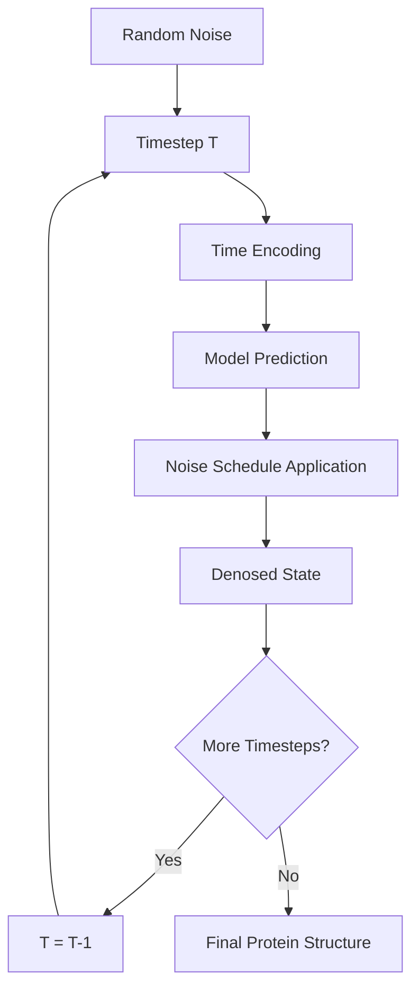

This page explores the temporal aspects of FoldingDiff's diffusion model architecture, focusing on how time information is encoded and how noise is scheduled throughout the denoising process. These components are fundamental to the diffusion model's ability to generate protein structures through gradual denoising.

## Time Encoding Mechanisms

The diffusion model employs sophisticated time encoding strategies to inform the network about the current timestep in the denoising process. FoldingDiff implements two primary time encoding approaches:

### Gaussian Fourier Projection

The default and recommended time encoding method uses Gaussian random features to project timesteps into a high-dimensional space [foldingdiff/modelling.py#L42-L65](foldingdiff/modelling.py#L42-65). This approach is particularly well-suited for score-based models and provides rich temporal representations:

```python
class GaussianFourierProjection(nn.Module):
    def __init__(self, embed_dim: int, scale: float = 2 * torch.pi):
        super().__init__()
        # Randomly sample weights during initialization, fixed during optimization
        w = torch.randn(embed_dim // 2) * scale
        self.register_buffer("W", w)

    def forward(self, x: torch.Tensor):
        x_proj = x[:, None] * self.W[None, :] * 2 * torch.pi
        embed = torch.cat([torch.sin(x_proj), torch.cos(x_proj)], dim=-1)
        return embed
```

The Gaussian Fourier projection creates time embeddings by projecting timesteps through randomly sampled frequencies, then applying sine and cosine transformations. This creates a smooth, continuous representation of time that helps the model understand the progression of the denoising process.

### Sinusoidal Position Embeddings

An alternative time encoding method uses sinusoidal embeddings [foldingdiff/modelling.py#L74-L95](foldingdiff/modelling.py#L74-95), similar to those used in transformer architectures:

```python
class SinusoidalPositionEmbeddings(nn.Module):
    def forward(self, time: torch.Tensor) -> torch.Tensor:
        device = time.device
        half_dim = self.dim // 2
        embeddings = math.log(10000) / (half_dim - 1)
        embeddings = torch.exp(torch.arange(half_dim, device=device) * -embeddings)
        embeddings = time[:, None] * embeddings[None, :]
        embeddings = torch.cat((embeddings.sin(), embeddings.cos()), dim=-1)
        return embeddings
```

This method provides a deterministic way to encode time information using exponentially spaced frequencies, creating unique embeddings for each timestep.

### Integration with Model Architecture

Time embeddings are integrated into the model through additive combination with input embeddings [foldingdiff/modelling.py#L470-L475](foldingdiff/modelling.py#L470-475):

```python
# timestep is (batch, 1), squeeze to (batch,)
# embedding gets to (batch, embed_dim) -> unsqueee to (batch, 1, dim)
time_encoded = self.time_embed(timestep.squeeze(dim=-1)).unsqueeze(1)
inputs_with_time = inputs_upscaled + time_encoded
```

> [!TIP]
> The time encoding is added to the input embeddings rather than concatenated, allowing the model to learn how temporal information modulates the protein representation at each denoising step.

## Noise Schedules

Noise schedules control how much noise is added at each timestep during the forward diffusion process and consequently guide the denoising during sampling. FoldingDiff implements three distinct noise schedule strategies:

### Linear Schedule

The linear schedule provides a straightforward progression of noise levels [foldingdiff/beta_schedules.py#L32-L37](foldingdiff/beta_schedules.py#L32-37):

```python
def linear_beta_schedule(timesteps: int, beta_start=1e-4, beta_end=0.02) -> torch.Tensor:
    return torch.linspace(beta_start, beta_end, timesteps)
```

This creates a uniform progression from minimal noise at the beginning to maximum noise at the end of the diffusion process.

### Cosine Schedule

The cosine schedule implements the approach from "Improved Denoising Diffusion Probabilistic Models" [foldingdiff/beta_schedules.py#L20-L30](foldingdiff/beta_schedules.py#L20-30):

```python
def cosine_beta_schedule(timesteps: int, s: float = 8e-3) -> torch.Tensor:
    steps = timesteps + 1
    x = torch.linspace(0, timesteps, steps)
    alphas_cumprod = torch.cos(((x / timesteps) + s) / (1 + s) * torch.pi * 0.5) ** 2
    alphas_cumprod = alphas_cumprod / alphas_cumprod[0]
    betas = 1 - (alphas_cumprod[1:] / alphas_cumprod[:-1])
    return torch.clip(betas, 0.0001, 0.9999)
```

The cosine schedule provides more nuanced control over noise progression, with slower changes in the middle of the process and more aggressive changes near the beginning and end.

### Quadratic Schedule

The quadratic schedule uses a sigmoid-based approach for noise progression [foldingdiff/beta_schedules.py#L38-L43](foldingdiff/beta_schedules.py#L38-43):

```python
def quadratic_beta_schedule(timesteps: int, beta_start=1e-4, beta_end=0.02) -> torch.Tensor:
    betas = torch.linspace(-6, 6, timesteps)
    return torch.sigmoid(betas) * (beta_end - beta_start) + beta_start
```

This creates an S-shaped curve for noise progression, potentially providing better balance between early and late diffusion stages.

## Computational Framework

### Alpha Computations

The system computes comprehensive alpha values from beta schedules to support the diffusion process [foldingdiff/beta_schedules.py#L45-L64](foldingdiff/beta_schedules.py#L45-64):

```python
def compute_alphas(betas: torch.Tensor) -> Dict[str, torch.Tensor]:
    alphas = 1.0 - betas
    alphas_cumprod = torch.cumprod(alphas, dim=0)
    alphas_cumprod_prev = F.pad(alphas_cumprod[:-1], (1, 0), value=1.0)
    posterior_variance = betas * (1.0 - alphas_cumprod_prev) / (1.0 - alphas_cumprod)
    sqrt_alphas_cumprod = torch.sqrt(alphas_cumprod)
    sqrt_one_minus_alphas_cumprod = torch.sqrt(1.0 - alphas_cumprod)
    return {
        "betas": betas,
        "alphas": alphas,
        "alphas_cumprod": alphas_cumprod,
        "sqrt_alphas_cumprod": sqrt_alphas_cumprod,
        "sqrt_one_minus_alphas_cumprod": sqrt_one_minus_alphas_cumprod,
        "posterior_variance": posterior_variance,
    }
```

This comprehensive set of values supports both the forward diffusion process and the reverse sampling process, providing all necessary statistical parameters for noise manipulation.

### Schedule Selection Interface

The system provides a unified interface for selecting and configuring noise schedules [foldingdiff/beta_schedules.py#L65-L80](foldingdiff/beta_schedules.py#L65-80):

```python
def get_variance_schedule(keyword: SCHEDULES, timesteps: int, **kwargs) -> torch.Tensor:
    logging.info(f"Getting {keyword} variance schedule with {timesteps} timesteps")
    if keyword == "cosine":
        return cosine_beta_schedule(timesteps, **kwargs)
    elif keyword == "linear":
        return linear_beta_schedule(timesteps, **kwargs)
    elif keyword == "quadratic":
        return quadratic_beta_schedule(timesteps, **kwargs)
    else:
        raise ValueError(f"Unrecognized variance schedule: {keyword}")
```

## Sampling Integration

The time encoding and noise schedules work together during the sampling process to guide protein structure generation. The sampling loop uses the computed schedules to progressively denoise random noise into meaningful protein angle representations [foldingdiff/sampling.py#L78-L91](foldingdiff/sampling.py#L78-91).



> [!TIP]
> The choice of noise schedule significantly impacts generation quality. The cosine schedule generally provides better performance for protein structure generation due to its more balanced approach to noise progression across timesteps.

## Configuration and Usage

Time encoding and noise schedules are configurable through the model initialization parameters [foldingdiff/modelling.py#L244](foldingdiff/modelling.py#L244):

- `time_encoding`: Choose between "gaussian_fourier" (default) or "sinusoidal"
- Noise schedules are selected during training configuration
- Timesteps are typically set to 1000 for standard diffusion processes

The system also provides visualization tools for understanding noise schedule behavior [foldingdiff/beta_schedules.py#L81-L104](foldingdiff/beta_schedules.py#L81-104), allowing researchers to analyze and compare different scheduling strategies.

## Next Steps

To understand how these temporal components integrate with the broader architecture, explore:

- [Diffusion Model Architecture and BERT Integration](6-diffusion-model-architecture-and-bert-integration) - Learn how time encoding fits into the overall model design
- [Protein Backbone Sampling Pipeline](15-protein-backbone-sampling-pipeline) - See how these schedules are used during protein generation
- [Loss Functions for Angular Data](12-loss-functions-for-angular-data) - Understand how temporal information affects training objectives

The temporal encoding and noise scheduling systems form the backbone of FoldingDiff's ability to generate protein structures through controlled denoising, providing the temporal context necessary for meaningful protein structure generation.