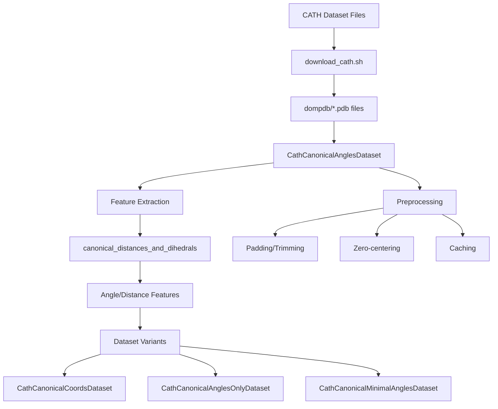

The CATH dataset integration in foldingdiff provides a comprehensive framework for loading, processing, and featurizing protein structures from the CATH (Class, Architecture, Topology, Homologous superfamily) database. This integration serves as the primary data source for training protein structure generation models using diffusion-based approaches.

## Dataset Architecture Overview

The CATH dataset integration follows a hierarchical architecture that separates data loading, featurization, and preprocessing concerns. The core dataset classes extend PyTorch's Dataset interface while providing specialized functionality for protein structure data.

## Data Acquisition and Setup

The CATH dataset is automatically downloaded and processed through a dedicated shell script that fetches the non-redundant S40 dataset from the official CATH repository [download_cath.sh](data/download_cath.sh#L1-L9). The dataset contains protein domain structures organized by structural classification, providing a diverse training set for protein structure modeling.

The script downloads the compressed PDB files and extracts them to the `data/cath/dompdb/` directory, where they become accessible to the dataset classes. An MD5 checksum verification ensures data integrity during the download process.

## Core Dataset Class: CathCanonicalAnglesDataset

The primary dataset class, [CathCanonicalAnglesDataset](foldingdiff/datasets.py#L75-L482), serves as the foundation for all CATH-based data loading. It implements comprehensive protein structure featurization with the following key characteristics:

### Feature Sets and Angularity

The dataset supports multiple feature configurations through predefined mappings [datasets.py#L44-L70]:

- **canonical**: 9 features including 3 bond distances and 6 angles
- **canonical-full-angles**: 6 angular features (phi, psi, omega, tau, CA:C:1N, C:1N:1CA)
- **canonical-minimal-angles**: 4 essential angles (phi, psi, omega, tau)
- **cart-coords**: 3 Cartesian coordinates for alpha carbons

Each feature is classified by its angularity, determining whether it requires special handling for periodic boundary conditions during training and inference.

### Data Loading and Processing

The dataset initialization [datasets.py#L101-L120] supports flexible configuration options:

- **Source selection**: Choose between "cath", "alphafold", or custom directory paths
- **Sequence length control**: Configure minimum (40 residues) and maximum (512 residues) lengths
- **Trimming strategies**: "leftalign", "randomcrop", or "discard" for handling sequences exceeding maximum length
- **Zero-centering**: Automatic mean subtraction for improved training stability
- **Caching**: Optional caching of computed features for faster subsequent loading

The dataset automatically discovers PDB files through the [__get_pdb_fnames](foldingdiff/datasets.py#L235-L260) method, which handles both keyword-based and directory-based data sources.

### Feature Computation Pipeline

Protein structure featurization occurs through a parallelized pipeline [datasets.py#L304-L340]:

1. **Parallel processing**: Uses multiprocessing to extract features from all PDB files
2. **Angle calculation**: Computes backbone dihedral angles (phi, psi, omega) and geometric angles
3. **Distance measurement**: Extracts bond distances between consecutive atoms
4. **Coordinate extraction**: Generates alpha carbon coordinates for structural reference
5. **Quality filtering**: Removes structures with parsing errors or missing data

The featurization leverages the [canonical_distances_and_dihedrals](foldingdiff/angles_and_coords.py#L34-L50) function from the angles_and_coords module, which uses biotite for robust PDB parsing and geometric calculations.

## Dataset Variants

The CATH integration provides specialized dataset variants for different modeling requirements:

### CathCanonicalCoordsDataset

This variant [datasets.py#L483-L497] returns XYZ coordinates of alpha carbon atoms instead of angular features. It's particularly useful for coordinate-based modeling approaches and direct structure comparison tasks.

### CathCanonicalAnglesOnlyDataset

Focusing exclusively on angular features [datasets.py#L502-L540], this variant returns the 6 canonical angles (3 dihedral and 3 non-dihedral) without distance information. This is ideal for pure angular diffusion models.

### CathCanonicalMinimalAnglesDataset

The most streamlined variant [datasets.py#L557-L566] returns only the essential 4 angles (phi, psi, omega, tau) required for reasonable protein reconstruction. This minimal representation reduces computational complexity while maintaining structural fidelity.

## Data Preprocessing and Augmentation

The dataset implements sophisticated preprocessing to handle variable-length sequences and improve training efficiency:

### Padding and Masking

Sequences are padded to a fixed length (default 512 residues) with special attention masks [datasets.py#L364-L460] that distinguish real residues from padding. This enables efficient batch processing while preserving sequence boundaries.

### Length-based Trimming Strategies

For sequences exceeding the maximum length, three strategies are available:

- **leftalign**: Truncate from the C-terminus, preserving N-terminal structure
- **randomcrop**: Randomly select a contiguous segment within the sequence
- **discard**: Exclude sequences that are too long

### Zero-Centering and Angular Wrapping

Angular features are automatically zero-centered by subtracting feature means [datasets.py#L410-L420]. Angular values are wrapped to the [-π, π] range using modulo operations to maintain proper periodicity.

## Configuration Integration

The CATH dataset integrates seamlessly with the configuration system through JSON files like [cath_full_angles.json](config_jsons/cath_full_angles.json#L1-L31). These configurations specify:

- Feature set definitions ("canonical-full-angles")
- Sequence length constraints (min: 40, max: 128)
- Preprocessing parameters (trim_strategy: "randomcrop")
- Training hyperparameters (batch_size: 64, timesteps: 1000)

This integration allows reproducible dataset configuration across different experiments and modeling approaches.

## Performance Optimizations

The CATH dataset implementation includes several performance optimizations:

- **Multiprocessing**: Parallel feature extraction across all CPU cores
- **Caching**: Optional on-disk caching of computed features to avoid recomputation
- **Memory efficiency**: Lazy loading of structures to minimize memory footprint
- **Batch-friendly design**: Consistent tensor shapes and efficient masking strategies

These optimizations enable training on large-scale CATH datasets while maintaining reasonable computational requirements.

> [!TIP]
> The dataset's modular design allows easy extension to additional protein structure databases. By implementing the same interface as CathCanonicalAnglesDataset, new data sources can be integrated with minimal changes to the training pipeline.

> [!TIP]
> For optimal training performance, enable caching and use the "randomcrop" trimming strategy. This combination provides both computational efficiency and data augmentation benefits through random segment selection.

## Next Steps

After understanding the CATH dataset integration, explore the [Angle-to-Coordinate Conversion System](10-angle-to-coordinate-conversion-system) to learn how angular features are converted back to 3D protein structures, or examine the [Dataset Variants and Feature Sets](11-dataset-variants-and-feature-sets) for detailed comparisons of different feature configurations.