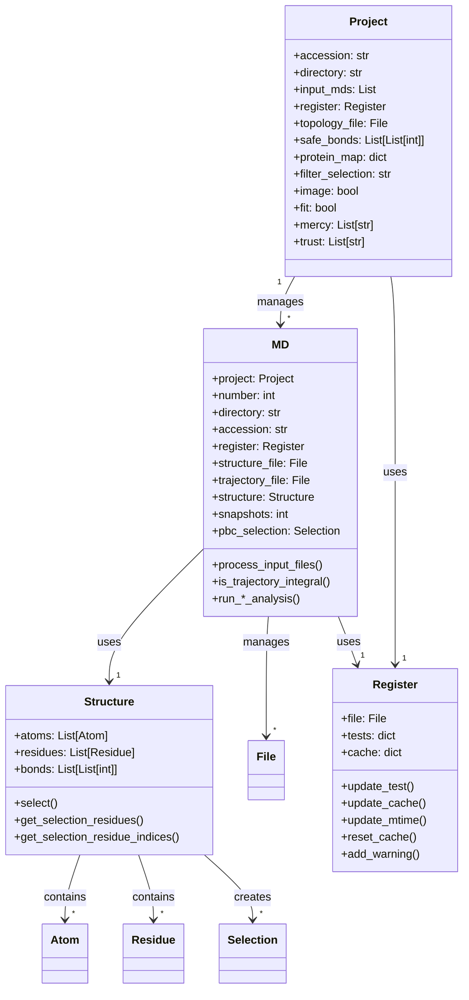
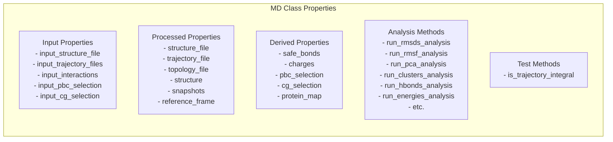
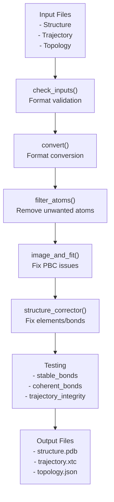
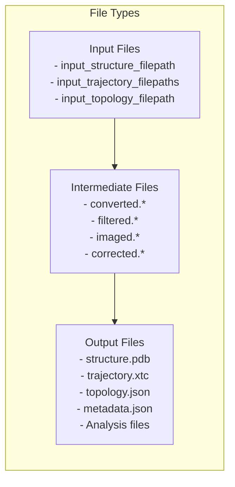
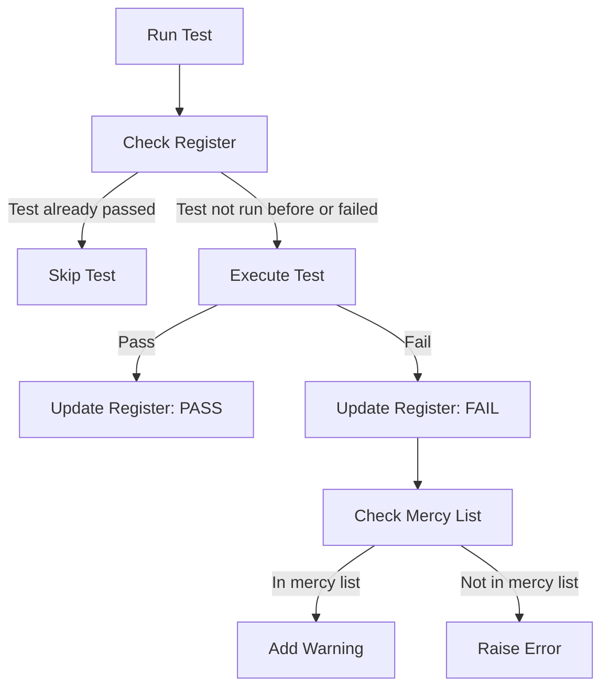
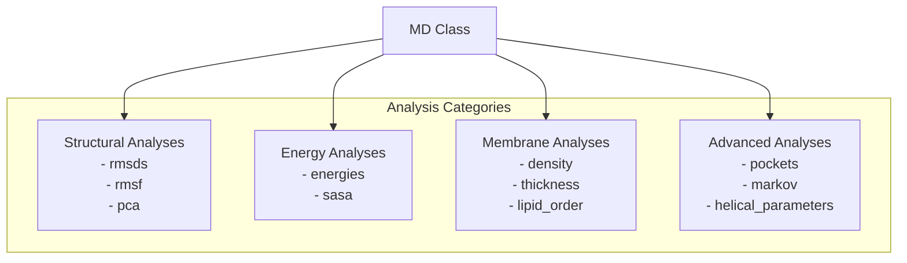

# Core Framework

Relevant source files

The following files were used as context for generating this wiki page:

- [model_workflow/mwf.py](model_workflow/mwf.py)
- [model_workflow/utils/constants.py](model_workflow/utils/constants.py)

The Core Framework comprises the foundational architectural components of the MDDB-workflow system. This page documents the central classes, data models, and mechanisms that form the backbone of the workflow system for processing molecular dynamics (MD) simulations and preparing data for the MDDB database. The framework handles project management, MD simulation representation, structural data modeling, and provides the infrastructure for processing pipelines and analysis modules.

For specific details about individual core components, see [Project Class](#2.1), [MD Class](#2.2), [Structure and Atom Models](#2.3), and [Register System](#2.4).

## Architecture Overview

The Core Framework is designed around a hierarchical object model that represents molecular dynamics simulations and manages their processing workflow. It follows an object-oriented design with clearly defined responsibilities for each component.

**Core Architectural Principles:**

1. **Hierarchical Organization**: Projects contain one or more MD simulations
2. **Lazy Evaluation**: Files and analyses are generated on-demand
3. **Caching**: The Register system tracks test results and cached values
4. **Test-Driven Processing**: Input validation and testing ensure data integrity
5. **Property-Based Access**: Most attributes are accessed through properties that trigger processing when needed

Sources: [model_workflow/mwf.py:89-1380](). [model_workflow/utils/constants.py:1-489]()

## Main Components

### Project Class

The Project class serves as a container for multiple related MD simulations, managing shared resources and configuration. It maintains the topology file, safe bonds, and configuration parameters that apply to all contained MD simulations.

### MD Class

The MD class is the central component of the framework, representing a single molecular dynamics simulation with its structure, trajectory, and associated analyses. 

Key responsibilities:
- Managing input and output files
- Processing raw simulation data
- Running analyses
- Tracking test results
- Managing metadata

The MD class uses lazy initialization for most properties, only generating or processing data when explicitly requested.

The MD class implements property getters that manage file dependencies and caching, ensuring files are only processed when necessary. This design allows for efficient resource use and maintains a clear record of processing steps.

Sources: [model_workflow/mwf.py:100-1380]()

### Structure and Atom Models

The Structure class represents molecular structures, providing methods for atom selection, bond management, and coordinate manipulation. It's a fundamental data model used throughout the system.

Key features:
- Atom and residue representation
- Selection mechanism for subsets of atoms
- Bond management
- PBC (Periodic Boundary Conditions) handling
- Coarse-grain representation support

### Register System

The Register system tracks test executions, caches intermediary results, and logs warnings. It provides mechanisms for:

1. Recording test results (pass/fail/not applicable)
2. Caching calculated values
3. Tracking file modification times
4. Managing warnings

The Register is crucial for avoiding redundant calculations and maintaining data integrity across processing steps.

## Processing Workflow

The Core Framework implements a comprehensive processing pipeline for molecular dynamics data:

The processing workflow:

1. **Input Validation**: Checks the format and compatibility of input files
2. **Conversion**: Converts files to standard formats if needed
3. **Filtering**: Removes unwanted atoms (e.g., water, ions) according to filter settings
4. **Imaging and Fitting**: Corrects periodic boundary issues and centers the system
5. **Structure Correction**: Fixes elements, bonds, and other structural issues
6. **Testing**: Validates the processed files for data integrity
7. **Output Generation**: Produces standard output files for subsequent analysis

This pipeline is managed by the `process_input_files()` method in the MD class, which handles intermediate files and ensures each step is only executed when necessary.

Sources: [model_workflow/mwf.py:475-968]()

## File Management

The framework implements a sophisticated file management system that handles:

- Input file resolution (relative paths, absolute paths, globbing)
- Output file generation
- Intermediate file cleanup
- Symlink creation to avoid duplication
- Remote file downloading when needed

Files are tracked using the File class, which provides consistent handling of file operations and metadata. File dependencies are managed through a series of property getters that trigger generation when files are requested but don't exist.

Sources: [model_workflow/mwf.py:181-297](), [model_workflow/mwf.py:300-420]()

## Testing and Validation

The Core Framework implements a robust testing system to ensure data integrity throughout processing:

1. **Stable Bonds Test**: Ensures bonds remain stable throughout the trajectory
2. **Coherent Bonds Test**: Verifies bonds are physically reasonable
3. **Trajectory Integrity Test**: Checks for sudden jumps or discontinuities

Tests can be configured with:
- **Mercy**: Allows specific tests to fail without halting processing
- **Trust**: Skips certain tests, assuming they would pass

This testing system is deeply integrated with the Register to track test executions and results.

Sources: [model_workflow/mwf.py:493-557](), [model_workflow/mwf.py:1384-1405]()

## Integration with Analysis Modules

The Core Framework provides the foundation for analysis modules through a standardized interface. Analysis methods in the MD class follow a consistent pattern:

1. Check if output file already exists (unless overwrite is requested)
2. Prepare necessary inputs (structure, trajectory, etc.)
3. Call the appropriate analysis function
4. Save results to standardized JSON files

Analysis functions vary widely in purpose, from basic structural analyses like RMSD (Root Mean Square Deviation) to sophisticated analyses like pocket detection and Markov state modeling.

The analysis modules build upon the processed files and data models provided by the Core Framework, ensuring consistency and reliability across different types of analyses.

Sources: [model_workflow/mwf.py:1410-1607]()

## Conclusion

The Core Framework of MDDB-workflow provides a robust foundation for processing and analyzing molecular dynamics simulations. Its object-oriented design, with clear separation of concerns between different components, allows for flexible and extensible workflow management. 

Key strengths include:
- Comprehensive file management and processing
- On-demand computation with caching
- Robust testing and validation
- Integration with diverse analysis modules

This architecture enables reliable preparation of molecular dynamics data for the MDDB database while providing extensive analysis capabilities.

---