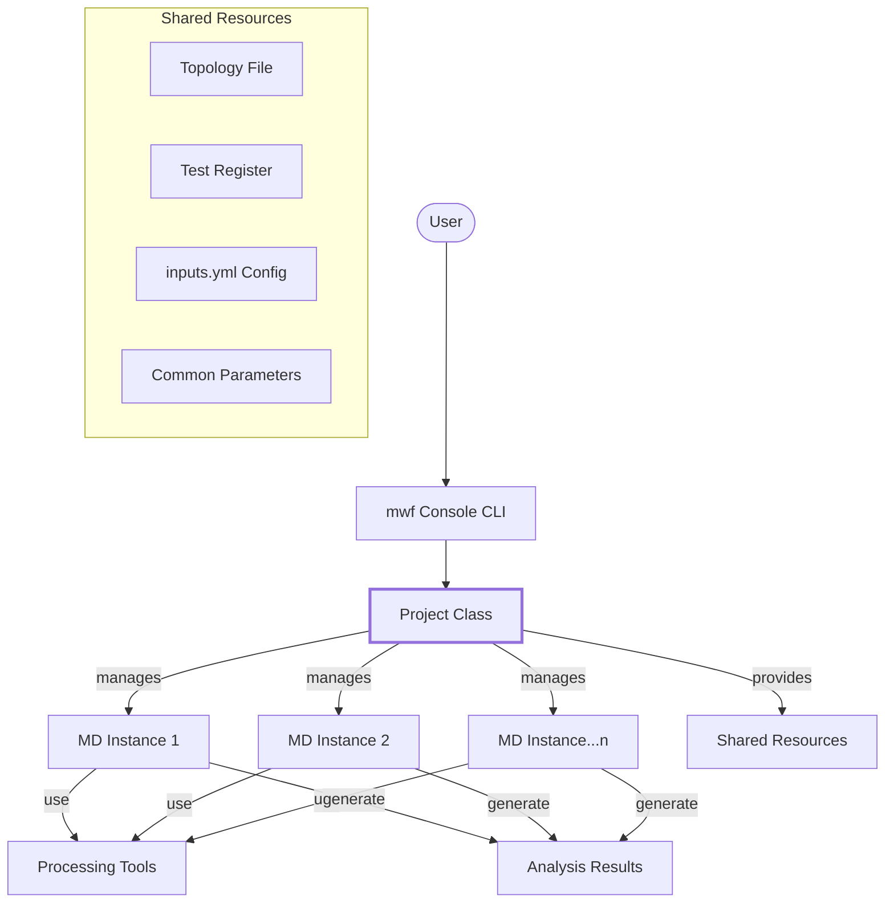
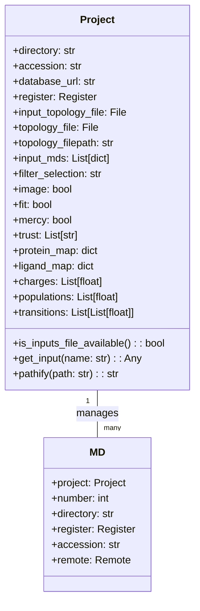
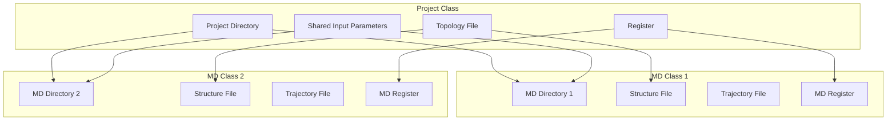
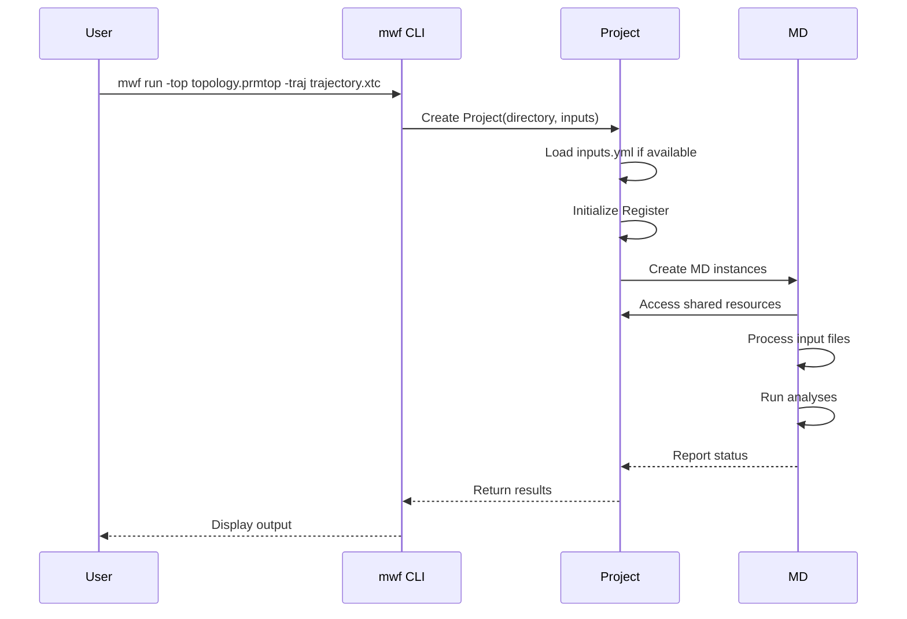

# Project Class

Relevant source files

The following files were used as context for generating this wiki page:

- [model_workflow/mwf.py](model_workflow/mwf.py)
- [model_workflow/utils/constants.py](model_workflow/utils/constants.py)

The Project class serves as a central management entity in the MDDB-workflow system, responsible for organizing and coordinating multiple Molecular Dynamics (MD) simulations. It provides shared resources, configuration management, and data handling capabilities for all MD instances within a project.

For information about the MD Class which is managed by Project, see [MD Class](#2.2).

## 1. Overview

The Project class is one of the core components of the MDDB-workflow architecture, sitting between the command-line interface and the individual MD simulations. It manages collections of related MD simulations that share common parameters, processing logic, and analysis requirements.

Sources: [model_workflow/mwf.py:3-99]()

## 2. Responsibilities

The Project class has several key responsibilities:

1. **Configuration Management**: Loads and manages project-wide configuration from inputs files
2. **Directory Organization**: Maintains the project directory structure and file paths
3. **MD Management**: Creates and tracks multiple MD instances 
4. **Resource Sharing**: Provides shared resources like topology files to all MD instances
5. **Test Registration**: Maintains a register to track test executions and results
6. **Remote Access**: Handles connections to remote databases for data retrieval or submission

## 3. Class Structure

The Project class maintains several important properties that influence how MD simulations are processed and analyzed:

Sources: [model_workflow/mwf.py:100-180](), [model_workflow/mwf.py:1000-1380]()

## 4. Key Properties

### 4.1 Path and Location Properties

| Property | Type | Description |
|----------|------|-------------|
| `directory` | string | The base directory for the project |
| `input_topology_file` | File | The input topology file |
| `topology_file` | File | The processed topology file |
| `topology_filepath` | string | Path to the topology file |

### 4.2 Configuration Properties

| Property | Type | Description |
|----------|------|-------------|
| `filter_selection` | string | Selection criteria for filtering atoms |
| `image` | boolean | Flag for imaging operations |
| `fit` | boolean | Flag for fitting operations |
| `mercy` | boolean | When true, allows certain test failures to be warnings instead of errors |
| `trust` | List[string] | List of tests that are trusted even if they fail |
| `rmsd_cutoff` | float | Cutoff value for RMSD calculations |
| `interaction_cutoff` | float | Cutoff value for interactions |
| `interactions_auto` | boolean | Flag for automatic interaction detection |

### 4.3 Data Properties

| Property | Type | Description |
|----------|------|-------------|
| `input_mds` | List[dict] | Input specifications for MDs |
| `protein_map` | dict | Protein mapping data |
| `ligand_map` | dict | Mapping for ligands |
| `charges` | List[float] | Atom charges |
| `populations` | List[float] | Population data (for Markov State Models) |
| `transitions` | List[List[float]] | Transition probability data |

Sources: [model_workflow/mwf.py:1242-1345]()

## 5. Project-MD Relationship

The Project class creates and manages multiple MD instances, with each MD representing a single molecular dynamics simulation. This relationship is illustrated below:

Key aspects of this relationship:

1. **Directory Structure**: Each MD has its own directory within the project directory
2. **Shared Topology**: The project provides a common topology file used by all MDs
3. **Register Inheritance**: MDs can use the project's register or have their own
4. **Parameter Inheritance**: MDs inherit project-level parameters unless overridden

Sources: [model_workflow/mwf.py:104-187](), [model_workflow/mwf.py:166-172]()

## 6. Project Initialization

When initializing a Project, the following steps typically occur:

1. **Directory Setup**: Verify and set up the project directory structure
2. **Configuration Loading**: Load the inputs file (yaml/json) if available
3. **Remote Connection**: Set up database connections if necessary
4. **Register Creation**: Initialize a register for test tracking
5. **MD Creation**: Create MD instances based on configuration

The relationship between Project initialization and workflow execution is shown below:

Sources: [model_workflow/mwf.py:104-126]()

## 7. Input Management

The Project class handles two types of inputs:

1. **Command Line Inputs**: Parameters passed directly via the CLI
2. **Configuration File Inputs**: Parameters specified in the inputs.yml/yaml file

The inputs.yml file is the primary way to configure the project and its MDs. The Project class provides methods to access these inputs:

- `is_inputs_file_available()`: Checks if an inputs file exists
- `get_input(name)`: Retrieves a specific input parameter

Common input parameters that can be specified include:

| Parameter | Description | Default Value |
|-----------|-------------|---------------|
| `filter_selection` | Atoms to keep after filtering | None (keep all atoms) |
| `image` | Whether to image the trajectory | False |
| `fit` | Whether to fit the trajectory | False |
| `rmsd_cutoff` | RMSD cutoff for integrity tests | 9 |
| `interaction_cutoff` | Cutoff for interaction analysis | 0.1 |
| `pbc_selection` | Atoms in periodic boundary conditions | Auto-detected |
| `cg_selection` | Coarse-grained atom selection | None |

Sources: [model_workflow/utils/constants.py:50-63](), [model_workflow/mwf.py:422-451]()

## 8. Test Registration

The Project class uses a Register system to track test executions and cache results. This system helps:

1. Avoid rerunning tests that have already passed
2. Track which files have been modified since tests were last run
3. Maintain a cache of computed values for performance

The common tests tracked include:

| Test | Description | Flag Constant |
|------|-------------|---------------|
| Stable Bonds | Check if bonds are stable | `STABLE_BONDS_FLAG` |
| Coherent Bonds | Check if bond definitions are coherent | `COHERENT_BONDS_FLAG` |
| Trajectory Integrity | Check for sudden jumps in trajectory | `TRAJECTORY_INTEGRITY_FLAG` |

Sources: [model_workflow/utils/constants.py:190-212](), [model_workflow/mwf.py:165-172]()

## 9. Usage Example

The Project class is typically used in the following way:

1. Create a Project instance with a directory and optional inputs
2. The Project creates MD instances based on configuration
3. Operations are performed on the MDs, with the Project providing shared resources
4. Results are collected from the MDs for reporting or further processing

The Project class is primarily used by the command-line interface and rarely needs to be instantiated directly by users.

## 10. Summary

The Project class serves as the central coordination point for the MDDB-workflow system, managing multiple MD simulations and providing shared resources. By centralizing configuration and resource management, it ensures consistent processing across all simulations within a project.

Key features:
- Manages multiple MD instances
- Handles shared configuration and resources
- Coordinates file paths and directory structure
- Facilitates test registration and tracking
- Provides database connectivity for remote operations

The Project class works closely with the MD class to organize, process, and analyze molecular dynamics simulations in a structured and reproducible way.

---