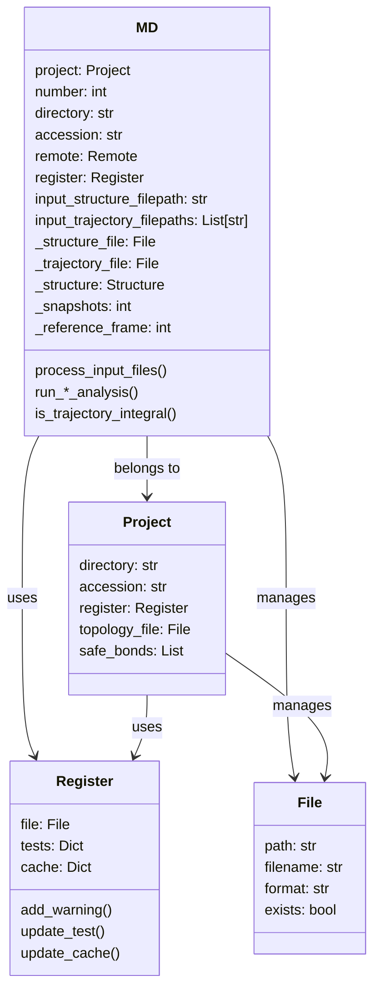
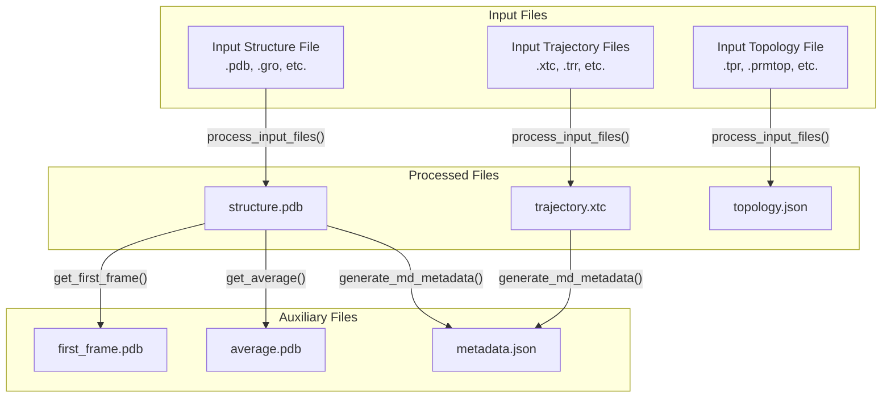
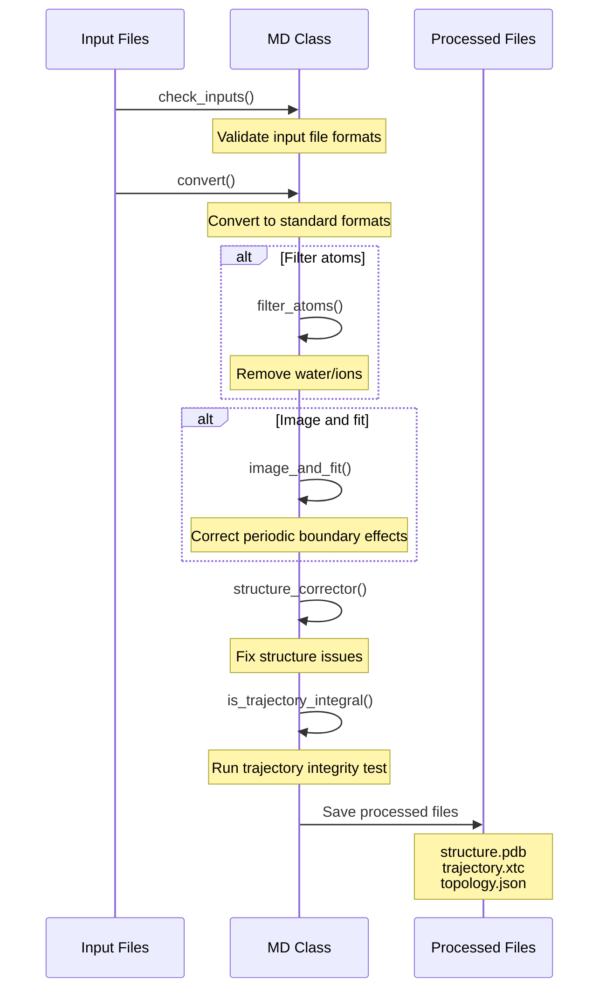
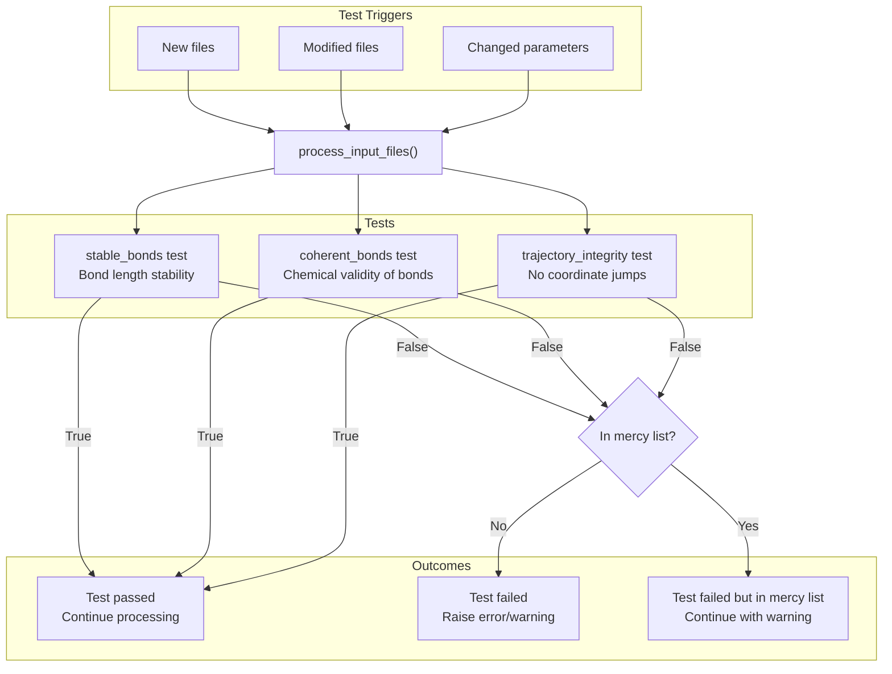
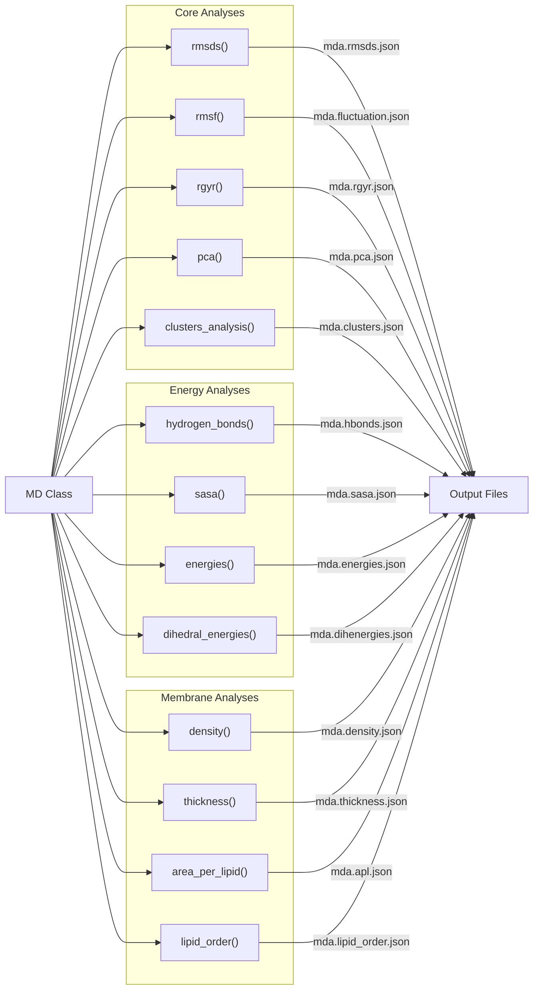
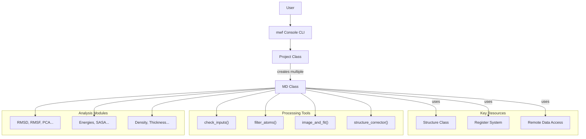

# MD Class

<details>
<summary>Relevant source files</summary>

The following files were used as context for generating this wiki page:

- [model_workflow/mwf.py](model_workflow/mwf.py)
- [model_workflow/utils/constants.py](model_workflow/utils/constants.py)

</details>


## Purpose and Overview

The MD Class is a core component of the MDDB-workflow system that represents a single molecular dynamics (MD) simulation. It manages the combination of a structure and trajectory data, providing methods to process input files, run tests for data integrity, and perform various analyses. The MD Class always exists within the context of a Project object and inherits some properties from it, such as topology information and certain configuration settings.

For information about the parent Project class that manages collections of MD simulations, see [Project Class](#2.1).

Sources: [model_workflow/mwf.py:100-105]()

## Class Structure and Initialization

The MD class is initialized with several key parameters that establish its identity and data sources:

```python
def __init__(self,
    project: 'Project',  # The parent project this MD belongs to
    number: int,         # The number of the MD according to its accession
    directory: str,      # The local directory where the MD takes place
    input_structure_filepath: str,  # Input structure file
    input_trajectory_filepaths: List[str],  # Input trajectory files
):
```

The initialization process:
1. Stores reference to the parent project
2. Sets up directory paths and file references
3. Establishes a connection to remote data if database URL is available
4. Creates a register for tracking tests and caching results

Upon initialization, the MD class doesn't immediately process files or run analyses - instead, it uses lazy loading to defer these operations until the data is actually needed.



Sources: [model_workflow/mwf.py:104-172]()

## File Handling and Path Management

### Input File Management

The MD class handles both input and processed files using a careful path management system:

1. Input files can be specified directly or through an inputs.yml configuration file
2. Files can be relative to the MD directory or the project directory
3. If files don't exist locally, the class can download them from a remote database
4. The class supports automatic glob pattern expansion for matching multiple files

The MD class has properties that provide access to input files:
- `input_structure_file`: The source structure file (PDB, etc.)
- `input_trajectory_files`: The source trajectory files (XTC, etc.)

### Local Path Resolution

The class uses a `pathify()` method to construct local paths for files:

```python
def pathify(self, filename_or_relative_path: str) -> str:
    return self.directory + '/' + filename_or_relative_path
```

This allows for consistent file path management regardless of where in the code files are accessed.

### Processed File Management

The main processed files managed by the MD class are:
- `structure_file`: The final processed structure file (PDB)
- `trajectory_file`: The final processed trajectory file (XTC)
- `topology_file`: The topology file (inherited from the Project)

These properties trigger file processing when accessed if processed files don't already exist.



Sources: [model_workflow/mwf.py:189-190](), [model_workflow/mwf.py:271-297](), [model_workflow/mwf.py:304-420](), [model_workflow/mwf.py:970-1002]()

## Processing Pipeline

The core of the MD class is its `process_input_files()` method, which transforms raw input files into standardized, processed files ready for analysis. This processing includes several key steps:

### 1. Input Validation

Checks if input files exist and have valid formats using the `check_inputs()` function.

### 2. File Conversion and Merging

Converts input structure and trajectory files to standard formats (PDB and XTC) and merges multiple trajectory files if needed.

### 3. Atom Filtering

Optionally removes atoms (like water and ions) based on selection strings, creating a smaller, more manageable dataset.

### 4. Trajectory Imaging and Fitting

Applies periodic boundary condition corrections and optionally fits the trajectory to remove global translation and rotation.

### 5. Structure Correction

Performs comprehensive structure validation and correction, including:
- Element type verification
- Bond stability checking
- Atom coordinate correction
- Selection of an appropriate reference frame



Sources: [model_workflow/mwf.py:479-968]()

## Register System and Testing

The MD class uses a `Register` object to track test results and cache computation results. Each MD instance has its own register file (.register.json) that persists across multiple runs of the workflow.

### Key Tests

The MD class implements several critical tests to ensure data integrity:

1. **Stable Bonds Test**: Verifies that bond lengths remain within reasonable ranges throughout the trajectory
2. **Coherent Bonds Test**: Checks that bonds are consistent with chemical knowledge
3. **Trajectory Integrity Test**: Ensures there are no sudden jumps or discontinuities in the trajectory

### Test Execution Logic

Tests are automatically run when:
- Files are processed for the first time
- Input files have been modified since the last run
- Processing parameters have changed

Test results can be:
- `True`: Test passed
- `False`: Test failed
- `'na'`: Test is not applicable
- `None`: Test has not been run

The MD class handles test failures gracefully through a "mercy" system, which allows certain non-critical failures to be overridden based on Project-level settings.



Sources: [model_workflow/mwf.py:166-172](), [model_workflow/mwf.py:493-546](), [model_workflow/mwf.py:1385-1404]()

## Selection Systems

The MD class manages several important atom selections that control how various operations are performed:

### Periodic Boundary Condition (PBC) Selection

Identifies atoms that are still subject to periodic boundary conditions (typically solvent, ions, and lipids). This selection is critical for proper imaging and fitting operations:

```python
def get_pbc_selection(self) -> 'Selection':
    # Implementation details...
```

### Coarse-Grained (CG) Selection

Identifies atoms that represent coarse-grained beads rather than actual atoms, requiring special handling:

```python
def get_cg_selection(self) -> 'Selection':
    # Implementation details...
```

Selections can be:
1. Explicitly provided in the inputs file
2. Automatically determined based on residue types and names
3. Empty if not applicable to the simulation

These selections are used throughout the processing pipeline to ensure appropriate handling of different atom types.

Sources: [model_workflow/mwf.py:1190-1321]()

## Analysis Capabilities

The MD class provides a comprehensive suite of analysis methods to extract insights from the molecular dynamics simulations. Each analysis method follows a similar pattern:

1. Check if the analysis has already been run and results exist
2. Check if the analysis should be overwritten
3. Run the analysis and save results to a standardized output file

### Core Structural Analyses

| Analysis | Method | Description | Output file |
|----------|--------|-------------|------------|
| RMSD | `run_rmsds_analysis()` | Root Mean Square Deviation of structure | mda.rmsds.json |
| RMSF | `run_rmsf_analysis()` | Root Mean Square Fluctuation of atoms | mda.fluctuation.json |
| RGYR | `run_rgyr_analysis()` | Radius of Gyration | mda.rgyr.json |
| PCA | `run_pca_analysis()` | Principal Component Analysis | mda.pca.json |
| Clusters | `run_clusters_analysis()` | Clustering of trajectory frames | mda.clusters.json |

### Energy and Interaction Analyses

| Analysis | Method | Description | Output file |
|----------|--------|-------------|------------|
| Hydrogen Bonds | `run_hbonds_analysis()` | H-bond network analysis | mda.hbonds.json |
| SASA | `run_sas_analysis()` | Solvent Accessible Surface Area | mda.sasa.json |
| Energies | `run_energies_analysis()` | Energy decomposition | mda.energies.json |
| Dihedral Energies | `run_dihedral_energies()` | Energy of dihedral angles | mda.dihenergies.json |

### Membrane-Specific Analyses

| Analysis | Method | Description | Output file |
|----------|--------|-------------|------------|
| Density | `run_density_analysis()` | Membrane density profiles | mda.density.json |
| Thickness | `run_thickness_analysis()` | Membrane thickness | mda.thickness.json |
| Area per Lipid | `run_apl_analysis()` | Area per lipid in membrane | mda.apl.json |
| Lipid Order | `run_lipid_order_analysis()` | Lipid order parameters | mda.lipid_order.json |

Each analysis produces standardized JSON output files that can be loaded into the MDDB database for visualization and further analysis.



Sources: [model_workflow/mwf.py:1410-1770](), [model_workflow/utils/constants.py:150-175]()

## Key Properties and Computed Data

The MD class provides access to various properties derived from the simulation data:

### Core Properties

| Property | Type | Description |
|----------|------|-------------|
| `structure_file` | File | Path to processed structure file |
| `trajectory_file` | File | Path to processed trajectory file |
| `topology_file` | File | Path to topology file (from project) |
| `snapshots` | int | Number of frames in trajectory |
| `structure` | Structure | Processed structure object |
| `pytraj_trajectory` | TrajectoryIterator | PyTraj trajectory object |
| `reference_frame` | int | Frame used for reference representation |

### Derived Properties

| Property | Description |
|----------|-------------|
| `first_frame_file` | First frame of trajectory as PDB |
| `average_structure_file` | Average structure over trajectory |
| `metadata_file` | Generated metadata for the MD |
| `processed_interactions` | Processed interaction data |
| `pbc_selection` | Selection of periodic boundary atoms |
| `cg_selection` | Selection of coarse-grained atoms |

Most properties use lazy evaluation - they're only calculated when requested and then cached for future use. This approach optimizes performance by avoiding unnecessary computations.

Sources: [model_workflow/mwf.py:969-1379]()

## Relationship with Other Components

The MD class is deeply integrated with other components of the MDDB-workflow system:



### Project Class
- The MD class is always created within a Project
- Inherits certain settings and resources from the Project (mercy list, topology, etc.)
- Can access shared Project-level resources like the ligand mapping

### Structure Class
- Central data model used to represent molecular structures
- Provides selection capabilities and structure manipulation functions

### Register System
- Tracks test execution and results
- Caches computational results to avoid redundant calculations
- Persists state across multiple runs

### Remote Data Access
- Allows downloading files from remote database when needed
- Supports the database URL and accession pattern: `{project.accession}.{md.number}`

Sources: [model_workflow/mwf.py:100-103](), [model_workflow/mwf.py:113-126]()

## Usage Pattern

The MD class is typically used in this sequence:

1. An instance is created by the Project class
2. Input files are specified either directly or through inputs.yml
3. Processed files are generated through the `process_input_files()` method
4. Various analyses are run using the `run_*_analysis()` methods
5. Results are saved as standardized JSON files for database upload

The MD class is designed to be robust to interruptions - if processing is halted, it can resume from the last completed step when restarted, saving time and computational resources.

Sources: [model_workflow/mwf.py:479-968]()

---