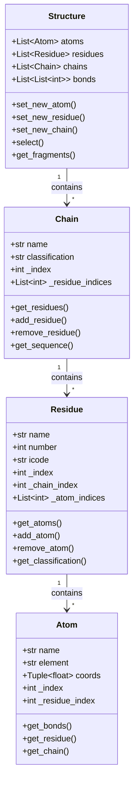
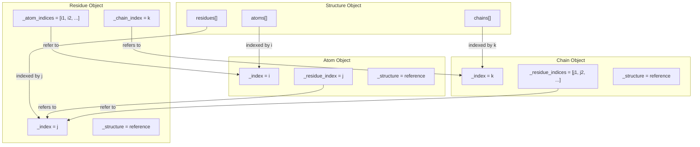
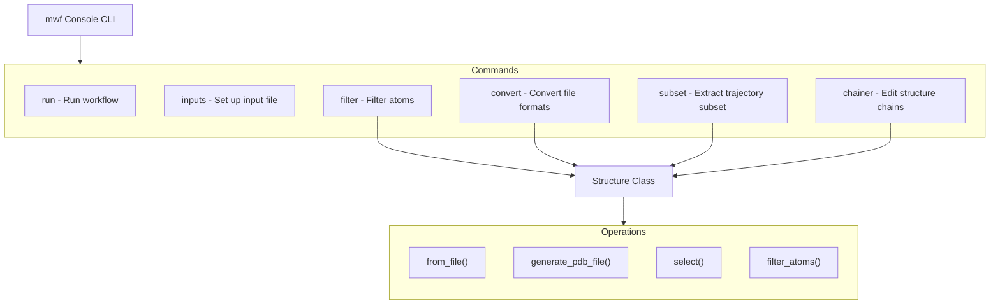

# Structure and Atom Models

Relevant source files

The following files were used as context for generating this wiki page:

- [model_workflow/console.py](model_workflow/console.py)
- [model_workflow/utils/structures.py](model_workflow/utils/structures.py)

## Purpose and Scope

This document describes the core data models used to represent molecular structures in the MDDB-workflow system. These models form the foundation for all molecular dynamics (MD) analyses performed by the workflow. Specifically, this document covers the hierarchical structure of atoms, residues, and chains, their relationships, properties, and capabilities for manipulation and selection.

For information about how these structures are used in the broader workflow context, see [Core Framework](#2).

## Class Hierarchy Overview

The MDDB-workflow represents molecular structures through a hierarchical model consisting of four main classes: `Structure`, `Chain`, `Residue`, and `Atom`. This hierarchy mirrors the natural organization of biomolecules, allowing for intuitive data manipulation.

Sources: [model_workflow/utils/structures.py:72-1831]()

## Reference and Index System

The structure model uses a sophisticated reference and index system to maintain relationships between objects while allowing for efficient manipulation.

Sources: [model_workflow/utils/structures.py:77-104](), [model_workflow/utils/structures.py:352-396](), [model_workflow/utils/structures.py:866-898]()

## The Atom Class

The `Atom` class is the fundamental building block of the molecular structure system, representing individual atoms in a molecule.

### Key Properties

| Property | Type | Description |
|----------|------|-------------|
| `name` | str | Atom name (e.g., "CA", "N", "O") |
| `element` | str | Chemical element (e.g., "C", "N", "O") |
| `coords` | Tuple(float, float, float) | 3D coordinates (x, y, z) |
| `_structure` | Structure | Reference to parent structure |
| `_index` | int | Index in the structure's atom list |
| `_residue_index` | int | Index of the residue this atom belongs to |

### Key Methods

- `get_residue()`: Returns the residue this atom belongs to
- `set_residue()`: Assigns the atom to a different residue
- `get_chain()`: Returns the chain this atom belongs to
- `set_chain_index()`: Updates the chain this atom belongs to
- `get_bonds()`: Returns indices of atoms bonded to this atom
- `get_bonded_atoms()`: Returns the actual atom objects bonded to this atom
- `get_selection()`: Creates a Selection object for this atom
- `is_ion()`: Checks if the atom is an isolated ion
- `is_cg()`: Checks if the atom is a coarse-grained particle
- `guess_element()`: Attempts to determine the element from the atom name

Sources: [model_workflow/utils/structures.py:72-343]()

## The Residue Class

The `Residue` class represents a molecular residue (e.g., amino acid, nucleotide, ligand), containing a collection of atoms.

### Key Properties

| Property | Type | Description |
|----------|------|-------------|
| `name` | str | Residue name (e.g., "ALA", "GLY") |
| `number` | int | Residue number in the chain |
| `icode` | str | Insertion code for alternative numbering |
| `_structure` | Structure | Reference to parent structure |
| `_index` | int | Index in the structure's residue list |
| `_atom_indices` | List[int] | Indices of atoms in this residue |
| `_chain_index` | int | Index of the chain this residue belongs to |
| `_classification` | str | Biochemical classification |

### Key Methods

- `get_atoms()`: Returns the atoms in this residue
- `set_atoms()`: Updates the atoms in this residue
- `add_atom()`: Adds an atom to this residue
- `remove_atom()`: Removes an atom from this residue
- `get_chain()`: Returns the chain this residue belongs to
- `set_chain()`: Assigns the residue to a different chain
- `get_bonded_atoms()`: Returns atoms bonded to this residue
- `get_bonded_residues()`: Returns residues bonded to this residue
- `get_classification()`: Determines the biochemical classification
- `get_letter()`: Returns the one-letter code for amino acids/nucleotides
- `get_formula()`: Returns the chemical formula for the residue
- `find_rings()`: Identifies ring structures in the residue

### Residue Classification

The `get_classification()` method categorizes residues into several types:

- `protein`: Amino acid residues
- `dna`: Deoxyribonucleic acid residues
- `rna`: Ribonucleic acid residues
- `carbohydrate`: Sugar molecules
- `fatty`: Fatty acid residues
- `steroid`: Steroid molecules
- `ion`: Single-atom ions
- `solvent`: Water and other solvent molecules
- `acetyl`: Acetylation capping terminals
- `amide`: Amide capping terminals
- `other`: Unclassified residues

Sources: [model_workflow/utils/structures.py:346-858]()

## The Chain Class

The `Chain` class represents a polymer chain (e.g., protein chain, nucleic acid strand), containing a sequence of residues.

### Key Properties

| Property | Type | Description |
|----------|------|-------------|
| `name` | str | Chain identifier (typically a single letter) |
| `_classification` | str | Chain biochemical classification |
| `_structure` | Structure | Reference to parent structure |
| `_index` | int | Index in the structure's chain list |
| `_residue_indices` | List[int] | Indices of residues in this chain |

### Key Methods

- `get_residues()`: Returns the residues in this chain
- `set_residues()`: Updates the residues in this chain
- `add_residue()`: Adds a residue to this chain
- `remove_residue()`: Removes a residue from this chain
- `get_atoms()`: Returns all atoms in this chain
- `get_classification()`: Determines the biochemical classification
- `get_sequence()`: Returns the amino acid/nucleotide sequence
- `get_selection()`: Creates a Selection object for this chain
- `find_residue()`: Locates a residue by number and insertion code

Sources: [model_workflow/utils/structures.py:861-1026]()

## The Structure Class

The `Structure` class is the top-level container, representing an entire molecular system with atoms, residues, and chains.

### Key Properties

| Property | Type | Description |
|----------|------|-------------|
| `atoms` | List[Atom] | All atoms in the structure |
| `residues` | List[Residue] | All residues in the structure |
| `chains` | List[Chain] | All chains in the structure |
| `_bonds` | List[List[int]] | Covalent bonds between atoms |
| `_fragments` | List[Selection] | Groups of covalently bonded atoms |
| `residue_numeration_base` | int | Base for residue numbering (10, 16, or 36) |

### Key Methods for Building Structures

- `set_new_atom()`: Adds a new atom to the structure
- `set_new_residue()`: Adds a new residue to the structure
- `set_new_chain()`: Adds a new chain to the structure
- `purge_residue()`: Removes a residue from the structure
- `purge_chain()`: Removes a chain from the structure
- `fix_atom_elements()`: Corrects and standardizes atom elements

### Structure Creation from Files

The `Structure` class provides several static methods for creating structures from different file formats:

- `from_pdb()`: Creates a structure from PDB format text
- `from_pdb_file()`: Creates a structure from a PDB file
- `from_mmcif()`: Creates a structure from mmCIF format text
- `from_mmcif_file()`: Creates a structure from a mmCIF file
- `from_prody()`: Creates a structure from a ProDy topology
- `from_mdanalysis()`: Creates a structure from an MDAnalysis universe
- `from_prmtop_file()`: Creates a structure from a PRMTOP file
- `from_tpr_file()`: Creates a structure from a TPR file
- `from_file()`: Detects format and creates appropriate structure

Sources: [model_workflow/utils/structures.py:1029-1582]()

## Selection System

One of the most powerful features of the Structure model is its comprehensive atom selection system, which allows for precise filtering and grouping of atoms for analysis.

```mermaid
flowchart LR
    Structure["Structure Object"] --> SelectMethods["Selection Methods"]
    
    subgraph "Selection Methods"
        direction TB
        select["select(selection_string, syntax)"]
        select_atom_indices["select_atom_indices(indices)"]
        select_residue_indices["select_residue_indices(indices)"]
        select_all["select_all()"]
        select_by_classification["select_by_classification(class)"]
        
        subgraph "Specialized Selections"
            direction TB
            select_water["select_water()"]
            select_ions["select_ions()"]
            select_counter_ions["select_counter_ions()"]
            select_heavy_atoms["select_heavy_atoms()"]
            select_protein["select_protein()"]
            select_nucleic["select_nucleic()"]
            select_lipids["select_lipids()"]
            select_carbohydrates["select_carbohydrates()"]
            select_pbc_guess["select_pbc_guess()"]
            select_cg["select_cg()"]
            select_cartoon["select_cartoon()"]
        end
    end
    
    SelectMethods --> SelectionObject["Selection Object"]
    SelectionObject --> Operations["Selection Operations"]
    
    subgraph "Operations"
        direction TB
        union["s1 + s2 (union)"]
        intersection["s1 & s2 (intersection)"]
        difference["s1 - s2 (difference)"]
    end
```

### Selection Syntaxes

The `select()` method supports three different selection syntaxes:

1. **VMD** (default): Uses the VMD atom selection language
2. **ProDy**: Uses the ProDy selection syntax
3. **PyTraj**: Uses the PyTraj mask syntax

These different syntaxes offer flexibility when working with various molecular dynamics tools and libraries.

### Fragment and Bond Analysis

The Structure model also provides methods for analyzing covalent bonds and molecular fragments:

- `get_bonds()`: Returns the covalent bonds between atoms
- `get_fragments()`: Returns groups of covalently bonded atoms
- `find_fragments()`: Identifies distinct molecular fragments in a selection
- `find_whole_fragments()`: Finds all fragments that contain selected atoms
- `find_rings()`: Identifies ring structures in a molecule

Sources: [model_workflow/utils/structures.py:1730-1873]()

## Integration with Console CLI

The structure and atom models integrate with the MDDB-workflow's console command-line interface, enabling operations like:

- Converting between different molecular file formats
- Filtering atoms based on selection criteria
- Extracting trajectory subsets
- Editing chain assignments

Sources: [model_workflow/console.py:90-148]()

## Practical Applications

The Structure and Atom models serve as the foundation for most analyses in the MDDB-workflow:

1. **Structure Preparation**:
   - Loading raw molecular dynamics files
   - Filtering unwanted atoms (water, ions)
   - Correcting element assignments
   - Fixing structural issues

2. **Structure Analysis**:
   - Identifying bonds and fragments
   - Classifying residues and chains
   - Finding rings and special structural features

3. **Selection for Analysis**:
   - Selecting protein backbones for RMSD calculations
   - Identifying interface regions between chains
   - Extracting ligand-binding pockets
   - Selecting specific domains for targeted analysis

4. **Trajectory Processing**:
   - Aligning structures across trajectory frames
   - Removing periodic boundary condition effects
   - Analyzing structural changes over time

The flexibility and comprehensiveness of these models allow them to handle a wide range of molecular systems, from small organic molecules to large biomolecular complexes, supporting both all-atom and coarse-grained representations.

---