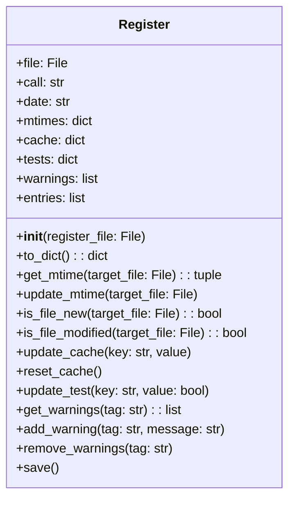
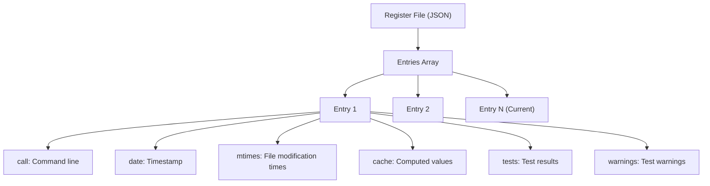
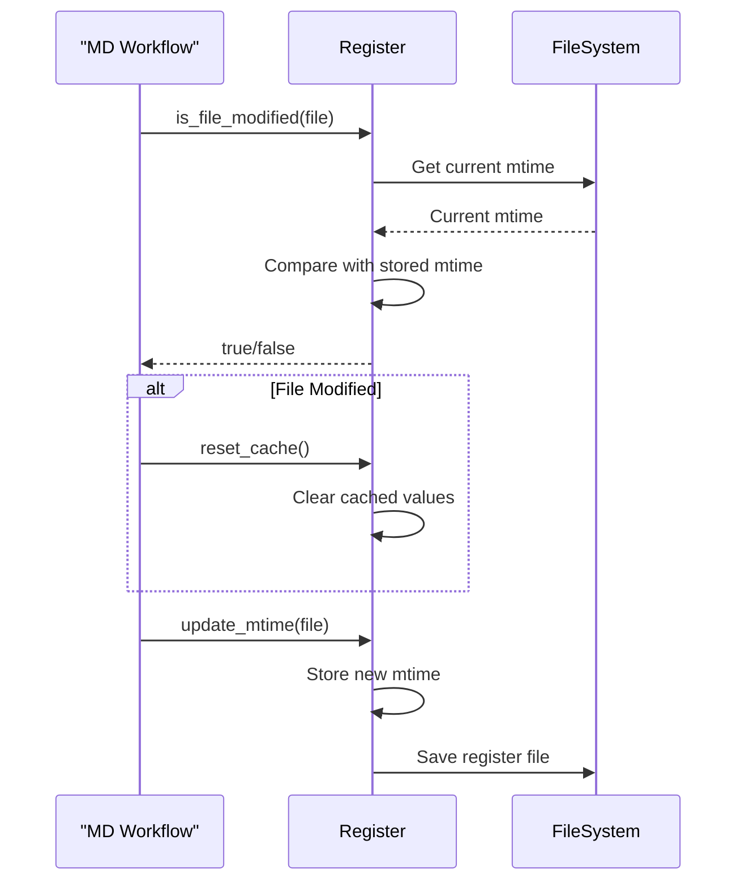
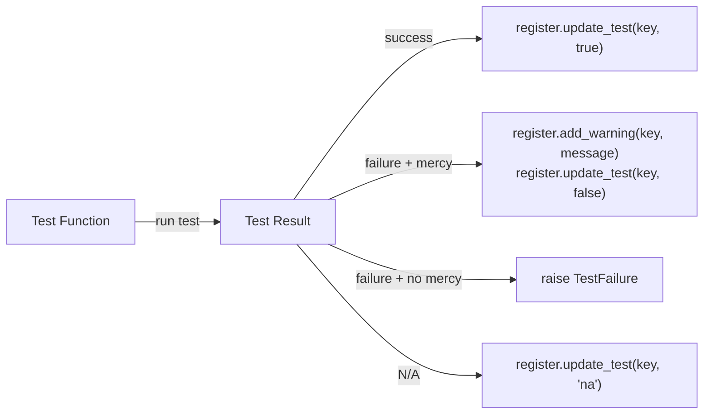
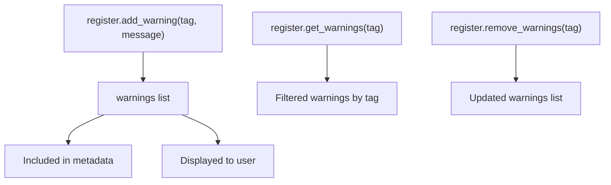
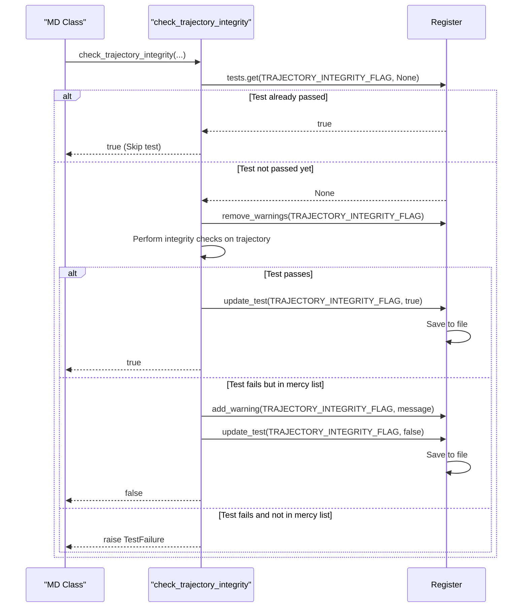
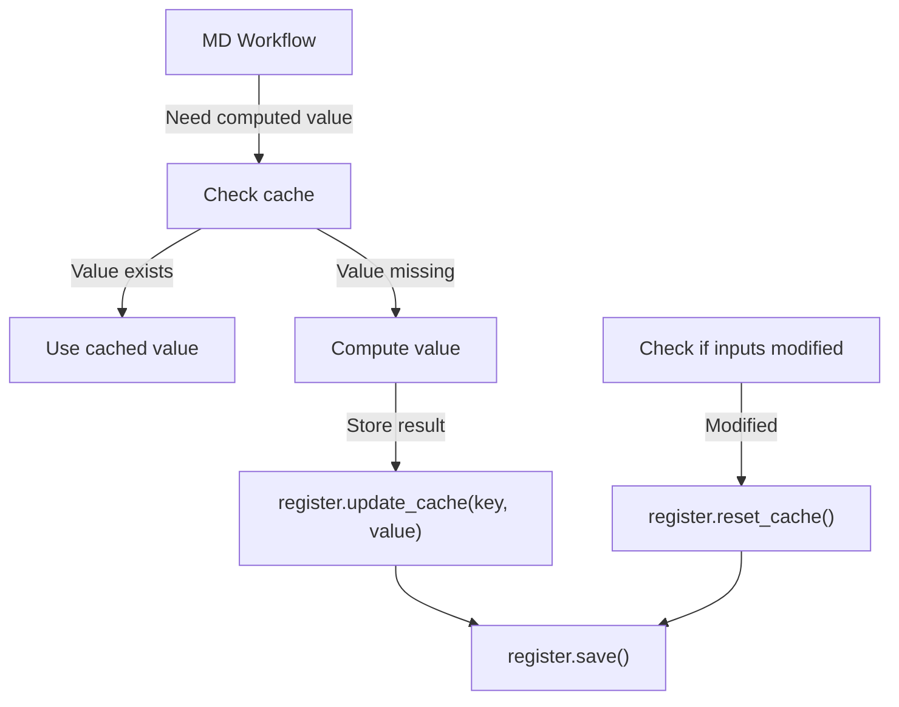
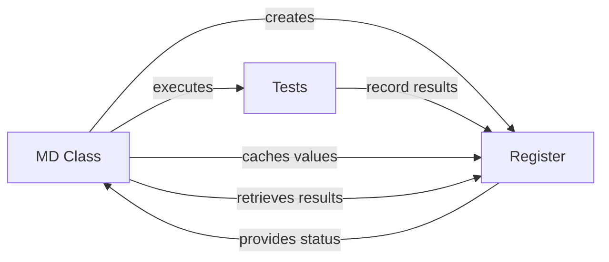

# Register System

Relevant source files

The following files were used as context for generating this wiki page:

- [model_workflow/analyses/rmsd_check.py](model_workflow/analyses/rmsd_check.py)
- [model_workflow/utils/register.py](model_workflow/utils/register.py)

The Register System is a component of the MDDB-workflow framework that provides test tracking and result caching capabilities. It allows the workflow to maintain state across multiple runs, avoid repeating tests that have already succeeded, and record warnings for issues that were allowed to proceed via mercy flags.

## Overview

The Register System serves several key functions:

1. **Test Tracking**: Records which tests have passed or failed across workflow runs
2. **Result Caching**: Stores computed values to avoid redundant calculations 
3. **Warning Management**: Maintains a list of warnings for test failures allowed via mercy flags
4. **Modification Tracking**: Monitors changes to input files to determine when cached results should be invalidated

The system operates by maintaining a JSON-based history file that records each workflow run, preserving important state information between executions.

Sources: [model_workflow/utils/register.py:11-151]()

## Architecture

**Register Class Components:**

| Component | Type | Purpose |
|-----------|------|---------|
| `file` | File | Reference to the JSON file storing register data |
| `call` | str | Command line arguments used for current workflow run |
| `date` | str | Timestamp of current workflow execution |
| `mtimes` | dict | Maps filenames to modification timestamps |
| `cache` | dict | Stores computed values for reuse across runs |
| `tests` | dict | Maps test names to boolean results (pass/fail) |
| `warnings` | list | Collection of warning messages with tags |
| `entries` | list | Historical record of all workflow runs |

Sources: [model_workflow/utils/register.py:14-68]()

## Persistence Mechanism

The Register System maintains a file-based persistence mechanism that tracks workflow execution history. Each time the workflow runs, a new entry is added to the register file containing:

When a new Register instance is created, it:
1. Loads the existing register file (if it exists)
2. Inherits the previous state (cache, tests, warnings) from the last entry
3. Creates a new entry for the current run
4. Persists any changes via the `save()` method

This approach ensures that successful test results and calculated values persist across workflow runs, avoiding redundant computations.

Sources: [model_workflow/utils/register.py:15-54](), [model_workflow/utils/register.py:142-152]()

## File Modification Tracking

The Register System monitors input file modification times to intelligently determine when cached values should be invalidated.

The `is_file_modified()` method checks if a file's current modification time differs from the previously recorded time, allowing the workflow to detect when input files have changed.

Sources: [model_workflow/utils/register.py:72-104]()

## Test Tracking

The Register System tracks test results using a simple key-value structure where:
- The key is a string identifier for the test (e.g., `TRAJECTORY_INTEGRITY_FLAG`)
- The value is a boolean indicating whether the test passed (`true`), failed (`false`), or was not applicable (`'na'`)

When a test is about to run, it first checks `register.tests.get(TEST_KEY, None)` to determine if the test has already passed in a previous run. If so, the test can be skipped.

Sources: [model_workflow/analyses/rmsd_check.py:36-42](), [model_workflow/utils/register.py:116-119]()

## Warning Management

The Register System maintains warnings for tests that failed but were allowed to proceed because they were in the "mercy" list:

Warning records include:
- A tag identifier (typically matching the test name)
- A message describing the issue

These warnings serve as both documentation of potential issues and as alerts to users about aspects of the data that might require attention.

Sources: [model_workflow/utils/register.py:121-140](), [model_workflow/analyses/rmsd_check.py:132-135]()

## Integration Example: Trajectory Integrity Testing

The following diagram illustrates how the Register System integrates with the trajectory integrity test:

This pattern is common throughout the codebase, where tests first check the register to see if they need to run, and then update the register with their results.

Sources: [model_workflow/analyses/rmsd_check.py:19-145]()

## Caching Mechanism

The Register's caching mechanism allows computationally expensive results to be stored and reused:

The cache is implemented as a simple key-value store within the register file, allowing any serializable Python object to be stored for later retrieval.

Sources: [model_workflow/utils/register.py:105-114]()

## Best Practices

When working with the Register System:

1. Use consistent keys for tests and cached values
2. Always check the register before performing expensive calculations
3. Update file modification times when files are processed
4. Use warning tags that match test names for easier filtering
5. Remember that mercy flags allow failures to proceed but warnings will still be recorded

## Integration with MD Class

The Register System is tightly integrated with the MD class, which manages individual molecular dynamics simulations:

The MD class initializes a Register for each simulation and uses it throughout the processing pipeline to track test statuses and cache intermediate results.

Sources: [model_workflow/analyses/rmsd_check.py:19-145]()

---