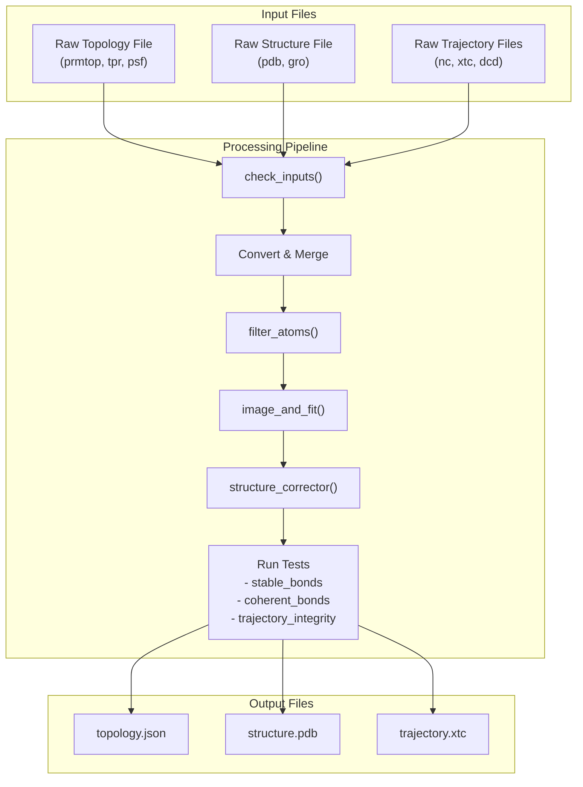
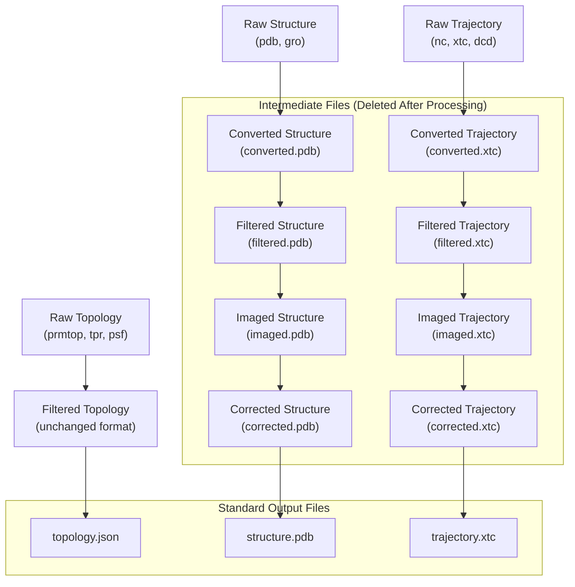
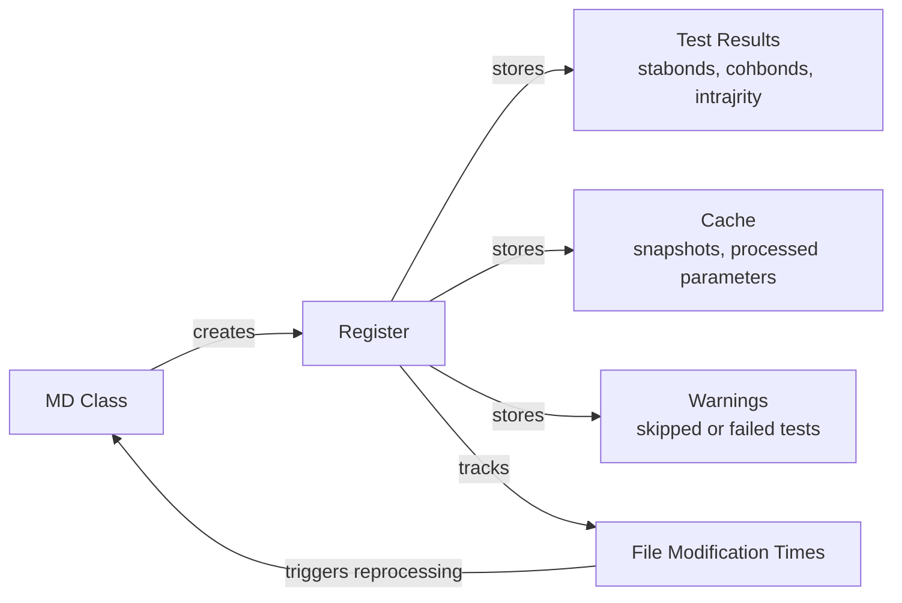
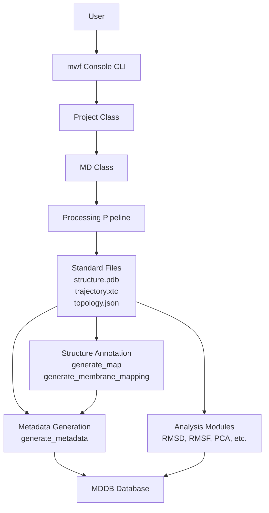

# Processing Pipeline

<details>
<summary>Relevant source files</summary>

The following files were used as context for generating this wiki page:

- [README.md](README.md)
- [model_workflow/mwf.py](model_workflow/mwf.py)
- [model_workflow/utils/constants.py](model_workflow/utils/constants.py)

</details>


## Overview

The Processing Pipeline is the core sequence of operations in the MDDB-workflow that transforms raw molecular dynamics (MD) simulation data into standardized formats for analysis and database storage. This page documents the steps involved in processing input files, the file transformations that occur, and the quality control tests that ensure data integrity.

For information about running analyses on the processed data, see [Analysis Modules](#4).

Sources: [model_workflow/mwf.py:479-967](), [README.md:81-169]()

## Pipeline Workflow

The processing pipeline consists of several sequential steps that transform raw input files (topology, structure, and trajectory) into standardized formats while ensuring data quality. The entire process is orchestrated by the `process_input_files` method in the `MD` class.



Sources: [model_workflow/mwf.py:479-967](), [README.md:98-142]()

## Pipeline Steps in Detail

### 1. Input Validation

The first step in the pipeline is to validate the input files using the `check_inputs` function. This ensures that the topology, structure, and trajectory files exist and are in compatible formats.

```python
check_inputs(input_structure_file, input_trajectory_files, input_topology_file)
```

Sources: [model_workflow/mwf.py:595]()

### 2. File Conversion and Merging

The input files are converted to standardized formats, and multiple trajectory files can be merged into a single trajectory:

- Structure files are converted to PDB format
- Trajectory files are converted to XTC format
- Multiple trajectory parts are merged into a single file

This is done through the `convert` function, which uses various tools like PyTraj and MDTraj under the hood.

Sources: [model_workflow/mwf.py:632-642]()

### 3. Atom Filtering

The `filter_atoms` function removes unnecessary atoms (typically water molecules and counter ions) to reduce file size and improve processing speed. Custom filtering selections can be specified using VMD syntax.

```python
filter_atoms(
    input_structure_file=converted_structure_file,
    input_trajectory_file=converted_trajectory_file,
    input_topology_file=input_topology_file,
    output_structure_file=filtered_structure_file,
    output_trajectory_file=incompleted_filtered_trajectory_file,
    output_topology_file=filtered_topology_file,
    reference_structure=provisional_structure,
    filter_selection=self.project.filter_selection,
)
```

Sources: [model_workflow/mwf.py:689-704]()

### 4. Trajectory Imaging and Fitting

The `image_and_fit` function corrects for periodic boundary conditions (PBC) and removes global translation and rotation:

- **Imaging**: Makes the trajectory uniform, avoiding atom jumps and keeping molecules whole
- **Fitting**: Removes the translation and rotation of the system, aligning frames to a reference

```python
image_and_fit(
    input_structure_file=filtered_structure_file,
    input_trajectory_file=filtered_trajectory_file,
    input_topology_file=filtered_topology_file,
    output_structure_file=imaged_structure_file,
    output_trajectory_file=incompleted_imaged_trajectory_file,
    image=self.project.image,
    fit=self.project.fit,
    translation=self.project.translation,
    structure=provisional_structure,
    pbc_selection=provisional_pbc_selection
)
```

Sources: [model_workflow/mwf.py:758-775]()

### 5. Structure Correction

The `structure_corrector` function performs several critical tasks:

- Corrects atom elements
- Validates and fixes atom bonds
- Validates chemical sense of the structure
- Ensures trajectory integrity

This step may involve resorting atoms in rare cases where coordinates need to be reordered.

```python
structure_corrector(
    structure=provisional_structure,
    input_trajectory_file=imaged_trajectory_file,
    input_topology_file=filtered_topology_file,
    output_structure_file=corrected_structure_file,
    output_trajectory_file=corrected_trajectory_file,
    MD=self,
    pbc_selection=provisional_pbc_selection
)
```

Sources: [model_workflow/mwf.py:810-827]()

### 6. Quality Control Tests

Several tests are run to ensure data quality:

- **Stable Bonds Test**: Checks if atom bonds are stable along the trajectory
- **Coherent Bonds Test**: Validates the chemical sense of bonds (e.g., hydrogen atoms should have exactly one bond)
- **Trajectory Integrity Test**: Ensures there are no sudden jumps in the trajectory

If any test fails, the pipeline can be configured to either stop, continue with warnings, or skip specific tests.

Sources: [model_workflow/mwf.py:904-956](), [README.md:171-214]()

## File Transformations

The following diagram illustrates how files are transformed throughout the processing pipeline:



Sources: [model_workflow/mwf.py:836-968](), [model_workflow/utils/constants.py:84-101]()

## Register System and Cache

The processing pipeline uses a Register system to track test results and cache intermediate values:

- Keeps track of file modification times to avoid reprocessing unchanged files
- Caches values like the number of snapshots
- Stores test results and warnings

If input files are modified, the Register system ensures that appropriate tests are rerun.



Sources: [model_workflow/mwf.py:166-172](), [model_workflow/mwf.py:511-539]()

## Command Line Usage

The processing pipeline can be invoked through the `mwf run` command:

```bash
mwf run -top raw_topology.prmtop -stru raw_topology.prmtop -mdir replica_* -traj *.nc -s
```

Additional options:
- `-filt`: Filter selection (e.g., `-filt 'protein or nucleic'`)
- `-img`: Enable trajectory imaging
- `-fit`: Enable trajectory fitting
- `-t` or `--trust`: Skip specific tests
- `-m` or `--mercy`: Allow specific tests to fail

Sources: [README.md:98-142](), [README.md:171-214]()

## Special Cases and Considerations

### Multiple Trajectory Parts

The pipeline can handle multiple trajectory parts, which are automatically detected and merged:

```
replica_2/
    raw_trajectory_part01.nc
    raw_trajectory_part02.nc
    raw_trajectory_part03.nc
```

Sources: [README.md:88-89](), [README.md:129]()

### Missing Structure File

If no structure file is provided, the pipeline can extract one from the first frame of the trajectory:

```python
# If there is not input structure anywhere then use the input topology
# We will extract the structure from it using a sample frame from the trajectory
if self.project.input_topology_file.filename != STANDARD_TOPOLOGY_FILENAME:
    return self.project.input_topology_file.path
```

Sources: [model_workflow/mwf.py:266-268]()

### Coarse-Grained Simulations

The pipeline can handle coarse-grained simulations by identifying and setting appropriate elements for coarse-grained atoms:

```python
# Set a provisional coarse grain selection
provisional_cg_selection = self._set_cg_selection(provisional_structure, verbose=False)
for atom_index in provisional_cg_selection.atom_indices:
    provisional_structure.atoms[atom_index].element = CG_ATOM_ELEMENT
```

Sources: [model_workflow/mwf.py:715-717]()

## Integration with Other Components

The Processing Pipeline is a foundational component of the MDDB-workflow that enables other subsystems to function properly:



Sources: [model_workflow/mwf.py:25-38](), [model_workflow/mwf.py:57-80]()

---