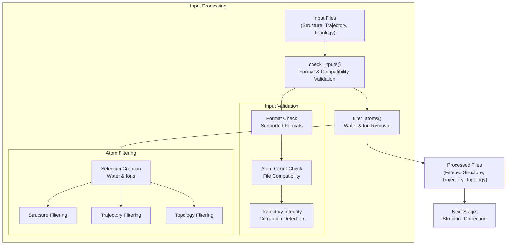
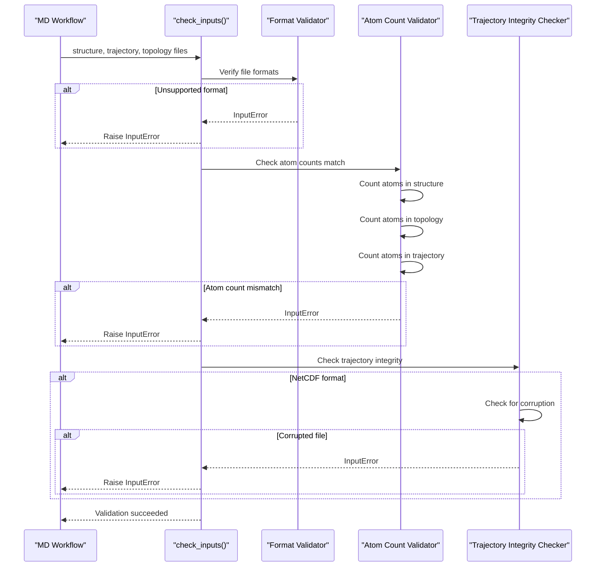
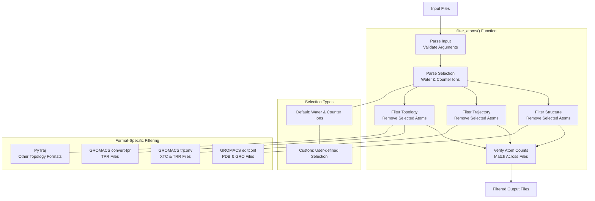

# Input Processing

<details>
<summary>Relevant source files</summary>

The following files were used as context for generating this wiki page:

- [model_workflow/tools/check_inputs.py](model_workflow/tools/check_inputs.py)
- [model_workflow/tools/filter_atoms.py](model_workflow/tools/filter_atoms.py)
- [model_workflow/tools/get_charges.py](model_workflow/tools/get_charges.py)
- [model_workflow/utils/conversions.py](model_workflow/utils/conversions.py)
- [model_workflow/utils/filters.py](model_workflow/utils/filters.py)
- [model_workflow/utils/gmx_spells.py](model_workflow/utils/gmx_spells.py)
- [model_workflow/utils/pyt_spells.py](model_workflow/utils/pyt_spells.py)
- [model_workflow/utils/vmd_spells.py](model_workflow/utils/vmd_spells.py)

</details>


## Purpose and Scope

This page documents the input processing components of the MDDB-workflow system. Input processing involves two critical steps in the molecular dynamics (MD) analysis pipeline:

1. **Input Validation** - Verifying the format and compatibility of input files
2. **Atom Filtering** - Removing water molecules and counter ions from the simulation data

These steps ensure that only relevant data is processed in subsequent stages of the workflow. For information about structure correction after input processing, see [Structure Correction](#3.2).

## Input Processing Overview



Sources:
- [model_workflow/tools/check_inputs.py:32-260]()
- [model_workflow/tools/filter_atoms.py:24-159]()

## Input Validation

The input validation process ensures that all input files (structure, trajectory, and topology) are in supported formats and compatible with each other. The `check_inputs()` function performs several critical checks:

1. **Format Validation** - Verifies that input files are in supported formats
2. **Atom Count Consistency** - Ensures that structure, trajectory, and topology files have the same number of atoms
3. **Trajectory Integrity** - Detects corrupted trajectory files

### Supported Formats

The system supports various molecular dynamics file formats:

| File Type | Supported Formats |
|-----------|-------------------|
| Structure | pdb, gro, tpr, top, prmtop, psf |
| Trajectory | xtc, trr, nc, dcd, crd, pdb, rst7 |
| Topology | tpr, top, prmtop, psf |

Sources:
- [model_workflow/tools/check_inputs.py:23-26]()

### Validation Process



Sources:
- [model_workflow/tools/check_inputs.py:32-260]()
- [model_workflow/utils/gmx_spells.py:366-371]()

### Key Implementation Details

The validation process adapts to different file types:

- For TPR topology files, GROMACS is used to validate
- For structure files, PyTraj or MDTraj is used
- For NetCDF trajectory files, special corruption detection is performed

When validation fails, a descriptive `InputError` is raised with specific details about what failed.

Sources:
- [model_workflow/tools/check_inputs.py:42-47]()
- [model_workflow/tools/check_inputs.py:51-73]()
- [model_workflow/tools/check_inputs.py:76-210]()

## Atom Filtering

After validation, atom filtering removes water molecules and counter ions from the simulation data. This step is crucial for:

1. Reducing the data size
2. Focusing analyses on the biologically relevant components
3. Improving computational efficiency in subsequent processing steps

The `filter_atoms()` function handles this process.

### Filtering Process



Sources:
- [model_workflow/tools/filter_atoms.py:24-159]()
- [model_workflow/utils/gmx_spells.py:253-292]()
- [model_workflow/utils/gmx_spells.py:306-349]()
- [model_workflow/utils/gmx_spells.py:455-493]()

### Selection Mechanism

There are two ways to specify what atoms to filter:

1. **Default Selection**: Automatically selects water molecules and counter ions using structural patterns
2. **Custom Selection**: User-specified selection using VMD-style syntax

The selection is handled through the `Structure` class, which provides methods like `select_water_and_counter_ions()` and `select()` to create atom selections that can then be inverted to get the atoms to keep.

Sources:
- [model_workflow/tools/filter_atoms.py:39-47]()
- [model_workflow/tools/filter_atoms.py:163-183]()
- [model_workflow/tools/filter_atoms.py:186-216]()

### Format-Specific Implementation

Filtering is implemented differently based on file formats:

| File Type | Format | Implementation Method |
|-----------|--------|------------------------|
| Structure | PDB, GRO | GROMACS editconf |
| Trajectory | XTC, TRR | GROMACS trjconv |
| Topology | TPR | GROMACS convert-tpr |
| Topology | PyTraj formats | PyTraj topology filtering |
| Topology | Standard JSON | Custom JSON filtering |

The filtering creates an index file (`.ndx`) containing the atoms to keep, which is then used by the appropriate tool to filter the files.

Sources:
- [model_workflow/tools/filter_atoms.py:161-183]()
- [model_workflow/tools/filter_atoms.py:186-216]()
- [model_workflow/tools/filter_atoms.py:219-239]()
- [model_workflow/tools/filter_atoms.py:244-345]()

## Technical Implementation Details

### Key Function: check_inputs()

The `check_inputs()` function validates input files:

```python
def check_inputs(input_structure_file, input_trajectory_files, input_topology_file):
    # Check format compatibility
    # Verify atom counts match
    # Check for corrupted trajectories
```

Key implementation details:
- Uses file extensions to determine formats
- Employs different tools based on format (PyTraj, MDTraj, GROMACS)
- Contains special handling for NetCDF trajectory corruption detection

Sources:
- [model_workflow/tools/check_inputs.py:32-260]()

### Key Function: filter_atoms()

The `filter_atoms()` function removes water and counter ions:

```python
def filter_atoms(
    input_structure_file,
    input_trajectory_file,
    input_topology_file,
    output_structure_file,
    output_trajectory_file,
    output_topology_file,
    reference_structure,
    filter_selection,
    filter_selection_syntax='vmd'
):
    # Parse selection
    # Filter structure
    # Filter trajectory
    # Filter topology
    # Verify atom counts match
```

The function handles different file formats and ensures consistency between filtered files.

Sources:
- [model_workflow/tools/filter_atoms.py:24-159]()

### Other Utilities

Several supporting functions are used in the input processing:

- `filter_structure()`: Filters PDB/GRO structure files using GROMACS
- `filter_trajectory()`: Filters XTC/TRR trajectory files using GROMACS
- `filter_tpr()`: Filters TPR topology files using GROMACS
- `filter_topology()`: Filters PyTraj-supported topology files
- `standard_topology_filter()`: Filters the standard JSON topology format

Sources:
- [model_workflow/utils/gmx_spells.py:253-292]()
- [model_workflow/utils/gmx_spells.py:306-349]()
- [model_workflow/utils/gmx_spells.py:455-493]()
- [model_workflow/utils/pyt_spells.py:127-159]()
- [model_workflow/tools/filter_atoms.py:244-345]()

## Integration with Overall Workflow

Input processing is an early stage in the MDDB-workflow pipeline:

```mermaid
flowchart LR
    Input["Raw Input Files"] --> CheckInputs["check_inputs()<br>Validate Inputs"]
    CheckInputs --> FilterAtoms["filter_atoms()<br>Remove Water & Ions"]
    FilterAtoms --> GetBonds["get_bonds()<br>Structure Correction"]
    GetBonds --> ImageFit["image_and_fit()<br>Trajectory Processing"]
    ImageFit --> Analysis["Analysis Modules"]
    
    subgraph "Input Processing Stage"
        CheckInputs
        FilterAtoms
    end
    
    style Input fill:#f9f9f9,stroke:#333
    style Analysis fill:#f9f9f9,stroke:#333
    style "Input Processing Stage" stroke-dasharray: 5 5
```

The input processing components:

1. Serve as gatekeepers for the workflow
2. Ensure data quality and consistency
3. Prepare data for more computationally intensive steps later in the pipeline
4. Reduce file sizes by removing non-essential components

Sources:
- [model_workflow/tools/check_inputs.py:32-260]()
- [model_workflow/tools/filter_atoms.py:24-159]()

## Summary

Input processing in the MDDB-workflow system consists of two main steps:

1. **Input Validation** - Ensures input files are compatible and properly formatted
2. **Atom Filtering** - Removes water molecules and counter ions to focus on relevant data

These steps are critical for ensuring data quality and computational efficiency in the subsequent stages of the workflow. The implementation adapts to various molecular dynamics file formats using appropriate libraries and external tools like GROMACS, PyTraj, and MDTraj.

---