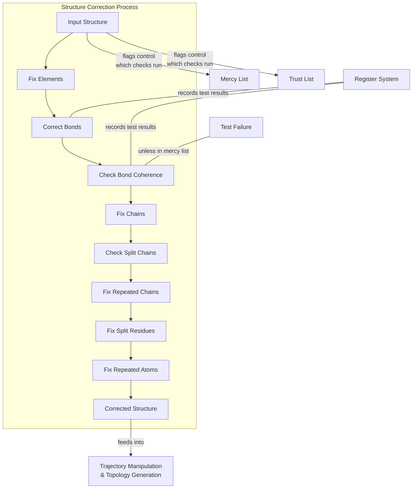
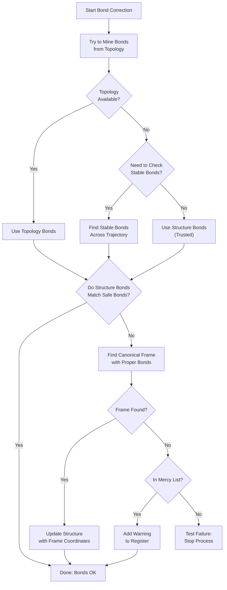
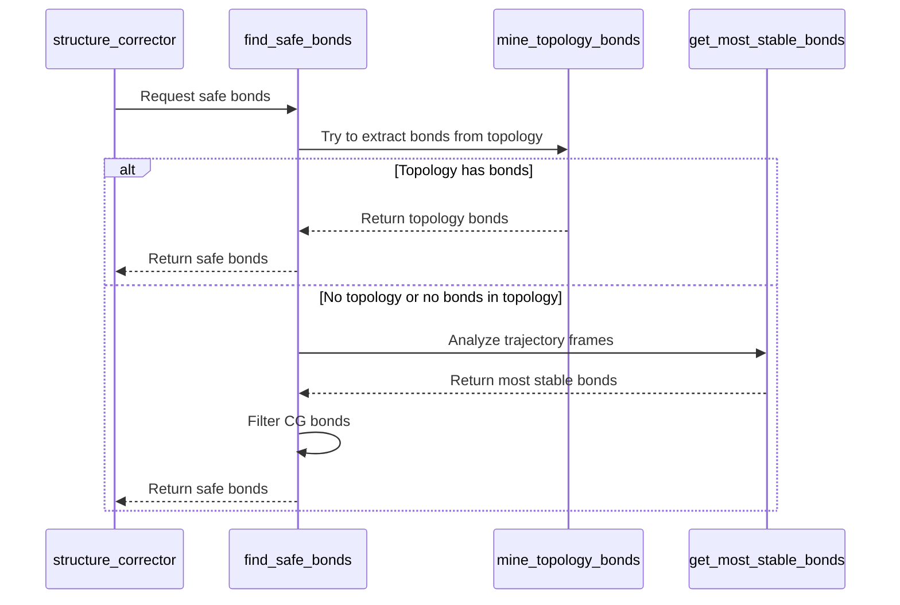
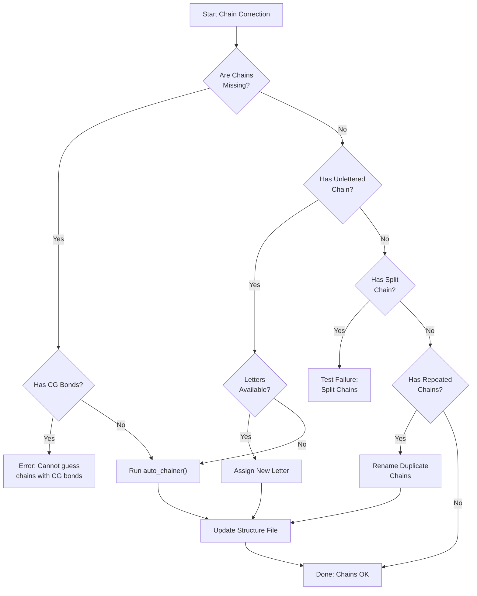
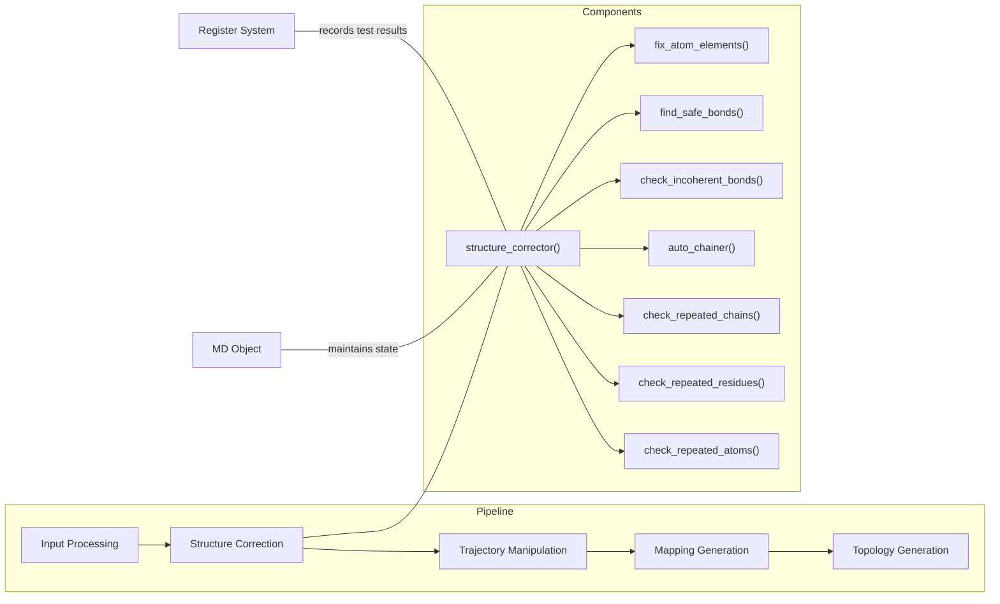
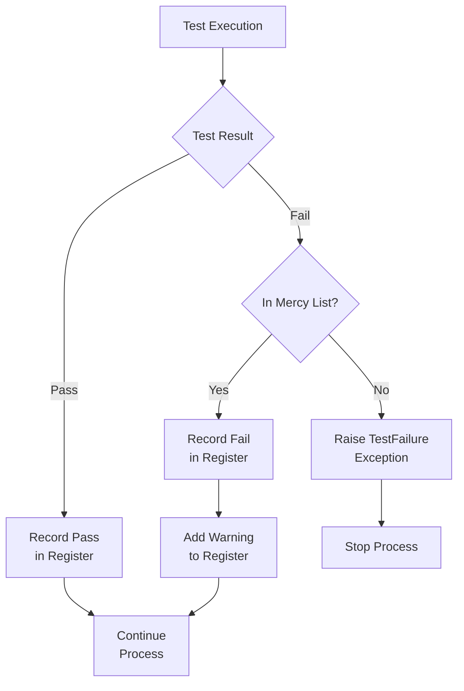

# Structure Correction

<details>
<summary>Relevant source files</summary>

The following files were used as context for generating this wiki page:

- [model_workflow/tools/generate_topology.py](model_workflow/tools/generate_topology.py)
- [model_workflow/tools/get_bonds.py](model_workflow/tools/get_bonds.py)
- [model_workflow/tools/image_and_fit.py](model_workflow/tools/image_and_fit.py)
- [model_workflow/tools/structure_corrector.py](model_workflow/tools/structure_corrector.py)

</details>


## Purpose and Scope

The Structure Correction system is responsible for analyzing molecular dynamics (MD) simulation structures, identifying irregularities, and modifying the structures to standardize their format. This crucial preprocessing step ensures that structures are consistent and properly configured before further analysis. 

This page documents the structure correction process within the MDDB-workflow pipeline. For related processes, see [Input Processing](#3.1) for initial validation and [Trajectory Manipulation](#3.3) for operations performed after structure correction.

## Overview of Structure Correction

The structure correction process examines and fixes various structural issues that could otherwise lead to errors in subsequent analysis steps. Issues addressed include element standardization, bond validation, chain assignment, and atom/residue renumbering.



Sources: [model_workflow/tools/structure_corrector.py:31-280]()

## Key Components

### Entry Point: structure_corrector

The main function that orchestrates the structure correction process is `structure_corrector`. It takes an input structure, applies various corrections, and outputs a standardized structure file.

```mermaid
classDiagram
    class structure_corrector {
        +structure: Structure
        +input_trajectory_file: File
        +input_topology_file: File
        +output_structure_file: File
        +output_trajectory_file: File
        +MD: MD object
        +pbc_selection: Selection
        +Returns: dict
    }
    
    structure_corrector --> "Element Correction" : fixes atom elements
    structure_corrector --> "Bond Correction" : ensures bond stability
    structure_corrector --> "Chain Correction" : assigns missing chains
    structure_corrector --> "Residue Correction" : fixes split residues
    structure_corrector --> "Atom Correction" : renames repeated atoms
```

Sources: [model_workflow/tools/structure_corrector.py:33-280]()

### Element Correction

The first step corrects missing or non-standard elements. Elements are standardized (e.g., "ZN" becomes "Zn") and missing elements are inferred based on atom properties.

Sources: [model_workflow/tools/structure_corrector.py:57-63]()

### Bond Correction

Bond correction is a critical component that ensures the stability of atom bonds throughout the simulation. It involves:

1. Finding safe bonds
2. Checking if structure bonds match the safe bonds
3. If they don't match, finding a canonical frame where bonds are stable
4. Updating the structure coordinates with those from the canonical frame



Sources: [model_workflow/tools/structure_corrector.py:72-152](), [model_workflow/tools/get_bonds.py:12-153]()

#### find_safe_bonds

This function attempts to determine the correct bonds for the structure:

1. First tries to extract bonds from the topology file
2. If that fails, analyzes multiple trajectory frames to identify stable bonds
3. Applies special handling for coarse-grained systems



Sources: [model_workflow/tools/get_bonds.py:227-258](), [model_workflow/tools/get_bonds.py:159-192](), [model_workflow/tools/get_bonds.py:62-105]()

#### get_bonds_canonical_frame

This function finds a frame in the trajectory where all bonds match the reference (safe) bonds:

1. Examines frames one by one
2. Compares the bonds in each frame to the reference bonds
3. Returns the first frame number where all bonds match
4. If no matching frame is found, it provides diagnostic information

Sources: [model_workflow/tools/get_bonds.py:109-156]()

### Bond Coherence Check

After ensuring bond stability, the system checks for bond coherence - whether atoms have the expected number of bonds for their element type.

Sources: [model_workflow/tools/structure_corrector.py:158-179]()

### Chain Correction

The system addresses several chain-related issues:

1. Missing chains: Adds chains where they are missing
2. Split chains: Reports an error if a chain appears in multiple disconnected segments
3. Repeated chains: Renames chains with unique identifiers



Sources: [model_workflow/tools/structure_corrector.py:184-247]()

### Residue and Atom Correction

The final steps correct residue and atom-level issues:

1. Split residues: Ensures atoms belonging to the same residue are grouped together
2. Repeated atoms: Renames atoms to ensure uniqueness within residues

If atoms are reordered to fix split residues, the trajectory coordinates are also reordered to match.

Sources: [model_workflow/tools/structure_corrector.py:253-280]()

## Integration with MD Workflow

Structure correction sits between input processing and trajectory manipulation in the MDDB-workflow pipeline. The tests performed during structure correction are tracked by the Register system, which maintains a record of test results and warnings.



Sources: [model_workflow/tools/structure_corrector.py:33-280](), [model_workflow/tools/image_and_fit.py:21-283](), [model_workflow/tools/generate_topology.py:5-83]()

## Test Tracking

The structure correction process involves several critical tests that are tracked by the MD's Register system:

1. **Stable Bonds Test**: Ensures that bonds remain stable throughout the trajectory
2. **Coherent Bonds Test**: Ensures that atoms have the expected number of bonds

These tests can either:
- Pass: The structure meets the requirements
- Fail with mercy: The process continues with a warning recorded
- Fail without mercy: The process terminates with an error



Sources: [model_workflow/tools/structure_corrector.py:72-152](), [model_workflow/tools/structure_corrector.py:158-179]()

## Output

After successful structure correction, the system produces:

1. A corrected structure file (.pdb)
2. Potentially modified trajectory file (if atoms were reordered)
3. Updated bond information in the MD object
4. Test results and warnings in the Register

This corrected structure serves as the foundation for subsequent processing steps, including trajectory manipulation and topology generation.

Sources: [model_workflow/tools/structure_corrector.py:53](), [model_workflow/tools/structure_corrector.py:151-152](), [model_workflow/tools/structure_corrector.py:270-271](), [model_workflow/tools/generate_topology.py:5-83]()

---