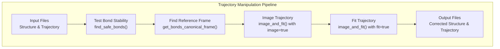
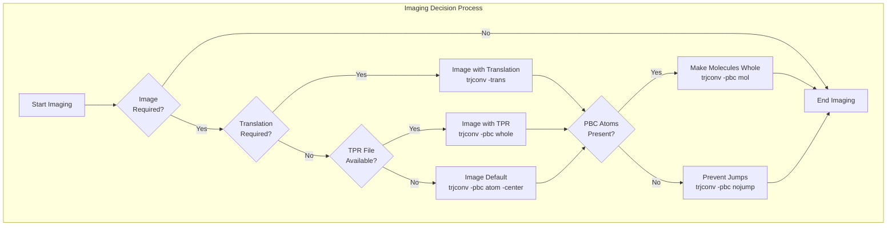
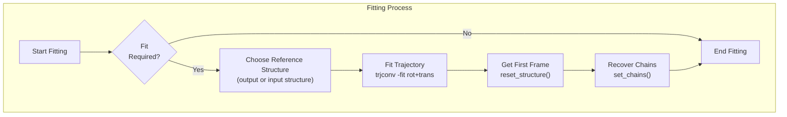
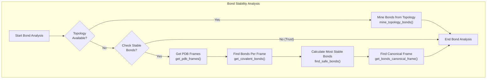
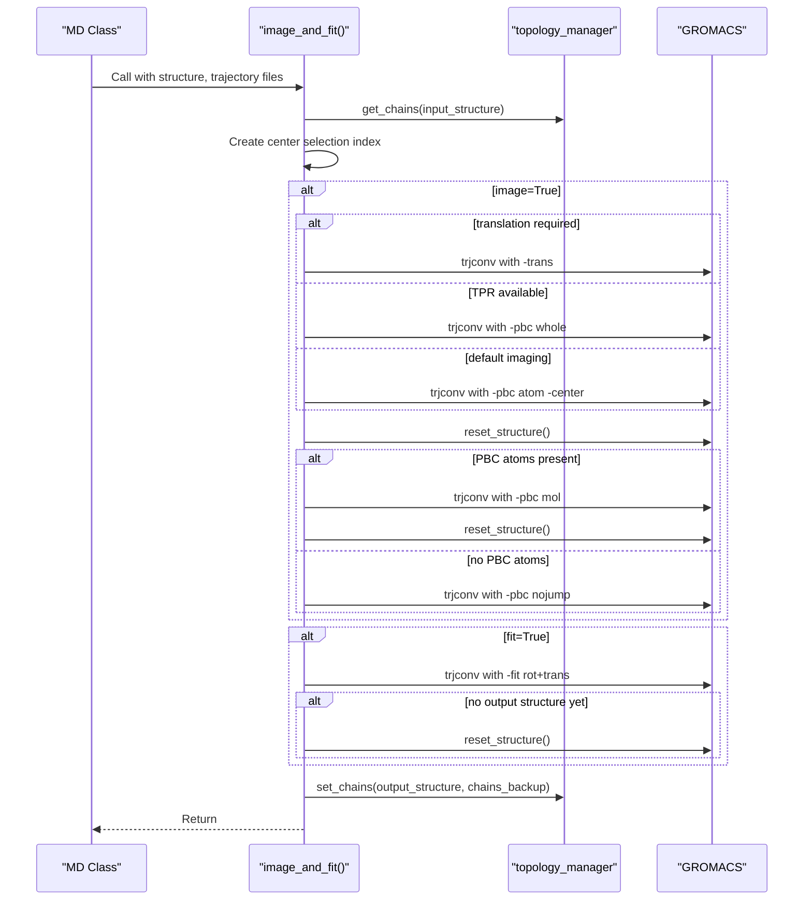
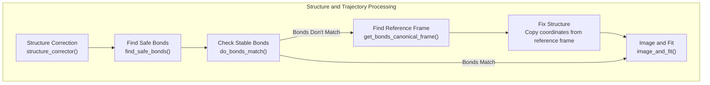

# Trajectory Manipulation

Relevant source files

The following files were used as context for generating this wiki page:

- [model_workflow/tools/generate_topology.py](model_workflow/tools/generate_topology.py)
- [model_workflow/tools/get_bonds.py](model_workflow/tools/get_bonds.py)
- [model_workflow/tools/image_and_fit.py](model_workflow/tools/image_and_fit.py)
- [model_workflow/tools/structure_corrector.py](model_workflow/tools/structure_corrector.py)
- [model_workflow/utils/filters.py](model_workflow/utils/filters.py)
- [model_workflow/utils/gmx_spells.py](model_workflow/utils/gmx_spells.py)
- [model_workflow/utils/pyt_spells.py](model_workflow/utils/pyt_spells.py)

## Purpose and Scope

This document details the trajectory manipulation capabilities within the MDDB-workflow system. Trajectory manipulation refers to operations performed on molecular dynamics trajectory data to correct for artifacts, align structures, handle periodic boundary conditions, and prepare the data for analysis. 

For information about input processing and atom filtering before trajectory manipulation, see [Input Processing](#3.1). For information about structure correction that occurs prior to trajectory manipulation, see [Structure Correction](#3.2).

## Overview of Trajectory Manipulation

In molecular dynamics simulations, trajectory data often requires several post-processing steps to ensure it is suitable for analysis. The MDDB-workflow provides tools to perform the following key operations:

1. **Imaging** - Correcting for periodic boundary conditions to ensure molecules are not split across boundaries
2. **Fitting** - Aligning frames to remove overall translation and rotation
3. **Reference Frame Selection** - Identifying and using optimal frames for subsequent analysis
4. **Bond Stability Analysis** - Ensuring consistent bond representation across the trajectory

Sources: 
- [model_workflow/tools/image_and_fit.py:21-282]()
- [model_workflow/tools/get_bonds.py:62-106]()
- [model_workflow/tools/get_bonds.py:109-156]()

## Core Operations

### Imaging and PBC Handling

Imaging is the process of ensuring that molecules split across periodic boundary conditions (PBC) appear whole in the trajectory. The MDDB-workflow implements several imaging strategies depending on the simulation and user requirements:

1. **Translation-based imaging** - Applying a translation vector to all coordinates
2. **Molecule-based imaging** - Making molecules whole using topological information
3. **PBC atom handling** - Special treatment for atoms that should remain under PBC conditions

Sources:
- [model_workflow/tools/image_and_fit.py:83-232]()

The actual imaging is performed using GROMACS commands, with different options based on the specific requirements:

- When translation is required, the `-trans` option is used with specified translation vector
- When a TPR file is available, `-pbc whole` is used to make molecules whole
- Without a TPR file, `-pbc atom -center` is used with a custom selection
- Additional `-pbc mol` or `-pbc nojump` steps ensure proper PBC handling for specific cases

Key implementation details:
- A special index file is generated to specify centering selection (protein and nucleic acids by default)
- PBC residues are handled differently to ensure they stay inside the simulation box
- Chain information is preserved during the imaging process

Sources:
- [model_workflow/tools/image_and_fit.py:76-80]()
- [model_workflow/tools/image_and_fit.py:93-158]()
- [model_workflow/tools/image_and_fit.py:172-232]()

### Trajectory Fitting

Fitting removes overall translational and rotational motion from the trajectory, making it easier to analyze internal molecular motions. The fitting process:

1. Uses a reference selection (typically protein and nucleic acids)
2. Aligns each frame to minimize RMSD from the reference structure
3. Preserves chain information that might be lost during GROMACS operations

Sources:
- [model_workflow/tools/image_and_fit.py:234-284]()
- [model_workflow/tools/image_and_fit.py:290-311]()

Key implementation details:
- If imaging was performed, the fitting uses the already imaged trajectory; otherwise, it uses the input trajectory
- A custom index file defines which atoms to use as the reference for fitting
- Chain information is recovered after fitting to preserve the original chain assignments

### Bond Stability Analysis

Before manipulating the trajectory, the system analyzes bond stability across multiple frames to ensure consistent representation:

1. **Finding stable bonds** - Examining multiple frames to identify bonds that are consistent throughout the trajectory
2. **Finding a canonical frame** - Identifying a reference frame where all bonds match the expected stable configuration

Sources:
- [model_workflow/tools/get_bonds.py:62-106]()
- [model_workflow/tools/get_bonds.py:109-156]()
- [model_workflow/tools/get_bonds.py:159-192]()
- [model_workflow/tools/get_bonds.py:227-258]()

Key implementation details:
- Bonds are preferentially mined from topology files if available
- If topology information is unavailable, bonds are determined by analyzing multiple trajectory frames
- Majority voting is used to determine which bonds are truly stable across the trajectory
- A canonical frame is identified where all bonds match the stable configuration

## The `image_and_fit` Function

The core of trajectory manipulation is implemented in the `image_and_fit` function, which integrates imaging and fitting operations:

Sources:
- [model_workflow/tools/image_and_fit.py:21-282]()

## Integration with Structure Correction

Trajectory manipulation works closely with structure correction to ensure consistency between structure and trajectory data:

Sources:
- [model_workflow/tools/structure_corrector.py:33-280]()
- [model_workflow/tools/get_bonds.py:227-258]()

## Special Handling for Coarse-Grained Simulations

Trajectory manipulation has specific considerations for coarse-grained simulations:

1. Imaging is not supported for coarse-grained simulations using GROMACS
2. Fitting requires a TPR file for coarse-grained simulations to access mass information
3. Bonds for coarse-grained atoms are marked as missing to prevent incorrect bond analysis

Sources:
- [model_workflow/tools/image_and_fit.py:52-58]()
- [model_workflow/tools/get_bonds.py:239-244]()
- [model_workflow/tools/get_bonds.py:262-266]()

## Pre-processing and Post-processing Operations

Several important operations occur before and after trajectory manipulation:

### Pre-processing:
- Atom filtering to remove water and ions (see [Input Processing](#3.1))
- Structure correction to fix element types and atom nomenclature (see [Structure Correction](#3.2))
- Bond analysis to ensure consistent bonding across the trajectory

### Post-processing:
- Topology generation to create a standardized structure representation (see [Topology and Metadata Generation](#3.6))
- Running various analysis modules on the corrected trajectory (see [Analysis Modules](#4))

Sources:
- [model_workflow/tools/generate_topology.py:5-83]()

## Practical Considerations

When working with trajectory manipulation in MDDB-workflow, consider the following:

1. **TPR files are valuable** - Having a TPR file enables more advanced imaging and fitting operations
2. **PBC handling is critical** - Special care is taken for residues that should remain under PBC conditions
3. **Chain preservation** - Chains are carefully preserved through the manipulation process
4. **Reference frame selection** - The system automatically selects optimal reference frames when possible

## Summary

Trajectory manipulation in MDDB-workflow provides comprehensive tools for preparing molecular dynamics trajectories for analysis. By handling periodic boundary conditions, alignment, and bond stability, it ensures high-quality input data for downstream analyses. The system integrates with GROMACS to leverage its powerful trajectory manipulation capabilities while adding custom logic for special cases and robustness.

Sources:
- [model_workflow/tools/image_and_fit.py:21-282]()
- [model_workflow/tools/get_bonds.py:62-156]()
- [model_workflow/tools/structure_corrector.py:33-148]()

---