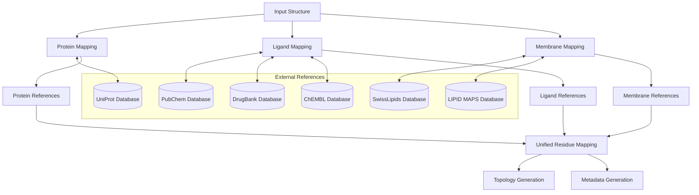
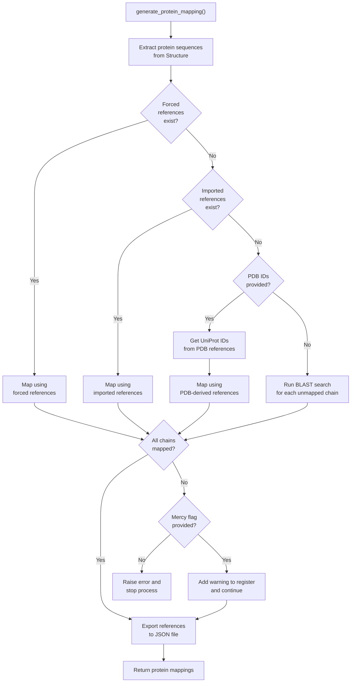
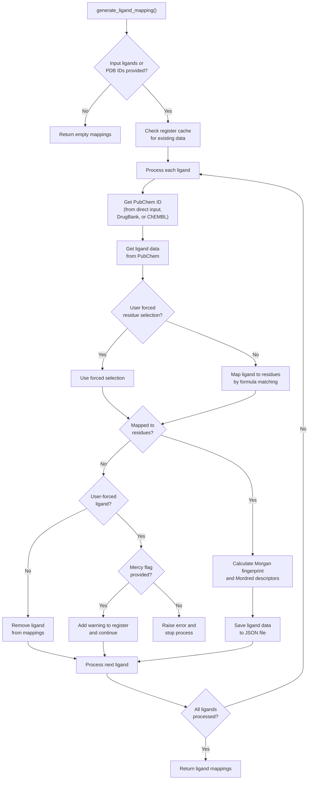
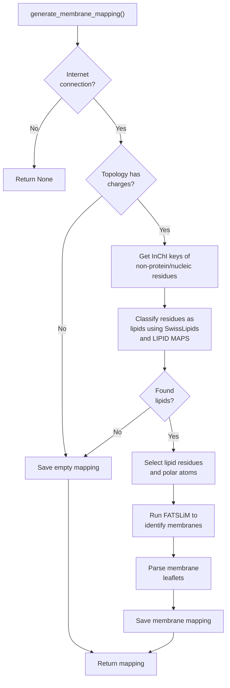
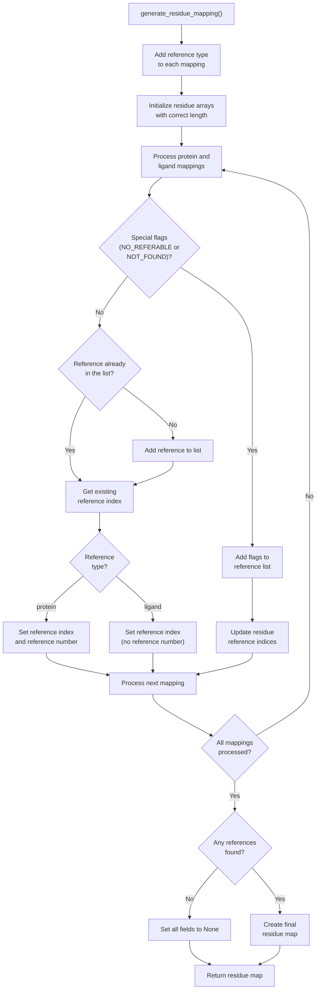

# Mapping Generation

Relevant source files

The following files were used as context for generating this wiki page:

- [model_workflow/analyses/density.py](model_workflow/analyses/density.py)
- [model_workflow/analyses/lipid_order.py](model_workflow/analyses/lipid_order.py)
- [model_workflow/resources/references_updater.py](model_workflow/resources/references_updater.py)
- [model_workflow/tools/chains.py](model_workflow/tools/chains.py)
- [model_workflow/tools/generate_ligands_desc.py](model_workflow/tools/generate_ligands_desc.py)
- [model_workflow/tools/generate_map.py](model_workflow/tools/generate_map.py)
- [model_workflow/tools/generate_membrane_mapping.py](model_workflow/tools/generate_membrane_mapping.py)
- [model_workflow/tools/generate_pdb_references.py](model_workflow/tools/generate_pdb_references.py)
- [model_workflow/tools/get_inchi_keys.py](model_workflow/tools/get_inchi_keys.py)
- [model_workflow/tools/residue_mapping.py](model_workflow/tools/residue_mapping.py)
- [model_workflow/utils/auxiliar.py](model_workflow/utils/auxiliar.py)
- [model_workflow/utils/topology_converter.py](model_workflow/utils/topology_converter.py)
- [model_workflow/utils/type_hints.py](model_workflow/utils/type_hints.py)
- [model_workflow/utils/warnings.py](model_workflow/utils/warnings.py)

This document describes the mapping generation system in the MDDB-workflow, which is responsible for annotating molecular structures by mapping their components (proteins, ligands, and membranes) to reference databases. These mappings establish the biological identity of each component and enable downstream analyses that depend on this information.

For related processes, see [Input Processing](#3.1), [Structure Correction](#3.2), and [Interaction Processing](#3.5).

## Overview

The mapping generation system generates three types of reference mappings:

1. **Protein Mapping**: Maps protein chains and residues to reference sequences from UniProt
2. **Ligand Mapping**: Maps ligand molecules to reference data from PubChem, DrugBank, or ChEMBL
3. **Membrane Mapping**: Identifies and maps membrane components using lipid references from SwissLipids and LIPID MAPS

These mappings are then combined into a unified residue mapping structure used throughout the workflow.

### Mapping Generation Workflow

Sources: [model_workflow/tools/generate_map.py](), [model_workflow/tools/generate_ligands_desc.py](), [model_workflow/tools/generate_membrane_mapping.py](), [model_workflow/tools/residue_mapping.py]()

## Protein Mapping

The protein mapping system identifies protein chains in the molecular structure and maps them to reference sequences from UniProt.

### Protein Mapping Process

Sources: [model_workflow/tools/generate_map.py:63-330]()

The protein mapping process follows these steps:

1. Extract amino acid sequences from each chain in the structure
2. Try to match sequences with provided reference sequences (forced references)
3. If not all chains are mapped, try previously imported references
4. If still not mapped, try to find UniProt IDs from provided PDB IDs
5. As a last resort, run BLAST search against UniProtKB/Swiss-Prot
6. If any sequences remain unmapped and no mercy flag is provided, fail the process

### Sequence Alignment

For each potential reference sequence, the system performs a local sequence alignment using the BLOSUM62 substitution matrix, with gap opening penalty of -10 and extension penalty of -0.5. The alignment score is normalized by sequence length, and only alignments with a normalized score > 1.0 are considered valid.

The `align` function returns a list of reference residue indices that match each position in the structure sequence, along with the alignment score.

Sources: [model_workflow/tools/generate_map.py:391-460]()

### Reference Data Structure

Each protein reference contains the following information:

| Field | Description |
|-------|-------------|
| name | Full protein name |
| gene | Gene names (comma-separated) |
| organism | Scientific name of the organism |
| uniprot | UniProt accession ID |
| sequence | Amino acid sequence |
| domains | List of protein domains with positions and descriptions |
| functions | List of molecular functions from Gene Ontology |

Sources: [model_workflow/tools/generate_map.py:517-628]()

## Ligand Mapping

The ligand mapping system identifies non-protein, non-nucleic acid molecular components in the structure and maps them to chemical reference databases.

### Ligand Mapping Process

Sources: [model_workflow/tools/generate_ligands_desc.py:301-469]()

### Ligand Reference Data Structure

Each ligand reference contains the following information:

| Field | Description |
|-------|-------------|
| name | Chemical name |
| pubchem | PubChem compound ID |
| drugbank | DrugBank ID (if available) |
| chembl | ChEMBL ID (if available) |
| smiles | SMILES representation |
| formula | Molecular formula |
| inchi | InChI string |
| inchikey | InChI key |
| morgan_fp_bit_array | Morgan fingerprint (bit vector) |
| mordred | Mordred molecular descriptors |
| mol_block | Molecular structure in MDL molfile format |

Sources: [model_workflow/tools/generate_ligands_desc.py:473-484](), [model_workflow/tools/generate_ligands_desc.py:450-454]()

### Descriptor Generation

For each mapped ligand, the system calculates:

1. **Morgan Fingerprints**: Topological fingerprints that capture molecular substructures
2. **Mordred Descriptors**: Comprehensive set of molecular descriptors including:
   - ABCIndex (branching index)
   - Acid/Base properties
   - Ring counts
   - Constitutional properties
   - Topological charges
   - Hydrogen bond properties
   - Lipinski rule parameters
   - Fragment complexity
   - Path counts

Sources: [model_workflow/tools/generate_ligands_desc.py:260-298]()

## Membrane Mapping

The membrane mapping system identifies lipid components and membrane structures in the molecular system.

### Membrane Mapping Process

Sources: [model_workflow/tools/generate_membrane_mapping.py:13-169]()

### Lipid Identification

The system uses InChI keys to identify lipid molecules by:

1. Creating InChI keys for each non-protein, non-nucleic residue using RDKit
2. Checking these keys against the SwissLipids and LIPID MAPS databases
3. Grouping residues that are connected through bonds to handle complex lipids

Sources: [model_workflow/tools/get_inchi_keys.py:72-168]()

### Membrane Structure Analysis

For membrane structure analysis, the system:

1. Selects all identified lipid residues
2. Identifies polar atoms in each lipid (atoms with highest charge)
3. Uses FATSLiM (through BioBB) to identify membrane leaflets
4. Maps lipids to top and bottom leaflets for each identified membrane

Sources: [model_workflow/tools/generate_membrane_mapping.py:95-169]()

### Membrane Mapping Data Structure

The membrane mapping contains the following information:

| Field | Description |
|-------|-------------|
| n_mems | Number of identified membranes |
| mems | Dictionary with membrane data (leaflets, polar atoms) |
| no_mem_lipid | Lipids not assigned to any membrane |
| references | Lipid reference data from SwissLipids/LIPID MAPS |

Each membrane entry contains:
- Atom indices for top and bottom leaflets
- Polar atom indices for each leaflet

Sources: [model_workflow/tools/generate_membrane_mapping.py:47-168]()

## Unified Residue Mapping

The final step combines protein and ligand mappings into a unified structure used by the topology and metadata generators.

### Integration Process

Sources: [model_workflow/tools/residue_mapping.py:6-97]()

### Unified Mapping Data Structure

The unified residue mapping contains:

| Field | Description |
|-------|-------------|
| references | List of reference IDs (UniProt/PubChem/flags) |
| reference_types | List of reference types ("protein"/"ligand") |
| residue_reference_indices | Array mapping each residue to a reference index |
| residue_reference_numbers | Array with reference numbering for each residue |

Sources: [model_workflow/tools/residue_mapping.py:90-95]()

## Applications in the Workflow

The mapping generation system powers several analyses in the MDDB-workflow:

1. **Membrane Analyses**: Density profiles, lipid order parameters
2. **Protein Structure Analyses**: RMSD/RMSF calculations with proper residue references
3. **Ligand-Protein Interactions**: Analysis of binding pockets and interactions

For example, the density analysis uses membrane mappings to calculate density profiles along the membrane normal:

Sources: [model_workflow/analyses/density.py:7-67]()

Similarly, the lipid order parameters analysis uses membrane mappings to calculate order parameters for each lipid acyl chain:

Sources: [model_workflow/analyses/lipid_order.py:9-168]()

---

This mapping system ensures that the molecular components in a simulation are properly annotated and linked to standardized reference data, enabling consistent and biologically meaningful analyses.

---