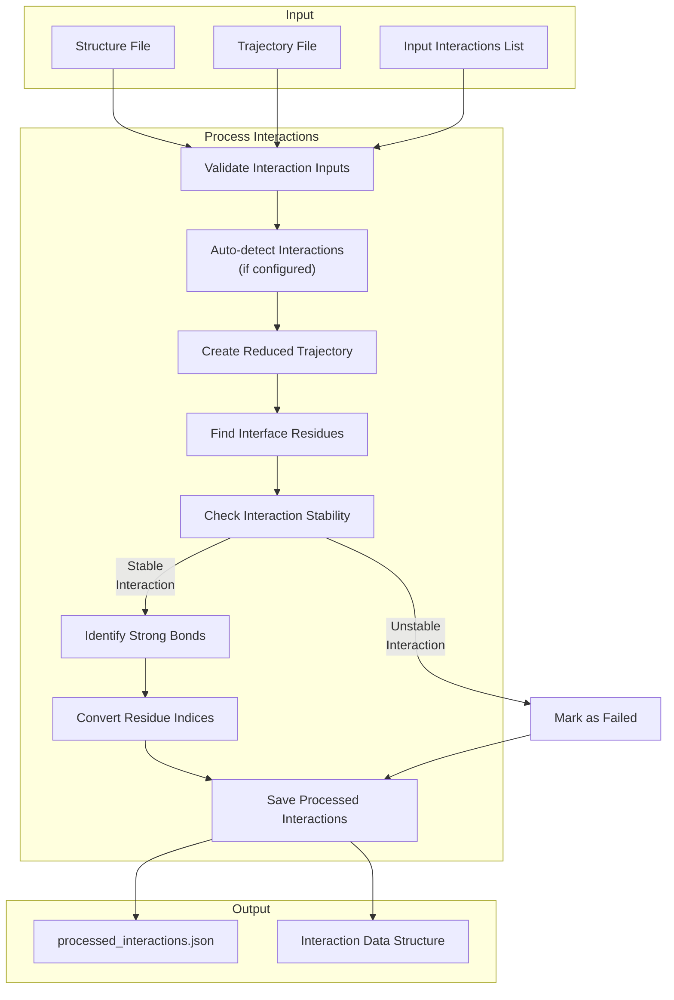
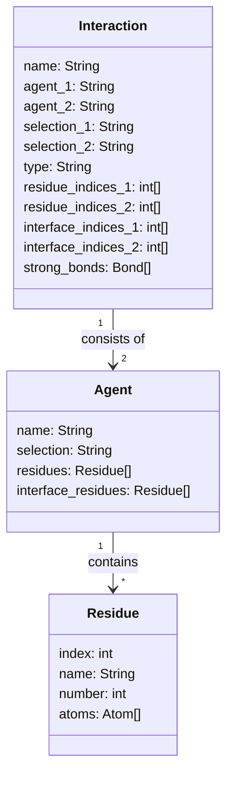
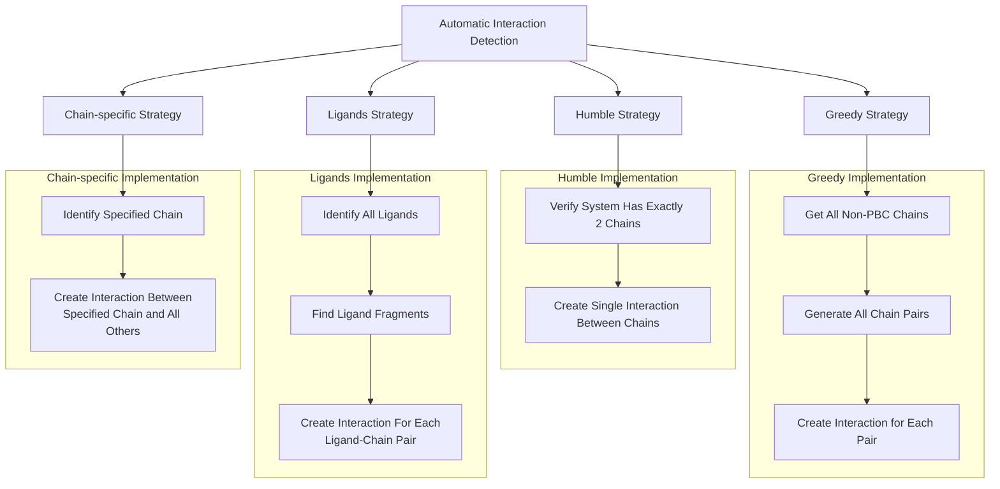
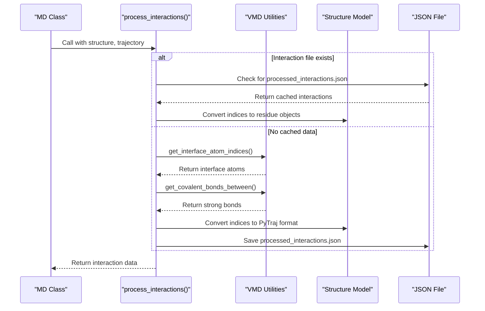
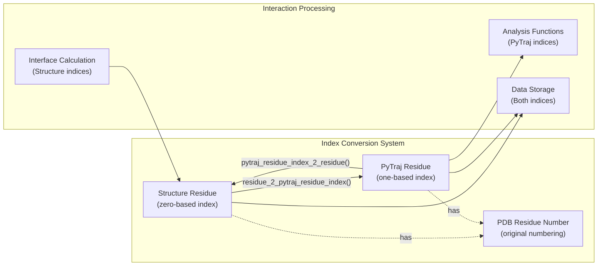

# Interaction Processing

Relevant source files

The following files were used as context for generating this wiki page:

- [model_workflow/tools/process_interactions.py](model_workflow/tools/process_interactions.py)
- [model_workflow/tools/topology_manager.py](model_workflow/tools/topology_manager.py)

## Purpose and Scope

The Interaction Processing module in MDDB-workflow identifies and characterizes molecular interactions between different components (agents) in molecular dynamics simulations. It determines which residues are at the interface between interacting molecules and validates the stability of these interactions throughout the simulation trajectory. This information is crucial for understanding protein-protein, protein-ligand, and other biomolecular interactions.

For information about mapping of structural components, see [Mapping Generation](#3.4). For topology generation and metadata creation, see [Topology and Metadata Generation](#3.6).

Sources: [model_workflow/tools/process_interactions.py:1-14]()

## Interaction Processing Workflow

The interaction processing fits into the larger MD workflow after structure correction and mapping generation, but before topology and metadata generation. It identifies molecularly interacting regions that are tracked throughout the analysis.

Sources: [model_workflow/tools/process_interactions.py:20-335]()

## Interaction Definition

### Structure of an Interaction

An interaction in MDDB-workflow is defined between two agents, each representing a molecular component like a protein chain or ligand. The primary information in an interaction includes:

- **Name**: Unique identifier for the interaction
- **Agents**: The two molecular components involved (agent_1 and agent_2)
- **Selections**: VMD-style atom selections defining each agent
- **Type**: Automatically determined interaction type based on agent classifications
- **Interface Residues**: Residues that participate in the interaction
- **Bond Information**: Strong covalent bonds between agents (if any)

Sources: [model_workflow/tools/process_interactions.py:169-205]()

### Interface Determination

Interface residues are determined by calculating the minimum distance between atoms in each agent across the trajectory frames. Residues that come within a specified distance cutoff (default 5Å) are classified as interface residues. The system tracks:

- All residues in each agent
- Interface residues specifically involved in the interaction
- The percentage of trajectory frames where the interaction occurs

Sources: [model_workflow/tools/process_interactions.py:232-282]()

## Automatic Interaction Detection

The module can automatically detect interactions without requiring explicit definitions, using several strategies:

| Strategy | Description | Use Case |
|----------|-------------|----------|
| `greedy` | Identifies all possible pairwise interactions between chains | Systems with multiple protein chains |
| `humble` | Identifies interactions between exactly two chains | Simple protein-protein systems |
| `ligands` | Identifies interactions between all protein chains and ligands | Protein-ligand systems |
| `chain X` | Identifies interactions between a specific chain and all others | Focus on a particular component |

Sources: [model_workflow/tools/process_interactions.py:52-155]()

## Interaction Processing Implementation

### Main Processing Function

The core functionality is implemented in the `process_interactions()` function, which follows these key steps:

1. **Input Preparation**: Process input interactions or auto-detect based on configuration
2. **Interaction Validation**: Ensure interaction definitions are valid
3. **Trajectory Processing**: Create a reduced trajectory if needed
4. **Interface Calculation**: Calculate interface residues using VMD utilities
5. **Stability Check**: Verify interactions meet the stability threshold
6. **Index Conversion**: Convert between different residue indexing systems
7. **Result Serialization**: Format and save interaction data

Sources: [model_workflow/tools/process_interactions.py:20-38](), [model_workflow/tools/process_interactions.py:304-335]()

### Interaction Stability Validation

An interaction is considered stable if it appears in a minimum percentage of trajectory frames (default 10%). If an interaction fails this threshold:

- With the `mercy` flag: The interaction is marked as failed but processing continues
- Without the `mercy` flag: A `TestFailure` exception is raised, stopping the workflow

This validation prevents unstable or incorrectly defined interactions from affecting downstream analyses.

Sources: [model_workflow/tools/process_interactions.py:240-261]()

## Interaction Data Structure

### Key Data Fields

The processed interaction data includes several key fields:

| Field | Description |
|-------|-------------|
| `name` | Unique identifier for the interaction |
| `agent_1`, `agent_2` | Names of the interacting agents |
| `residue_indices_1`, `residue_indices_2` | All residue indices for each agent |
| `interface_indices_1`, `interface_indices_2` | Indices of interface residues |
| `atom_indices_1`, `atom_indices_2` | All atom indices for each agent |
| `interface_atom_indices_1`, `interface_atom_indices_2` | Indices of interface atoms |
| `strong_bonds` | Covalent bonds between agents |
| `pt_residues_1`, `pt_residues_2` | PyTraj-formatted residue indices |
| `pt_interface_1`, `pt_interface_2` | PyTraj-formatted interface residue indices |

### Persistence and Caching

Processed interactions are saved to a JSON file (`processed_interactions.json`) to avoid recomputing them in subsequent runs. This caching mechanism improves performance for repeated analyses of the same system.

Sources: [model_workflow/tools/process_interactions.py:207-216](), [model_workflow/tools/process_interactions.py:337-364]()

## Integration with Structure Model

### Residue Index Conversion

The interaction processing module works with multiple residue indexing schemes:

1. **Structure indices**: Zero-based indices within the Structure object
2. **PDB residue numbers**: Original numbering from the PDB file
3. **PyTraj indices**: One-based indices used by PyTraj library

The conversion between these indexing schemes is facilitated by functions from the topology manager:

- `residue_2_pytraj_residue_index`: Converts from Structure residue to PyTraj index
- `pytraj_residue_index_2_residue`: Converts from PyTraj index to Structure residue

This conversion is crucial for consistent residue identification across different analytical tools.

Sources: [model_workflow/tools/process_interactions.py:289-298](), [model_workflow/tools/topology_manager.py:29-72]()

### Benefits of Multiple Indexing Systems

Maintaining multiple indexing systems provides several advantages:

1. **Compatibility**: Enables seamless integration with different libraries that use different indexing schemes
2. **Data Integrity**: Preserves original PDB numbering for consistent reporting
3. **Performance**: Reduces the need for repeated conversions in analysis workflows
4. **Flexibility**: Allows direct access to atoms and residues through different reference systems

Sources: [model_workflow/tools/topology_manager.py:22-28](), [model_workflow/tools/topology_manager.py:31-45]()

---