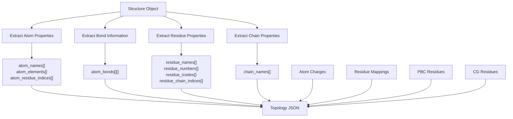
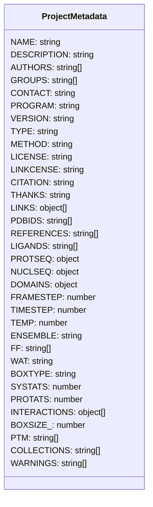
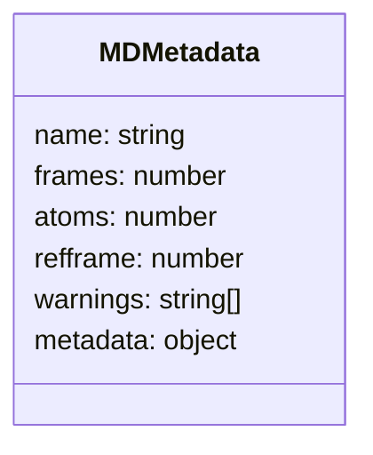
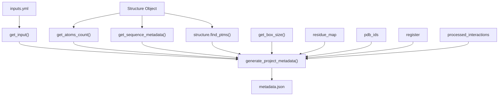
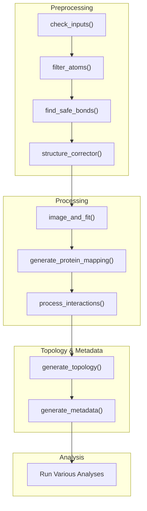

# Topology and Metadata Generation

<details>
<summary>Relevant source files</summary>

The following files were used as context for generating this wiki page:

- [manual_tools/inputs_generator_by_pdb.py](manual_tools/inputs_generator_by_pdb.py)
- [model_workflow/resources/inputs_file_template.yml](model_workflow/resources/inputs_file_template.yml)
- [model_workflow/tools/generate_metadata.py](model_workflow/tools/generate_metadata.py)
- [model_workflow/tools/generate_topology.py](model_workflow/tools/generate_topology.py)
- [model_workflow/tools/get_bonds.py](model_workflow/tools/get_bonds.py)
- [model_workflow/tools/image_and_fit.py](model_workflow/tools/image_and_fit.py)
- [model_workflow/tools/structure_corrector.py](model_workflow/tools/structure_corrector.py)

</details>


This page documents the topology and metadata generation components of the MDDB-workflow system. These components are responsible for creating standardized JSON representations of molecular structures and capturing comprehensive information about molecular dynamics simulations. The generated files are essential for both analysis and database storage.

For information about trajectory manipulation prior to these steps, see [Trajectory Manipulation](#3.3). For information about mapping generation that feeds into metadata, see [Mapping Generation](#3.4).

## Overview

After a molecular dynamics simulation has been processed, corrected, and mapped, the workflow generates two critical files:

1. **Topology file**: A comprehensive JSON representation of the molecular structure including atoms, bonds, residues, chains, and their properties.
2. **Metadata file**: Contains detailed information about the simulation parameters, structure statistics, and reference information required for database storage and front-end display.

```mermaid
flowchart LR
    subgraph "Previous Steps"
        StructCorr["Structure Correction"]
        Mapping["Mapping Generation"]
        ImageFit["Image and Fit"]
    end

    subgraph "Topology & Metadata Generation"
        GenTop["generate_topology()"]
        GenMeta["generate_metadata()"]
    end

    subgraph "Outputs"
        TopFile["topology.json"]
        MetaFile["metadata.json"]
    end

    StructCorr --> GenTop
    Mapping --> GenMeta
    ImageFit --> GenTop
    GenTop --> TopFile
    GenMeta --> MetaFile
    TopFile --> "Database"
    MetaFile --> "Database"
```

Sources: [model_workflow/tools/generate_topology.py](https://github.com/mmb-irb/MDDB-workflow/blob/main/model_workflow/tools/generate_topology.py), [model_workflow/tools/generate_metadata.py](https://github.com/mmb-irb/MDDB-workflow/blob/main/model_workflow/tools/generate_metadata.py)

## Topology Generation

### Purpose and Components

The topology file represents the molecular structure in a standardized JSON format, capturing all essential structural elements including atoms, bonds, residues, and chains. This representation serves as the foundation for analysis and visualization.

```mermaid
classDiagram
    class Topology {
        atom_names[]
        atom_elements[]
        atom_charges[]
        atom_residue_indices[]
        atom_bonds[][]
        residue_names[]
        residue_numbers[]
        residue_icodes{}
        residue_chain_indices[]
        chain_names[]
        residue_mappings{}
        pbc_residues[]
        cg_residues[]
    }
    
    Topology --|> Structure : derived from
```

Sources: [model_workflow/tools/generate_topology.py:1-84](https://github.com/mmb-irb/MDDB-workflow/blob/main/model_workflow/tools/generate_topology.py)

### Topology Generation Process

The topology generation process extracts structural information from the corrected structure object and organizes it into arrays and dictionaries suitable for JSON serialization:

1. **Atom Information**: Names, elements, charges, and corresponding residue indices
2. **Bond Information**: Connections between atoms, properly sorted by indices
3. **Residue Information**: Names, numbers, insertion codes, and chain indices
4. **Chain Information**: Chain names
5. **Special Residue Sets**: PBC residues, CG residues



Sources: [model_workflow/tools/generate_topology.py:5-84](https://github.com/mmb-irb/MDDB-workflow/blob/main/model_workflow/tools/generate_topology.py)

### Handling Special Cases

The topology generation handles several special cases:

- **Missing Bonds**: If bonds cannot be determined (e.g., for coarse-grained atoms), they are represented as `float('nan')` in the JSON
- **Insertion Codes**: Stored as a dictionary with residue indices as keys, only for residues that have insertion codes
- **Missing Charges**: If charges are not available, they are set to `None` (which becomes `null` in JSON)

Sources: [model_workflow/tools/generate_topology.py:30-31, 38-52, 61-64](https://github.com/mmb-irb/MDDB-workflow/blob/main/model_workflow/tools/generate_topology.py)

## Metadata Generation

### Project Metadata

Project metadata contains comprehensive information about the molecular dynamics simulation, providing context for analysis and database queries. The metadata is organized into various categories:



Sources: [model_workflow/tools/generate_metadata.py:100-186](https://github.com/mmb-irb/MDDB-workflow/blob/main/model_workflow/tools/generate_metadata.py)

### Key Metadata Categories

The project metadata encompasses several key categories:

1. **Project Identification**: Name, description, authors, groups, contact information
2. **Simulation Details**: Program, version, type, method, ensemble, timestep, temperature
3. **Structure Statistics**: Atom counts, residue counts for various molecule types (protein, nucleic, lipid, etc.)
4. **Box Information**: Box type and dimensions
5. **Molecular Components**: References, ligands, protein sequences, interactions
6. **Technical Information**: Force fields, water model, post-translational modifications
7. **Special Collections**: Collection-specific fields (e.g., CV19, nanobodies)
8. **Issues**: Warning messages from the processing pipeline

Sources: [model_workflow/tools/generate_metadata.py:100-186](https://github.com/mmb-irb/MDDB-workflow/blob/main/model_workflow/tools/generate_metadata.py), [model_workflow/resources/inputs_file_template.yml:9-183](https://github.com/mmb-irb/MDDB-workflow/blob/main/model_workflow/resources/inputs_file_template.yml)

### MD Simulation Metadata

For individual MD simulations within a project, a separate metadata file is generated with simulation-specific information:



The `metadata` field within MD metadata may contain any of the standard metadata fields that differ from the project-level values.

Sources: [model_workflow/tools/generate_metadata.py:198-244](https://github.com/mmb-irb/MDDB-workflow/blob/main/model_workflow/tools/generate_metadata.py)

## Metadata Generation Process

The process of generating metadata involves collecting information from various sources:



Sources: [model_workflow/tools/generate_metadata.py:11-186](https://github.com/mmb-irb/MDDB-workflow/blob/main/model_workflow/tools/generate_metadata.py)

### Key Data Sources for Metadata

The metadata generation relies on several key data sources:

1. **User Inputs**: Values from the inputs.yml file, accessed through the `get_input` function
2. **Structure Analysis**: Atom counts, post-translational modifications
3. **Box Analysis**: Box dimensions from the trajectory
4. **Sequence Analysis**: Protein and nucleic acid sequences, domains
5. **Residue Mapping**: References to external databases (e.g., UniProt)
6. **Interaction Analysis**: Processed molecular interactions
7. **Register**: Warnings and errors from the processing pipeline

Sources: [model_workflow/tools/generate_metadata.py:11-186](https://github.com/mmb-irb/MDDB-workflow/blob/main/model_workflow/tools/generate_metadata.py), [model_workflow/resources/inputs_file_template.yml:9-519](https://github.com/mmb-irb/MDDB-workflow/blob/main/model_workflow/resources/inputs_file_template.yml)

## Integration with Overall Workflow

The topology and metadata generation steps integrate into the overall MDDB-workflow system as final processing steps before analysis:



Sources: Analysis of all files and diagrams provided in the prompt

## Key Functions

### generate_topology

The `generate_topology` function creates a JSON representation of the molecular structure:

```python
def generate_topology(
    structure: 'Structure',
    charges: List[int],
    residue_map: dict,
    pbc_residues: List[int],
    cg_residues: List[int],
    output_topology_filepath: str
)
```

Parameters:
- `structure`: The Structure object containing all molecular information
- `charges`: List of atomic charges (can be MISSING_CHARGES)
- `residue_map`: Dictionary mapping residues to external references
- `pbc_residues`: List of residue indices under periodic boundary conditions
- `cg_residues`: List of coarse-grained residue indices
- `output_topology_filepath`: Path to save the generated JSON file

Sources: [model_workflow/tools/generate_topology.py:5-84](https://github.com/mmb-irb/MDDB-workflow/blob/main/model_workflow/tools/generate_topology.py)

### generate_project_metadata

The `generate_project_metadata` function creates metadata for the entire project:

```python
def generate_project_metadata(
    input_structure_filename: str,
    input_trajectory_filename: str,
    get_input: Callable,
    structure: 'Structure',
    residue_map: dict,
    protein_references_file: 'File',
    pdb_ids: List[str],
    register: dict,
    output_metadata_filename: str,
    ligand_customized_names: str,
    processed_interactions: list
)
```

Parameters:
- `input_structure_filename`: Path to the input structure file
- `input_trajectory_filename`: Path to the input trajectory file
- `get_input`: Function to retrieve values from the inputs file
- `structure`: The Structure object
- `residue_map`: Dictionary mapping residues to external references
- `protein_references_file`: File containing protein reference information
- `pdb_ids`: List of PDB identifiers
- `register`: Register containing warnings and test results
- `output_metadata_filename`: Path to save the metadata file
- `ligand_customized_names`: Custom names for ligands
- `processed_interactions`: List of processed molecular interactions

Sources: [model_workflow/tools/generate_metadata.py:11-186](https://github.com/mmb-irb/MDDB-workflow/blob/main/model_workflow/tools/generate_metadata.py)

### generate_md_metadata

The `generate_md_metadata` function creates metadata for an individual MD simulation:

```python
def generate_md_metadata(
    md_inputs: dict,
    structure: 'Structure',
    snapshots: int,
    reference_frame: int,
    register: dict,
    output_metadata_filename: str
)
```

Parameters:
- `md_inputs`: Dictionary of MD-specific inputs
- `structure`: The Structure object
- `snapshots`: Number of frames in the trajectory
- `reference_frame`: Reference frame for the simulation
- `register`: Register containing warnings and test results
- `output_metadata_filename`: Path to save the metadata file

Sources: [model_workflow/tools/generate_metadata.py:198-244](https://github.com/mmb-irb/MDDB-workflow/blob/main/model_workflow/tools/generate_metadata.py)

## Summary

The Topology and Metadata Generation components are crucial final steps in the processing pipeline of the MDDB-workflow system. They convert the processed molecular structure and simulation data into standardized JSON formats that can be easily stored in a database and accessed by analysis and visualization tools.

The topology file provides a comprehensive representation of the molecular structure, while the metadata file captures contextual information about the simulation, including parameters, statistics, and references to external databases. Together, these files enable efficient storage, retrieval, and analysis of molecular dynamics simulations in the MDDB database.

---