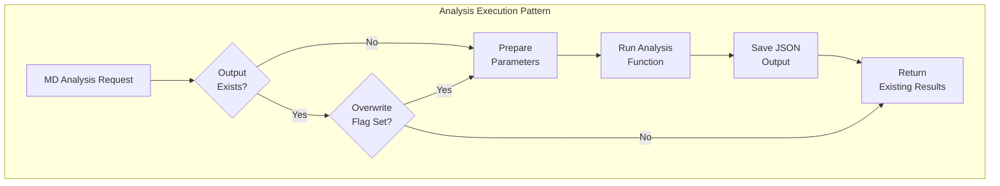
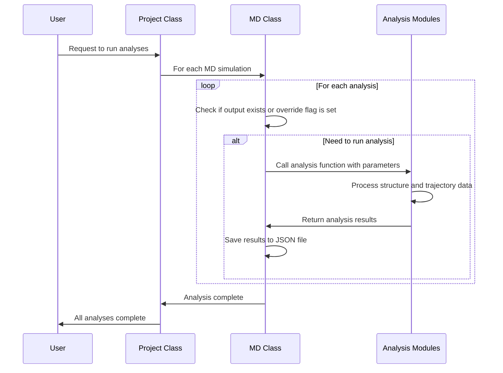

# Analysis Modules

<details>
<summary>Relevant source files</summary>

The following files were used as context for generating this wiki page:

- [model_workflow/mwf.py](model_workflow/mwf.py)
- [model_workflow/utils/constants.py](model_workflow/utils/constants.py)

</details>


## Purpose and Overview

Analysis modules in the MDDB-workflow form a comprehensive suite of tools for extracting meaningful information from molecular dynamics (MD) simulations. These modules calculate various properties related to the structure, energetics, dynamics, and interactions within the simulated system. This page documents the available analysis modules, their organization, execution patterns, and how they fit into the overall workflow.

For information about the overall processing pipeline prior to analysis, see [Processing Pipeline](#3).

Sources: [model_workflow/mwf.py:56-80]()

## Analysis Module Architecture

Analysis modules operate as standalone functions that are called from the MD class. Each module follows a consistent execution pattern that handles dependency checking, output file management, and parameter preparation.



Sources: [model_workflow/mwf.py:1410-1757]()

### Common Analysis Parameters

Most analysis modules share a standard set of parameters:

| Parameter | Description |
|-----------|-------------|
| input_structure_file/input_topology_file | Structure file used for topological information |
| input_trajectory_file | Trajectory file containing simulation frames |
| output_analysis_filepath | Where the analysis results are saved (JSON format) |
| structure | Structure object representation |
| snapshots | Total number of frames in the trajectory |
| frames_limit | Maximum number of frames to analyze (for performance) |
| pbc_selection | Selection of atoms in periodic boundary conditions |

Sources: [model_workflow/mwf.py:1410-1757]()

### Output Files

Each analysis produces a standardized JSON output file with a consistent naming pattern:

| Analysis | Output Filename |
|----------|----------------|
| RMSD | mda.rmsds.json |
| RMSF | mda.fluctuation.json |
| PCA | mda.pca.json |
| Clusters | mda.clusters.json |
| SASA | mda.sasa.json |
| Energies | mda.energies.json |
| Hydrogen Bonds | mda.hbonds.json |
| Membrane Thickness | mda.thickness.json |

Sources: [model_workflow/utils/constants.py:151-175]()

## Categories of Analysis Modules

```mermaid
graph TB
    subgraph "Analysis Categories"
        direction TB
        Structural["Structural Analyses"]
        Energy["Energy Analyses"]
        Membrane["Membrane Analyses"]
        Advanced["Advanced Analyses"]
    end
    
    subgraph "Structural Analyses"
        direction TB
        RMSD["RMSD Analysis\nrmsds()"]
        RMSF["RMSF Analysis\nrmsf()"]
        RGYR["Radius of Gyration\nrgyr()"]
        PCA["PCA Analysis\npca()"]
        TMScore["TM-Score\ntmscores()"]
        RMSDPerRes["RMSD Per Residue\nrmsd_per_residue()"]
        RMSDPair["RMSD Pairwise\nrmsd_pairwise()"]
        Clusters["Clustering\nclusters_analysis()"]
    end
    
    subgraph "Energy Analyses"
        direction TB
        Energies["Energy Analysis\nenergies()"]
        DiheEnergies["Dihedral Energies\ncompute_dihedral_energies()"]
        SASA["Solvent Accessible Surface\nsasa()"]
    end
    
    subgraph "Membrane Analyses"
        direction TB
        Density["Density Profiles\ndensity()"]
        Thickness["Membrane Thickness\nthickness()"]
        APL["Area Per Lipid\narea_per_lipid()"]
        LipidOrder["Lipid Order Parameters\nlipid_order()"]
        LipidInt["Lipid Interactions\nlipid_interactions()"]
    end
    
    subgraph "Advanced Analyses"
        direction TB
        HBonds["Hydrogen Bonds\nhydrogen_bonds()"]
        Pockets["Pocket Detection\npockets()"]
        Helical["Helical Parameters\nhelical_parameters()"]
        Markov["Markov State Models\nmarkov()"]
        DistPerRes["Distance Per Residue\ndistance_per_residue()"]
    end
    
    Structural --- RMSD & RMSF & RGYR & PCA & TMScore & RMSDPerRes & RMSDPair & Clusters
    Energy --- Energies & DiheEnergies & SASA
    Membrane --- Density & Thickness & APL & LipidOrder & LipidInt
    Advanced --- HBonds & Pockets & Helical & Markov & DistPerRes
```



Sources: [model_workflow/mwf.py:57-80](), [model_workflow/mwf.py:1410-1757]()

## Structural Analyses

Structural analyses evaluate conformational changes and structural properties of the molecular system throughout the simulation.

### RMSD Analysis

Root Mean Square Deviation (RMSD) measures the average distance between atoms of superimposed structures, quantifying conformational changes over time.

```python
MD.run_rmsds_analysis()  # Method in MD class to execute RMSD analysis
```

The analysis calculates RMSD in several ways:
- Against the first frame
- Against the average structure
- For different selections (all atoms, backbone, etc.)
- Per-ligand RMSD where applicable

Output file: `mda.rmsds.json`

Sources: [model_workflow/mwf.py:1410-1436]()

### RMSF Analysis

Root Mean Square Fluctuation (RMSF) measures the deviation of a particle's position over time, identifying flexible and rigid regions of the molecule.

```python
MD.run_rmsf_analysis()  # Method in MD class to execute RMSF analysis
```

Output file: `mda.fluctuation.json`

Sources: [model_workflow/mwf.py:1462-1481]()

### Radius of Gyration

Radius of gyration (RGYR) measures the compactness of the molecular structure throughout the simulation.

```python
MD.run_rgyr_analysis()  # Method in MD class to execute RGYR analysis
```

Output file: `mda.rgyr.json`

Sources: [model_workflow/mwf.py:1482-1506]()

### Principal Component Analysis

Principal Component Analysis (PCA) identifies the dominant modes of motion in the simulation.

```python
MD.run_pca_analysis()  # Method in MD class to execute PCA analysis
```

This analysis also generates projection trajectory files with prefix `mdt.pca_trajectory`.

Output file: `mda.pca.json`

Sources: [model_workflow/mwf.py:1507-1534](), [model_workflow/utils/constants.py:157]()

### Clustering Analysis

Clustering groups similar conformations from the trajectory, identifying major conformational states.

```python
MD.run_clusters_analysis()  # Method in MD class to execute clustering analysis
```

This analysis generates both a JSON results file and visualization screenshots.

Output files: 
- `mda.clusters.json`
- `mdf.clusters_*_screenshot_??.jpg`

Sources: [model_workflow/mwf.py:1608-1646](), [model_workflow/utils/constants.py:148]()

## Energy Analyses

Energy analyses evaluate the energetic properties and interactions within the molecular system.

### Energy Analysis

Calculates various energy components of the system and interactions between parts of the molecule.

```python
MD.run_energies_analysis()  # Method in MD class to execute energy analysis
```

This analysis creates a directory with intermediate files before generating the final output.

Output file: `energies/mda.energies.json`

Sources: [model_workflow/mwf.py:1732-1757](), [model_workflow/utils/constants.py:178]()

### SASA Analysis

Solvent Accessible Surface Area (SASA) calculates the area of the molecule that is accessible to solvent.

```python
MD.run_sas_analysis()  # Method in MD class to execute SASA analysis
```

Output file: `mda.sasa.json`

Sources: [model_workflow/mwf.py:1708-1730]()

### Dihedral Energies

Analyzes the energy associated with dihedral angles in the molecule.

```python
MD.run_dihedral_energies()  # Method in MD class to execute dihedral energy analysis
```

Output file: `mda.dihenergies.json`

Sources: [model_workflow/mwf.py:1760-1771]()

## Membrane Analyses

Membrane analyses provide specialized metrics for simulations containing lipid bilayers.

### Membrane Density

Calculates density profiles across the membrane.

```python
MD.run_density_analysis()  # Method in MD class to execute membrane density analysis
```

Output file: `mda.density.json`

Sources: [model_workflow/mwf.py:62]()

### Membrane Thickness

Measures the thickness of the lipid bilayer at different positions and times.

```python
MD.run_thickness_analysis()  # Method in MD class to execute membrane thickness analysis
```

Output file: `mda.thickness.json`

Sources: [model_workflow/mwf.py:63]()

### Area Per Lipid

Calculates the average area occupied by each lipid in the membrane.

```python
MD.run_area_per_lipid_analysis()  # Method in MD class to execute area per lipid analysis
```

Output file: `mda.apl.json`

Sources: [model_workflow/mwf.py:64]()

### Lipid Order Parameters

Analyzes the ordering of lipid tails in the membrane.

```python
MD.run_lipid_order_analysis()  # Method in MD class to execute lipid order analysis
```

Output file: `mda.lipid_order.json`

Sources: [model_workflow/mwf.py:65]()

## Advanced Analyses

Advanced analyses provide specialized insights for specific research questions.

### Hydrogen Bonds

Identifies and tracks hydrogen bonds between different parts of the system.

```python
MD.run_hbonds_analysis()  # Method in MD class to execute hydrogen bonds analysis
```

Output file: `mda.hbonds.json`

Sources: [model_workflow/mwf.py:1670-1706]()

### Pocket Detection

Identifies and characterizes pockets within the protein structure.

```python
MD.run_pockets_analysis()  # Method in MD class to execute pocket detection analysis
```

This analysis creates a directory with intermediate files and pocket structures.

Output files:
- `mda.pockets.json`
- `mdf.pocket*` structures

Sources: [model_workflow/mwf.py:78](), [model_workflow/utils/constants.py:168-169]()

### Helical Parameters

Analyzes the geometric parameters of helical structures, particularly useful for nucleic acids.

```python
MD.run_helical_parameters_analysis()  # Method in MD class to execute helical parameter analysis
```

Output file: `mda.helical.json`

Sources: [model_workflow/mwf.py:79]()

### Markov State Models

Creates a Markov State Model to analyze conformational transitions and kinetics.

```python
MD.run_markov_analysis()  # Method in MD class to execute Markov analysis
```

Output file: `mda.markov.json`

Sources: [model_workflow/mwf.py:80]()

## Integration with Workflow



Sources: [model_workflow/mwf.py:1410-1757]()

## Running Analyses

Analyses can be executed through the `mwf` command-line interface or by calling the analysis methods directly on an MD object. Most analyses are executed automatically when running a full workflow, but they can also be run individually.

### Command Line Interface

```bash
# Run all default analyses
mwf run -top topology.prmtop -traj trajectory.xtc

# Run with specific analyses
mwf run -top topology.prmtop -traj trajectory.xtc -ana rmsds,rmsf,pca
```

### Programmatic Interface

```python
from model_workflow.mwf import Project, MD

# Create a project and access an MD object
project = Project(directory="./my_project")
md = project.mds[0]

# Run specific analyses
md.run_rmsds_analysis()
md.run_pca_analysis()
md.run_energies_analysis()
```

Sources: [model_workflow/mwf.py:1410-1757]()

## Summary

The analysis modules in MDDB-workflow provide a comprehensive set of tools for analyzing molecular dynamics simulations. Each module focuses on specific aspects of the simulation, from structural changes to energetic properties to specialized analyses for membranes and advanced techniques. The modules are designed to be both automatic, running as part of the standard workflow, and flexible, allowing users to select and customize the analyses they need.

---