# Structural Analyses

<details>
<summary>Relevant source files</summary>

The following files were used as context for generating this wiki page:

- [model_workflow/analyses/clusters.py](model_workflow/analyses/clusters.py)
- [model_workflow/analyses/distance_per_residue.py](model_workflow/analyses/distance_per_residue.py)
- [model_workflow/analyses/hydrogen_bonds.py](model_workflow/analyses/hydrogen_bonds.py)
- [model_workflow/analyses/hydrogen_bonds_2.py](model_workflow/analyses/hydrogen_bonds_2.py)
- [model_workflow/analyses/markov.py](model_workflow/analyses/markov.py)
- [model_workflow/analyses/markov_2.py](model_workflow/analyses/markov_2.py)
- [model_workflow/analyses/pca.py](model_workflow/analyses/pca.py)
- [model_workflow/analyses/pockets.py](model_workflow/analyses/pockets.py)
- [model_workflow/analyses/rgyr.py](model_workflow/analyses/rgyr.py)
- [model_workflow/analyses/rmsd_check.py](model_workflow/analyses/rmsd_check.py)
- [model_workflow/analyses/rmsd_pairwise.py](model_workflow/analyses/rmsd_pairwise.py)
- [model_workflow/analyses/rmsd_per_residue.py](model_workflow/analyses/rmsd_per_residue.py)
- [model_workflow/analyses/rmsds.py](model_workflow/analyses/rmsds.py)
- [model_workflow/analyses/rmsf.py](model_workflow/analyses/rmsf.py)
- [model_workflow/analyses/tmscores.py](model_workflow/analyses/tmscores.py)
- [model_workflow/tools/get_reduced_trajectory.py](model_workflow/tools/get_reduced_trajectory.py)
- [model_workflow/tools/get_screenshot.py](model_workflow/tools/get_screenshot.py)
- [model_workflow/utils/register.py](model_workflow/utils/register.py)

</details>


## Purpose and Scope

This document details the structural analysis modules within the MDDB-workflow system. These analyses examine the conformational behavior and structural properties of molecules in molecular dynamics simulations. The analyses covered here focus on quantifying structural changes, identifying movement patterns, and characterizing structural features across trajectory frames.

For energy-related analyses, see [Energy Analyses](#4.2). For membrane-specific analyses, see [Membrane Analyses](#4.3). For more advanced analyses including pockets and helical parameters, see [Advanced Analyses](#4.4).

## Overview of Structural Analysis Modules

The MDDB-workflow provides several core structural analysis modules that work with the trajectory data processed by the pipeline. These analyses provide critical insights into the conformational dynamics of molecular systems.

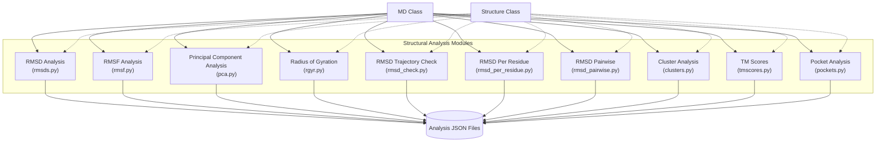

Sources:
- [model_workflow/analyses/rmsds.py]()
- [model_workflow/analyses/rmsf.py]()
- [model_workflow/analyses/pca.py]()
- [model_workflow/analyses/rgyr.py]()
- [model_workflow/analyses/rmsd_check.py]()
- [model_workflow/analyses/rmsd_per_residue.py]()
- [model_workflow/analyses/rmsd_pairwise.py]()
- [model_workflow/analyses/clusters.py]()
- [model_workflow/analyses/tmscores.py]()
- [model_workflow/analyses/pockets.py]()

## Core Structural Analysis Modules

### RMSD Analysis

Root Mean Square Deviation (RMSD) analysis calculates the average distance between atoms in different structural conformations. This analysis quantifies how much a structure deviates from a reference structure over the trajectory.

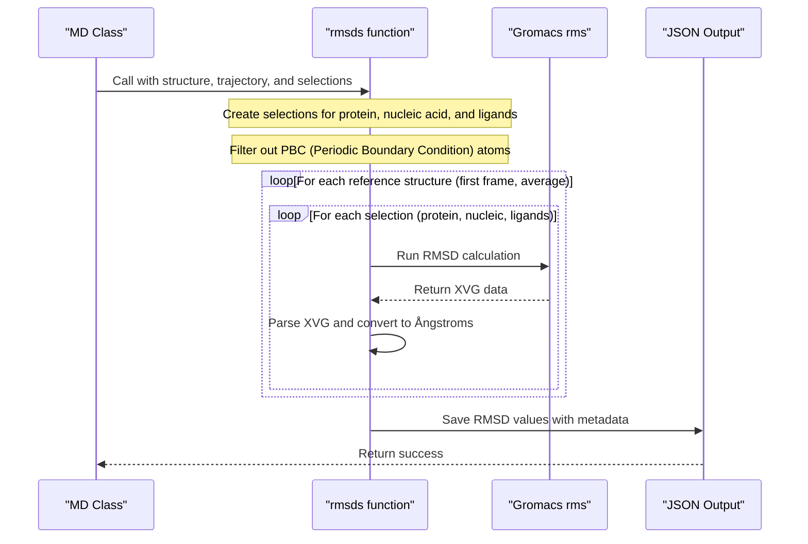

The RMSD analysis module (`rmsds.py`) performs the following key functions:

1. Calculates RMSD for different reference structures:
   - First frame of the trajectory
   - Average structure

2. Analyzes different structural components separately:
   - Protein
   - Nucleic acid
   - Ligands (if present)

3. Handles periodic boundary conditions (PBC) by excluding PBC atoms from the analysis

4. Creates a reduced trajectory if the original trajectory exceeds the frame limit

The output is saved as a JSON file containing RMSD values for each selection and reference structure.

Sources:
- [model_workflow/analyses/rmsds.py:10-118]()

### RMSF Analysis

Root Mean Square Fluctuation (RMSF) measures the average deviation of atom positions from their mean position over the trajectory. This analysis helps identify flexible and rigid regions of a molecule.

The RMSF module (`rmsf.py`) performs the following:

1. Uses MDAnalysis to calculate RMSF values for all atoms
2. Filters out values from PBC residue atoms as they may not have meaningful fluctuations
3. Computes statistical properties (mean, standard deviation, min, max) of the RMSF values
4. Outputs a JSON file with RMSF data for each atom and summary statistics

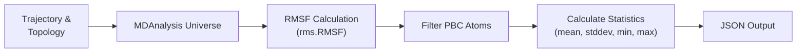

Sources:
- [model_workflow/analyses/rmsf.py:1-64]()

### Trajectory Integrity Check

The trajectory integrity check (`rmsd_check.py`) ensures that the trajectory doesn't contain any unphysical jumps or discontinuities. This is an important quality control step that:

1. Calculates frame-to-frame RMSD to detect sudden jumps
2. Uses statistical analysis to identify outliers in the RMSD pattern
3. Can analyze the trajectory as a whole or by fragments
4. Provides flexibility through the "mercy" parameter for handling problematic trajectories

The check works by:
1. Loading the trajectory frame by frame
2. Computing RMSD between consecutive frames
3. Detecting outliers using z-score analysis
4. Failing the test if any outliers are detected (unless mercy is granted)

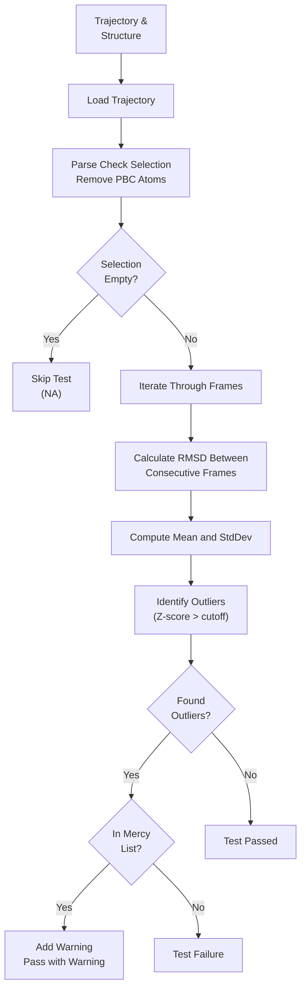

Sources:
- [model_workflow/analyses/rmsd_check.py:12-145]()

### Principal Component Analysis (PCA)

Principal Component Analysis (PCA) identifies the most significant motions in a molecular dynamics trajectory by reducing the dimensionality of the data. The PCA module (`pca.py`) performs the following:

1. Prepares a reduced trajectory if needed
2. Superimposes all frames on a reference (first frame)
3. Performs PCA using scikit-learn on atom coordinates
4. Generates trajectory projections along principal components
5. Saves eigenvalues, projections, and atom indices to a JSON file

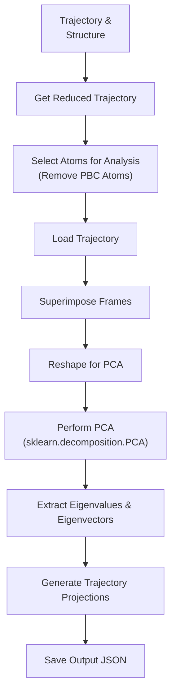

The PCA analysis provides insight into:
- Major collective motions of the system
- The relative importance of each motion (eigenvalues)
- The direction and magnitude of atomic movements (eigenvectors)
- Conformational changes along the most significant modes

Sources:
- [model_workflow/analyses/pca.py:1-137]()

### RMSD Per Residue

The RMSD per residue analysis (`rmsd_per_residue.py`) calculates RMSD values for each residue individually, providing insight into which parts of a molecule show the most significant structural changes.

Key features of this module:
1. Uses PyTraj to calculate RMSD for each residue
2. Handles reduction of trajectory frames if needed
3. Filters out PBC atoms which may have boundary-crossing artifacts
4. Maps PyTraj residue indices back to the original structure indices
5. Creates a comprehensive residue-by-residue RMSD profile

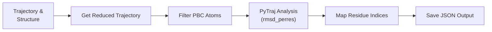

Sources:
- [model_workflow/analyses/rmsd_per_residue.py:1-89]()

### RMSD Pairwise Analysis

The RMSD pairwise analysis (`rmsd_pairwise.py`) calculates RMSD between all pairs of frames in the trajectory, creating a matrix of structural similarities.

Key features:
1. Can analyze the overall structure and specific interactions
2. Selects representative atoms (CA for proteins, C5' for nucleic acids)
3. Filters out PBC atoms
4. Creates a comprehensive RMSD matrix
5. Outputs JSON format for easy visualization and further analysis

Sources:
- [model_workflow/analyses/rmsd_pairwise.py:1-107]()

### Radius of Gyration (RGYR)

The radius of gyration analysis (`rgyr.py`) measures the compactness of a structure over time. It calculates the root mean square distance of atoms from their center of mass.

Key features:
1. Uses Gromacs to calculate overall RGYR and components along x, y, and z axes
2. Creates a reduced trajectory if needed
3. Filters out PBC atoms
4. Calculates statistical properties (mean, standard deviation, min, max)
5. Outputs both time series and summary statistics

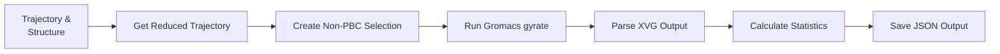

Sources:
- [model_workflow/analyses/rgyr.py:1-121]()

## Advanced Structural Analyses

### Cluster Analysis

The cluster analysis module (`clusters.py`) identifies conformational states by grouping similar frames together based on RMSD distances.

Key features of the clustering module:
1. Performs clustering for the overall structure and individual interactions
2. Uses RMSD as a distance metric between frames
3. Automatically adjusts the RMSD cutoff to achieve a target number of clusters
4. Identifies transitions between clusters
5. Generates representative screenshots for each cluster
6. Outputs cluster members, representative frames, and transitions

The clustering algorithm works by:
1. Building a pairwise RMSD matrix between all frames
2. Setting an initial RMSD cutoff
3. Adjusting the cutoff until the desired number of clusters is achieved
4. Identifying the most representative frame for each cluster
5. Analyzing transitions between clusters

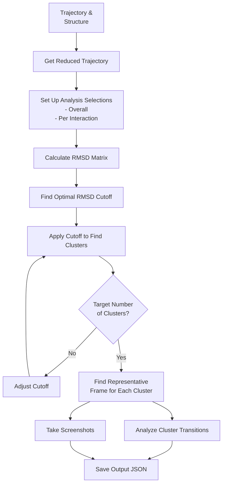

Sources:
- [model_workflow/analyses/clusters.py:1-273]()

### Pocket Analysis

The pocket analysis module (`pockets.py`) identifies and characterizes potential binding sites (pockets) in protein structures. This module is particularly useful for drug discovery applications.

Key features of the pocket analysis:
1. Uses the Fpocket algorithm through the MDpocket interface
2. Analyzes pockets over the trajectory to identify stable binding sites
3. Calculates the volume of each pocket over time
4. Identifies atoms lining each pocket
5. Creates a reduced trajectory for analysis (100 frames)

The pocket detection workflow:
1. Creates a grid representing pocket frequency across the trajectory
2. Identifies the most stable pockets based on frequency grid
3. Analyzes each selected pocket individually to track its dynamics
4. Calculates volumetric and other properties for each pocket

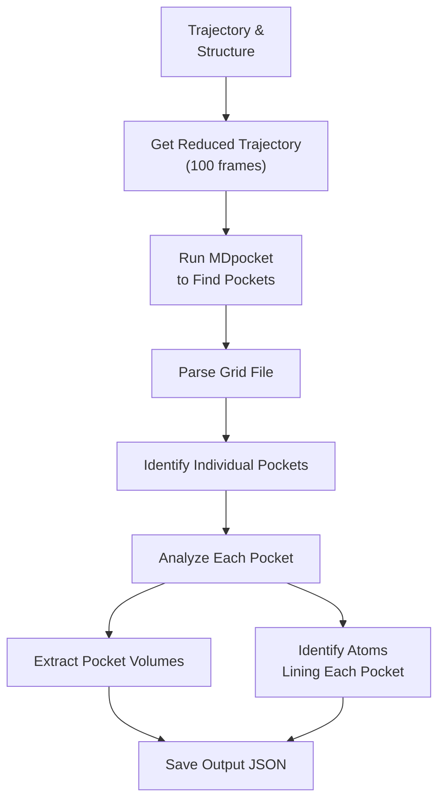

Sources:
- [model_workflow/analyses/pockets.py:1-527]()

### TM-Score Analysis

The TM-Score analysis module (`tmscores.py`) calculates the Template-Modeling score, which measures the similarity between protein structures. Unlike RMSD, TM-Score is less sensitive to local variations.

Key features:
1. Computes TM-Score against different reference structures
2. Focuses on Cα atoms for comparison
3. Handles PBC atoms appropriately
4. Outputs time series of TM-Score values

Sources:
- [model_workflow/analyses/tmscores.py:1-138]()

### Markov State Analysis

The Markov state analysis module (`markov.py`) creates a simplified representation of the conformational landscape using the most populated states and the transitions between them.

Key features:
1. Identifies the most populated frames
2. Calculates RMSD between these representative frames
3. Generates screenshots for visualization
4. Creates a network representation of conformational dynamics

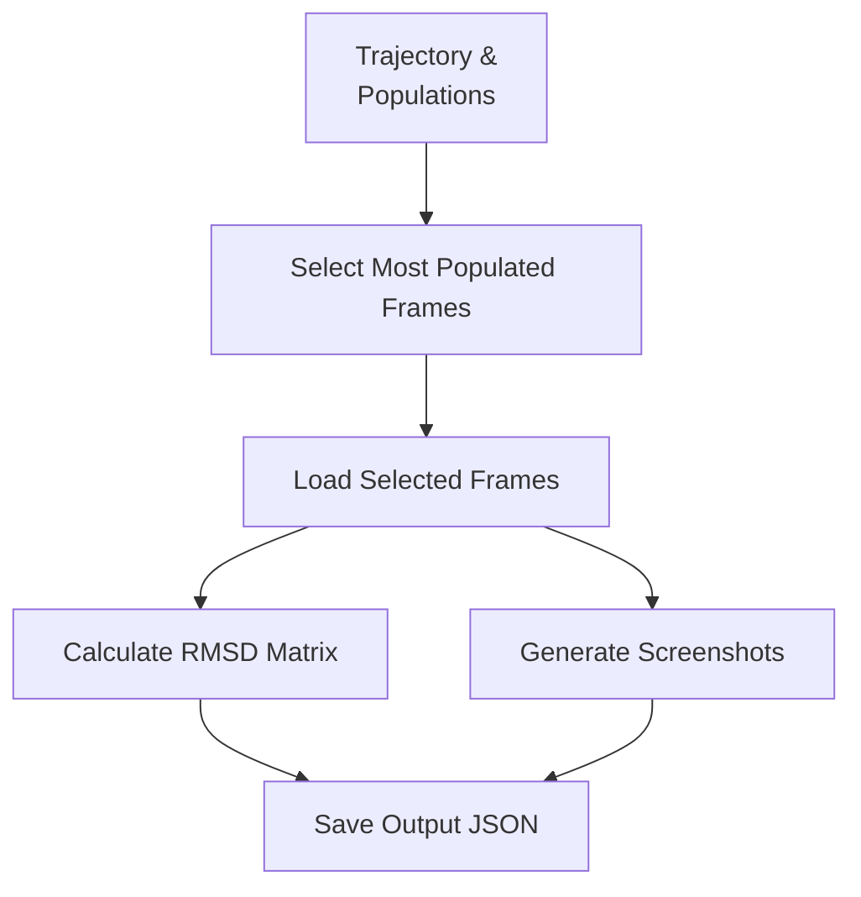

Sources:
- [model_workflow/analyses/markov.py:1-105]()

## Common Implementation Patterns

### Trajectory Handling

Most structural analyses follow common patterns for handling trajectories:

1. **Trajectory Reduction**: For computational efficiency, many analyses create a reduced trajectory when the original exceeds a frame limit.

```python
reduced_trajectory_filepath, step, frames = get_reduced_trajectory(
    input_topology_file,
    input_trajectory_file,
    snapshots,
    frames_limit,
)
```

2. **PBC Handling**: Periodic boundary condition atoms are typically excluded from analyses to avoid artifacts:

```python
selection -= pbc_selection
if not selection:
    print('No selection to analyze after PBC subtraction')
    return
```

3. **Tool Interfaces**: Analyses use various backends including:
   - Gromacs (via subprocess calls)
   - PyTraj
   - MDTraj
   - MDAnalysis
   - Custom Python implementations

### Output Format

All structural analyses output JSON files with a consistent structure:

```
{
  "data": [...],      # Main analysis data
  "start": 0,         # Starting frame (usually 0)
  "step": 10,         # Step between frames
  (optional fields specific to each analysis)
}
```

The consistent output format facilitates integration with visualization tools and the MDDB database.

## Integration with MD Class

The structural analysis modules are invoked by the MD class, which:

1. Prepares the necessary input files
2. Provides the Structure object
3. Handles the PBC selection
4. Manages the output file paths

This integration ensures consistent analysis workflows and proper data management.

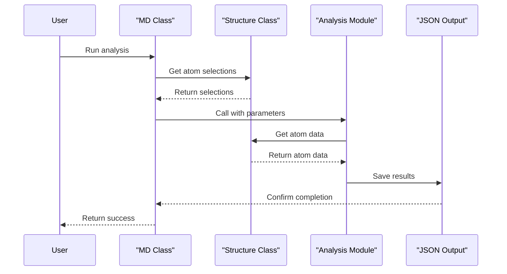

Sources:
- [model_workflow/analyses/rmsds.py]()
- [model_workflow/analyses/rmsf.py]()
- [model_workflow/analyses/pca.py]()
- [model_workflow/tools/get_reduced_trajectory.py:32-97]()
- [model_workflow/utils/register.py:14-152]()

---