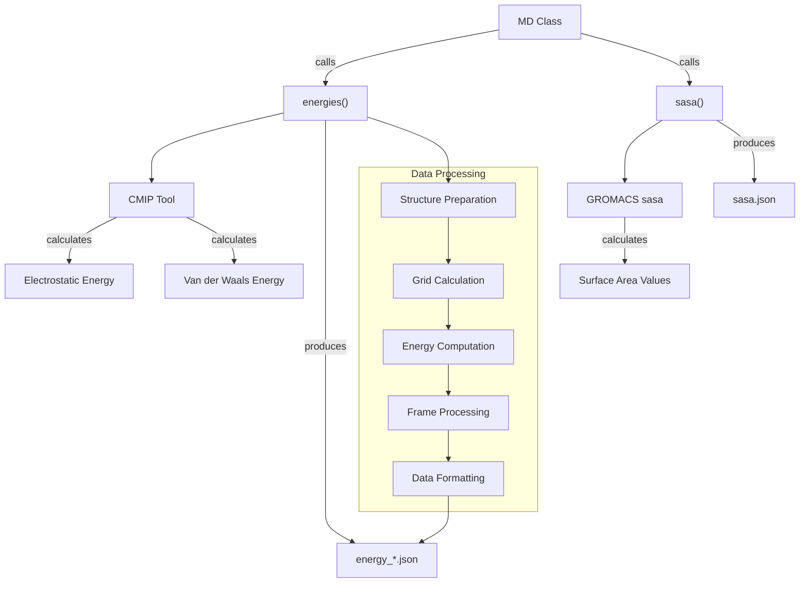
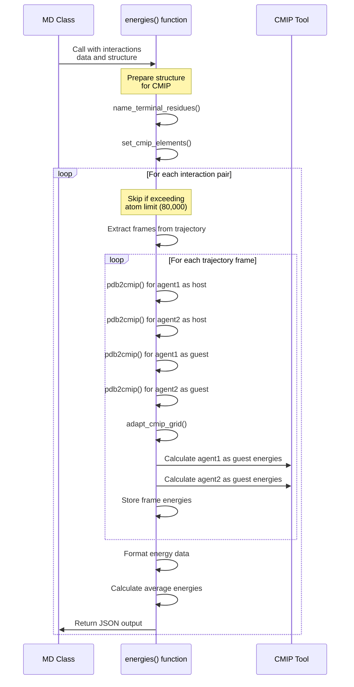
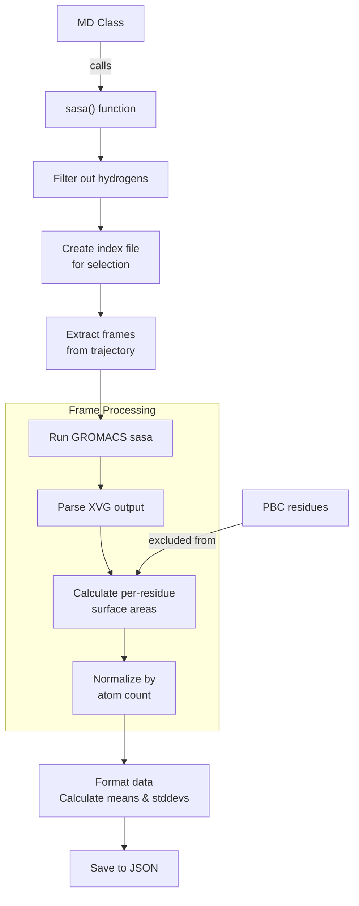
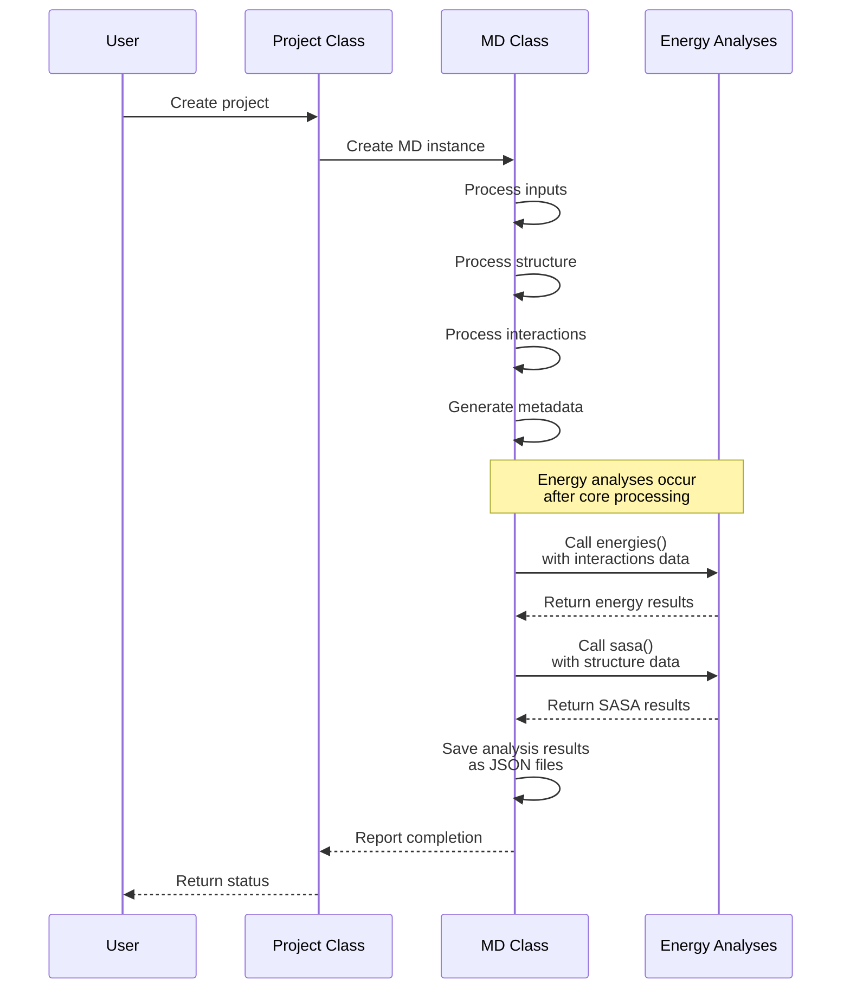

# Energy Analyses

<details>
<summary>Relevant source files</summary>

The following files were used as context for generating this wiki page:

- [model_workflow/analyses/energies.py](model_workflow/analyses/energies.py)
- [model_workflow/analyses/sasa.py](model_workflow/analyses/sasa.py)

</details>


## Purpose and Scope

The Energy Analyses module provides tools for calculating and analyzing energetic properties of molecular dynamics simulations. This module specifically focuses on:

1. Interaction energies between molecular components (electrostatic and Van der Waals)
2. Solvent Accessible Surface Area (SASA) calculations

These analyses help researchers understand binding affinities, molecular interactions, and conformational stability within the simulated systems. For other types of analyses such as structural analyses (RMSD, RMSF), see [Structural Analyses](#4.1) or for membrane-specific analyses, see [Membrane Analyses](#4.3).

## Overview of Energy Analysis Components



Sources:
[model_workflow/analyses/energies.py:49-573]()
[model_workflow/analyses/sasa.py:16-152]()

## Interaction Energies Analysis

The interaction energies analysis calculates electrostatic and Van der Waals potentials between defined interaction agents in the molecular system. This is performed by the `energies()` function which leverages the CMIP (Classical Molecular Interaction Potential) tool.

### Theoretical Background

The interaction energies analysis is based on:

- **CMIP (Classical Molecular Interaction Potential)**: Calculates electrostatic and Van der Waals interaction energies between molecular components
- **ACPYPE**: A Python tool that uses Antechamber to generate topologies for chemical compounds

Key references:
- SOUSA DA SILVA, A. W. & VRANKEN, W. F. ACPYPE - AnteChamber PYthon Parser interfacE. BMC Research Notes 5 (2012)
- Gelpí, J.L., et al. Classical molecular interaction potentials: Improved setup procedure in molecular dynamics simulations of proteins. Proteins, 45: 428-437 (2001)

Sources:
[model_workflow/analyses/energies.py:1-16]()

### Energies Analysis Workflow



Sources:
[model_workflow/analyses/energies.py:49-573]()

### Implementation Details

The energy analysis function handles several complex tasks:

1. **Structure Preparation**:
   - Renames terminal residues according to CMIP requirements
   - Sets element types to be CMIP-compatible (e.g., hydrogen atoms bonded to oxygen are renamed as 'HO')

2. **Interaction Processing**:
   - For each defined interaction between two molecular components:
     - Prepares special PDB files for both agents with proper charges
     - Marks atoms at the interface as "dummy" atoms when appropriate
     - Handles covalent bonds between interacting components

3. **CMIP Grid Calculation**:
   - Calculates appropriate grid dimensions to encompass both interacting components
   - Ensures grid size doesn't exceed memory limits (65 million grid points)
   - Adjusts grid resolution if necessary

4. **Energy Calculation**:
   - Runs CMIP twice for each interaction pair (each agent as guest/host)
   - Extracts Van der Waals and electrostatic energies
   - Filters extremely high energy values (>100) which might represent computational artifacts

5. **Results Processing**:
   - Averages energies across all trajectory frames
   - Separately calculates averages for first and last 20% of frames
   - Outputs per-atom energy values for all calculation types

Sources:
[model_workflow/analyses/energies.py:141-504]()
[model_workflow/analyses/energies.py:581-764]()

### Key Functions and Parameters

| Function | Purpose | Key Parameters |
|----------|---------|----------------|
| `energies()` | Main function that orchestrates energy calculation | `input_trajectory_file`, `structure`, `interactions`, `charges` |
| `pdb2cmip()` | Transforms structure to CMIP-compatible format | `host_file`, `host_selection`, `guest_selection` |
| `adapt_cmip_grid()` | Calculates optimal grid dimensions | `agent1_cmip_pdb`, `agent2_cmip_pdb` |
| `get_cmip_energies()` | Executes CMIP and extracts energy values | `cmip_inputs`, `guest`, `host` |
| `format_data()` | Processes raw energy data into final format | `data` (list of energy values) |

Sources:
[model_workflow/analyses/energies.py:49-764]()

### Output Format

The energies analysis produces JSON output with the following structure:

```
{
  "name": "interaction_name",
  "agent1": {
    "vdw": [atom1_vdw_avg, atom2_vdw_avg, ...],
    "es": [atom1_es_avg, atom2_es_avg, ...],
    "both": [atom1_both_avg, atom2_both_avg, ...],
    "ivdw": [atom1_initial_vdw_avg, ...],     // First 20% of frames
    "ies": [atom1_initial_es_avg, ...],       // First 20% of frames
    "iboth": [atom1_initial_both_avg, ...],   // First 20% of frames
    "fvdw": [atom1_final_vdw_avg, ...],       // Last 20% of frames
    "fes": [atom1_final_es_avg, ...],         // Last 20% of frames
    "fboth": [atom1_final_both_avg, ...]      // Last 20% of frames
  },
  "agent2": {
    // Same structure as agent1
  },
  "version": "1.0.0"
}
```

Sources:
[model_workflow/analyses/energies.py:563-568]()
[model_workflow/analyses/energies.py:752-762]()

## Solvent Accessible Surface Area (SASA) Analysis

The SASA analysis calculates the surface area of each residue that is accessible to solvent molecules. This is implemented in the `sasa()` function which uses GROMACS to perform the calculations.

### SASA Analysis Workflow



Sources:
[model_workflow/analyses/sasa.py:16-152]()

### Implementation Details

The SASA analysis performs the following steps:

1. **Preparation**:
   - Filters out hydrogen atoms from the structure for analysis
   - Creates an NDX index file for atom selection

2. **Frame Processing**:
   - Extracts frames from the trajectory
   - For each frame, runs GROMACS `sasa` command to calculate atomic surface areas
   - Parses the resulting XVG file to extract surface area values

3. **Data Processing**:
   - Aggregates atomic values to calculate per-residue surface areas
   - Excludes residues in periodic boundary conditions (PBC), such as membrane components
   - Normalizes SASA values by dividing by the number of atoms in each residue
   - Converts units from nm² to Ų

4. **Result Generation**:
   - Calculates mean and standard deviation of SASA values for each residue
   - Organizes data for JSON output

Sources:
[model_workflow/analyses/sasa.py:34-149]()

### Key Functions and Parameters

| Function | Purpose | Key Parameters |
|----------|---------|----------------|
| `sasa()` | Main function for SASA calculation | `input_topology_filename`, `input_trajectory_filename`, `structure`, `pbc_residues` |
| `xvg_parse()` | Parses GROMACS XVG output files | Called internally with output from GROMACS |
| `get_pdb_frames()` | Extracts frames from trajectory | `input_topology_filename`, `input_trajectory_filename`, `snapshots`, `frames_limit` |

Sources:
[model_workflow/analyses/sasa.py:16-23]()

### Output Format

The SASA analysis produces JSON output with the following structure:

```
{
  "step": frame_step_size,
  "saspf": [
    [residue1_frame1_sasa, residue1_frame2_sasa, ...],
    [residue2_frame1_sasa, residue2_frame2_sasa, ...],
    ...
  ],
  "means": [residue1_mean, residue2_mean, ...],
  "stdvs": [residue1_stddev, residue2_stddev, ...]
}
```

Note: For residues in periodic boundary conditions (PBC), the corresponding values in the arrays are set to `null`.

Sources:
[model_workflow/analyses/sasa.py:144-149]()

## Integration with MD Class

Energy analyses are integrated into the broader MDDB-workflow through the MD class, which manages the execution of these analyses as part of the overall processing pipeline.



Sources:
[model_workflow/analyses/energies.py:49-573]()
[model_workflow/analyses/sasa.py:16-152]()

## Limitations and Considerations

When using the energy analyses, keep in mind the following limitations:

1. **Atom Count Limits**:
   - CMIP has a hard limit of 80,000 atoms per interacting agent
   - Interactions exceeding this limit are skipped with a warning

2. **Grid Size Management**:
   - Grid points are limited to 65 million to prevent memory errors
   - When exceeded, grid resolution is automatically reduced

3. **SASA Considerations**:
   - PBC residues (e.g., membrane components) are excluded from results
   - SASA values are normalized by atom count for better comparability

4. **Computational Requirements**:
   - Energy analyses are computationally intensive
   - Backup files are created during processing to allow resuming if interrupted

Sources:
[model_workflow/analyses/energies.py:101-112]()
[model_workflow/analyses/energies.py:282-299]()
[model_workflow/analyses/sasa.py:29-32]()

---