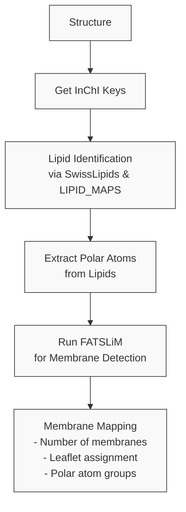
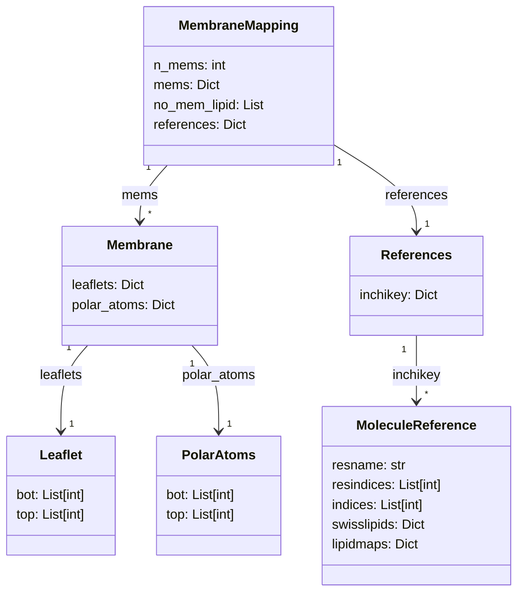
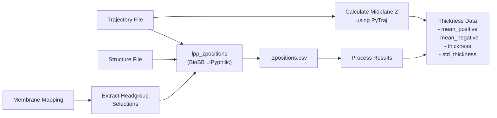
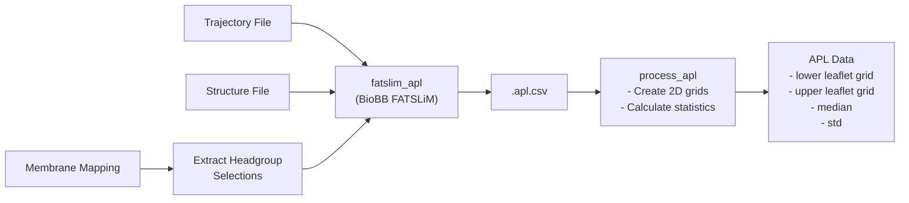
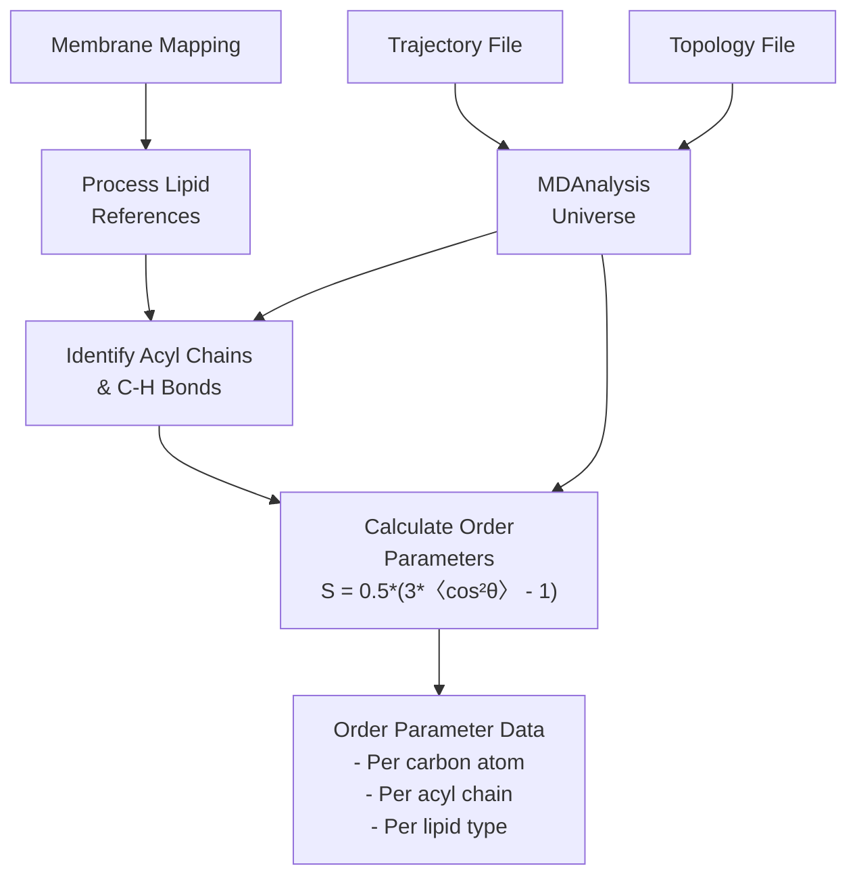
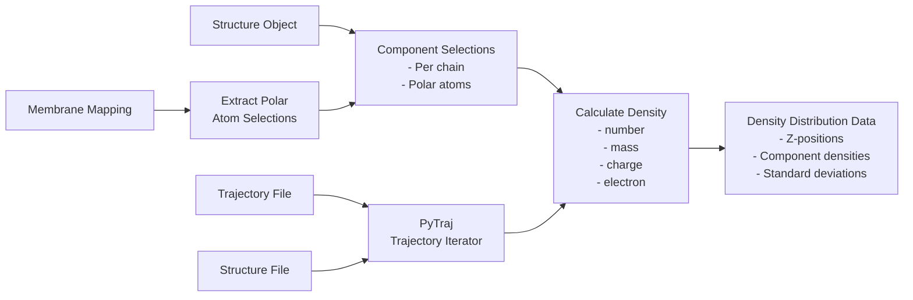
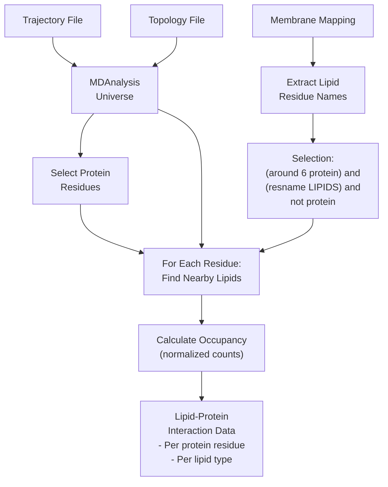
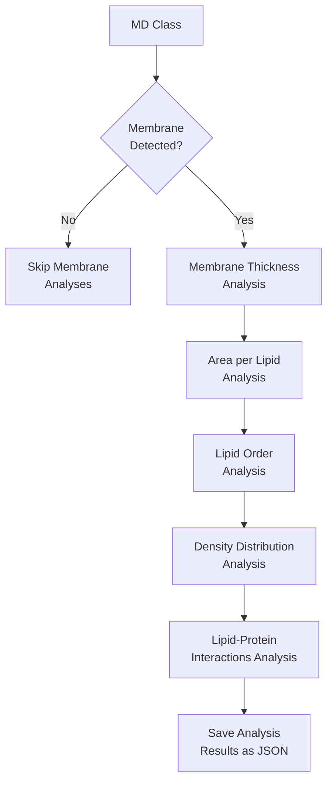

# Membrane Analyses

Relevant source files

The following files were used as context for generating this wiki page:

- [model_workflow/analyses/area_per_lipid.py](model_workflow/analyses/area_per_lipid.py)
- [model_workflow/analyses/density.py](model_workflow/analyses/density.py)
- [model_workflow/analyses/lipid_interactions.py](model_workflow/analyses/lipid_interactions.py)
- [model_workflow/analyses/lipid_order.py](model_workflow/analyses/lipid_order.py)
- [model_workflow/analyses/thickness.py](model_workflow/analyses/thickness.py)
- [model_workflow/tools/generate_membrane_mapping.py](model_workflow/tools/generate_membrane_mapping.py)
- [model_workflow/tools/get_inchi_keys.py](model_workflow/tools/get_inchi_keys.py)
- [model_workflow/utils/selections.py](model_workflow/utils/selections.py)
- [model_workflow/utils/topology_converter.py](model_workflow/utils/topology_converter.py)
- [model_workflow/utils/type_hints.py](model_workflow/utils/type_hints.py)
- [model_workflow/utils/warnings.py](model_workflow/utils/warnings.py)

## Overview

The Membrane Analyses module provides specialized tools for analyzing structural and dynamic properties of lipid membranes in molecular dynamics simulations. This set of tools identifies membrane structures within simulations and performs various analyses to characterize their properties, including thickness, lipid order parameters, area per lipid, density distributions, and lipid-protein interactions.

The membrane analyses are performed following the mapping and identification of membrane components, which is a prerequisite step that automatically detects lipid molecules in the system based on their InChI keys.

Sources:
- [model_workflow/tools/generate_membrane_mapping.py:13-169]()
- [model_workflow/analyses/thickness.py:9-65]()
- [model_workflow/analyses/lipid_order.py:9-169]()
- [model_workflow/analyses/area_per_lipid.py:11-76]()
- [model_workflow/analyses/density.py:7-67]()
- [model_workflow/analyses/lipid_interactions.py:9-56]()

## Membrane Identification Pipeline

Before any membrane analysis can be performed, the system needs to identify which molecules constitute membranes in the simulation. This is accomplished through the membrane mapping process.

### Membrane Mapping Workflow

The membrane mapping process:

1. **InChI Key Generation**: Extracts InChI keys for non-protein, non-nucleic acid residues in the structure.
2. **Lipid Identification**: Queries external databases (SwissLipids and LIPID_MAPS) to identify lipid molecules.
3. **Polar Atom Selection**: Identifies polar atoms within lipids for membrane detection.
4. **Membrane Detection**: Uses FATSLiM to identify membranes and assign atoms to upper or lower leaflets.
5. **Mapping Generation**: Creates a comprehensive mapping of membrane components for subsequent analyses.

Sources:
- [model_workflow/tools/generate_membrane_mapping.py:13-169]()
- [model_workflow/tools/get_inchi_keys.py:72-169]()

### Membrane Data Structure

The membrane mapping generates a structured data object containing information about all identified membranes:

The membrane mapping is stored as a JSON object with the following structure:
- `n_mems`: Number of membranes identified
- `mems`: Dictionary of membrane objects, each containing:
  - `leaflets`: Dictionary with `bot` and `top` lists of atom indices
  - `polar_atoms`: Dictionary with `bot` and `top` lists of polar atom indices
- `no_mem_lipid`: List of atom indices belonging to lipids not assigned to a membrane
- `references`: Dictionary mapping InChI keys to lipid molecule information

Sources:
- [model_workflow/tools/generate_membrane_mapping.py:47-162]()

## Membrane Structural Analyses

The system provides several analyses for characterizing membrane structural properties.

### Membrane Thickness Analysis

The thickness analysis calculates the distance between leaflets of a membrane, providing insights into membrane structure and fluidity.

The thickness analysis:
1. Selects polar headgroup atoms from the membrane mapping
2. Uses BioBB LiPyphilic's ZPositions module to calculate leaflet positions
3. Calculates the midplane Z-position using PyTraj
4. Computes membrane thickness and associated statistics

Sources:
- [model_workflow/analyses/thickness.py:9-65]()

### Area per Lipid Analysis

The area per lipid (APL) analysis calculates the surface area occupied by each lipid molecule in the membrane, a key parameter for membrane fluidity and phase behavior.

The area per lipid analysis:
1. Selects polar headgroup atoms from the membrane mapping
2. Uses BioBB FATSLiM's APL module to calculate area per lipid
3. Processes results to create 2D grids for each leaflet
4. Computes median and standard deviation of area per lipid values

Sources:
- [model_workflow/analyses/area_per_lipid.py:11-76]()

### Lipid Order Parameter Analysis

The lipid order parameter analysis calculates the orientational order of lipid acyl chains, providing insights into membrane packing and phase.

The lipid order parameter analysis:
1. Processes lipid references from the membrane mapping
2. Identifies acyl chains and C-H bonds in lipid molecules
3. Special handling for cholesterol vs. non-cholesterol lipids
4. Calculates order parameters S = 0.5*(3*〈cos²θ〉 - 1), where θ is the angle between C-H bonds and membrane normal
5. Computes averages and standard deviations for each lipid carbon atom

Sources:
- [model_workflow/analyses/lipid_order.py:9-169]()

## Membrane Component Analyses

### Density Distribution Analysis

The density analysis calculates various density distributions (number, mass, charge, electron) along the membrane normal (z-axis).

The density distribution analysis:
1. Creates selections for each chain and for polar atoms from the membrane mapping
2. Uses PyTraj to calculate various density distributions along the z-axis
3. Processes results for each component and density type
4. Compiles density profiles and associated statistics

Sources:
- [model_workflow/analyses/density.py:7-67]()

### Lipid-Protein Interactions Analysis

The lipid-protein interactions analysis identifies and quantifies which lipids interact with which protein residues.

The lipid-protein interactions analysis:
1. Extracts lipid names from the membrane mapping
2. Identifies protein residues in the system
3. For each trajectory frame, finds lipids within 6Å of each protein residue
4. Counts and normalizes occurrences to calculate lipid occupancy around protein residues

Sources:
- [model_workflow/analyses/lipid_interactions.py:9-56]()

## Integration in the Analysis Pipeline

The membrane analyses are integrated into the overall MDDB workflow analysis pipeline, where they are executed after metadata generation if a membrane is detected in the system.

Each membrane analysis module follows a similar pattern:
1. Check if a membrane mapping exists and contains at least one membrane
2. Skip the analysis if no membrane is found
3. Run the specific analysis using the appropriate tools
4. Process and save the results as a JSON file

Sources:
- [model_workflow/analyses/thickness.py:17-21]()
- [model_workflow/analyses/area_per_lipid.py:17-21]()
- [model_workflow/analyses/lipid_order.py:28-32]()
- [model_workflow/analyses/density.py:17-21]()
- [model_workflow/analyses/lipid_interactions.py:19-23]()

## Summary of Membrane Analysis Tools

The following table summarizes the membrane analysis modules provided by the MDDB-workflow system:

| Analysis | Purpose | External Dependencies | Output Data |
|---------|---------|---------------------|------------|
| Membrane Mapping | Identify membranes in the system | FATSLiM, SwissLipids DB, LIPID_MAPS DB | Membrane leaflets, polar atoms, lipid references |
| Thickness | Calculate membrane thickness | BioBB LiPyphilic | Mean positions, thickness, standard deviations |
| Area per Lipid | Calculate area per lipid | BioBB FATSLiM | 2D grids for each leaflet, median, standard deviation |
| Lipid Order | Calculate lipid tail ordering | MDAnalysis | Order parameters per carbon atom and acyl chain |
| Density | Calculate density distributions | PyTraj | Z-axis profiles for number, mass, charge, electron densities |
| Lipid Interactions | Analyze lipid-protein contacts | MDAnalysis | Occupancy of lipids around protein residues |

Each analysis provides insights into different aspects of membrane structure and dynamics, contributing to a comprehensive characterization of membrane systems in molecular dynamics simulations.

---