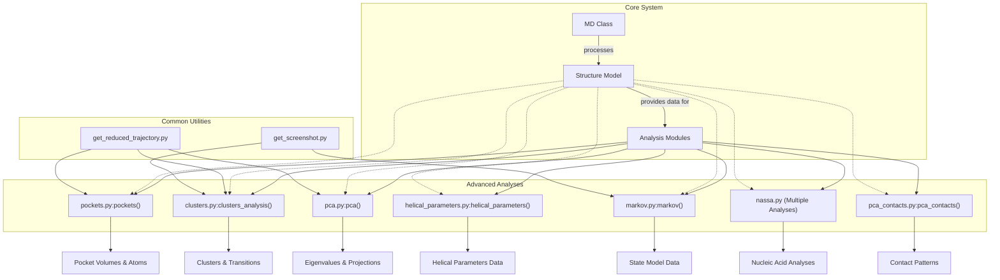
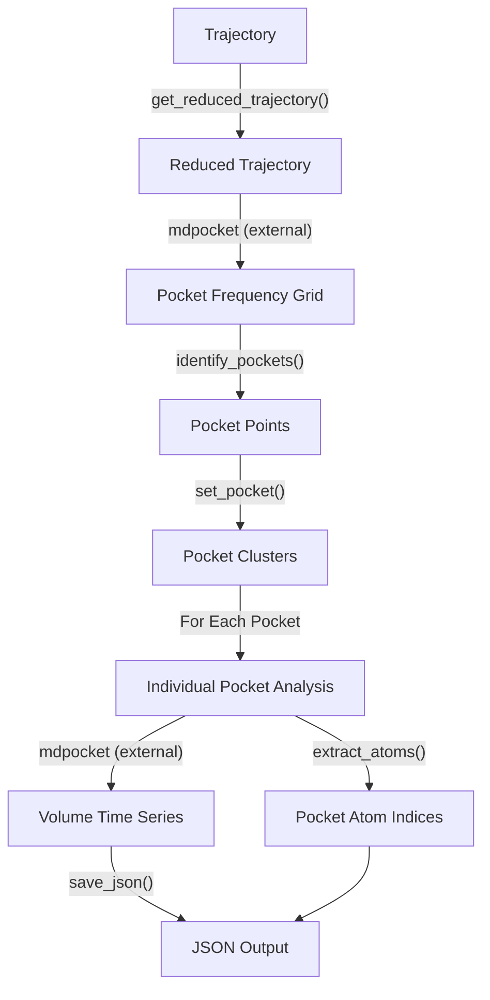
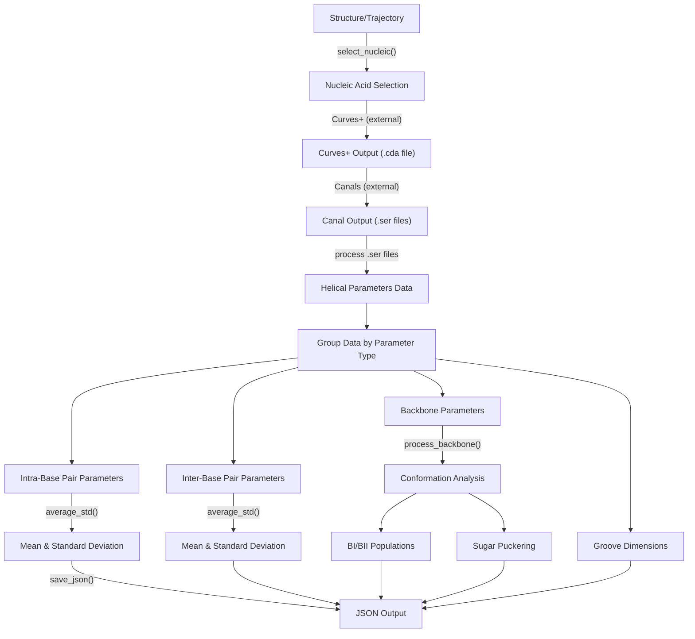
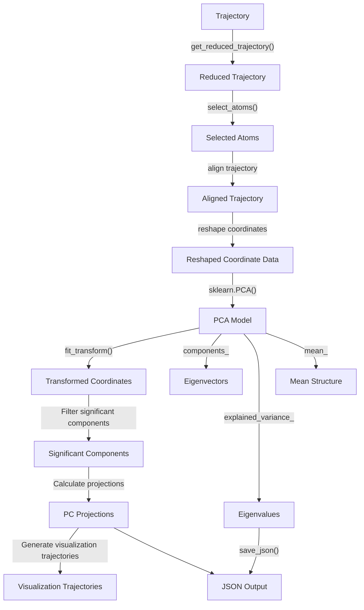
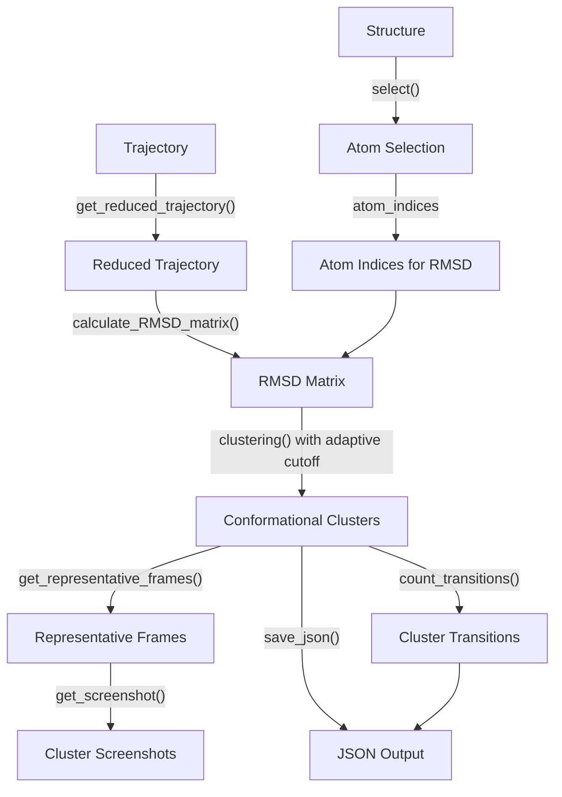
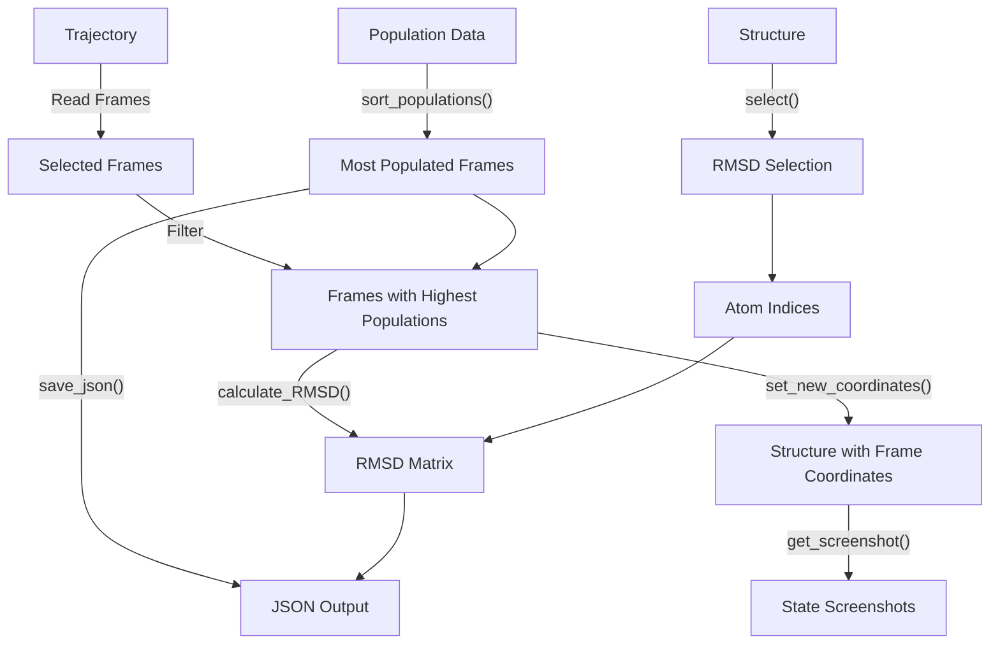
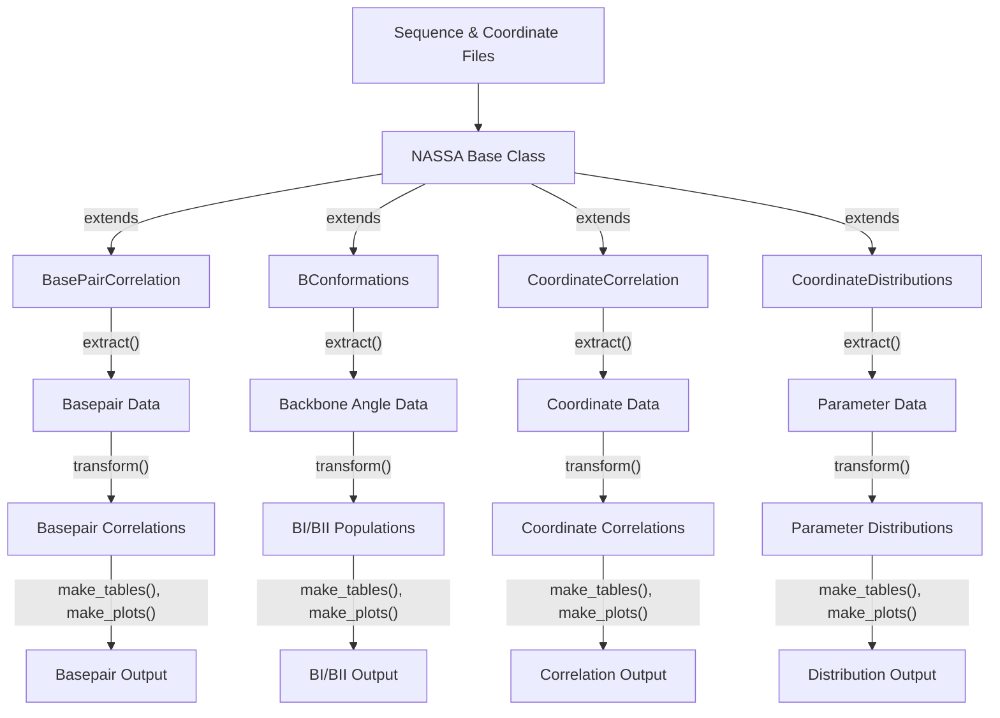
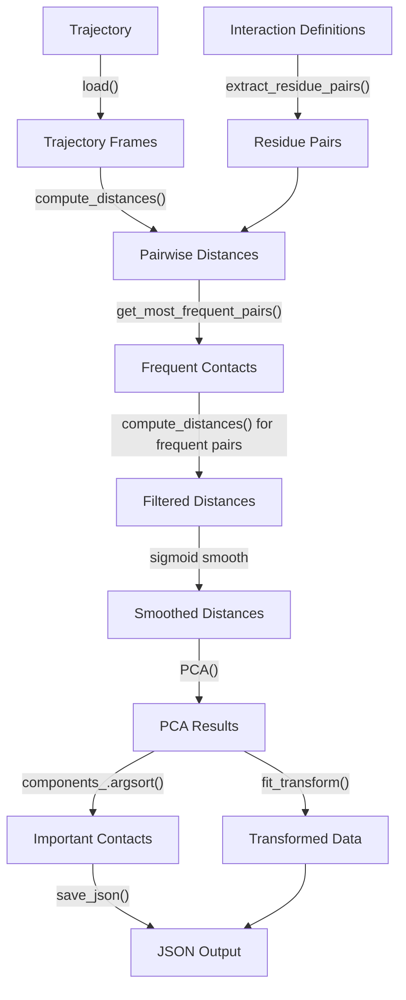
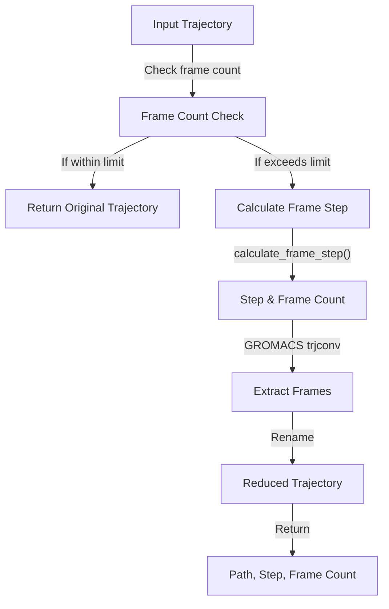
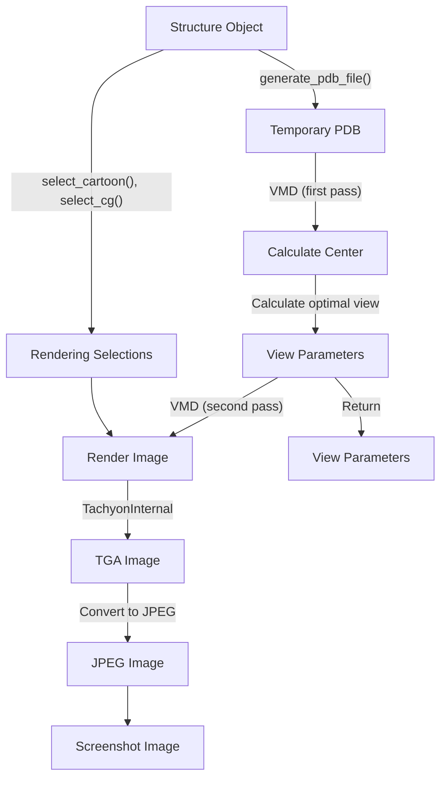

# Advanced Analyses

Relevant source files

The following files were used as context for generating this wiki page:

- [model_workflow/analyses/clusters.py](model_workflow/analyses/clusters.py)
- [model_workflow/analyses/helical_parameters.py](model_workflow/analyses/helical_parameters.py)
- [model_workflow/analyses/markov.py](model_workflow/analyses/markov.py)
- [model_workflow/analyses/markov_2.py](model_workflow/analyses/markov_2.py)
- [model_workflow/analyses/nassa.py](model_workflow/analyses/nassa.py)
- [model_workflow/analyses/pca.py](model_workflow/analyses/pca.py)
- [model_workflow/analyses/pca_contacts.py](model_workflow/analyses/pca_contacts.py)
- [model_workflow/analyses/pockets.py](model_workflow/analyses/pockets.py)
- [model_workflow/resources/nassa_template.yml](model_workflow/resources/nassa_template.yml)
- [model_workflow/tools/get_average.py](model_workflow/tools/get_average.py)
- [model_workflow/tools/get_reduced_trajectory.py](model_workflow/tools/get_reduced_trajectory.py)
- [model_workflow/tools/get_screenshot.py](model_workflow/tools/get_screenshot.py)
- [model_workflow/tools/nassa_base.py](model_workflow/tools/nassa_base.py)
- [model_workflow/tools/nassa_loaders.py](model_workflow/tools/nassa_loaders.py)
- [model_workflow/utils/bibitransformer_nassa.py](model_workflow/utils/bibitransformer_nassa.py)
- [model_workflow/utils/heatmaps_nassa.py](model_workflow/utils/heatmaps_nassa.py)
- [model_workflow/utils/nassa_file.py](model_workflow/utils/nassa_file.py)

The Advanced Analyses module in MDDB-workflow provides sophisticated analytical capabilities for molecular dynamics simulations that go beyond basic structural measurements. These analyses extract higher-level insights into molecular behavior, dynamics, and function from trajectory data.

This page documents the following advanced analysis types:
- Pocket Analysis - detecting and analyzing cavities and potential binding sites
- Helical Parameters Analysis - detailed analysis of nucleic acid structural parameters
- Principal Component Analysis (PCA) - identifying major modes of structural variation
- Cluster Analysis - grouping similar conformational states
- Markov State Modeling - analyzing state transitions and populations
- NASSA Analysis - comprehensive nucleic acid structural analysis suite
- PCA Contacts Analysis - PCA focused on residue-residue interactions

For other types of analyses, see:
- For basic structural analyses, see [Structural Analyses](#4.1)
- For energy-based analyses, see [Energy Analyses](#4.2) 
- For membrane-specific analyses, see [Membrane Analyses](#4.3)

## Advanced Analyses Architecture

The following diagram shows how the advanced analyses integrate with the overall MDDB-workflow system:

Sources: [model_workflow/analyses/pockets.py](), [model_workflow/analyses/helical_parameters.py](), [model_workflow/analyses/pca.py](), [model_workflow/analyses/clusters.py](), [model_workflow/analyses/markov.py](), [model_workflow/analyses/nassa.py](), [model_workflow/analyses/pca_contacts.py](), [model_workflow/tools/get_reduced_trajectory.py](), [model_workflow/tools/get_screenshot.py]()

## Pocket Analysis

Pocket analysis detects and characterizes cavities in molecular structures, which often represent potential binding sites for ligands or other molecules. The implementation uses the Fpocket and MDpocket algorithms to analyze pockets over trajectory frames.

### Implementation Details
The pocket analysis is implemented in `pockets()` [model_workflow/analyses/pockets.py:44-526]() with the following key steps:

1. Creates a reduced trajectory with a subset of frames using `get_reduced_trajectory()` [model_workflow/analyses/pockets.py:70-75]()
2. Runs MDpocket to generate a frequency grid showing how often pockets appear [model_workflow/analyses/pockets.py:117-131]()
3. Analyzes the grid to identify pocket points and cluster them into connected regions [model_workflow/analyses/pockets.py:269-325]()
4. Analyzes each significant pocket individually to track volume over time [model_workflow/analyses/pockets.py:363-453]()
5. Extracts atoms lining each pocket [model_workflow/analyses/pockets.py:499-509]()

### Key Parameters
- `structure_file`: Input structure file
- `trajectory_file`: Input trajectory file
- `frames_limit`: Maximum number of frames to analyze (default: 100)
- `maximum_pockets_number`: Maximum number of pockets to analyze (default: 10)

### Output
The analysis generates a JSON file containing:
- Pocket volumes over time for each identified pocket
- Atom indices lining each pocket
- Metadata about the analysis including frame step information

Sources: [model_workflow/analyses/pockets.py:44-526]()

## Helical Parameters Analysis

Helical parameters analysis characterizes the three-dimensional structure of DNA or RNA molecules by measuring various geometric parameters that describe base and base pair positions and orientations.

### Implementation Details
The helical parameters analysis is implemented in `helical_parameters()` [model_workflow/analyses/helical_parameters.py:112-177](), which coordinates several steps:

1. Identifies nucleic acid residues in the structure [model_workflow/analyses/helical_parameters.py:124-136]()
2. Runs Curves+ to calculate basic helical parameters from the trajectory [model_workflow/analyses/helical_parameters.py:345-374]()
3. Runs Canal software to process the Curves+ output and generate time series data [model_workflow/analyses/helical_parameters.py:391-406]()
4. Processes resulting .ser files to compute statistics and conformational analyses [model_workflow/analyses/helical_parameters.py:416-500]()
5. Analyzes stiffness parameters using specialized functions [model_workflow/analyses/helical_parameters.py:485-526]()

### Analyzed Parameters
The analysis processes multiple categories of parameters:
- **Intra-base pair parameters**: shear, stretch, stagger, buckle, propeller, opening
- **Inter-base pair parameters**: shift, slide, rise, tilt, roll, twist
- **Backbone parameters**: alpha, beta, gamma, delta, epsilon, zeta angles
- **Groove dimensions**: major and minor groove width and depth

### Key Parameters
- `input_topology_filename`: Input topology file
- `input_trajectory_filename`: Input trajectory file
- `frames_limit`: Maximum number of frames to analyze
- `dna_selection`: Selection string for nucleic acid atoms (optional)

### Output
The analysis produces a comprehensive JSON file with:
- Average values and standard deviations for each parameter type
- BI/BII population analysis for backbone conformations
- Sugar puckering analysis
- Stiffness parameters for DNA mechanical properties

Sources: [model_workflow/analyses/helical_parameters.py:112-526]()

## Principal Component Analysis (PCA)

Principal Component Analysis identifies the major modes of structural variation in a molecular dynamics trajectory, reducing the high-dimensional conformational space to a smaller set of essential motions.

### Implementation Details
The PCA analysis is implemented in `pca()` [model_workflow/analyses/pca.py:13-131]() with these key steps:

1. Creates a reduced trajectory with a subset of frames [model_workflow/analyses/pca.py:30-35]()
2. Selects atoms for alignment and analysis based on user-provided selections [model_workflow/analyses/pca.py:38-49]()
3. Removes PBC atoms from the selections [model_workflow/analyses/pca.py:51-58]()
4. Aligns the trajectory to remove translational and rotational motion [model_workflow/analyses/pca.py:63]()
5. Reshapes the coordinate data for PCA processing [model_workflow/analyses/pca.py:68-70]()
6. Performs PCA using scikit-learn [model_workflow/analyses/pca.py:73-76]()
7. Extracts eigenvalues, eigenvectors, and projections [model_workflow/analyses/pca.py:80-82]()
8. Generates trajectory files showing motion along significant principal components [model_workflow/analyses/pca.py:94-118]()

### Key Parameters
- `input_topology_file`: Input topology file
- `input_trajectory_file`: Input trajectory file
- `fit_selection`: Selection string for atoms used for alignment
- `analysis_selection`: Selection string for atoms used in PCA
- `frames_limit`: Maximum number of frames to analyze
- `projection_frames`: Number of frames for projection trajectories (default: 20)

### Output
The PCA analysis generates:
- A JSON file containing eigenvalues and projections for significant components
- Trajectory files (.xtc) showing the motion along each significant principal component

Sources: [model_workflow/analyses/pca.py:13-131]()

## Cluster Analysis

Cluster analysis groups similar conformations from a molecular dynamics trajectory to identify distinct structural states visited during the simulation.

### Implementation Details
The cluster analysis is implemented in `clusters_analysis()` [model_workflow/analyses/clusters.py:15-260]() with these key steps:

1. Creates a reduced trajectory with a subset of frames [model_workflow/analyses/clusters.py:80-85]()
2. Calculates a pairwise RMSD matrix between frames [model_workflow/analyses/clusters.py:124-128]()
3. Uses an adaptive RMSD cutoff to achieve the desired number of clusters [model_workflow/analyses/clusters.py:141-165]()
4. Identifies representative frames for each cluster [model_workflow/analyses/clusters.py:200-217]()
5. Counts transitions between clusters [model_workflow/analyses/clusters.py:177-196]()
6. Generates screenshots of representative structures [model_workflow/analyses/clusters.py:228-232]()

The clustering algorithm itself is implemented in the `clustering()` function [model_workflow/analyses/clusters.py:264-273](), which groups frames based on RMSD values below a specified cutoff.

### Key Parameters
- `input_structure_file`: Input structure file
- `input_trajectory_file`: Input trajectory file
- `interactions`: List of interaction definitions (for interface-based clustering)
- `pbc_selection`: Selection for periodic boundary condition atoms to exclude
- `frames_limit`: Maximum number of frames to analyze (default: 1000)
- `n_steps`: Number of RMSD cutoff steps to try (default: 100)
- `desired_n_clusters`: Target number of clusters (default: 20)
- `overall_selection`: Selection string for general clustering (default: "name CA or name C5'")

### Output
The analysis generates:
- JSON files containing cluster definitions and transition counts
- Screenshot images (.jpg) of representative structures for each cluster

Sources: [model_workflow/analyses/clusters.py:15-273]()

## Markov State Modeling

Markov State Modeling (MSM) represents the dynamics of a molecular system as transitions between discrete states, providing a simplified model of the conformational landscape.

### Implementation Details
The Markov state modeling functionality is implemented in `markov()` [model_workflow/analyses/markov.py:13-105]() with these key steps:

1. Identifies frames with highest populations [model_workflow/analyses/markov.py:40-43]()
2. Extracts these frames from the trajectory [model_workflow/analyses/markov.py:45-62]()
3. Calculates an RMSD matrix between the selected frames [model_workflow/analyses/markov.py:64-80]()
4. Generates screenshots for visualization of each state [model_workflow/analyses/markov.py:83-98]()

The analysis uses the frame population data to select representative states, rather than performing actual Markov state modeling calculations. This provides the data needed to visualize the most important conformational states in the system.

### Key Parameters
- `input_topology_filename`: Input topology file
- `input_trajectory_filename`: Input trajectory file
- `structure`: Structure object
- `populations`: Frame population data (list of floats)
- `rmsd_selection`: Selection string for RMSD calculation
- `nodes_number`: Number of states to include (default: 20)

### Output
The Markov state modeling generates:
- A JSON file containing frame indices, populations, and the RMSD matrix
- Screenshot images (.jpg) for each state

Sources: [model_workflow/analyses/markov.py:13-105]()

## NASSA Analysis

NASSA (Nucleic Acid Structural Statistical Analysis) provides a comprehensive set of analyses specifically for nucleic acid structures, focusing on sequence-dependent properties and conformational preferences.

### Implementation Details
The NASSA functionality is implemented as a set of classes in [model_workflow/analyses/nassa.py](), all inheriting from a base `Base` class defined in [model_workflow/tools/nassa_base.py]():

1. `BasePairCorrelation` [model_workflow/analyses/nassa.py:27-177]() - Analyzes correlations between basepair parameters 
2. `BConformations` [model_workflow/analyses/nassa.py:180-320]() - Analyzes BI/BII backbone conformations
3. `CoordinateCorrelation` [model_workflow/analyses/nassa.py:323-472]() - Analyzes correlations between different helical coordinates
4. `CoordinateDistributions` [model_workflow/analyses/nassa.py:474-659]() - Analyzes statistical distributions of coordinate values

Each analysis class implements the following methods:
- `extract()` - Extracts relevant data from input files
- `transform()` - Performs data transformations and analysis
- `make_tables()` - Generates tabular output
- `make_plots()` - Creates visualization data

### Analysis Components
NASSA includes several analysis modules:
- **BasePair Correlation**: Correlations between parameters of consecutive base pairs
- **BConformations**: Analysis of backbone BI/BII states and populations
- **Coordinate Correlation**: Correlations between different helical parameters
- **Coordinate Distributions**: Statistical analysis of parameter distributions
- **Stiffness Analysis**: DNA mechanical properties

### Output
The NASSA analysis generates:
- JSON files containing analysis results
- Visualization data for parameter distributions and correlations

Sources: [model_workflow/analyses/nassa.py:27-659](), [model_workflow/tools/nassa_base.py:7-162](), [model_workflow/tools/nassa_loaders.py:1-132]()

## PCA Contacts Analysis

PCA Contacts Analysis applies principal component analysis specifically to residue-residue contact distances, identifying patterns in interactions between different parts of the molecular system.

### Implementation Details
The PCA contacts analysis is implemented in `pca_contacts()` [model_workflow/analyses/pca_contacts.py:63-151]() with these key steps:

1. Extracts residue pairs from interaction definitions [model_workflow/analyses/pca_contacts.py:82-84]()
2. Calculates pairwise distances between residues [model_workflow/analyses/pca_contacts.py:87-92]()
3. Identifies frequent contacts based on distance and frequency thresholds [model_workflow/analyses/pca_contacts.py:94-104]()
4. Calculates distances specifically for frequent pairs [model_workflow/analyses/pca_contacts.py:103-105]()
5. Applies a sigmoid smoothing function to the distances [model_workflow/analyses/pca_contacts.py:108]()
6. Performs PCA on the smoothed distance matrix [model_workflow/analyses/pca_contacts.py:111-112]()
7. Extracts the most important contact pairs [model_workflow/analyses/pca_contacts.py:115-120]()

### Key Parameters
- `trajectory`: Input trajectory file
- `topology`: Input topology file
- `interactions`: List of interaction definitions
- `n_components`: Number of PCA components (default: 2)
- `distance_threshold`: Distance threshold for contacts (default: 15.0 Å)
- `frequency_threshold`: Frequency threshold for contacts (default: 0.05)
- `smooth`: Smoothing factor for sigmoid function (default: 5.0)

### Output
The PCA contacts analysis generates a JSON file containing:
- Transformed distance data for principal components
- Component values showing contribution of each contact
- Ordered list of important residue pairs
- Interaction residue information

Sources: [model_workflow/analyses/pca_contacts.py:63-151]()

## Common Utilities

Several utility functions are shared across multiple advanced analyses:

### Reduced Trajectory Generation
The `get_reduced_trajectory()` function [model_workflow/tools/get_reduced_trajectory.py:37-96]() creates a subset of frames from a trajectory to make analyses more efficient:

### Screenshot Generation
The `get_screenshot()` function [model_workflow/tools/get_screenshot.py:26-446]() generates visualization images of molecular structures, used by cluster and Markov analyses:

Sources: [model_workflow/tools/get_reduced_trajectory.py:37-96](), [model_workflow/tools/get_screenshot.py:26-446]()

---