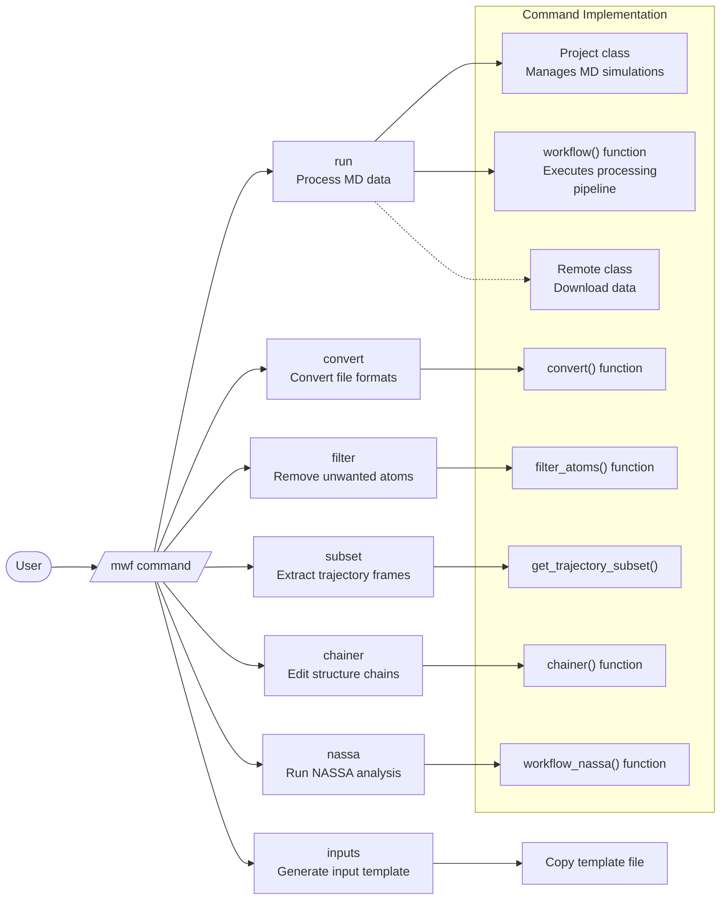
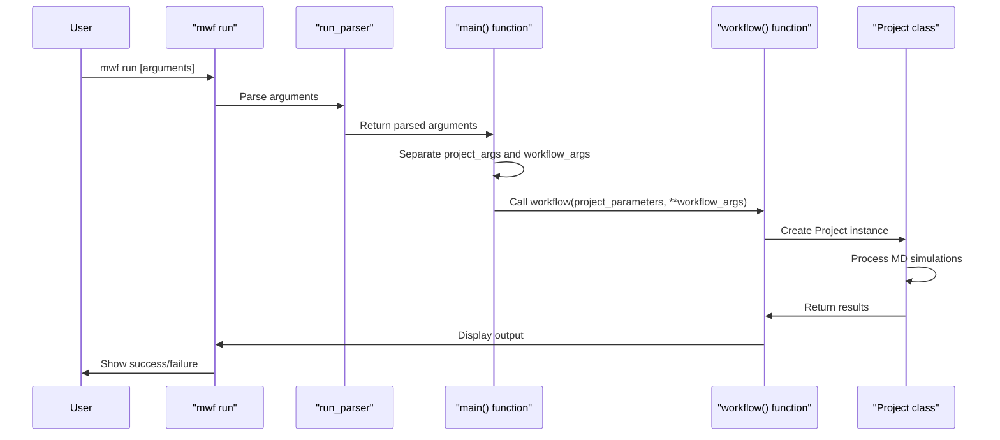
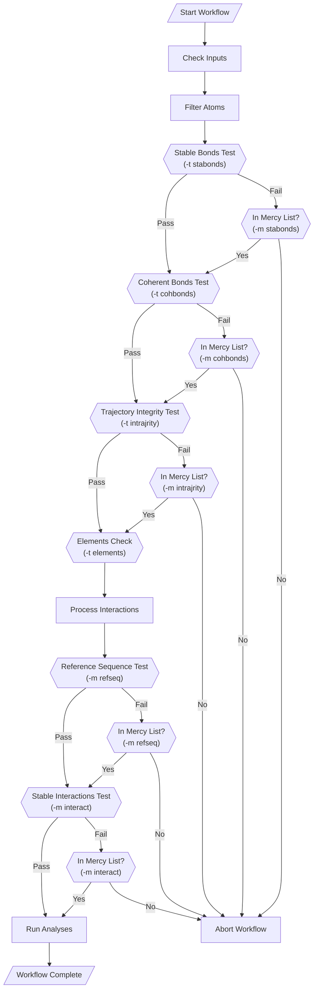
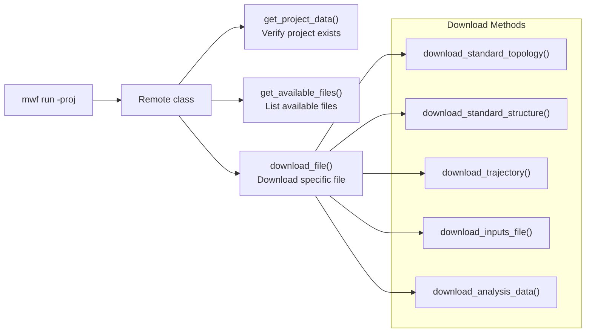

# Command Line Interface

<details>
<summary>Relevant source files</summary>

The following files were used as context for generating this wiki page:

- [README.md](README.md)
- [envs/environment.yml](envs/environment.yml)
- [model_workflow/console.py](model_workflow/console.py)
- [model_workflow/utils/remote.py](model_workflow/utils/remote.py)
- [model_workflow/utils/structures.py](model_workflow/utils/structures.py)
- [test/conftest.py](test/conftest.py)
- [test/test_console.py](test/test_console.py)
- [test/test_density.py](test/test_density.py)

</details>


This document provides comprehensive documentation of the `mwf` command-line interface (CLI), the primary means of interacting with the MDDB-workflow system. The CLI enables users to process molecular dynamics simulation data, run analyses, and prepare files for the MDDB database.

For information about the core framework architecture, see [Core Framework](#2).

## Installation

The `mwf` command is installed as part of the MDDB-workflow package. Once installed, it becomes available in your environment.

### Standard Installation

```bash
git clone https://github.com/mmb-irb/MDDB-workflow.git
cd MDDB-workflow
conda env create --file envs/environment.yml
conda activate mwf_env
python -m pip install -e .
```

### HPC Installation

For high-performance computing environments without internet access:

```bash
# On local machine with internet:
conda install conda-pack
conda pack -n mwf --ignore-editable-packages

# On remote HPC:
mkdir mwf_env
tar -xzf mwf.tar.gz -C mwf_env
source mwf_env/bin/activate
conda-unpack

# Copy repository to HPC and install
cd MDDB-workflow
python -m pip install --no-build-isolation --no-index --no-deps -e .
```

Sources: [README.md:7-74]()

## CLI Architecture

The `mwf` CLI follows a command-subcommand structure where `mwf` is the main entry point and various subcommands provide specific functionality.



Sources: [model_workflow/console.py:28-239](), [README.md:79-169]()

## Command Overview

### mwf run

The primary command for processing molecular dynamics data and running analyses.

```bash
mwf run -top <topology_file> -stru <structure_file> -mdir <md_directories> -traj <trajectory_files>
```

### mwf inputs

Generates a template input file that defines metadata and parameters for the analyses.

```bash
mwf inputs
```

### mwf convert

Converts structure and trajectory files between formats.

```bash
mwf convert -is <input_structure> -os <output_structure> -it <input_trajectory> -ot <output_trajectory>
```

### mwf filter

Filters atoms from structures and trajectories based on selection criteria.

```bash
mwf filter -is <input_structure> -os <output_structure> -it <input_trajectory> -ot <output_trajectory> -sel <selection>
```

### mwf subset

Extracts a subset of frames from a trajectory.

```bash
mwf subset -is <input_structure> -it <input_trajectory> -ot <output_trajectory> -start <start_frame> -end <end_frame>
```

### mwf chainer

Edits chain assignments in structure files.

```bash
mwf chainer -is <input_structure> -os <output_structure> -sel <selection>
```

### mwf nassa

Runs the NASSA (Nucleic Acid Sequence-Structure Analysis) system.

```bash
mwf nassa -c <config_file> -n <analysis_names>
```

Sources: [model_workflow/console.py:240-694](), [README.md:98-166]()

## Command Reference

### mwf run

The `mwf run` command is the core functionality of the workflow, processing raw MD data and performing analyses.



#### Basic Usage

```bash
mwf run -top raw_topology.prmtop -stru raw_topology.prmtop -mdir replica_* -traj *.nc
```

#### Important Arguments

| Argument | Description | Example |
|----------|-------------|---------|
| `-dir`, `--working_directory` | Directory where the workflow is run | `-dir /path/to/project` |
| `-mdir`, `--md_directories` | MD directories containing trajectories | `-mdir replica_1 replica_2` |
| `-md`, `--md_config` | Define specific MD configurations | `-md replica_1 struct.pdb traj.xtc` |
| `-proj`, `--accession` | Download files from database | `-proj A01M9.1` |
| `-stru`, `--input_structure_filepath` | Path to input structure | `-stru structure.pdb` |
| `-traj`, `--input_trajectory_filepaths` | Path to input trajectories | `-traj trajectory.xtc` |
| `-top`, `--input_topology_filepath` | Path to input topology | `-top topology.prmtop` |
| `-inp`, `--inputs_filepath` | Path to inputs file | `-inp inputs.yml` |
| `-img`, `--image` | Image the trajectory | `-img` |
| `-fit`, `--fit` | Fit the trajectory | `-fit` |
| `-filt`, `--filter_selection` | Filter atoms | `-filt "protein or nucleic"` |
| `-d`, `--download` | Only download files | `-d` |
| `-s`, `--setup` | Only setup files | `-s` |
| `-t`, `--trust` | Skip specified tests | `-t stabonds cohbonds` |
| `-m`, `--mercy` | Allow specified tests to fail | `-m refseq interact` |
| `-i`, `--include` | Only run specified analyses | `-i rmsds rmsf` |
| `-e`, `--exclude` | Skip specified analyses | `-e pca sasa` |
| `-ow`, `--overwrite` | Overwrite outputs | `-ow` |

Sources: [model_workflow/console.py:253-483](), [README.md:98-116](), [README.md:137-165](), [README.md:185-214]()

### mwf inputs

Generates a template inputs file that contains metadata about the system and parameters for analyses.

#### Usage

```bash
mwf inputs [-ed <editor>]
```

#### Arguments

| Argument | Description | Example |
|----------|-------------|---------|
| `-ed`, `--editor` | Specify text editor | `-ed vim` |

The command will create an `inputs.yml` file in the current directory if it doesn't exist, then open it in the specified editor (or prompt for an editor selection).

Sources: [model_workflow/console.py:499-509](), [README.md:149-151]()

### mwf convert

Converts structure and trajectory files between formats.

#### Usage

```bash
mwf convert -is <input_structure> -os <output_structure> -it <input_trajectories> -ot <output_trajectory>
```

#### Arguments

| Argument | Description | Example |
|----------|-------------|---------|
| `-is`, `--input_structure` | Input structure file | `-is input.pdb` |
| `-os`, `--output_structure` | Output structure file | `-os output.gro` |
| `-it`, `--input_trajectories` | Input trajectory files | `-it traj1.nc traj2.nc` |
| `-ot`, `--output_trajectory` | Output trajectory file | `-ot merged.xtc` |

Sources: [model_workflow/console.py:512-527]()

### mwf filter

Filters atoms from structures and trajectories based on selection criteria.

#### Usage

```bash
mwf filter -is <input_structure> -os <output_structure> -it <input_trajectory> -ot <output_trajectory> -sel <selection> [-syn <syntax>]
```

#### Arguments

| Argument | Description | Example |
|----------|-------------|---------|
| `-is`, `--input_structure` | Input structure file | `-is input.pdb` |
| `-os`, `--output_structure` | Output structure file | `-os filtered.pdb` |
| `-it`, `--input_trajectory` | Input trajectory file | `-it input.xtc` |
| `-ot`, `--output_trajectory` | Output trajectory file | `-ot filtered.xtc` |
| `-sel`, `--selection_string` | Atom selection | `-sel "protein"` |
| `-syn`, `--selection_syntax` | Selection syntax | `-syn vmd` |

Sources: [model_workflow/console.py:530-550]()

### mwf subset

Extracts a subset of frames from a trajectory.

#### Usage

```bash
mwf subset -is <input_structure> -it <input_trajectory> -ot <output_trajectory> -start <start> -end <end> -step <step>
```

#### Arguments

| Argument | Description | Example |
|----------|-------------|---------|
| `-is`, `--input_structure` | Input structure file | `-is structure.pdb` |
| `-it`, `--input_trajectory` | Input trajectory file | `-it trajectory.xtc` |
| `-ot`, `--output_trajectory` | Output trajectory file | `-ot subset.xtc` |
| `-start`, `--start` | Start frame | `-start 100` |
| `-end`, `--end` | End frame | `-end 1000` |
| `-step`, `--step` | Frame step | `-step 10` |
| `-skip`, `--skip` | Frames to skip | `-skip 5 10 15` |
| `-fr`, `--frames` | Specific frames to extract | `-fr 1 10 100` |

Sources: [model_workflow/console.py:553-579]()

### mwf chainer

Edits chain assignments in structure files.

#### Usage

```bash
mwf chainer -is <input_structure> -os <output_structure> -sel <selection> -let <letter>
```

#### Arguments

| Argument | Description | Example |
|----------|-------------|---------|
| `-is`, `--input_structure` | Input structure file | `-is input.pdb` |
| `-os`, `--output_structure` | Output structure file | `-os output.pdb` |
| `-sel`, `--selection_string` | Atom selection | `-sel "resid 1 to 100"` |
| `-syn`, `--selection_syntax` | Selection syntax | `-syn vmd` |
| `-let`, `--letter` | New chain letter | `-let A` |
| `-whfr`, `--whole_fragments` | Consider whole fragments | `-whfr true` |

Sources: [model_workflow/console.py:582-603]()

### mwf nassa

Runs the NASSA (Nucleic Acid Sequence-Structure Analysis) system.

#### Usage

```bash
mwf nassa -c <config_file> -n <analysis_names>
```

#### Arguments

| Argument | Description | Example |
|----------|-------------|---------|
| `-c`, `--config` | Configuration file | `-c nassa.json` |
| `-n`, `--analysis_names` | Analyses to run | `-n hydration base_stacking` |
| `-w`, `--make_config` | Create config file | `-w` |
| `-seq`, `--seq_path` | Path to sequences | `-seq /path/to/sequences` |
| `-o`, `--output` | Output directory | `-o results` |
| `-hp`, `--helical_parameters` | Run helical parameters | `-hp` |
| `-all`, `--all` | Run all analyses | `-all` |
| `-ow`, `--overwrite` | Overwrite results | `-ow` |

Sources: [model_workflow/console.py:606-694]()

## Testing Architecture

The workflow implements several tests to ensure data quality. These tests can be controlled through the `-t/--trust` and `-m/--mercy` arguments.



### Available Tests

| Test | Flag | Description | Can Skip | Can Allow Failure |
|------|------|-------------|----------|-------------------|
| Stable bonds | `stabonds` | Checks atom bonds stability along trajectory | Yes | Yes |
| Coherent bonds | `cohbonds` | Checks number of bonds per atom for chemical coherence | Yes | Yes |
| Trajectory integrity | `intrajrity` | Ensures no sudden jumps in trajectory | Yes | Yes |
| Elements | `elements` | Corrects missing or wrong atom elements | Yes | No |
| Reference sequence | `refseq` | Ensures protein chains match with UniProt IDs | No | Yes |
| Stable interactions | `interact` | Confirms defined interactions are happening | No | Yes |

Sources: [README.md:171-230](), [model_workflow/console.py:397-430]()

## Remote Access Capabilities

The workflow can download files from the MDDB database using the `Remote` class.



Sources: [model_workflow/utils/remote.py:1-177](), [test/conftest.py:30-117]()

## Common Usage Examples

### Basic Processing

Process raw MD files, filtering out water and counter ions:

```bash
mwf run -top raw_topology.prmtop -stru raw_topology.prmtop -mdir replica_* -traj *.nc -filt -s
```

### Run All Analyses

After basic processing, run all analyses:

```bash
mwf run
```

### Run Specific Analyses

Run only RMSD and RMSF analyses:

```bash
mwf run -i rmsds rmsf
```

### Skip Tests

Process data while skipping bond stability tests:

```bash
mwf run -t stabonds
```

### Allow Test Failures

Process data while allowing reference sequence matching to fail:

```bash
mwf run -m refseq
```

Sources: [README.md:98-166]()

## Troubleshooting

### Missing Dependencies

If you encounter missing dependencies errors, ensure your `mwf_env` environment is activated:

```bash
conda activate mwf_env
```

### File Permission Issues

When using the `-ns`/`--no_symlinks` option if you're working in a file system that doesn't support symbolic links:

```bash
mwf run -ns -top raw_topology.prmtop -stru raw_structure.pdb
```

### Input Format Problems

For format compatibility issues, use the `convert` command to pre-process files:

```bash
mwf convert -is input.gro -os input.pdb -it input.trr -ot input.xtc
```

Sources: [model_workflow/console.py:245-247]()