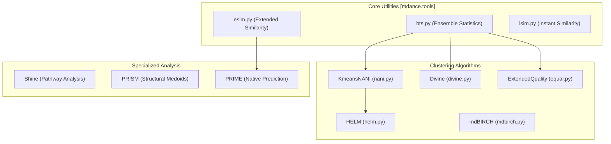
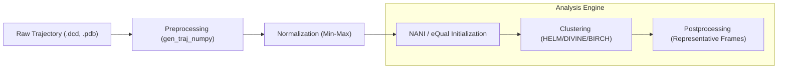

# MDANCE Overview

Relevant source files

The following files were used as context for generating this wiki page:

- [README.md](README.md)
- [docs/about.rst](docs/about.rst)
- [pyproject.toml](pyproject.toml)
- [setup.cfg](setup.cfg)
- [setup.py](setup.py)
- [src/mdance/__init__.py](src/mdance/__init__.py)
- [src/mdance/_version.py](src/mdance/_version.py)
- [tutorials/prime.md](tutorials/prime.md)

MDANCE (Molecular Dynamics Analysis with N-ary Clustering Ensembles) is a transformative framework designed for the analysis of large-scale molecular dynamics (MD) trajectories. It addresses the computational bottlenecks of traditional clustering methods by utilizing a novel **n-ary similarity framework**, which reduces the scaling of comparison operations from quadratic $O(N^2)$ to linear $O(N)$ complexity [README.md:32-36]().

The package provides a suite of deterministic and high-performance algorithms tailored for structural biology, ranging from smart $k$-means initialization (NANI) to native structure prediction (PRIME) [README.md:42-140]().

### The Scientific Problem
Modern MD simulations generate terabytes of conformational data. Traditional analysis tools often struggle with:
*   **Exponential Complexity**: Massive datasets make $O(N^2)$ pairwise comparisons prohibitive [README.md:23-25]().
*   **Stochasticity**: Random seed selection in algorithms like $k$-means leads to non-reproducible results [README.md:30-30]().
*   **Biological Accuracy**: Identifying metastable states and native structures within high-dimensional noise [README.md:27-28]().

### N-ary Similarity Framework
The core innovation of MDANCE is the replacement of pairwise distance matrices with **n-ary comparisons**. By calculating column-wise sums and squared sums of features across the entire ensemble, MDANCE identifies high-density regions and structural medoids in linear time [README.md:40-40](). This framework supports various extended similarity indices such as Jaccard, Russell-Rao (RR), and Sokal-Michener (SM) [tutorials/prime.md:55-55]().

For a deep dive into the mathematics and the `esim` and `isim` modules, see [N-ary Similarity Framework](#1.2).

### System Architecture
The following diagram maps the conceptual components of MDANCE to their corresponding code entities within the `src/mdance` directory.

**MDANCE Component Map**

**Sources:** [src/mdance/__init__.py:1-14](), [pyproject.toml:33-35](), [README.md:131-141]()

### Major Subsystems

MDANCE is organized into several functional families of algorithms and tools:

| Subsystem | Primary Class/Script | Complexity | Purpose |
| :--- | :--- | :--- | :--- |
| **NANI** | `KmeansNANI` | $O(N)$ | Deterministic $k$-means initialization using high-density region detection [README.md:44-52](). |
| **HELM** | `HELM` | $O(N)$ | Scalable hierarchical clustering that merges $k$-means clusters without pairwise matrices [README.md:54-62](). |
| **DIVINE** | `Divine` | $O(N)$ | Top-down divisive hierarchical clustering with recursive splitting [README.md:63-72](). |
| **mdBIRCH** | `run_mdbirch.py` | $O(N)$ | Online streaming clustering using an RMSD-calibrated CF-tree [README.md:73-83](). |
| **PRIME** | `prime_sim` / `prime_rep` | $O(N)$ | Native structure prediction from simulation ensembles [tutorials/prime.md:12-14](). |
| **SHINE** | `Shine` | $O(N)$ | Pathway ensemble clustering for enhanced sampling data [README.md:84-94](). |

### Workflow Integration
The MDANCE workflow typically transitions from raw trajectory data to normalized numpy representations before applying clustering or prediction algorithms.

**Data Flow Pipeline**

**Sources:** [tutorials/prime.md:18-29](), [README.md:142-145](), [pyproject.toml:19-25]()

### Getting Started
To begin using MDANCE, it is recommended to install the package via `pip` and explore the provided tutorials.

*   **Installation**: See [Installation and Getting Started](#1.1) for details on environment setup and dependencies like `MDAnalysis` and `shapeGMMTorch` [pyproject.toml:19-25]().
*   **Tutorials**: Practical guides are available for [NANI](https://github.com/mqcomplab/MDANCE/blob/main/tutorials/nani.md) and [PRIME](https://github.com/mqcomplab/MDANCE/blob/main/tutorials/prime.md).

**Sources:** [README.md:142-145](), [pyproject.toml:5-25](), [src/mdance/_version.py:47-59]()

---