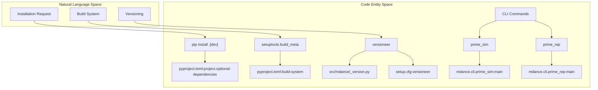
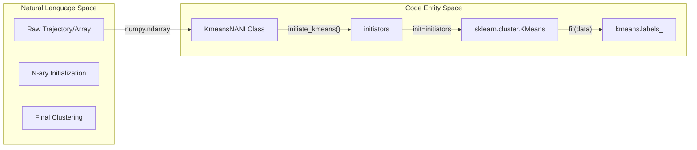

# Installation and Getting Started

<details>
<summary>Relevant source files</summary>

The following files were used as context for generating this wiki page:

- [.github/workflows/ci.yml](.github/workflows/ci.yml)
- [docs/getting_started.rst](docs/getting_started.rst)
- [examples/nani101.py](examples/nani101.py)
- [pyproject.toml](pyproject.toml)
- [setup.cfg](setup.cfg)
- [setup.py](setup.py)
- [src/mdance/_version.py](src/mdance/_version.py)

</details>


Molecular Dynamics Analysis with *N*-ary Clustering Ensembles (MDANCE) is a flexible clustering package designed for Molecular Dynamics (MD) trajectories. It leverages an $n$-ary similarity framework to provide deterministic and efficient clustering solutions, scaling linearly $O(N)$ with the number of frames for many operations where traditional methods scale quadratically $O(N^2)$ [docs/getting_started.rst:4-5]().

## Installation

MDANCE is distributed via PyPI and can be installed using standard Python package managers.

### Standard Installation
To install the latest stable version of MDANCE and its core dependencies:

```bash
pip install mdance
```
[docs/getting_started.rst:11-11]()

### Development Installation
For users intending to run the test suite or contribute to the codebase, install with development dependencies:

```bash
git clone https://github.com/mqcomplab/MDANCE.git
cd MDANCE
pip install -e .[dev]
```
[pyproject.toml:51-54](), [.github/workflows/ci.yml:37-37]()

### Verification
Verify the installation by importing the module and checking the version string:

```python
import mdance
print(mdance.__version__)
```
[docs/getting_started.rst:17-18]()

---

## Dependency Stack

MDANCE relies on a specialized stack of scientific computing libraries to handle high-dimensional MD data and efficient numerical operations.

| Dependency | Version | Role in MDANCE |
|:---|:---|:---|
| `numpy` | >= 1.20.0 | Core numerical operations and array handling. |
| `scikit-learn` | >= 0.24.0 | Base classes for clustering and synthetic data generation. |
| `MDAnalysis` | >= 2.0.0 | Trajectory parsing and atom selection. |
| `shapeGMMTorch`| >= 2.0.0 | Structural alignment and shape-based Gaussian Mixture Models. |
| `torch` | >= 2.2.2 | Backend for accelerated tensor computations. |

**Sources:** [pyproject.toml:19-25]()

---

## Build and Versioning System

MDANCE uses a modern Python packaging workflow centered around `pyproject.toml` and `versioneer`.

### Versioning Implementation
The project employs `versioneer` to automatically manage version strings based on Git tags. This ensures that the version retrieved via `mdance.__version__` is always synchronized with the repository state.

*   **Configuration**: Defined in `setup.cfg` under the `[versioneer]` block [setup.cfg:25-30]().
*   **Source**: The version is dynamically injected into `src/mdance/_version.py` [setup.cfg:28-28]().
*   **Integration**: `setup.py` calls `versioneer.get_version()` to set the package version during build time [setup.py:7-8]().

### Metadata and Entry Points
The `pyproject.toml` file defines the project metadata and command-line interfaces (CLI).

*   **CLI Tools**: Two main scripts are registered: `prime_sim` and `prime_rep` [pyproject.toml:34-35]().
*   **Package Discovery**: The build system looks for source code in the `src` directory [pyproject.toml:45-46]().

**Sources:** [pyproject.toml:1-55](), [setup.cfg:1-31](), [setup.py:1-12](), [src/mdance/_version.py:1-60]()

---

## Data Flow and Infrastructure

The following diagram illustrates the relationship between the installation configuration and the resulting environment.

### System Configuration to Code Entity Mapping
"This diagram maps the configuration files to the internal Python entities and build behaviors."


**Sources:** [pyproject.toml:1-55](), [setup.cfg:25-30](), [src/mdance/_version.py:1-60]()

---

## Getting Started: Your First Clustering

The primary entry point for many users is the **NANI** (N-ary Initialization) algorithm, which optimizes initial centroids for $k$-means to make it deterministic and more accurate [examples/nani101.py:7-9]().

### Example: NANI-Optimized K-Means
This workflow demonstrates using `KmeansNANI` to initialize a standard `scikit-learn` KMeans model.

```python
from sklearn.cluster import KMeans
from mdance.cluster.nani import KmeansNANI
from sklearn.datasets import make_blobs

# 1. Generate or load data (n_samples, n_features)
data, _ = make_blobs(n_samples=1000, centers=7, n_features=2)

# 2. Initialize NANI
# init_type='strat_all' uses stratified sampling across the dataset
mod = KmeansNANI(data=data, n_clusters=7, metric='MSD', 
                 N_atoms=1, init_type='strat_all', percentage=10)

# 3. Compute optimized initial centroids
initiators = mod.initiate_kmeans()[:7]

# 4. Run standard KMeans with NANI initiators
# n_init=1 because NANI is deterministic
kmeans = KMeans(n_clusters=7, init=initiators, n_init=1)
kmeans.fit(data)
labels = kmeans.labels_
```
**Sources:** [examples/nani101.py:17-74](), [src/mdance/cluster/nani.py]()

### NANI Initialization Workflow
"This diagram tracks the data transformation from raw input to cluster labels using the NANI framework."


**Sources:** [examples/nani101.py:59-74](), [src/mdance/cluster/nani.py]()

---

## Continuous Integration (CI)

MDANCE maintains code quality through an automated GitHub Actions pipeline.

*   **Trigger**: Every push or pull request to the `main` branch [.github/workflows/ci.yml:3-7]().
*   **Environment**: Runs on `ubuntu-latest` using a matrix for Python 3.9 and 3.11 [.github/workflows/ci.yml:11-15]().
*   **Execution**:
    1.  Caches `pip` dependencies using a hash of `pyproject.toml` [.github/workflows/ci.yml:26-32]().
    2.  Installs the project in editable mode with dev dependencies [.github/workflows/ci.yml:37-37]().
    3.  Executes `pytest` to run all unit tests in the `tests/` directory [.github/workflows/ci.yml:40-40]().

**Sources:** [.github/workflows/ci.yml:1-41](), [pyproject.toml:40-43]()

---