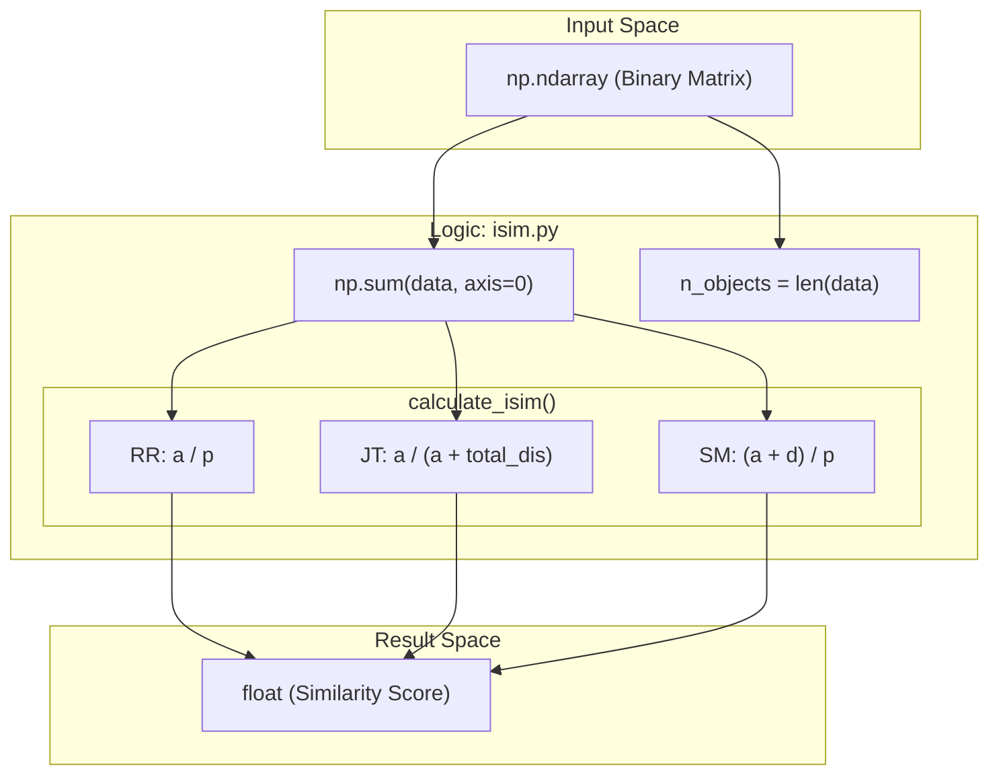
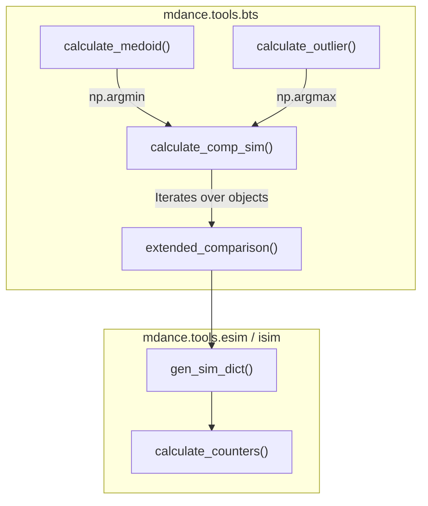

# N-ary Similarity Framework

Relevant source files

The following files were used as context for generating this wiki page:

- [src/mdance/tools/bts.py](src/mdance/tools/bts.py)
- [src/mdance/tools/esim.py](src/mdance/tools/esim.py)
- [src/mdance/tools/isim.py](src/mdance/tools/isim.py)

The N-ary Similarity Framework is the core mathematical innovation of MDANCE, enabling the comparison of multiple objects (frames, pathways, or fingerprints) simultaneously. Unlike traditional clustering methods that rely on pairwise distance matrices—which scale at $O(N^2)$—the n-ary approach achieves $O(N)$ scaling by utilizing column-wise statistical summaries of the data.

### Multi-Object vs. Pairwise Comparison

In standard clustering, comparing $N$ objects requires $N(N-1)/2$ pairwise calculations. MDANCE replaces this with an $n$-ary comparison where a single value describes the similarity of an entire set of $N$ objects [src/mdance/tools/bts.py:14-15](). This is achieved by representing the dataset through a **condensed data representation**:
1.  **Column-wise Sum (`c_sum`)**: The sum of features across all samples [src/mdance/tools/bts.py:47]().
2.  **Column-wise Squared Sum (`sq_sum`)**: The sum of squared features across all samples [src/mdance/tools/bts.py:48]().

For binary fingerprints, only the `c_sum` (number of "on" bits per position) is required to derive all extended similarity indices [src/mdance/tools/esim.py:18-24]().

#### O(N) Scaling Implementation
The Mean Square Deviation (MSD) for $N$ objects is calculated using the condensed representation:
$$MSD = \frac{\sum 2(N \cdot sq\_sum - c\_sum^2)}{N^2}$$
This formula allows MDANCE to calculate the total variance of a cluster in a single pass over the features, regardless of how many frames are in the cluster [src/mdance/tools/bts.py:49-51]().

**Sources:** [src/mdance/tools/bts.py:14-51](), [src/mdance/tools/bts.py:54-93](), [src/mdance/tools/esim.py:18-49]()

---

### Extended Similarity Indices (eSIM)

The `esim` module implements extended versions of classical similarity indices (Jaccard, Tanimoto, Sokal-Michener, etc.) adapted for $n$ objects. These indices are primarily used for binary data or discretized molecular fingerprints.

#### Key Components of eSIM
- **Counters**: The framework calculates four primary counters ($a, d, b, c$) based on a coincidence threshold (`c_threshold`) [src/mdance/tools/esim.py:18-49]().
    - **$a$ (1-similarity)**: Features where most objects have a value of 1.
    - **$d$ (0-similarity)**: Features where most objects have a value of 0.
    - **$total\_dis$ (dissimilarity)**: Features with high variance across the set.
- **Weighting Factors**: Users can apply `fraction` or `power_n` weighting to emphasize higher levels of coincidence among the $n$ objects [src/mdance/tools/esim.py:65-91]().

| Index Code | Full Name | Code Reference |
| :--- | :--- | :--- |
| **RR** | Russel-Rao | [src/mdance/tools/esim.py:170-171]() |
| **JT** | Jaccard-Tanimoto | [src/mdance/tools/esim.py:165-166]() |
| **SM** | Sokal-Michener | [src/mdance/tools/esim.py:171-172]() |
| **Ja** | Jaccard | [src/mdance/tools/esim.py:163-164]() |

**Sources:** [src/mdance/tools/esim.py:122-180](), [src/mdance/tools/bts.py:100-112]()

---

### Instant Similarity (iSIM)

The `isim` module provides a high-performance implementation for large-scale binary comparisons. It is optimized for speed when calculating standard indices like RR, JT, and SM without the overhead of the full `SimilarityIndex` class [src/mdance/tools/isim.py:71-91]().

#### Code-to-Logic Mapping: iSIM Calculation
The following diagram illustrates how the `calculate_isim` function processes input data into similarity scores.

**Diagram: iSIM Data Flow**

**Sources:** [src/mdance/tools/isim.py:14-68](), [src/mdance/tools/isim.py:71-132]()

---

### Complementary Similarity

Complementary similarity is a technique used to identify the contribution of a single object to the overall $n$-ary similarity of a set. By removing one object and recalculating the $n$-ary similarity, MDANCE can identify:
1.  **Medoids**: The object whose removal *decreases* the set similarity the least (most representative) [src/mdance/tools/bts.py:236-237]().
2.  **Outliers**: The object whose removal *increases* the set similarity the most (least representative) [src/mdance/tools/bts.py:255-256]().

This is implemented in `calculate_comp_sim`, which returns an array of similarity values for each object in the matrix [src/mdance/tools/bts.py:190-207]().

#### System Integration: bts.py and Similarity Search
The diagram below shows how `mdance.tools.bts` utilizes `esim` and `isim` to perform structural searches.

**Diagram: Medoid and Outlier Identification**

**Sources:** [src/mdance/tools/bts.py:190-218](), [src/mdance/tools/bts.py:231-267](), [src/mdance/tools/isim.py:187-195]()

---

### Summary of Key Functions

| Module | Function | Purpose |
| :--- | :--- | :--- |
| `bts.py` | `mean_sq_dev` | Calculates $O(N)$ MSD for a feature matrix [src/mdance/tools/bts.py:14](). |
| `bts.py` | `msd_condensed` | Calculates MSD using `c_sum` and `sq_sum` directly [src/mdance/tools/bts.py:54](). |
| `bts.py` | `extended_comparison` | Entry point for both MSD and eSIM/iSIM metrics [src/mdance/tools/bts.py:96](). |
| `esim.py` | `calculate_counters` | Derives $a, d, b, c$ counters for $n$-ary sets [src/mdance/tools/esim.py:18](). |
| `isim.py` | `calculate_isim` | Fast calculation of RR, JT, and SM indices [src/mdance/tools/isim.py:71](). |

**Sources:** [src/mdance/tools/bts.py:14-154](), [src/mdance/tools/esim.py:18-120](), [src/mdance/tools/isim.py:71-132]()

---