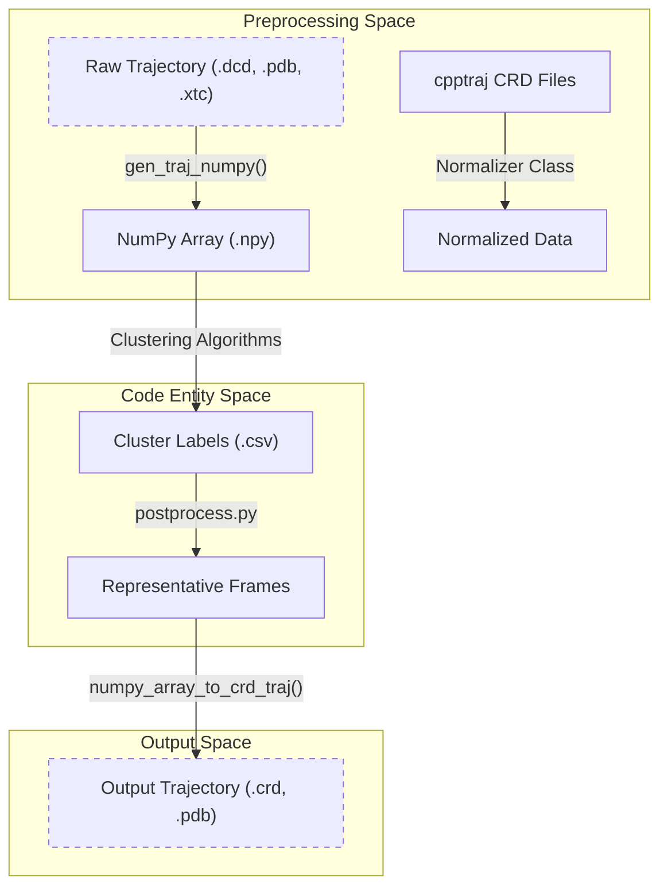
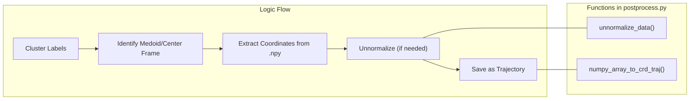

# Data Pipeline: Preprocessing and Postprocessing

Relevant source files

The following files were used as context for generating this wiki page:

- [CITATION.bib](CITATION.bib)
- [scripts/inputs/preprocessing.ipynb](scripts/inputs/preprocessing.ipynb)
- [scripts/nani/analysis_db.ipynb](scripts/nani/analysis_db.ipynb)
- [src/mdance/data/__init__.py](src/mdance/data/__init__.py)
- [src/mdance/data/labels_6.csv](src/mdance/data/labels_6.csv)
- [src/mdance/inputs/preprocess.py](src/mdance/inputs/preprocess.py)

The MDANCE data pipeline facilitates the transformation of raw Molecular Dynamics (MD) trajectory data into a format suitable for N-ary clustering and provides tools to map clustering results back to structural outputs. This lifecycle ensures that high-dimensional atomic coordinates are correctly handled, normalized when necessary, and ultimately interpretable as molecular conformations.

### Data Lifecycle Overview

The pipeline transitions data through three primary states:
1.  **Raw Trajectory**: Standard formats (e.g., `.dcd`, `.xtc`, `.pdb`) containing atomic coordinates across multiple timesteps.
2.  **Processed NumPy Arrays**: Flattened 2D arrays of shape `(n_frames, n_atoms * 3)` used for efficient similarity calculations [scripts/inputs/preprocessing.ipynb:51-51]().
3.  **Cluster-Representative Trajectories**: New trajectory files containing specific frames identified as cluster centers or medoids [src/mdance/inputs/postprocess.py:10-15]().

### System Entity Mapping

The following diagram bridges the conceptual data stages with the specific code entities responsible for the transitions.

**Data Flow and Code Entities**

**Sources:** [src/mdance/inputs/preprocess.py:9-54](), [src/mdance/inputs/postprocess.py:112-115](), [scripts/inputs/preprocessing.ipynb:44-51]()

---

### Trajectory Preprocessing

The preprocessing stage focuses on reading trajectory data and selecting relevant subsets of atoms (e.g., backbone atoms) for analysis. MDANCE leverages the `MDAnalysis` library to handle various file formats and atom selection syntax.

The core function `gen_traj_numpy` extracts coordinates based on an `atomSel` string and flattens them into a 2D format required by the clustering engines [src/mdance/inputs/preprocess.py:9-51](). Additionally, for non-MD data or specific Amber-style outputs, the `Normalizer` class provides Min-Max normalization and column-sum calculations [src/mdance/inputs/preprocess.py:54-102]().

**Key Components:**
*   **`gen_traj_numpy`**: Converts MD files to `.npy` format [src/mdance/inputs/preprocess.py:9-51]().
*   **`Normalizer`**: Handles normalization for non-MD data [src/mdance/inputs/preprocess.py:54-102]().
*   **Reference Data**: Bundled datasets like `aligned_tau.pdb` and `backbone.npy` are provided for testing [src/mdance/data/__init__.py:6-8]().

For detailed implementation details, atom selection syntax, and normalization workflows, see **[Trajectory Preprocessing (#2.1)]**.

**Sources:** [src/mdance/inputs/preprocess.py:9-102](), [src/mdance/data/__init__.py:1-20]()

---

### Postprocessing and Output Extraction

Postprocessing involves interpreting the results of clustering—typically a list of frame indices and their assigned cluster labels—to generate physical structural outputs.

The `postprocess.py` module provides utilities to reverse normalization and convert NumPy representations back into trajectory formats [src/mdance/inputs/postprocess.py:112-140](). This is essential for visualizing the "representative structures" identified by algorithms like NANI or eQual.

**Postprocessing Logic**

**Sources:** [src/mdance/inputs/postprocess.py:112-140](), [scripts/nani/analysis_db.ipynb:57-64]()

**Key Components:**
*   **`unnormalize_data`**: Reverses Min-Max scaling to restore original coordinate scales [src/mdance/inputs/postprocess.py:143-162]().
*   **`numpy_array_to_crd_traj`**: Writes extracted frames to AMBER CRD or similar formats [src/mdance/inputs/postprocess.py:112-140]().
*   **Clustering Analysis**: Notebooks like `analysis_db.ipynb` help identify the optimal number of clusters before extraction [scripts/nani/analysis_db.ipynb:7-44]().

For details on extracting specific frames and using the postprocessing scripts, see **[Postprocessing and Output Extraction (#2.2)]**.

**Sources:** [src/mdance/inputs/postprocess.py:112-162](), [scripts/nani/analysis_db.ipynb:7-44]()

---